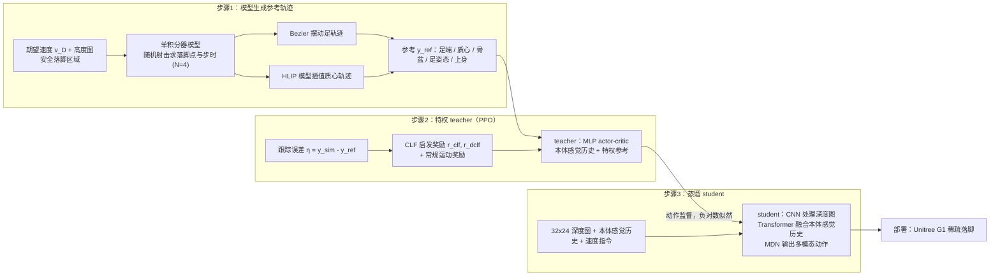

---

type: entity
tags: [paper, motion-cerebellum-survey, humanoid, motion-control, tufts]
status: complete
updated: 2026-10-06
arxiv: "2606.10288"
summary: "底座：模型辅助稀疏落脚控制。输入是稀疏落脚目标、机器人状态和模型预测信息；实现上用模型辅助强化学习指导足端放置和身体运动，让策略在复杂地形上减少盲目探索；它把模型知识放进感知落脚控制。"
related:
  - ../overview/humanoid-motion-cerebellum-technology-map.md
  - ../overview/motion-cerebellum-category-01-locomotion-base.md
sources:
  - ../../sources/papers/motion_cerebellum_survey_04_march.md
  - ../../sources/blogs/wechat_embodied_ai_lab_humanoid_motion_cerebellum_survey.md
  - ../../sources/papers/motion_cerebellum_64_catalog.md
---

# MARCH

**MARCH** 收录于 [具身智能研究室 · 运动小脑 64 篇长文](https://mp.weixin.qq.com/s/Kx9myecE1Z0eGqOapoqQnA) **第 04/64** 篇，归类为 **A 走路底座**。

## 一句话定义

底座：模型辅助稀疏落脚控制。输入是稀疏落脚目标、机器人状态和模型预测信息；实现上用模型辅助强化学习指导足端放置和身体运动，让策略在复杂地形上减少盲目探索；它把模型知识放进感知落脚控制。

## 英文缩写速查

| 缩写 | 英文全称 | 简要说明 |
|------|----------|----------|
| WBC | Whole-Body Control | 协调全身关节满足多任务/约束的控制层 |
| RL | Reinforcement Learning | 通过与环境交互学习策略的范式 |
| Loco-Manip | Loco-Manipulation | 行走与操作动力学耦合的全身任务 |

## 为什么重要

- 底座：模型辅助稀疏落脚控制。输入是稀疏落脚目标、机器人状态和模型预测信息；实现上用模型辅助强化学习指导足端放置和身体运动，让策略在复杂地形上减少盲目探索；它把模型知识放进感知落脚控制。
- 运动小脑 64 篇 **#04/64** · 底座：模型辅助稀疏落脚控制。

## 流程总览

图依据：论文 §4 Methodology / Fig.2

## 核心信息

| 字段 | 内容 |
|------|------|
| 编号 | 04/64 |
| 分组 | A 走路底座 |
| 机构 | 塔夫茨大学 |
| 论文/项目 | https://arxiv.org/abs/2606.10288v1 |

## 核心机制（归纳）

### 1）策展导读要点

底座：模型辅助稀疏落脚控制。输入是稀疏落脚目标、机器人状态和模型预测信息；实现上用模型辅助强化学习指导足端放置和身体运动，让策略在复杂地形上减少盲目探索；它把模型知识放进感知落脚控制。

### 2）策展导读要点

机构：塔夫茨大学

## 结论

**MARCH 的赌注是「模型知识可以替 RL 省掉盲目探索」：在稀疏落脚目标下用模型预测信息指导足端放置，而不是让策略在复杂地形上硬试。**

- 关键机制是模型辅助强化学习：稀疏落脚目标、机器人状态与模型预测信息共同约束足端放置和身体运动，把模型知识放进感知落脚控制。
- 适用边界是 **A 走路底座** 这一层的落脚控制，属身体层问题，不替代上层任务规划。
- 本页在策展编译基础上做机制归纳，量化 benchmark、消融与实机指标以 [原文（arXiv:2606.10288）](https://arxiv.org/abs/2606.10288v1) 为准。

## 常见误区

1. 运动小脑条目解决 **身体层** 问题，不替代 VLA/世界模型的任务规划。

## 实验与评测

- 本页在公众号/survey **策展编译**基础上补充机制归纳；**量化 benchmark、消融与实机指标以原文 PDF / 项目页为准**（链接见 [参考来源](#参考来源)）。
- 与同栈姊妹篇对照时，请回到对应 **技术地图 / 42 篇栈 / BFM 地图 / VLN 地图** 总览中的实验段落。

## 与其他页面的关系

- 技术地图：[humanoid-motion-cerebellum-technology-map.md](../overview/humanoid-motion-cerebellum-technology-map.md)
- 分类 hub：[motion-cerebellum-category-01-locomotion-base.md](../overview/motion-cerebellum-category-01-locomotion-base.md)

## 参考来源

- [motion_cerebellum_survey_04_march.md](../../sources/papers/motion_cerebellum_survey_04_march.md)
- [motion_cerebellum_64_catalog.md](../../sources/papers/motion_cerebellum_64_catalog.md)
- [wechat_embodied_ai_lab_humanoid_motion_cerebellum_survey.md](../../sources/blogs/wechat_embodied_ai_lab_humanoid_motion_cerebellum_survey.md)
- [arXiv PDF](https://arxiv.org/pdf/2606.10288)：已通读方法部分（实验与附录以略读为准）：摘要、§1 引言、§3 Preliminaries、§4 Methodology（参考生成 / 奖励塑形 / 蒸馏）、§5 训练设置、§6 仿真结果略读

## 推荐继续阅读

- [运动小脑技术地图](../overview/humanoid-motion-cerebellum-technology-map.md)
- [人形 RL 身体系统栈](../overview/humanoid-rl-motion-control-body-system-stack.md)
