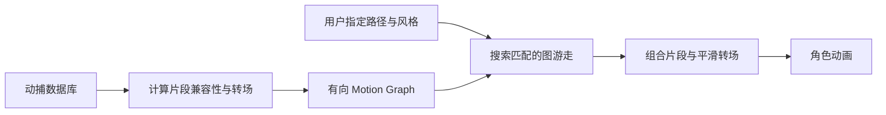

# Motion Graphs：动捕片段图与路径控制

## 一句话定义

把动捕片段与连续转场组成有向图，按指定地面路径及动作风格搜索可行图游走；属于数据库式合成而非扩散模型或真机闭环。

## 英文缩写速查

| 缩写 | 英文全称 | 简要说明 |
|---|---|---|
| MoCap | Motion Capture | 动作捕捉数据库 |
| TOG | Transactions on Graphics | 论文发表期刊 |
| G1 | Unitree G1 | 本专题对照的机器人平台 |

## 为什么重要

- 将本研究放进从可控角色动画、实时生成到 G1 真机视觉闭环的对照坐标；输入和输出属于不同技术层级。
- 对工程部署而言，必须分别核查动作生成时间、动作跟踪控制频率和整机成功率。

## 核心信息

| 项 | 内容 |
|---|---|
| 论文/会议 | [SIGGRAPH 2002](https://graphics.cs.wisc.edu/Papers/2002/KGP02/) |
| 机构 | 威斯康星大学麦迪逊分校（University of Wisconsin–Madison）；南加州大学（University of Southern California） |
| 作者 | Lucas Kovar, Michael Gleicher, Frédéric Pighin |
| 项目主页 | [作者官方入口](https://research.cs.wisc.edu/graphics/Gallery/kovar.vol/MoGraphs/) |
| 开源 | 项目页未核实到官方可执行源码 |
| 原文阅读状态 | **未完成全文与全部附录核对，暂为 draft** |

## 流程总览

基于可核对的一手论文机制绘制主干模块关系：

## 核心原理

基于动捕片段建立有向连接和可平滑的过渡边；把用户的行进轨迹、风格要求转成图搜索目标。交互方向控制可预计算节点与方向对应的后续片段。

## 实验与评测

原作者演示覆盖沿任意路径行走、混合动作风格与交互改变方向；示例中角色响应转向可能有延迟，不是即时重规划的动力学机器人。

## 结论

**研究价值在于 把动捕片段与连续转场组成有向图，按指定地面路径及动作风格搜索可行图游走；对比时必须看清控制层级和数据口径。**

1. 生成模型输出的运动序列并不自动满足真实机器人动态平衡和接触约束。
2. 相关数值只对应论文实验配置，不能横向等同于另一系统的真机成功率。
3. 将该工作与相邻项目区分为 **生成、跟踪、视觉条件适配、闭环执行** 等不同接口。

## 源码运行时序图

**不适用：** 原作者一手主页未列可运行官方源码，不能编造源码调用栈。

## 工程实践

适合作为图搜索和动画数据库的历史基线；官方提供论文与视频，不提供本次可确认的可运行源码。

## 局限与风险

不能直接证明重定向到 G1 后的物理稳定性；路径跟踪受动捕库覆盖程度与转场限制。

**阅读阻塞：** 仅核对论文的主要方法/结果段落、作者项目页及可用仓库入口；尚未完成全部原文与附录的通读及代码运行验证。按知识库规则保留 draft，未声称原文通读。

## 关联页面

- [从动作生成到人形闭环：方法与证据对比](../comparisons/generative-motion-to-humanoid-closed-loop.md)
- [扩散式动作生成](../methods/diffusion-motion-generation.md)
- [ARDY：交互可控动作生成](./ardy.md)
- [Kimodo：运动生成主干](./kimodo.md)

## 参考来源

- [motion_graphs_primary.md](../../sources/papers/motion_graphs_primary.md)
- [motion-graphs-primary.md](../../sources/sites/motion-graphs-primary.md)

## 推荐继续阅读

- [原始论文](https://graphics.cs.wisc.edu/Papers/2002/KGP02/)
- [作者项目主页](https://research.cs.wisc.edu/graphics/Gallery/kovar.vol/MoGraphs/)
