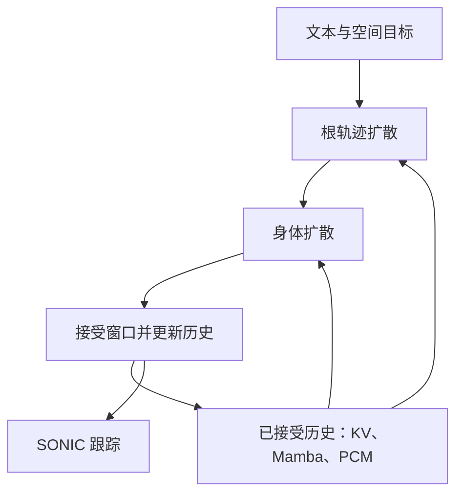
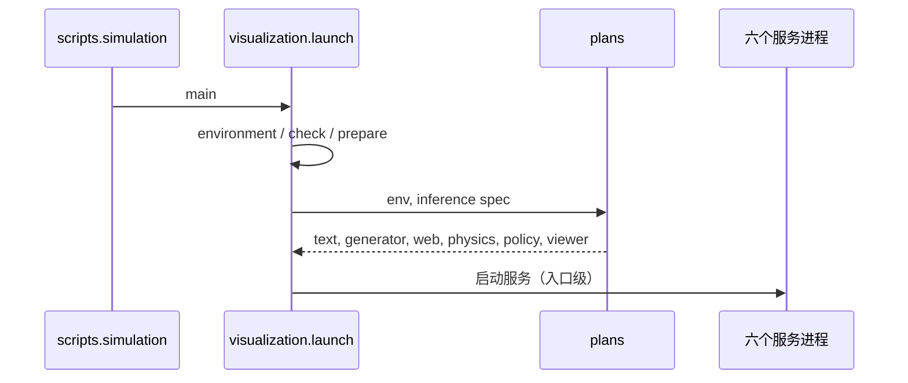

# Motion Mamba 2.0: Autoregressive Diffusion Mamba for Long-Horizon Humanoid Control｜长程人形控制的自回归扩散 Mamba

## 一句话定义

以根轨迹和身体动作的双阶段扩散生成配合循环状态及持久内容记忆，支持变化指令下的流式参考运动生成。

## 英文缩写速查

| 缩写 | 英文全称 | 简要说明 |
|---|---|---|
| PCM | Persistent Content Memory | 持久内容记忆 |
| CFG | Classifier-Free Guidance | 无分类器引导 |
| SSM | State Space Model | 状态空间模型 |

## 为什么重要

长程生成既要保留先前动作，又要及时接入新的文本与远处空间目标。区分动作参考生成和跟踪控制，可以避免把 GPU 单窗加速误认成真机的端到端响应时间。

## 核心信息

| 项目 | 内容 |
|---|---|
| 机构 | 北京大学、高丽大学、蒙纳士大学、南洋理工大学 |
| 发布 | 2026-11-23（v1） |
| 原文 | [arXiv:2611.29897](https://arxiv.org/abs/2611.29897) |
| 项目 | [主页](https://aigeeksgroup.github.io/MotionMamba2.0/) |
| 源码 | [GitHub](https://github.com/AIGeeksGroup/MotionMamba2.0) |

## 核心原理

每个窗口为 52 帧、25 FPS；文本、空间目标和已接受历史共同约束根轨迹去噪，根轨迹局部特征再条件化身体去噪。局部注意力读取近期特征，Mamba 循环状态跨窗恢复，PCM 保存可供注意力检索的摘要。去噪过程中历史保持固定，仅接受干净窗口后提交历史状态。生成参考运动与 SONIC 跟踪控制是不同层次。

## 流程总览

## 源码运行时序图

`python -m scripts.simulation start` → `scripts/simulation.py` → `visualization/launch.py`；已读启动器的 environment/check/prepare/plans，六服务为 text、generator、web、physics、policy、viewer。训练入口 `python -m scripts.training_motion_mamba2`，评测 `python -m scripts.evaluate`；未执行。 此图仅覆盖已核对入口，内部完整调用关系待复核。

## 评测与实验

论文 §V–VII：HiPHI 988 帧（39.52 s）条件下 Root CE 7.55 cm、End CE 13.64 cm；RTX 4090 的 52 帧完整窗口 p50 由 1685.35 ms 降至 276.14 ms，配对中位加速 6.138 倍。此为稳态窗口生成而非端到端响应延迟。Table 8 的 G1 真机四组全任务成功分别为 18/20、19/20、29/30、28/30，总计 94/100；97/100 满足稳定性判据，未观察到跌倒。

## 工程实践

按 App. D 分开记录 GPU 参考就绪与物理动作达到阈值的时间；真机端再观察跟踪误差、稳定性和完整任务验证。HiPHI 的 R@3 在 32 个生成候选内排序，另外两个数据集用真实动作干扰项，因此只在相同基准内比较。部署前仍需核对外部跟踪器与资产的可用性。

## 对比

HiPHI 39.52 秒设置下，移除 Mamba 的 Minimal、保留 Mamba 无 PCM 的 Native、完整模型的 Root CE 分别为 60.00、9.36、7.55 cm（Table 4）；说明在此匹配条件下两个机制的贡献不同。Table 7 的加速主要来自三条引导分支的联合 CUDA Graph 重放；不能把 6.138 倍归因于单个融合核。

## 结论

当前证据支持将此工作作为相应方法的工程参考，而非通用真机性能保证。

- 将生成器和真机跟踪器分别验收。
- 以长程终端误差和窗口延迟同时评估。
- 区分稳态推理与用户命令响应。

## 局限与风险

论文明确暂未覆盖物体操作；生成器不等价于低层运控。项目页列有代码、模型和数据；外部 SONIC、LLM2Vec 及资产仍受各自许可和安装条件约束。

## 关联页面

- [扩散式动作生成](../methods/diffusion-motion-generation.md)：条件运动生成和自回归窗口的工程总览。
- [人形行走任务](../tasks/humanoid-locomotion.md)：生成参考与平衡、接触、速度跟踪是不同验收层次。
- [paper-halo-perceptive-humanoid-motion-sim](./paper-halo-perceptive-humanoid-motion-sim.md)
- [paper-embo-harness](./paper-embo-harness.md)
- [纵深路线](../../roadmap/depth-motion-generation.md)

## 推荐继续阅读

- [官方项目](https://aigeeksgroup.github.io/MotionMamba2.0/)

## 参考来源

- [论文归档](../../sources/papers/motion-mamba-2.md)
- [项目页归档](../../sources/sites/motion-mamba-2.md)
- [源码归档](../../sources/repos/motion-mamba-2.md)
