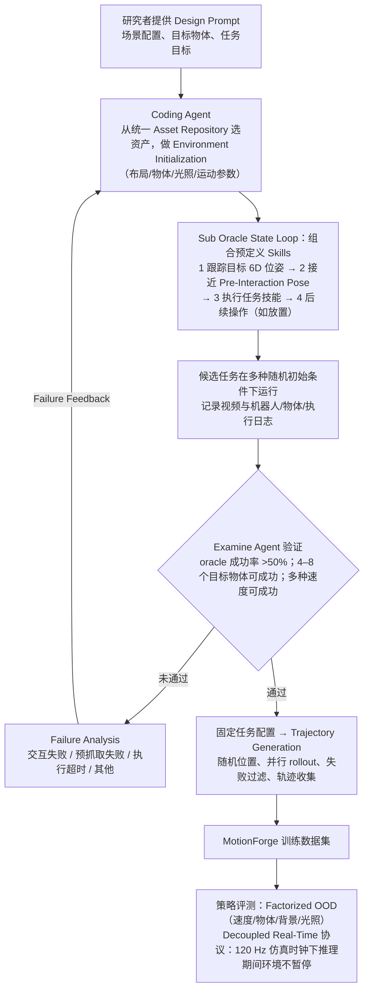

# MotionForge: A Data Generation Pipeline and Large-Scale Benchmark for Long-Horizon Manipulation of Dynamic Objects with Domain Shifts

MotionForge生成动态物体长程操作任务，改变速度、物体、背景和光照以测域偏移。

## 英文缩写速查

| 缩写 | 英文全称 | 简要说明 |
|---|---|---|
| RL | Reinforcement Learning | 利用交互反馈优化机器人策略。 |
| Sim2Real | Simulation-to-Real | 将仿真训练或验证迁移至实体机器人。 |
| WBC | Whole-Body Control | 协调机器人全身自由度与任务约束。 |

## 为什么重要

MotionForge生成动态物体长程操作任务，改变速度、物体、背景和光照以测域偏移。 评读时应将问题、观测条件与执行接口一并记录，避免从单个演示或指标外推能力。

## 流程总览

图依据：论文 §IV-A / §IV-B / Fig.5（数据生成流水线）、§III-C、§III-D（评测协议）。

## 方法栈

仿真管线提供任务和示范；异步协议让环境在策略推理时继续运行，旧动作执行期间目标仍可移动。

## 实验与评测

文章报告40项任务和约20,000条示范；异步测试中ACT总体成功率22.20%，FastWAM为1.15%，平均推理延迟约467 ms。

## 与其他工作对比

它把推理延迟纳入动态任务评估；低成功率反映任务仍具挑战。

## 工程实践

当前归档仅核实到arXiv入口，未核实可运行官方代码。

## 源码运行时序图

**不适用**：当前没有核实到该论文的可运行官方训练、推理或部署入口。

## 结论

**一句话总判：** MotionForge生成动态物体长程操作任务，改变速度、物体、背景和光照以测域偏移。

1. 核对方法实际改变的是数据、表征、规划、控制还是评测。
2. 只把论文覆盖的任务、平台与扰动范围当作证据。
3. 复现前确认代码、权重、数据许可和硬件依赖状态。

## 局限与风险

它把推理延迟纳入动态任务评估；低成功率反映任务仍具挑战。 当前导读以用户提供的文章和预印本题录为索引；详细配置与结果应核对论文全文。

## 关联页面

- [Day 6 导读](../overview/humanoid-motion-intelligence-day6-engineering-deployment.md)
- [Sim2Real](../concepts/sim2real.md)

## 参考来源

- [Day 6 原文归档](../../sources/blogs/humanoid_motion_intelligence_day6_engineering_deployment_2026_10_07.md)
- [arXiv:2609.25689](https://arxiv.org/abs/2609.25689)
- [arXiv PDF](https://arxiv.org/pdf/2609.25689)：已通读方法部分（实验与附录以略读为准）：§III 基准设计与协议（A、C、D）、§IV 任务构建与数据生成、§V-A 实验设定

## 推荐继续阅读

- [Day 6 导读](../overview/humanoid-motion-intelligence-day6-engineering-deployment.md)
