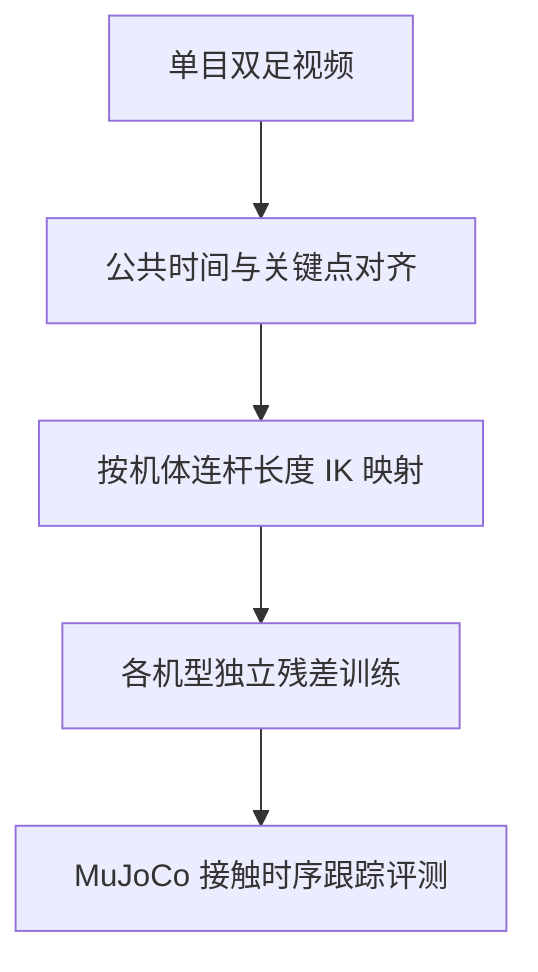

# 从双足视频到跨形态运动控制 MotionSkill（MotionSkill: From Bipedal Motion Video to Control across Embodiments）

**机构：** Fortune AI  
**论文：** [arXiv:2611.16346](https://arxiv.org/abs/2611.16346)

## 一句话定义

**恢复带时间戳的根状态、肢体关键点和步态相位；对遮挡关键点保留 observed/imputed/invalid 标志并适当补全。针对十种机器人用段长、关节约束和闭链做逐帧 IK 映射；每机型在 MuJoCo 中独立训练参考条件的接触残差策略。**

## 英文缩写速查

| 缩写 | 英文全称 | 简要说明 |
|---|---|---|
| IK | Inverse Kinematics | 各机体约束映射 |
| RMS | Root Mean Square | 关节跟踪均方根误差 |
| G1 | Unitree G1 | 评估机型 |

## 为什么重要

同一段双足步态视频有时间节奏但无法直接匹配不同机器人腿长、关节限制与驱动特性。

## 核心原理

恢复带时间戳的根状态、肢体关键点和步态相位；对遮挡关键点保留 observed/imputed/invalid 标志并适当补全。针对十种机器人用段长、关节约束和闭链做逐帧 IK 映射；每机型在 MuJoCo 中独立训练参考条件的接触残差策略。

### 流程总览

以下根据论文方法整理，箭头表示控制/数据流向。

## 实验与评测

基于一段 4 秒步态视频在十种双足机器人上仿真训练；未见初始状态的原视频动作完成率约 98%，上身遮挡 1 秒后约 26%。G1 二次视频试验原始/遮挡的关节 RMS 为 0.123/0.133 rad，水平位置误差 0.207/0.352 m。

## 与其他工作对比

恢复带时间戳的根状态、肢体关键点和步态相位；对遮挡关键点保留 observed/imputed/invalid 标志并适当补全。针对十种机器人用段长、关节约束和闭链做逐帧 IK 映射；每机型在 MuJoCo 中独立训练参考条件的接触残差策略。 与传统同方向方法的主要区别见以上控制接口及研究动机；跨论文统计结果不具有相同测试协议。

## 结论

**从双足视频到跨形态运动控制 MotionSkill 的实际价值在于明确研究对象与实验边界，而非脱离原文场景比较单个成功率。**

1. 共享的是参考时间和肢段关系，不是同一关节角。
2. 十机体实验为仿真且各自训练。
3. 视频遮挡显著影响任务完成率。

## 工程实践

实际验证时先检查任务接口与坐标系，再按论文试验复现主指标；记录 IK / RMS / G1 相关状态、控制采样与异常回退路径，不能以论文中的概念图代替可执行模块证明。

**源码开放状态：** 本次核对的论文未发现可核实的作者算法运行入口，不臆测代码接口。

## 源码运行时序图

**不适用**：尚无可确认的官方完整算法运行入口；以上主干流程是论文方法图，不是虚构源码调用。

## 局限与风险

每机体仍分别训练策略，不是一个策略零样本泛化；只覆盖短视频步态和 MuJoCo 模拟。

## 关联页面

- [motion retargeting](../concepts/motion-retargeting.md)
- [cross embodiment](../../roadmap/depth-cross-embodiment.md)
- [sim2real](../concepts/sim2real.md)
- [11.09–11.13 29 篇总览](../overview/humanoid_quadruped_2026_11_09_13_29_papers.md)

## 参考来源

- [arXiv v1 原文核对归档](../../sources/papers/motionskill-cross-embodiment_arxiv_2611_16346.md)
- [arXiv v1 HTML 全文](https://arxiv.org/html/2611.16346v1)

## 推荐继续阅读

- [论文 PDF](https://arxiv.org/pdf/2611.16346v1)
