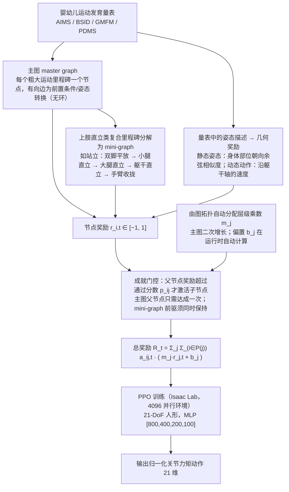

# MotorDev-RL：利用人形机器人验证人类运动发育量表

**MotorDev-RL**（*Validation of Human Motor Development Scales with Humanoid Robots*，[arXiv:2610.25701](https://arxiv.org/abs/2610.25701)）收录于 senlanke「具身运控lab」10-19–10-23 前沿论文动态（人形/四足）。本页依据**周报条目 + arXiv 摘要页**整理，流程图依据论文方法部分（见参考来源），未逐页核对实验数字；指标与结论以论文为准。

## 一句话定义

**MotorDev-RL：利用人形机器人验证人类运动发育量表——把四种婴幼儿运动发育量表转化为技能依赖图并用于 RL 课程学习；通过失败分析发现缺失的「跪姿到站立」里程碑，并验证补齐节点后可恢复完整技能学习。**

## 英文缩写速查

| 缩写 | 英文全称 | 简要说明 |
|------|----------|----------|
| RL | Reinforcement Learning | 强化学习 |
| WBC | Whole-Body Control | 全身控制 |

## 为什么重要

- 周报所述待解决的问题：人形机器人学习从躺卧、翻身到站立和行走的一系列技能时，缺少有科学依据的课程顺序。

## 流程总览

图依据：论文 §III-A / III-B（式 1–2）、Fig. 1–2、§IV 实验设定。

## 核心机制

| 项 | 内容 |
|----|------|
| **arXiv** | [2610.25701](https://arxiv.org/abs/2610.25701) · [PDF](https://arxiv.org/pdf/2610.25701) |
| **作者（arXiv）** | Fanxing Meng, Jing Xiao |
| **机构（周报所述，未逐条核实）** | 伍斯特理工学院 |
| **arXiv 评论栏** | 8 pages, 7 figures. Submitted to ICRA 2027. Video available at this https URL |
| **开源** | arXiv 摘要页/评论给出项目页或外链（https://youtu.be/SR3LUVhohV4）；未发现代码仓库链接（2026-10-26） |
| **周报所述创新点** | 把四种婴幼儿运动发育量表转化为技能依赖图并用于 RL 课程学习；通过失败分析发现缺失的「跪姿到站立」里程碑，并验证补齐节点后可恢复完整技能学习。 |

### arXiv 摘要节选（英文原文）

> We investigate how humanoid robots can learn a series of motor skills defined by human infant motor development scales, and we evaluate which scales are comprehensive enough to serve as self-contained guides for developing gross motor skills up to standing and walking. We represent each motor development scale as a developmental graph that guides the training of a humanoid robot.

## 源码运行时序图

**不适用**：arXiv 摘要页/评论给出项目页或外链（https://youtu.be/SR3LUVhohV4）；未发现代码仓库链接，无可对齐的官方代码流程。

## 实验与评测

- 周报与摘要给出的数字/场景已写入上表「创新点」与摘要节选；其余实验细节、基线与成功率定义请回到论文正文。
- 读法：先对齐任务设定、传感器与成功定义（仿真/真机），再解读 headline 数字，勿跨论文直接比较。

## 与其他工作对比

| 维度 | 读法 |
|------|------|
| **同周对照** | 见 [人形/四足周报技术地图](../overview/senlanke-weekly-2026-10-19-23-humanoid-quadruped-technology-map.md)，按方向浏览同期论文 |
| **开源状态** | arXiv 摘要页/评论给出项目页或外链（https://youtu.be/SR3LUVhohV4）；未发现代码仓库链接 |

## 结论

**MotorDev-RL：利用人形机器人验证人类运动发育量表。**

1. 本页是入库级摘要，复现前请核对论文正文、附录与代码仓库。
2. 指标须连同实验条件解读。
3. 关注 arXiv 版本更新与代码发布。

## 关联页面

- [senlanke-weekly-2026-10-19-23-humanoid-quadruped-technology-map](../overview/senlanke-weekly-2026-10-19-23-humanoid-quadruped-technology-map.md)
- [humanoid-locomotion](../tasks/humanoid-locomotion.md)
- [reinforcement-learning](../methods/reinforcement-learning.md)

## 参考来源

- [motor-development-scales-humanoid-curriculum_arxiv_2610_25701.md](../../sources/papers/motor-development-scales-humanoid-curriculum_arxiv_2610_25701.md)
- [wechat_senlanke_weekly_humanoid_quadruped_2026-10-19_23.md](../../sources/blogs/wechat_senlanke_weekly_humanoid_quadruped_2026-10-19_23.md)
- [arXiv:2610.25701](https://arxiv.org/abs/2610.25701)
- [arXiv PDF](https://arxiv.org/pdf/2610.25701)：已通读方法部分（实验与附录以略读为准）：§I–IV（引言、相关工作、发育图与奖励函数、实验设定），§V 结果略读

## 推荐继续阅读

- [arXiv PDF](https://arxiv.org/pdf/2610.25701)
