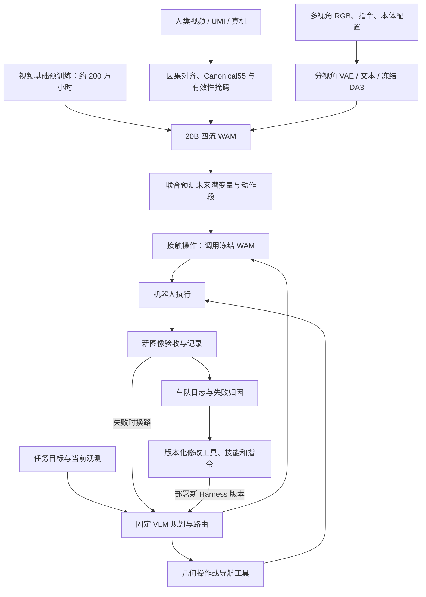

# Motubrain 2.0：数据对齐与规模化的智能体世界动作模型 | An Agentic World Action Model with Aligned and Scaled Data

## 一句话定义

**Motubrain 2.0** 用 20B 世界动作模型生成短程操作，再由可编辑的 Harness 统筹何时调用 WAM、几何操作或导航；后者利用真机日志修改工具、技能和指令，保持两个模型的参数不变。

## 英文缩写速查

| 缩写 | 英文全称 | 简要说明 |
|---|---|---|
| WAM | World Action Model | 联合预测未来视觉状态与动作的模型 |
| UMI | Universal Manipulation Interface | 手持式操作示教接口 |
| DA3 | Depth Anything 3 | 从当前 RGB 提取冻结的几何特征 |
| RTC | Real-Time Chunking | 执行当前动作段时生成后续段，并用前缀约束衔接 |
| ICL | In-Context Learning | 推理时输入参考视频，不针对该任务更新权重 |
| DMD | Distribution Matching Distillation | 分布匹配蒸馏，用于减少去噪步数 |
| RSI | Recursive Self-Improvement | 此处指 Harness 软件层迭代，不是策略在线训练 |

## 为什么重要

此工作把两类常被混在一起的瓶颈拆开：WAM 优先处理接触丰富的局部动作，Harness 处理跨房间任务中的选择、验收和恢复。这样可以分别测量数据对齐带来的零样本收益，以及流程改动带来的成功率和时间代价。

## 核心信息

| 字段 | 内容 |
|---|---|
| 机构 | 生数科技（报告署名 GensPI Technology） |
| 版本 | [官方技术报告 PDF 归档](../../sources/papers/motubrain_2_technical_report.md)，非第一代 arXiv:2604.27792 |
| 模型 | 20B 四流 WAM；8.33B Nano 另循视频预训练 → 联合学习两阶段 |
| 系统 | 21 个 MCP 工具、15 项书面技能；VLM 规划、视觉验收和失败换路 |
| 开放状态 | 可核验 RoboDojo 权重、推理配置与动作统计；2.0 正式代码入口待公开核验 |

## 核心机制

1. **统一动作语义，保留未知量。** Canonical55 分配双臂、躯干、头和底盘通道，末端位姿相对参考相机表达。手部轨迹缺少机器人关节或夹爪标签时，只监督有效通道；无动作标签的视频只参与视觉预测。时间对齐区分命令下发、执行和状态改变，采样时避免把未来状态喂给当前观测。
2. **分视角编码，定向读取。** 每路图像独立缩放与共享 VAE 编码，局部 3D RoPE 和视角 embedding 分工。前 6 层动作独立，第 7–24 层动作读取视频/语言，指定层再读冻结 DA3 的几何 KV；视频与语言分支不反向读取动作，但动作损失仍可通过共享 KV 把梯度传给视频侧。视频/动作训练噪声时刻独立，执行无需解码未来帧。
3. **短程动作与长程验收分开。** VLM 将接触丰富、匹配已见命令的子任务交给 WAM；对小物体、精确摆放或 WAM 卡住改走立体深度与几何工具，导航另走底盘工具。WAM 返回的是工具结束原因，成败再用新图像验收。车队日志按原因聚类，版本化编辑工具、技能和指令后再部署。
4. **区分三种改进接口。** 少样本后训练改模型参数；参考视频 ICL 改推理上下文；Harness RSI 改工具、技能和指令。ICL 的人机配对、同任务对比和按参考注意力截断动作段另见 [Entangle](https://arxiv.org/abs/2611.28732v2)，不是本报告的 arXiv 编号。

## 流程总览

流程图依据报告图 1、6、22；两个模型在 Harness 迭代阶段不更新，虚拟未来帧也不用于替代执行后的真实验收。

## 源码运行时序图

**不适用（截至 2026-11-26）**：报告所列 2.0 GitHub URL 未能公开访问，官方页显示待发布；已核对的 RoboDojo 模型目录只有权重、配置和统计，不含可运行的模型类、推理入口或 Harness 服务。报告 §7.3 的观测、WebSocket、动作缓冲和插值是设计描述，不冒充源码调用栈。

## 评测与结果

| 证据面 | 报告结果 | 读法 |
|---|---|---|
| 数据规模（§3） | 499,773.45 小时具身数据：约 386.5k Ego、90.2k UMI、23.0k 真机小时 | 与约 200 万小时视频基础预训练分列；按主相机记时，不能叫 250 万小时真机数据 |
| 仿真（§8.2） | RoboTwin 2.0 DMD 91.42% C2C / 83.16% C2R（均值 87.29%）；RoboCasa365 64.7%；RoboDojo 33.91%；LIBERO-Plus 95.1%；EBench 73.5%；VLABench 67.08% | 六项均不调用高层 VLM；各自协议与快照，不能直接同第一代 RoboTwin 榜单或真机横比 |
| 真机数据消融（表 26） | 四项 S1 任务等权成功率 52.2%→73.4% | 两组都无 DA3、目标本体样本暴露量近似相同；34k vs 67k 总步数不同，不是等计算量对照 |
| 已见指令桌面任务（表 29） | WAM 独立 7/32；无 WAM 的 Agent 25/32；完整 Harness 29/32 | 把编排系统增益与额外接入 WAM 的增益分开 |
| Harness 版本（表 31、32） | V1→V6：31/71→45/71；移动操作 3/23→13/23 | 同一受控十任务集；中位耗时 144→487 s、工具调用 14→62、token 0.67M→5.19M |
| 本地推理（§7.2） | 固定四步 Euler 回放 P50 642.4→331.2 ms、P95 645.9→335.1 ms | RoboTwin 固定观测，本地请求计时；不含网络/仿真，不是蒸馏 solver 或真机端到端时延 |

## 与其他工作对比

| 对照 | 主要区别 | 工程读法 |
|---|---|---|
| [Motubrain 1.0](./paper-motubrain.md) | 前代引入三流 MoT 和自回归真机 WAM；2.0 报告加独立几何条件，并测量上层编辑工具、技能、指令的收益 | 不用两代不同协议的 RoboTwin 榜单评估版本进退；比较模型时不要混入 Harness |
| [T2-z](./paper-t2-z-environment-latents.md) | T2-z 用当前环境交互优化环境潜变量、帮助预测候选动作后果；这里的 Harness 从车队日志迭代软件 | 区分测试时局部环境适配与跨试验的软件版本更新；两者都不是给整个底座在线训练 |

## 结论

**更强的短程模型和更可靠的长程系统是两件事，两者需要分别验收。**

1. 对齐优先于堆小时：核对坐标、命令语义、因果时间戳和窗口掩码后，再加入新来源。
2. 单独留出扰动场景：报告后期标准环境稳定时，扰动成功率仍可下降，不能仅凭训练损失与标准场景晋级。
3. 调度层对照至少保留 WAM 单独、Agent 不调 WAM、Agent 调 WAM 三臂；不要把系统级提升全部归 WAM。
4. 版本对比同时记录成功率、墙钟、调用和 token；复测除同任务配对之外留独立任务、机器人及失败样本。

## 局限与风险

- **开放边界：** [RoboDojo 模型卡与配置](../../sources/models/motubrain-2-robodojo.md)确认为单一基准的公开权重发布（CC BY-NC-SA 4.0），不是全模型族、训练代码或可运行推理服务。官方报告的约 1,000 小时 S1 数据仍为预告，未核实公开下载。
- **真机统计：** 20 天、13 台机器人、18 个任务、3,137 个计入 episode 是整体实验盘点，不是受控十任务对照的分母。附录 D 说明哪些试验被作废或未计入、哪些由人复核；该结果不代表无人干预的生产验收或跨本体持续增益。
## 工程实践

- **运行接口复核：** 接线时显式验证 `canonical55_mask`、本体统计和夹爪极性；把模型请求、网络、插值执行、VLM 规划分开计时。收到未来正式源码后，沿实际入口补调用图，不用模型类字符串反推接口。

## 关联页面

- [世界动作模型](../concepts/world-action-models.md) · [VLA 方法](../methods/vla.md) · [操作任务](../tasks/manipulation.md)
- [递归自改进](../concepts/recursive-self-improvement.md) · [Motubrain 第一代](./paper-motubrain.md) · [2.0 公开直播动态](./motubrain-2-live.md)
- [WAM 纵深路线](../../roadmap/depth-wam.md) · [RSI 纵深路线](../../roadmap/depth-rsi.md)

## 参考来源

- [官方技术报告](../../sources/papers/motubrain_2_technical_report.md) · [发布博客](../../sources/blogs/motubrain-2-release.md) · [技术项目页](../../sources/sites/motubrain-2-technology.md)。
- [代码开放状态](../../sources/repos/motubrain-2-0.md) · [RoboDojo 权重与配置](../../sources/models/motubrain-2-robodojo.md)。

## 推荐继续阅读

- [官方发布博客](https://www.motubrain.cn/en/blog/motubrain-2/) — 先看图 3 和图 5，再回技术报告 §§4、9 读注意力边界与真实试验设计。
- [Entangle](https://arxiv.org/abs/2611.28732v2) — 独立 ICL 论文，追查时序对齐和同任务捷径。
