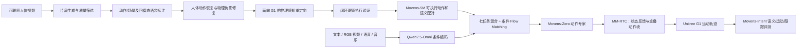
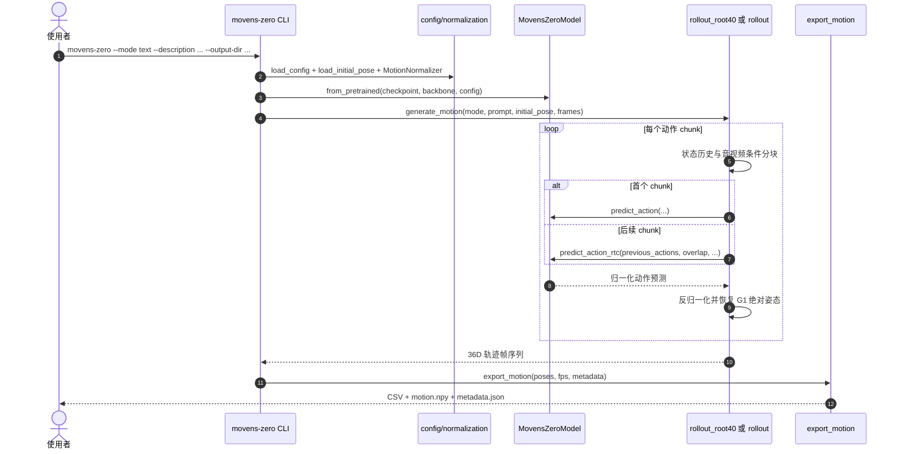

# Movens-Zero / Movens-5M：大规模多模态人形运动数据与行为基础模型

[论文原文（arXiv:2610.41877v1）](https://arxiv.org/html/2610.41877) · [项目主页](https://movens-zero.github.io/) · [官方代码](https://github.com/wendell0218/Movens-Zero) · [Movens-5M 数据卡](https://huggingface.co/datasets/wendell0218/Movens-5M)

## 一句话定义

**Movens-5M 是将互联网人体视频恢复、修复和物理跟踪验证为机器人动作的多模态数据集；Movens-Zero 是基于其训练、能接受文本/视频/语音/音乐条件生成 Unitree G1 全身运动的模型。** 两者属于同一篇论文，Movens-Intent 则是独立评测集，不重复建论文节点。

## 英文缩写速查

| 缩写 | 英文全称 | 简要说明 |
|---|---|---|
| BFM | Behavior Foundation Model | 行为基础模型，学习跨技能的身体动作 |
| RTC / MM-RTC | Real-Time Chunking / Multimodal Real-Time Chunking | 以重叠前缀衔接新旧动作块和更新条件 |
| FM | Flow Matching | 本文动作专家的条件流匹配训练目标 |
| SMPL-X | Skinned Multi-Person Linear Model eXpressive | 人体动作和形状恢复表示 |
| MPJPE | Mean Per Joint Position Error | 运动恢复关节位置误差 |
| G1 | Unitree G1 | 文中运动输出与机器人执行目标 |

## 为什么重要

- **数据可扩展性**：以互联网视频替代完全依赖高成本动捕；但只有经过物理修复、形态映射和跟踪筛选，才能变为适合机器人学习的参考。
- **语义与物理同时验证**：不仅评估文本/声音/视频条件是否相符，还看轨迹能否由机器人跟踪。
- **区分数据与算法收益**：论文表 7–9 给出数据量、动作专家参数量和数据质检管线的消融，适合研究 BFM 的 scaling 路线。
- **发布边界清晰**：完整数据通过四个 tar 仓库分片发布，中央数据卡的 Parquet 是预览；许可证字段为 `other`，不能简单称为自由商用。

## 流程总览

**依据**：论文第 3 节的五阶段数据引擎、第 5 节的多模态条件生成和 MM-RTC、第 4、6 节的评测。这里的「闭环跟踪执行验证」是论文数据构建和实验环节，不能误当作本仓库 CLI 默认直接连接真机。

## 核心机制

### 1. Movens-5M：从视频到可执行动作

论文报告约 **1,500 万条**恢复后人体运动序列、**500 万条**经物理执行筛选的人形运动、**10,000+ 小时**、**1.08B+ 动作帧**、**297 种细分动作**、**16 类场景**。数据引擎依次：

1. 对网络视频切片，做视觉/人体运动质量过滤。
2. 对齐文本、RGB 视频、语音和音乐；生成动作、对象和场景语义标签。
3. 通过 GVHMR、PromptHMR / SMPL-X 相关管线恢复人体动作，并修正接地、脚滑、穿透、时序抖动等失真。
4. 人体→G1 的运动学初始化与物理约束优化，并用多套 tracking policy 验证机器人可跟踪性。

**数据集字段**：预览记录以 `sample_id`、`sample_name` 为身份，配有 `original_video`、`rendering_video`、`retargeted_video`、`tracking_video` 及动作/物体/文字/时长/FPS 等元数据。自动推断的人体属性不应视作经人工核验的真实标签。详见 [独立数据归档](../../sources/datasets/movens-5m.md)。

### 2. Movens-Zero：四模态意图变全身动作

- 多模态骨干读取文本、RGB 视频、语音或音乐条件；动作专家使用条件 **Flow Matching** 预测机器人中心的未来运动块。
- 七任务混合训练将模态条件、状态历史、时间/进度等信息汇入共享动作专家，避免为每种模态完全分离一套控制。
- **MM-RTC** 执行一部分当前动作后，以重叠前缀和最新输入重新预测下一块，降低 chunk 接缝的时序不连续；算法依赖预测耗时、观测及时性和动作重叠设置。
- 官方工程实现有 36D G1 绝对运动表示（29 关节位置、根 xyz、根四元数 wxyz）以及 40D 的 root-centric 动作分块表示，需按所选配置/权重对应，不能混用。

### 3. 数据开放范围与版本

| 对象 | 官方入口 | 本次核查结论 |
|---|---|---|
| 中央 Movens-5M 数据卡 | [wendell0218/Movens-5M](https://huggingface.co/datasets/wendell0218/Movens-5M) | **Parquet 预览**，页面显示文件总量约 5.52 GB |
| 全量分片 | [Movens-5M-0](https://huggingface.co/datasets/Movens-0/Movens-5M-0) · [1](https://huggingface.co/datasets/Movens-2/Movens-5M-1) · [2](https://huggingface.co/datasets/Movens-1/Movens-5M-2) · [3](https://huggingface.co/datasets/Movens-1/Movens-5M-3) | 官方声明四仓组成**完整发布**，以 tar shards 组织；未本地下载核验 |
| Movens-Intent | [评测数据集](https://huggingface.co/datasets/wendell0218/Movens-Intent) | **8,192** 对 source-disjoint、专家审核的条件–动作样本，四模态各 2,048 |
| 代码/模型 | [GitHub](https://github.com/wendell0218/Movens-Zero) | 已有训练、推理、评测代码；S/M/L/XL 权重链接见 README |

## 实验与评测

论文 **arXiv:2610.41877v1 表 7**（固定 XL 动作专家，同一评测设置）：

| Movens-5M 比例 | 独有训练小时 | Text R@3 ↑ | Video MPJPE ↓ | Speech R@3 ↑ | Tracking Score ↑ |
|---|---:|---:|---:|---:|---:|
| 1% | 122 | 12.72% | 132.82 mm | 13.98% | 0.21 |
| 10% | 1,223 | 24.92% | 110.55 mm | 21.76% | 0.36 |
| 100% | 12,231 | 62.57% | 40.90 mm | 74.30% | 0.72 |

- **表 8 模型容量**：满量数据下，S（64.2M）→XL（910.5M）动作专家，Text R@3 从 10.30% 提升到 62.57%；数据 scaling 与模型 scaling 必须分开解释。
- **表 9 数据质检消融**：原始恢复动作→完整数据过滤、物理修复、跟踪验证及分布平衡，Text R@3 由 48.72% 提升到 62.57%，Tracking Score 由 0.41 提升到 0.72。
- **对照口径**：这些都是论文给定数据划分及目标 G1 的结果，不能直接解释为随意新机型或真机作业成功率；Video MPJPE 与其它表的 W-MPJPE 口径也不能混同。

## 结论

**Movens-5M 的主要价值不是单纯把人体动作数量做大，而是把原始视频变成有语义监督、物理修复和执行筛选证据的人形行为数据，再支撑多模态 BFM 的扩展。**

1. **先核对数据入口**：中央 HF 数据集是预览，论文规模须对应四个全量分片仓库，不能用 5.52 GB 推断全部 500 万动作已下载。
2. **先验收物理可行性**：除了语义指标，重点审计足滑、接触、限位、闭环跟踪成功率及失败分布。
3. **做数据/模型正交消融**：用相同 benchmark 对比数据量、动作专家容量，避免把数据收益混入结构升级。
4. **部署前确认 I/O**：36D qpos 绝对姿态与 40D root-centric 动作、50 Hz、G1 关节顺序和四元数 wxyz 必须与 checkpoint 匹配。
5. **先处理许可及迁移边界**：数据页标记 `other`，互联网视频的授权、隐私及机器人从仿真到真机的安全性均需单独验收。

## 源码运行时序图

**源码核对**：[`pyproject.toml`](https://github.com/wendell0218/Movens-Zero/blob/main/pyproject.toml) 将 `movens-zero` 注册到 `movens_zero.inference:main`；[`inference.py`](https://github.com/wendell0218/Movens-Zero/blob/main/movens_zero/inference.py) 读取配置/权重并调用 `generate_motion`；[`rollout.py`](https://github.com/wendell0218/Movens-Zero/blob/main/movens_zero/rollout.py) 在 action_dim=40 时委派 [`rollout_root40.py`](https://github.com/wendell0218/Movens-Zero/blob/main/movens_zero/rollout_root40.py)；[`export.py`](https://github.com/wendell0218/Movens-Zero/blob/main/movens_zero/export.py) 输出运动轨迹。该图说明**离线推理运行时**，不冒称已实测真机控制调用。

## 工程实践

1. 按官方 [README](https://github.com/wendell0218/Movens-Zero#readme) 安装依赖与对应 S/M/L/XL checkpoint，保持 `config.model.action_dim`、checkpoint 与归一化资产一致；`pyproject.toml` 需要 Python 3.10–3.11，完整多模态训练依赖 CUDA。
2. 先用文本条件跑离线推理：`movens-zero --mode text --description "Walk forward" --output-dir outputs/walk`（还须按 README 下载权重并设置运行环境），检查 29 关节 CSV、根位姿/四元数、`motion.npy`、`metadata.json` 和 FPS。
3. [`training/train.py`](https://github.com/wendell0218/Movens-Zero/blob/main/training/train.py) 通过 `--manifest` 输入训练记录；[`training/data.py`](https://github.com/wendell0218/Movens-Zero/blob/main/training/data.py) 校验模态、对应媒体路径及运动帧频（50 Hz），构造分块训练数据，再交给 flow matching 目标。**不能**把中央 HF 的 Parquet 预览直接当作训练 manifest。
4. 控制侧用 [动作重定向](../concepts/motion-retargeting.md)、[模仿学习](../methods/imitation-learning.md) 与 [运动任务](../tasks/locomotion.md) 的物理约束/跟踪指标核对；上真机前另做执行器延迟、接触风险、急停和安全验收。

## 局限与风险

- **数据与授权**：HF 页面 `license: other`；全量 tar shards 未在本次任务中下载逐文件/逐样本校验，网络视频可能涉及版权、隐私与人体属性的估计偏差。
- **物理验证 ≠ 实机全覆盖**：论文使用闭环 tracking 检验可执行性，不能推导 500 万条都已在真实 G1 逐条实测。
- **论文失败案例**：附录 F.3 报告高动态行为、移动相机幅度大的视频条件下的失败；语义匹配正确也不保证足端接触与动力学稳定。
- **工程迁移**：现有输出锚定 G1，跨本体要重定向、动作表示适配和跟踪策略验收。代码可读取不意味着已经运行过 GPU 训练、评测或 Sim2Real。
- **对照基准限制**：Movens-Intent 的 source-disjoint 结果不能直接当作工厂长期任务完成率、物体接触安全性或产品合规验收。

## 关联页面

- [模仿学习](../methods/imitation-learning.md) / [行为克隆](../methods/behavior-cloning.md)：已对齐的多模态运动监督如何进入策略
- [动作重定向](../concepts/motion-retargeting.md)：人体–G1 形态、接触、可跟踪性约束
- [Locomotion](../tasks/locomotion.md)：全身控制的动态稳定与可执行验收
- [具身数据纵深 · Stage 4](../../roadmap/depth-embodied-data.md)：互联网视频→机器人有效监督的扩增/物理过滤
- [动作感知量化、失败定位与可验证自主（2026-11-03 论文地图）](../overview/embodied-station-2026-11-03-49-papers-technology-map.md)：历史入口，保留同论文唯一节点

## 参考来源

- [Movens-Zero arXiv v1 全文核对归档](../../sources/papers/movens_zero_arxiv_2610_41877.md)
- [Movens-5M Hugging Face 原始数据卡归档](../../sources/datasets/movens-5m.md)
- [Movens-Zero 项目主页归档](../../sources/sites/movens-zero.md)
- [Movens-Zero 官方 GitHub 代码归档](../../sources/repos/movens-zero.md)
- [arXiv HTML 全文第 3–6 节、附录 A–G](https://arxiv.org/html/2610.41877)
- [Movens-5M 官方数据卡](https://huggingface.co/datasets/wendell0218/Movens-5M)

## 推荐继续阅读

- [Movens-Zero 论文 PDF](https://arxiv.org/pdf/2610.41877)
- [官方模型、数据、推理、训练与评测入口](https://github.com/wendell0218/Movens-Zero)
- [Movens-Intent 评测集](https://huggingface.co/datasets/wendell0218/Movens-Intent)
- [具身数据纵深路线](../../roadmap/depth-embodied-data.md)
