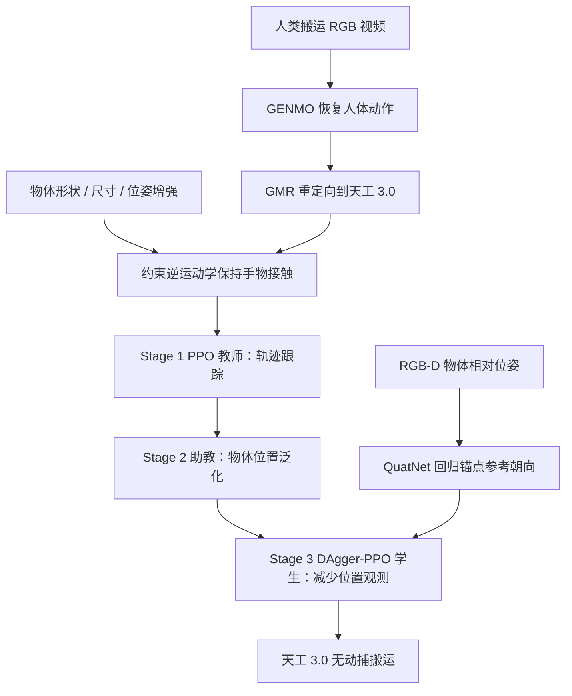

# MOVER：从人类搬运视频学习可泛化的人形搬运

**From Video to Vision**（MOVER，*Learning Generalizable Humanoid Carrying from Human Motion*，[arXiv:2610.14561](https://arxiv.org/abs/2610.14561)）由北京人形机器人创新中心（X-Humanoid）的 Ziluo Ding 提出。它把「视频模仿固定轨迹」拆成动作跟踪、物体位置泛化和观测蒸馏三个阶段，最终让天工 3.0 借助机载 RGB-D 感知物体，在没有动捕系统的环境中执行搬运。

## 一句话定义

**MOVER 以人类搬运视频提供动作先验，再用分阶段强化学习和视觉观测蒸馏，减少人形搬运对固定参考轨迹与动捕全局位置的依赖。**

## 英文缩写速查

| 缩写 | 英文全称 | 简要说明 |
|------|----------|----------|
| MOVER | MOVER (framework name) | 论文给出的搬运框架名称，未将其展开为英文缩写。 |
| GENMO | Generalist Model for Human Motion | 从输入视频恢复人体运动，提供重定向前的人体动作。 |
| GMR | General Motion Retargeting | 将人体动作映射到人形机器人并处理本体差异。 |
| PPO | Proximal Policy Optimization | 训练 Stage 1/2 策略并参与蒸馏后优化。 |
| DAgger | Dataset Aggregation | 在 Stage 3 中用助教策略为受限观测学生提供示范。 |
| RGB-D | Red-Green-Blue-Depth | 机载相机提供图像与深度，用于估计物体相对位姿。 |
| LSTM | Long Short-Term Memory | QuatNet 的时序网络，用于预测锚点参考朝向。 |

## 为什么重要

视频能低成本提供动作示范，但直接重定向通常只产生一条人形–物体轨迹；策略因此容易学会复现特定起点，而不是处理不同物体位置。MOVER 把数据扩增、奖励调整和观测蒸馏串成一条训练路径，针对「搬运从哪里开始」和「部署是否依赖动捕」逐步改变策略的输入与目标。

## 方法栈与流程总览

### 1. 从视频构造多样的交互参考

GENMO 从 RGB 视频估计世界坐标人体运动，GMR 再将其映射到 29 自由度天工 3.0。作者从原始搬运动作出发，改变物体网格、各向异性尺寸、初始位姿和支撑高度，同时保持抓取时的手–物变换；受约束逆运动学调整手臂与躯干，并约束关节限位、碰撞间隙和支撑条件。论文报告由 100 段视频扩增出 4,000 条参考轨迹。

### 2. 三阶段训练

| 阶段 | 策略角色 | 主要变化 | 学习目标 |
|------|----------|----------|----------|
| Stage 1 | Teacher | 使用较丰富的参考轨迹与状态观测 | 严格跟踪身体、物体和接触轨迹，完成搬运 |
| Stage 2 | Assistant | 移除全局锚点位置和自身体位置跟踪奖励；提高物体与接触奖励 | 降低对固定位置的依赖，在不同物体起点搬运 |
| Stage 3 | Student | DAgger-PPO 蒸馏，压缩位置相关观测；保留本体历史、物体相对位姿及少量朝向参考 | 在更少观测下保持抓取和搬运能力 |

论文还尝试移除所有参考动作信息，但发现只靠物体相对位姿不能始终确定送达方向。为此 QuatNet 使用物体相对位姿、机器人关节位置和目标点，回归锚点参考朝向，补回策略完成搬运所需的方向线索。

### 3. 视觉位姿与遮挡处理

头部 RGB-D 相机检测贴在物体上的标记，并结合相机外参和当前头部关节姿态，将物体位姿转换到骨盆坐标系。测量会先经过重投影误差和时序一致性检查，再进行平滑。短时遮挡时以最近有效观测传播位姿；抓住物体后，可用手掌正运动学和近似固定的手–物变换补充更新。抓取前长时间丢失标记时，机器人暂停等待有效观测。

## 源码运行时序图

**不适用：** 截至 2026-10-24，论文页面未列独立项目页或公开实现仓库，因此没有可核验的官方训练、推理或部署代码入口。上方流程图概括的是论文方法数据流，不代表源码运行流程。

## 工程实践

- **先检查接触一致性，再扩增物体：** 物体位姿扰动后需重算手臂与躯干姿态，否则扩充的只是几何数量，无法保证有效抓取参考。
- **让训练阶段逐步减弱参考依赖：** 先稳定复现示范，再通过奖励改动学习不同起点，最后用蒸馏缩减部署观测，便于分阶段定位性能退化。
- **明确视觉坐标变换链：** 标记检测结果需结合头部关节正运动学、相机外参和标记到物体的固定变换，才能得到控制器所需的物体相对位姿。
- **区分动捕评测与视觉部署：** 论文同时评估动捕观测和 RGB-D 观测；两者结果不能合并为同一部署成功率。
- **开源状态：** 论文引用 GENMO、GMR 和 rsl-rl 等既有方法/代码基础，但截至入库日未提供 MOVER 自身的代码入口；完整复现仍无法从本文归档直接执行。

## 实验与评测

作者以 Isaac Lab 训练、MuJoCo 仿真评测，平台为 29 自由度天工 3.0。搬运成功定义为物体最终距目标位置不超过 0.3 m。论文摘要称仿真成功率达到 93%；正文的分位置、物体形状和训练阶段表显示性能随位置偏移与蒸馏方式变化明显，不能将单一数字理解为所有条件下的固定成功率。

| 评测 | 论文报告 | 阅读方式 |
|------|----------|----------|
| 数据 | 100 段搬运视频扩增为 4,000 条人形轨迹 | 数据扩增覆盖几何和摆放变化，来源视频仍有限 |
| 仿真平台 | Isaac Lab 训练；MuJoCo 评测；29-DoF Tiangong 3.0 | 仿真与目标硬件明确，但方法细节需以论文版本为准 |
| 视觉真机 | 三个物体位置分别成功 7/10、5/10、5/10 | 展示无动捕场景可运行；每个位置仅 10 次，证据量有限 |
| 蒸馏代价 | 位置偏移较大时，移除位置观测后送达成功率下降 | 抓取能力与精确送达能力需分别衡量 |

## 结论

**MOVER 展示了从视频动作先验走向视觉条件人形搬运的完整训练思路，但现有结果更支持「可行性」而非成熟泛化能力。**

1. **数据扩增需保留物理接触关系**：物体尺寸和位置变化后，约束逆运动学用于维持手物接触与可行姿态。
2. **分阶段奖励比一步去掉参考更易控**：Stage 2 先弱化全局位置跟踪，使助教学会在不同起点找物体。
3. **蒸馏会改变成功类型**：抓取成功率可以保持较高，物体最终送达位置却可能变差，应分别报告两项指标。
4. **QuatNet 补的是方向信息**：去掉参考轨迹会丢失目标方向线索，单靠当前物体相对位姿不足以总能确定搬运方向。
5. **视觉部署仍依赖物体标记和坐标标定**：当前证据是标记辅助 RGB-D，不等于开放词汇、无标记物体感知。
6. **真机样本规模较小**：三处摆放各 10 次，适合视为概念验证，不足以推断广泛场景成功率。
7. **代码未随论文提供**：现阶段适合作为方法对照与复现线索，不能直接当作开源部署方案。

## 与其他工作对比

| 工作 | 共同点 | 主要差异 |
|------|--------|----------|
| [HDMI](./paper-hrl-stack-06-hdmi.md) | 用人类视频学习人形全身物体交互 | MOVER 专门聚焦搬运位置泛化和部署观测蒸馏，并使用 QuatNet 估计锚点参考朝向 |
| [OmniRetarget](./paper-hrl-stack-03-omniretarget.md) | 从人类交互动作生成可用于人形控制的参考 | MOVER 将训练目标延伸到弱化轨迹依赖的搬运策略；重定向与策略学习都需在相同物体配置上验证 |
| [Whole-Body Dexterity](./paper-whole-body-dexterity.md) | 通过全身动作完成物体搬运 | Whole-Body Dexterity 侧重身体部位与接触区域的协调；MOVER 侧重视频监督、位置泛化和视觉部署 |

## 局限与风险

- **数据规模有限：** 论文指出训练视频仍不足，面对更多形状和动作模式时泛化有限。
- **精确送达退化：** 移除位置相关观测后，学生在较大目标偏移下更难准确把物体放到指定位置。
- **视觉条件较强：** 物体上需要 fiducial tag，且依赖相机外参与手部运动学；标记检测失效会影响抓取前的策略运行。
- **真机结果样本少：** 每个视觉放置点 10 次实验，且视觉策略成功率低于动捕观测设置。
- **无法直接复现：** 未找到论文明确提供的 MOVER 项目页或实现代码，Isaac Lab、GENMO、GMR 的存在不等于训练配方已公开。

## 关联页面

- [Loco-Manipulation（移动操作）](../tasks/loco-manipulation.md) — 腿式平台行走与操作的耦合任务
- [Motion Retargeting](../concepts/motion-retargeting.md) — 人体动作映射到机器人运动的上游步骤
- [HDMI](./paper-hrl-stack-06-hdmi.md) — 从人类视频学习全身交互控制
- [Whole-Body Dexterity](./paper-whole-body-dexterity.md) — G1 全身接触搬运与姿态重定位
- [X-Humanoid](./x-humanoid.md) — 北京人形机器人创新中心与天工平台资料入口

## 参考来源

- [论文来源归档](../../sources/papers/from_video_to_vision_arxiv_2610_14561.md)
- [arXiv:2610.14561](https://arxiv.org/abs/2610.14561) — 论文摘要与版本入口
- [arXiv HTML v1](https://arxiv.org/html/2610.14561v1) — 方法、表格和实验细节

## 推荐继续阅读

- [GENMO](https://arxiv.org/abs/2502.10292) — 论文所用的人体运动恢复与生成先验
- [GMR: Retargeting Matters](https://arxiv.org/abs/2510.02252) — 人形通用运动重定向方法
- [MOVER 原文 HTML](https://arxiv.org/html/2610.14561v1) — 查阅公式、实验设定与评测表
