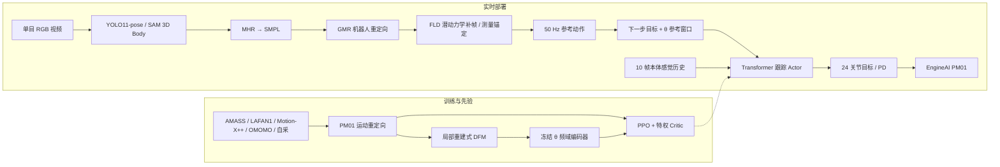

# MoViC：基于单目视频流的实时人形机器人全身控制
*MoViC: Real-Time Humanoid Whole-Body Control from Monocular Video Streams*

## 一句话定义

**MoViC**（[arXiv:2611.19998v1](https://arxiv.org/abs/2611.19998)，2026-11-15；香港大学、新加坡国立大学、北京理工大学、EngineAI 深圳）用**单个 RGB 相机**驱动实时人形全身动作跟踪：约 **10 Hz** 人体重建 + 重定向，经潜动力学外推形成 **50 Hz** 参考，由带**频域 θ 目标**的 Transformer 跟踪策略控制 **EngineAI PM01 24-DoF**，无需操作者佩戴动捕设备。

## 英文缩写速查

| 缩写 | 英文全称 | 简要说明 |
|---|---|---|
| WBC | Whole-Body Control | 人形全身运动协调控制 |
| BFM | Behavior Foundation Model | 跨多个动作类别复用的全身跟踪行为模型 |
| SEG | Video-to-motion processing module (SEG) | 作者对在线视觉重建、重定向与外推模块的统称 |
| MHR | Momentum Human Rig | SAM 3D Body 输出所用人体网格/骨架表示 |
| SMPL | Skinned Multi-Person Linear Model | 单目人体参数化表示 |
| GMR | General Motion Retargeting | 将人体动作转换为机器人参考 |
| DFM | Deep Fourier Mimic | 频域动作编码，局部重建式编码器生成 θ 条件 |
| FLD | Fourier Latent Dynamics | 周期潜动力学，部署期多步外推 |
| PPO | Proximal Policy Optimization | 训练全身跟踪策略的强化学习算法 |
| PD | Proportional-Derivative control | 执行 24 关节位置目标的低层控制 |

## 为什么重要

- **遥操作入口变轻：** 与 VR 头显、动捕衣/追踪器相比，操作者只需进入 RGB 摄像头视野；但视觉处理计算、相机安装与机器人侧状态估计仍不可省略。
- **准确重建和高速执行解耦：** 视觉侧重建约 10 Hz，控制端执行 50 Hz；不以缩减单目重建模型换取控制频率，而在参考层用潜动力学补帧。
- **时域参考压缩：** 不是仅依赖单帧命令，也不硬堆 10 帧显式未来参考，而是让 320-D θ 频域条件总结较长动作趋势；适于研究高动态、非周期动作的全身跟踪。
- **复用同一跟踪策略：** 真机演示从舞蹈切换到双臂搬箱、单臂提包，没有为每个演示任务额外训练独立低层策略；但物体闭环感知能力仍有限。

## 流程总览

**辨析：** 训练 actor 的 θ 来自**局部重建式编码器**；10→50 Hz 插值/外推来自**多步预测式潜动力学 FLD**。它们在原文中是不同训练目标，不能简单把「θ 编码」等同于「外推」。

## 核心原理

### 1. 参考动作重定向与数据

论文用 **AMASS / LAFAN1 / Motion-X++ / OMOMO / 自采**人体动作，经统一人体表示、重采样及并行可微运动学优化重定向至 PM01。目标兼顾全局关键点位置、人体相邻关节的局部结构、指定部位朝向、关节限位和时间平滑（论文式 1）。

### 2. 局部 θ 表征与外推

- **actor 条件（DFM 局部重建）：** 每帧 57-D 机器人运动状态，回看 31 帧（原训练网格 30 Hz），1D-CNN 映射至 64 个 latent channels。每通道的频率、幅值、偏置、相位正弦和相位余弦，共 **5×64=320-D**。训练采用单窗重建损失（论文式 8b），冻结后提供未来对齐的 θ 窗口（前瞻约 **10 帧 / 0.333 s**，式 10–11）。
- **部署参考生成（FLD 多步预测）：** 另一潜动力学模型用多步预测损失（式 8a，M=15）学习相位推进，在低频视觉结果之间补齐 50 Hz 参考。测量锚定公式 **x̂(t+i) = x(t) + [d(t+i) − d(t)]**，用相对变化缓解共享解码偏置，并以最近缓冲窗口的一致性门限拒绝可疑更新（式 12）；这不保证消除全部噪声。
- **不能混淆：** θ 编码为策略提供**动作趋势条件**；FLD 外推为部署提供**逐步数值参考**。将两者合写为一个「线性插值器」会丢失研究贡献。

### 3. Transformer BFM 与 PPO

| 模块 | 输入 / 结构 | 作用 |
|---|---|---|
| Actor proprio history | 10×81 = **810-D** | 关节角/速度、上次动作、机身角速度与姿态等 |
| Explicit next-step target | **52-D** | 给定下一个 20 ms 控制时刻的明确跟踪目标 |
| θ goal | **320-D** | 补充未来动作频域上下文，不堆 10 个显式参考 |
| Transformer | 4 层，6 头，token D=768 | query token 聚合多路条件，输出 **24-D** 关节目标 |
| Critic | 仅训练期特权状态 + 未来参考 | 非对称 PPO；critic 不使用 θ，部署不调用 |
| 低层控制 | PD | 执行关节位置指令，不等同于直接输出电机力矩 |

训练对 12 个跟踪 link 的位置/姿态/速度误差给奖励，并惩罚动作突变、关节越界和非允许接触（论文表 I）。PPO γ=0.99、GAE λ=0.95、clip ε=0.1；训练报告 4×A100。

### 4. 异步单目视频模块 SEG

论文 §III-C1 / §IV-A：Logitech BRIO **1080p@30 fps** 固定水平相机；TensorRT **YOLO11-pose** 检测单人（置信度 >0.75）、裁剪 512×512 后经 **SAM 3D Body / MHR** 重建，再映射到 **SMPL**、用 **GMR** 重定向。视频/模型运行在单张 **RTX 5090** 的 PC；图像缓冲保留最新一帧，采集、推断、发布异步执行。该流式实现**未解码手部精细姿态**。

## 评测与结果

| 论文实验 | 基线 | MoViC | 指标与范围 |
|---|---|---|---|
| θ + 单显式参考（表 IV） | 10 显式未来帧、无 θ：**95%** | **99%** | 仿真跟踪成功率；输入 **1182-D vs 1330-D** |
| θ + 单显式参考（表 IV） | 同上 **0.28 rad / 4.55 rad/s** | **0.25 rad / 4.30 rad/s** | 仿真 MPJPE / MPJVE |
| 单帧未来目标，无 θ（表 IV） | **90%** | θ + 单帧为 **99%** | 同一仿真消融任务，不是硬件抓取成功率 |
| FLD vs 线性外推（表 III） | 位置 / 速度 RMSE **0.7561 rad / 8.6816 rad/s** | **0.0655 rad / 1.2372 rad/s** | 预测误差对照 |
| 视频重建（表 V，EMDB） | GVHMR+GMR **123.45 mm MPJPE** | SEG **117.54 mm** | EMDB-1 good-frame 子集 |
| Bencaogangmu 舞蹈跟踪（图 8） | SONIC / OmniH2O / TWIST | 三类跟踪误差均最低 | MuJoCo，对照适配 PM01 并使用同一参考动作训练集 |
| 真机演示（图 9–10） | — | PM01 动态舞蹈、双手转移箱子、单手提包 **139 s 连续演示** | 定性证据，没有报告独立任务成功率统计 |

**评测读法：** 表 IV 的 **99%** 只反映该论文仿真成功标准。图 8 的跟踪误差是相对**视频重建成的机器人参考**，不能直接视为相对真实人体动作的绝对误差；图 9–10 真机演示不能推断大样本任务成功率。

## 结论

**MoViC 的关键贡献是把高质量单目重建、频域条件化的统一 BFM 与异步参考外推连接起来，使普通 RGB 视频成为 PM01 全身实时跟踪的输入接口。**

- **优先验证时序接口：** 重建约 10 Hz 与策略 50 Hz 的频率缺口由 FLD 外推补齐；选型时需独立报告视频感知延迟、参考误差与执行跟踪误差。
- **θ 不是额外 10 帧原始状态：** 320-D 频域代码与 52-D 下一步目标组合，比 10 帧显式参考的 actor 输入从 1330-D 缩至 1182-D，在论文仿真消融中反而取得 **99% vs 95%** 成功率。
- **关注 OOD 动作：** 演示包含较剧烈舞蹈及非周期性的双臂/单臂搬运；尚需独立验证遮挡、不同相机和未见机体的鲁棒性。
- **复现依赖仍高：** SAM 3D Body、视觉模型、GMR、频域编码和 PPO tracker 多模块耦合；论文报告使用 4×A100 训练、RTX 5090 部署，不宜把「仅一台 RGB 相机」误读为轻量计算。
- **物体接触并不闭环可见：** 低层策略不直接感知物体/接触力。真实场景精细对齐仍靠操作员视觉调整；需要引入物体视觉和触觉方能扩展精细操作。

## 工程实践

| 项 | 论文提供的信息 |
|---|---|
| 机器人 | EngineAI PM01，24-DoF，位置目标经 PD |
| 相机 | 固定 Logitech BRIO，1920×1080@30 fps |
| 频率接口 | 视觉约 10 Hz；参考/控制 **50 Hz** |
| 源码与模型 | **截至 2026-11-18 未开放可用的官方 MoViC 代码与权重入口**（项目页「Code coming soon」） |
| 源码运行时序图 | **不适用**：没有官方可运行代码，无法核实模块真实调用路径；本页仅有基于论文的**系统流程图** |
| 可执行检查 | 若后续开源，优先检查 SAM 3D Body/SMPL→GMR→FLD 的时间戳、延迟与坐标系，actor 观察向量是否为 810+52+320，以及真机关节限幅与安全停机 |

## 源码运行时序图

**不适用（官方尚未公开可运行的 MoViC 实现）**。不能用论文框架图伪造源码函数调用时序；待代码发布后阅读 README 和入口脚本再补。

## 局限与风险

- **单目遮挡与深度歧义：** 视频重建会在遮挡/出画/复杂多人条件下降级；论文仅在满足单人检测门限的图像上运行后续流程，无法保证任意场景鲁棒。
- **时延与安全：** 10→50 Hz 外推解决频率不匹配，但不意味着端到端零时延；外推突变、视觉漂移或错误参考仍需真机安全联锁。
- **动作与接触：** 策略不感知物体状态与接触力；手指精细动作未包含在流式重建输出中，不能把箱/包演示解读成通用精细抓取或灵巧手控制。
- **泛化证据：** 当前实机评测基于 PM01，论文未提供跨机体 sim2real 的定量泛化结论。
- **开源边界：** 官方项目主页为「Code(coming soon)」；论文与视频可读，训练/部署代码与权重不可据此认定可下载。

## 关联页面

- [Teleoperation（遥操作）](../tasks/teleoperation.md) 与 [遥操作纵深路线](../../roadmap/depth-teleoperation.md) — 从视觉操作者信号到实时全身动作
- [Whole-Body Tracking Pipeline](../concepts/whole-body-tracking-pipeline.md) 与 [BFM 纵深路线](../../roadmap/depth-bfm.md) — 下游跟踪和结构化动作先验
- [GMR](../methods/motion-retargeting-gmr.md) 与 [SAM 3D Body](./sam-3d-body.md) — 上游人体重建与机器人动作映射
- [SONIC](./nvidia-sonic.md) — 同属通用全身跟踪/视频遥操作路线，对照输入表征和延迟处理
- [BeyondRetarget](./paper-beyondretarget-monocular-humanoid.md) — 单目直接到机器人运动（绕过显式 SMPL），与 MoViC 的 **SAM 3D Body → SMPL → GMR** 两段式技术路线不同

## 参考来源

- [论文来源归档：arXiv:2611.19998v1](../../sources/papers/movic_arxiv_2611_19998.md)
- [官方项目页归档](../../sources/sites/movicproject-github-io.md)

## 推荐继续阅读

- [arXiv HTML 全文（公式、表格与实验）](https://arxiv.org/html/2611.19998)
- [MoViC 官方主页与真机演示](https://movicproject.github.io/)
- [GMR：人体动作到机器人重定向](../methods/motion-retargeting-gmr.md)
