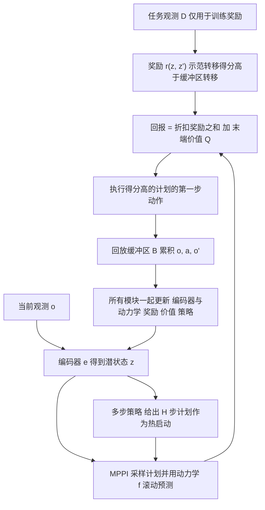

# MPAIL2：在线世界模型使真机观测式逆强化学习成为可能（arXiv:2602.24121）

**MPAIL2**（*Online World Modeling Enables Real-World Inverse Reinforcement Learning from Observation*，华盛顿大学 Byron Boots 组，[arXiv:2602.24121](https://arxiv.org/abs/2602.24121)，arXiv 页注 CoRL 2026；v1 原标题 *Planning from Observation and Interaction*）。本页以 v3（2026-10-18）为准，原文通读记录见 [来源归档](../../sources/papers/mpail2-irlfo_arxiv_2602_24121.md)。

## 一句话定义

**MPAIL2 是一个在线、离策略的潜空间世界模型框架：同时学编码器、动力学、对抗式推断的奖励、价值与多步策略，并用 MPPI 在线规划，只依赖任务观测（论文 §3 称无动作、无奖励监督）和自己的交互，在真机上从零学习视觉操作。**

## 英文缩写速查

| 缩写 | 英文全称 | 简要说明 |
|------|----------|----------|
| IRL | Inverse Reinforcement Learning | 逆强化学习：从示范反推奖励，再用奖励训练策略 |
| IRLfO | Inverse RL from Observation | 只给观测轨迹、不给示范动作的 IRL（论文 §1） |
| LfO | Learning from Observation | 仅凭观测学习任务 |
| MPAIL | Model Predictive Adversarial Imitation Learning | 本文前作（arXiv:2507.21533），状态式动力学、同策略更新；本文称 MPAIL2 |
| AIL | Adversarial Imitation Learning | 对抗式模仿学习，奖励与策略交替博弈更新 |
| GP | Gradient Penalty | WGAN 式梯度惩罚，用来稳定奖励训练（§3 式 3） |
| MPPI | Model Predictive Path Integral | 基于采样的模型预测控制，本文的规划器 |
| RLPD | RL with Prior Data | 带先验数据的在线 RL 基线（经 SERL 实现） |
| BC | Behavior Cloning | 行为克隆，本文用 Diffusion Policy 实现 |
| PnP / BP / MoP | Pick-and-Place / Block Push / Mug-on-Plate | 论文表格里的任务简称 |
| [−P] / [−PM] / [−PMO] / [−O] | 去掉 Planning / Model / Off-policy 的消融 | 分别对应 MAIRL、DAC、AIRL、MPAIL 式基线（§4，附录 C.2） |

## 为什么重要

- 它回答的问题是：在真机上不给奖励、不给示范动作、不预训练时，IRL 能否在几十分钟的交互量级内学会视觉操作。作者自述这是首个真机从零学视觉操作的 IRL 方法（摘要，§1）。
- 论文把 IRL 在真机上长期不可用归因于交互效率差和对抗奖励不稳定，并提出三条设计性质：潜空间可预测性、多步回报传播、在线规划带来的执行鲁棒（§1）。附录 D.3 用消融给出了各自的证据（见下文）。
- 对「奖励设计」一线的读者：它是把「奖励从示范里学、并在线随策略变化」放进规划式学习器的一个真机案例，可与 [奖励设计](../concepts/reward-design.md)、[逆强化学习](../methods/inverse-reinforcement-learning.md) 对照阅读。

## 核心原理与流程总览

学习循环（§3，Fig. 1，Algorithm 1）：

要点（均出自论文 §3 与附录 A、C）：

- **任务无关的潜空间：** 编码器与动力学只用多步潜空间预测损失（停梯度目标）训练，不接收奖励或价值梯度。作者称这样可避免对抗奖励把潜表示拖向塌缩（§3、附录 A.2），并便于迁移（§4 Q3）。
- **离策略奖励：** 奖励目标为 `E_D[r] − E_B[r] − β·GP`，用全部历史交互而非最近一次策略的数据；论文引用前人结论称同策略奖励会收敛到常数（§3）。
- **价值与策略：** Q 集成（5 头）+ 熵正则化 λ-return 目标；多步策略沿想象的 H 步 rollout 优化 TD(λ) 式回报，主要职责是给 MPPI 热启动与支撑离策略价值估计（§3，附录 E.3 报告策略在 MPPI 精英得分中占比始终低于 20%）。
- **规划器：** MPPI，512 条 rollout，64 个精英，5 轮迭代，H=7，策略计划占比 0.05（附录 C.1，Table 5）。
- **模型规模与速度：** 总参数 7,114,494（两路 64×64 RGB 加本体感觉，Fig. 6）；真机推块动作频率 10.28 ± 0.45 Hz（附录 C）。

## 工程实践

- **真机平台与观测（附录 B，Table 2）：** Franka（Block Push、Mug-on-Plate）与 Kinova Gen3 + Robotiq 2F-85（Pick-and-Place）；观测为 64×64 RGB（外部相机 + 腕部相机）加本体感觉；动作为末端笛卡尔速度或位置指令（Pick-and-Place 含夹爪）。
- **示范数据：** 真机各 10 到 15 条，用空间鼠标（Block Push）或键盘（其余）遥操作采集，1,025 到 1,802 个转移（Table 2，B.2–B.4）。MPAIL2 训练时不使用示范动作，只用示范观测训练奖励。
- **评测协议（§4）：** 报告 Best（保存的检查点中事后挑出的最好者）与 Last（最后一个）两种；检查点每 10 个 episode 保存，Best 的挑选用到成功标签，对所有在线方法做法一致；真机每任务 3 个种子，每检查点 50 次试验；训练时间含交互、复位与学习器更新，不含检查点评测。物体由人工在 episode 之间复位，复位位置由程序采样（附录 B）。
- **基线实现：** [−P]、[−PM]、[−PMO]、[−O] 都沿用 MPAIL2 的部分设计（编码器、离策略等），是「强化过的」IRL 基线而不是原论文实现（§4，附录 C.2）；RLPD 用 SERL 实现，有稠密奖励则给稠密奖励，否则靠操作员在线标注的奖励分类器；BC 为 U-Net 去噪的 Diffusion Policy，训练 500 个 epoch（附录 C.2）。
- **代码：** 项目页给出的仓库为 https://github.com/UWRobotLearning/mpail2（链接取自项目页，本次未读仓库内容）。

### 主要真机结果（论文 Table 1 / Table 4，成功率 %，3 种子均值 ± 标准差）

| 任务 | MPAIL2（Best / Last） | [−P]（Best） | BC（Diffusion） | RLPD / [−PM] |
|------|----------------------|--------------|------------------|---------------|
| Block Push | 100±0 / 61.8±13.5 | 64.0±17.7 | 94.1±5.9 | 均 0 |
| Pick-and-Place | 82.0±12.2 / 68.0±13.6 | 16.0±14.8 | 12.0±5.8 | 均 0 |
| Mug-on-Plate | 54.9±14.7 / 35.3±17.3 | 3.9±2.8 | 33.5±12.3 | 均 0 |
| Block Push（仅外部相机视频示范） | 62.7±10.0 / 58.8±14.4 | 29.4±8.3 | 25.5±5.5 | 均 0 |
| 迁移：Block Push 反向（迁移后） | 90.2±4.7 / 63.5±4.1 | 13.9±13.3 | 15.8±7.8 | 均 0 |
| 迁移：Block Push 反向（从零） | 88.2±5.7 / 80.3±11.5 | 52.9±11.8 | 26±9.8 | 均 0 |
| 迁移：Pick-and-Place 反向（迁移后） | 94±10.2 / 47±29.4 | 16±17.9 | 18±5.8 | 均 0 |
| 迁移：Pick-and-Place 反向（从零） | 53±36.7 / 43±29 | 12±11.7 | 12±5.8 | 均 0 |

## 评测证据与清单说法的对比核对

清单对该论文的一句话摘要（作者说明是 LLM 据摘要起草）：「First real-world inverse RL from observation only (video, no actions or rewards), learning visual manipulation from scratch with an online world model.」

| 清单措辞 | 论文里实际的说法 | 判断 |
|----------|------------------|------|
| First real-world inverse RL | 摘要与 §1 的限定是「first IRL method to learn visual manipulation in the real world from scratch」，且 §2 承认 [11]（基于模型的 IRL）已在真机做过视觉到达，并称「few works have investigated real-world IRL … none that forgo action supervision」 | 清单把「首个」说宽了：论文声称的是「真机、从零、视觉操作、无动作监督」的组合首个，并非首个真机 IRL |
| from observation only (video) | 主实验的示范观测含外部相机、腕部相机与本体感觉（Table 2）；只有一个任务 Block Push（Video）只用外部相机（63% 对 BC 的 26%，§4 Q3、附录 B.5）；§7 说这些视频里出现的是机器人自己，尚未做跨本体 | 部分成立：多数任务不是纯视频，视频示范只在一个任务上验证，且不是人类或他人视频 |
| no actions or rewards | 示范无动作、无奖励，成立（§3）。但示范是遥操作采集的同一机器人观测（B.2–B.4）；Best 检查点依赖事后成功标签；物体由人工复位；任务观测由操作员指定（§4、§7） | 成立，但「无监督」不是完全无人工 |
| from scratch | 论文脚注定义为不使用任何预训练（编码器、策略、评论家等），附录 C.2 补充 BC 以外的组件均不预训练或冻结 | 成立 |
| online world model | 编码器与动力学在线训练、任务无关的潜空间，规划用潜空间滚动（§3） | 成立；注意只是确定性潜动力学，非概率或循环模型（§7） |
| 清单未提到的 | 真机迁移（§4 Q3）、与 RLPD / BC 的对比（RLPD 真机全 0，Block Push 上 BC 94.1 高于 MPAIL2 的 Last 61.8，Best 100 是事后挑选）、3 个种子 | 清单只覆盖标题层面的论点，没有反映这些限定 |

另有一处版本差异：arXiv v1 标题是 *Planning from Observation and Interaction*，清单用的是 v3 标题；v1 与 v3 的真机任务集和数字不同（见来源归档「版本差异」）。

## 结论

MPAIL2 展示了仅凭任务观测在真机在线学习的可行性，但仍依赖人工复位、工作空间限制和事后检查点选择。

- 同时报告 Best 与 Last，检查对抗训练后期是否衰退，不能只引用最佳成功率。
- 按规划深度核验模型奖励误差，避免长想象轨迹放大失真。
- 区分无示范动作与无人参与，迁移到高分辨率、延迟或跨本体场景前需另做验证。

## 局限

**论文自己承认的（§7、附录 E.5）：**

- 操作员仍需指定任务观测、手动复位物体、事后选最佳检查点；安全来自受限工作空间而非学习器。
- 对抗训练后期可能衰退（Sim: Block Push），末检查点可能落后于最佳；实用的停止准则未解决。
- 只做 64×64 图像下的单臂桌面操作，未评估更高分辨率与更长时域；想象奖励随滚动深度退化（真机误差由 7% 升至 43%，附录 D.4）。
- 视频示范里是机器人自己，未做跨本体学习；预训练世界、策略、奖励模型能否融入而不丢掉自身交互学习，仍未知。
- 编码器假设潜状态可即时观测，未处理硬件延迟、PID 跟踪误差等持续信息（循环 / 概率模型留作未来）。
- 作者对 RLPD 真机 0% 的解释：预算内未接触物体、没拿到奖励，「可能给更多交互就会成功」，并怀疑原 SERL 的墙钟时间内交互更多（附录 E.1）。

**读论文时我看到的未验证之处（我的判断，不是作者自述）：**

- 真机每任务仅 3 个种子，标准差很大（例如 Pick-and-Place 反向从零 Best 53±36.7，迁移后 Last 47±29.4），论文里的优劣排序在种子层面的显著性没有统计检验。
- Best 是事后用成功标签挑出的，Table 1 的 100±0（Block Push）与 82±12（Pick-and-Place）是该口径；Last 分别是 61.8 与 68.0。Block Push 上 BC 的 94.1 高于 MPAIL2 的 Last（论文承认，§4 Q1）。
- 摘要的「under 40 minutes」与 Table 4 的最佳检查点序号（Pick-and-Place 为 140，论文正文把同类序号解释为 episode 数，如「140 episodes (50 minutes)」）我无法从表里直接对上；v1 的图注写单次完整训练约 70 到 90 分钟。该时间口径（是否含评测、复位）我只能标为推测：约指到达最佳检查点前的训练时间。
- 「BC 在相同交互预算下只有 12%」的比较里，BC 是离线训练、无交互；示范数量只有 10 条，且论文自己说 Pick-and-Place 的 BC 失败多因抓空后仍照搬示范（附录 E.1），结论只针对这一小数据设置。
- 基线（[−P]、[−PM] 等）经 MPAIL2 的设计强化过，与原论文方法并不等同；[−O] 声明是「增强版 MPAIL 式」消融而非忠实复现（附录 C.2）。
- 迁移实验中，从零训练与迁移用的是同一机器人和高度相似任务，且换的只是推 / 放的方向；是否能迁移到视觉或物体差别更大的任务未验证。

## 关联页面

- [逆强化学习（方法页）](../methods/inverse-reinforcement-learning.md)
- [MPPI 采样式 MPC](../methods/mppi.md)
- [基于模型的强化学习](../methods/model-based-rl.md)
- [模仿学习](../methods/imitation-learning.md)
- [Diffusion Policy](../methods/diffusion-policy.md)
- [行为克隆](../methods/behavior-cloning.md)
- [奖励设计](../concepts/reward-design.md)
- [基于模型 vs 无模型强化学习](../comparisons/model-based-vs-model-free.md)
- [TD-MPC2（潜空间规划，对照其任务塑形的潜表示）](./paper-td-mpc2.md)
- [SERL（真机样本高效 RL 套件，RLPD 基线的实现来源）](./paper-rcl-2401-16013-serl-a-software-suite-for-sample-efficient-robot.md)

## 参考来源

- [mpail2-irlfo_arxiv_2602_24121.md](../../sources/papers/mpail2-irlfo_arxiv_2602_24121.md)（原文通读归档）
- [arXiv:2602.24121](https://arxiv.org/abs/2602.24121)（v3 PDF：<https://arxiv.org/pdf/2602.24121v3>）
- [项目页](https://uwrobotlearning.github.io/mpail2/)
- 清单出处：Glen Berseth，My CoRL 2026 Reading List（作者说明每条摘要为 LLM 据摘要起草，排序为其个人兴趣模型打分，不是论文质量评价）

## 继续阅读

- [MPAIL（前作，arXiv:2507.21533）](https://arxiv.org/abs/2507.21533)
- [TD-MPC2](./paper-td-mpc2.md)
- [SERL](./paper-rcl-2401-16013-serl-a-software-suite-for-sample-efficient-robot.md)
- [逆强化学习方法页](../methods/inverse-reinforcement-learning.md)
