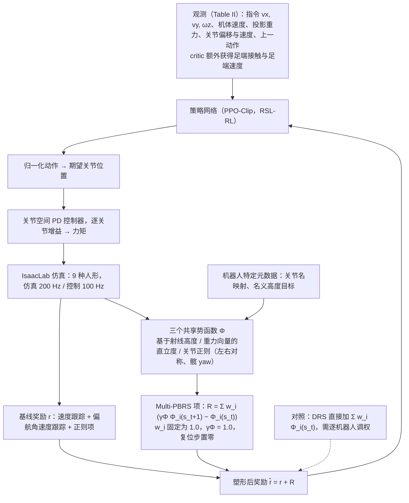

# MPBRS：九种人形机器人共享奖励配置

**一句话定义：** MPBRS 研究如何用同一组多势函数奖励结构与权重训练多种人形机器人，只提供机器人特定的结构映射和默认姿态元数据。

## 流程总览

图依据：论文 §III-B / §IV-B / §IV-C（式 4、5，Table II、III）。DRS 虚线表示对照设置而非 MPBRS 的组成部分。

## 英文缩写速查

| 缩写 | 英文全称 | 简要说明 |
|------|----------|----------|
| MPBRS | Multi-Potential-Based Reward Shaping | 本文方法：多个势函数差分组成的塑形奖励 |
| PBRS | Potential-Based Reward Shaping | 以势函数差分构造塑形项的经典奖励塑形框架 |
| RL | Reinforcement Learning | 训练人形 locomotion 策略的学习范式 |

## 核心方法

奖励塑形项常需要大量手工调权，也可能互相冲突、对单一机器人过拟合，或因小幅权重变化而不稳定。MPBRS 研究 Multi-Potential-Based Reward Shaping：利用多个势函数的差分塑形奖励，并提出统一的人形 locomotion 奖励配置。

论文在九种人形机器人上评估同一奖励结构与权重；每台机器人只需提供关节/连杆映射和默认姿态等机器人特定元数据，而无需重新设计奖励项。

## 评测（论文摘要报告）

与标准 shaping 相比，MPBRS 在跨机器人评估中呈现更一致的缩放行为和更低的调参敏感性。摘要未列明全部机器人、指标和数值，具体结果需以论文正文与实验表为准。

## 与其他工作对比

- **相对标准 shaping：** 论文以其为对照，报告 MPBRS 跨机器人缩放行为更一致、调参敏感性更低；数值与机器人清单以论文为准。
- **相对逐机器人手工调权：** 常见做法是为每台机器人重新组合 [人形奖励项](../concepts/humanoid-policy-reward-functions.md) 并调权；MPBRS 固定奖励结构与权重，只把差异压到关节/连杆映射与默认姿态元数据上。
- **相对 [PBRS 人形 locomotion 基准笔记](./paper-notebook-benchmarking-potential-based-rewards-for-learnin.md)：** 后者评测势函数奖励在人形 locomotion 中的作用；MPBRS 关注的是同一 PBRS 配置能否在九种机器人间复用。

## 工程启示

- 共享奖励配置有助于减少跨机器人迁移时重复手工调参。
- 统一的是奖励结构与权重；机器人特定的关节映射、连杆映射和默认姿态仍需正确提供。
- 验证时需区分奖励可移植性、策略性能和各机器人本体差异，避免把相同配置理解为无需适配。

## 开放状态

本次核查的 arXiv 页面未列官方项目页或代码链接，因此开源状态待核实。

## 结论

**MPBRS 的主张是「奖励配置可跨人形机器人复用」，而非某台机器人上的性能新高；证据目前只有摘要级描述。**

1. 复用的是奖励结构与权重，机器人特定元数据仍是迁移的必要输入。
2. 跨机器人结论需回到论文核对九种机器人、指标与对照设置后再引用。
3. 代码与项目页未见公开，暂无法复现。

## 参考来源

- [MPBRS 论文归档](../../sources/papers/mpbrs_arxiv_2610_30334.md)
- [arXiv:2610.30334](https://arxiv.org/abs/2610.30334)
- [arXiv PDF](https://arxiv.org/pdf/2610.30334)：已通读方法部分（实验与附录以略读为准）：§III Methodology（MDP、DRS 与 Multi-PBRS）、§IV System Overview（PD 控制、训练设置、实现细节）、§V Results 的训练基准部分（略读）

## 关联页面

- [Reinforcement Learning](../methods/reinforcement-learning.md)
- [Reward Design](../concepts/reward-design.md)
- [Locomotion](../tasks/locomotion.md)
- [人形策略奖励函数](../concepts/humanoid-policy-reward-functions.md)
