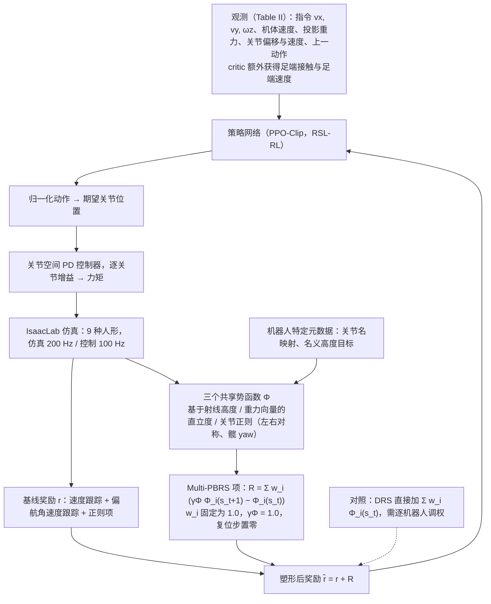

# MPBRS：九种人形机器人共享奖励配置

**一句话定义：** MPBRS 研究如何用同一组多势函数奖励结构与权重训练多种人形机器人，只提供机器人特定的结构映射和默认姿态元数据。

## 英文缩写速查

| 缩写 | 英文全称 | 简要说明 |
|------|----------|----------|
| MPBRS | Multi-Potential-Based Reward Shaping | 本文方法：多个势函数差分之和构成的塑形奖励 |
| PBRS | Potential-Based Reward Shaping | 以势函数差分构造塑形项的经典奖励塑形框架（Ng et al., 1999） |
| DRS | Direct Reward Shaping | 直接把势函数值加入每步奖励的对照方法，需逐机器人调权 |
| RL | Reinforcement Learning | 训练人形 locomotion 策略的学习范式 |
| PPO | Proximal Policy Optimization | 本文策略训练所用的 PPO-Clip 算法（经 RSL-RL 实现） |
| PD | Proportional-Derivative | 把策略输出的目标关节位置转为力矩的关节级比例-微分控制器 |

## 为什么重要

人形 locomotion 的 RL 训练高度依赖奖励设计。常见做法是为每台机器人反复调整奖励项与权重，直到训练稳定、步态看起来合理；这一流程耗时、难复现，而且结果往往无法直接迁移到相似的人形本体上。直接塑形（DRS）即插即用，却对权重敏感：权重稍变就可能出现过于保守的步态、震荡，或"站着不动"之类的代理目标解。

PBRS 的经典结论（Ng, Harada, Russell, 1999）是：以势函数差分构造的塑形项不改变折扣 MDP 的最优策略集合。这让"任务目标"与"加速学习的稠密信号"在概念上分离。本文关心的问题是：在三维、接触丰富、高维的人形 locomotion 中，这种性质是否能转化为**跨机器人复用**的实际收益。论文的答案偏向"稳定性与可移植性"，而非"收敛更快"。

## 流程总览

图依据：论文 §III-B / §IV-B / §IV-C（式 4、5，Table II、III）。DRS 虚线表示对照设置而非 MPBRS 的组成部分。

## 核心原理与方法

**输入。** 策略观测见 Table II：指令 $(v_x, v_y, \omega_z)$、机体线速度、机体角速度、投影重力、关节位置偏移与速度、上一动作。原文正文写策略观测维度为 $18+3N_a$，但 Table II 上段各项相加为 $12+3N_a$，两者不一致（critic 额外的足端接触与足端速度为 6 维，可能是 $18+3N_a$ 的来源，未核实）。

**基线奖励（Table III）。** 线速度跟踪（权重 0.5）、偏航角速度跟踪（0.3）、腰部默认姿态（0.25）、动作幅值惩罚（-0.005）、动作变化率惩罚（-0.05）；终止（如高度低于阈值、倾角超限、自碰撞）惩罚 -200。只有前两项是直接的任务项，其余为正则项。跟踪核的尺度参数 $\sigma_v = \sigma_\omega = 0.5$。

**两种塑形。**
- DRS（式 4）：$R_{\text{DRS}}(s_t) = \sum_{i=1}^{3} w_i \Phi_i(s_t)$。三个势函数分别为高度（DRS 权重 0.75）、直立度（0.5）、关节正则（0.25）。权重需按机器人手工调。
- Multi-PBRS（式 5）：

$$
R_{\text{PBRS}}(s_t, s_{t+1}) = \sum_{i=1}^{3} w_i \left( \gamma_\Phi \Phi_i(s_{t+1}) - \Phi_i(s_t) \right), \qquad \hat r = r + R_{\text{PBRS}}
$$

本文取 $w_i = 1.0$、$\gamma_\Phi = 1.0$，复位步的塑形项置零以避免跨回合的虚假脉冲。

**三个共享势函数。**
- 高度势函数 $\Phi_h$：基于射线测得的地面距离与名义高度目标，高斯型，$\sigma_h = 0.08$。
- 直立度势函数 $\Phi_{up}(s) = \exp(-4\,|g^b_z + 1|)$：由机体坐标系下的投影重力 $g^b_z$ 计算，鼓励基座保持直立。
- 关节正则势函数 $\Phi_{jr}$：$\sigma_q = 0.5$，包含左右对称项与髋 yaw 惩罚。各分项的确切形式因 PDF 公式排版难以无歧义还原（未核实，以原文 Table III 为准）。

每个势函数在线计算并跨时间步缓存，保证 $\Phi_i(s_t)$ 与 $\Phi_i(s_{t+1})$ 配对一致。

**关键直觉。** PBRS 项只在"下一状态的势函数更高"时为正，势函数静止时接近零。这把信号从"处于好状态"改为"朝更好状态移动"，因此对势函数的绝对偏移不敏感。这也是论文认为 PBRS 比 DRS 更不容易因量级失配而失稳的原因。

**输出。** 策略输出归一化动作 $a \in \mathbb{R}^{N_a}$，映射为目标关节位置；由逐关节增益的 PD 控制器输出力矩：

$$
\tau_j = K_{p,j}\left(q_j^{\text{des}} - q_j\right) - K_{d,j}\dot q_j
$$

机器人特定信息仅限于：关节名映射（用于左右对称与髋 yaw）、名义高度目标、默认姿态，以及 PD 增益。手臂关节固定在名义角度；若腰部有 roll、pitch、yaw 三个关节，则只控制 yaw，roll 与 pitch 取默认值。

## 工程实践

| 项目 | 原文取值 / 做法 |
|------|----------------|
| 仿真环境 | NVIDIA IsaacLab；仿真 200 Hz，控制 100 Hz |
| 算法 | PPO-Clip，经 RSL-RL 实现；clip ε = 0.2，熵系数 0.001，desired KL 0.01，学习率 $3\times10^{-4}$（自适应） |
| 折扣与优势 | 策略 γ = 0.99，GAE λ = 0.95；塑形折扣 $\gamma_\Phi = 1.0$ |
| 数据规模 | 每环境 64 步，8 个 epoch，16 个 mini-batch；训练使用 2048 个 agent，1000 个交互步 |
| 网络 | 策略与 critic 均为 [512, 256, 128, 64]，ELU 激活 |
| 初始化 | 初始动作噪声 std 1.0（log 空间）；关节初始位置对默认值做幅值 0.1 的均匀扰动 |
| 观测噪声 | 按 Table II 对各观测加均匀噪声（如指令 0.02、投影重力 0.015、关节偏移 0.004） |
| 硬件与耗时 | Intel i7-9700F，RTX 2060（6 GB）；单次训练约 50 分钟 |
| 复现核对 | 论文脚注给出 GitHub 仓库（见「开放状态」）；本次未能访问 |
| 源码运行时序图 | **不适用**（代码仓库本次无法访问核实运行入口，待核实后补充） |

**迁移到新机器人时的检查清单。**
- 对照 Table I 的关节数、动作数与腰部自由度，确认控制的关节子集（腿部 + 腰 yaw）。
- 填写关节名映射（左右对称、髋 yaw）与名义高度目标，再核对终止阈值是否随机器人高度与基座尺寸调整。
- 逐关节确认 PD 增益与执行器限幅；原文按执行器特性逐关节调参。

**调试指标。** 论文用于判断训练的指标包括：总奖励曲线（但跨设置不可直接比较，DRS 的奖励量级不同）、跌倒率（MPBRS 与 Baseline 趋势接近，DRS 在部分机器人上偏离）、x–y 与偏航角速度跟踪奖励，以及各塑形项的分布（Fig. 6，两项都收敛到零说明达到目标状态）。

## 评测

**训练基准（Fig. 3）。** 在九种人形上比较 Baseline、DRS 与 MPBRS，三种设置均能在所有机器人上收敛。DRS 的总奖励曲线常显得收敛更快，但这是因为它额外加入了辅助项，量级不同，不代表任务收敛更快。MPBRS 的策略行为与 Baseline 保持一致；DRS 的总奖励偏离更大，并在部分机器人上跌倒率偏高。三种设置的速度跟踪性能总体相当。收敛速度主要取决于机器人本身（形态、执行器限幅、名义动力学），而非塑形方式。

Table I 列出的九种机器人（关节数 / 动作数 / 腰部自由度）：

| 机器人 | 关节数 | 动作数 | 腰部 |
|--------|--------|--------|------|
| Fourier N1 | 23 | 13 | 1 |
| Unitree H1 | 19 | 11 | 1 |
| Unitree G1 | 29 | 13 | 3 |
| Booster T1 | 23 | 13 | 1 |
| Fourier GR3V2 | 31 | 13 | 3 |
| HighTorque HI | 25 | 13 | 3 |
| Kuavo S45 | 28 | 12 | 无 |
| TienKung2 | 20 | 12 | 无 |
| Berkeley Humanoid Lite | 22 | 12 | 无 |

**单机轨迹跟踪（Fig. 4，Fourier N1）。** 使用 MPBRS 训练的策略在 x 方向可跟踪至约 3.5 m/s，y 方向跟踪噪声更大。每 10 秒对机器人重置一次，跟踪误差在重置时出现尖峰，随后迅速恢复。正文称观察区间为 17.5 秒，图注写 20 秒，两者不一致（未核实）。

**权重敏感性（Fig. 5–7，仅 Fourier N1）。** 把塑形权重从 0.1 扫到 500。MPBRS 在权重 500 时仍能收敛并跟踪指令；DRS 在权重过高时机器人直接站着不动，因为高度、直立与关节正则奖励主导了其他项。Fig. 6 显示 MPBRS 下各塑形项的分布都收敛到零。

## 与其他工作对比

- **相对标准 DRS：** 论文的核心对照。DRS 的权重需逐机器人调；MPBRS 固定 $w_i = 1.0$，只改变势函数形式。论文报告 MPBRS 对权重和奖励尺度的敏感性更低，但收敛速度只有小幅改善。
- **相对逐机器人手工调权：** 常见做法是为每台机器人重新组合 [人形奖励项](../concepts/humanoid-policy-reward-functions.md) 并调权；MPBRS 固定奖励结构与权重，只把差异压到关节映射与名义高度等元数据上。
- **相对 [PBRS 人形 locomotion 基准笔记](./paper-notebook-benchmarking-potential-based-rewards-for-learnin.md)：** 同一思路的前作（Jeon et al., arXiv:2307.10142）在人形 locomotion 中基准 PBRS，发现收敛收益有限但对奖励缩放更稳健。MPBRS 把这一结论推广到 9 种人形、三个并行势函数，并关注同一配置能否跨机器人复用。
- **相对模仿学习：** 论文引用的文献指出参考运动的选择与权重会偏向复现参考，且难以跨形态迁移；MPBRS 不需要参考运动，但也不提供风格层面的约束。

## 结论

**MPBRS 的主张是「奖励结构与权重可以跨人形机器人复用」，而不是某台机器人上的性能新高。** 论文的证据主要来自仿真训练曲线与一台机器人的敏感性分析。

1. 复用的是奖励结构与固定权重；机器人特定的关节映射、名义高度与默认姿态仍是迁移的必要输入。
2. MPBRS 的主要收益是稳定性与可移植性，而不是收敛速度；DRS 的总奖励曲线看起来更快，但它改变了优化目标。
3. 敏感性结论只在 Fourier N1 上做过完整扫描（权重 0.1–500）；其余八种机器人的证据是训练基准曲线。
4. 论文只在仿真中验证（IsaacLab），未报告真机结果；sim-to-real 与观测噪声建模列为未来工作。
5. 若要引用跨机器人结论，需先核对 Fig. 3 的具体曲线与统计方式：原文未报告随机种子数量、方差或置信区间。

## 局限与风险

- **仅仿真验证。** 没有真机实验；观测噪声只是训练时的扰动模型，不能替代实机验证。
- **策略不变性的前提需要注意（本页基于 Ng et al. 条件的推断，原文未做严格证明）。** Ng et al. (1999) 的不变性结论要求塑形项的折扣与 MDP 折扣一致。本文使用 $\gamma_\Phi = 1.0$ 而策略 $\gamma = 0.99$，论文以 [4][6][28][29] 为依据，认为无折扣势函数在本设置下仍保持训练稳定。严格的最优策略不变性在本设置下不宜直接视为成立，需结合 Ng et al. 原文的条件与这些文献核对（未核实）。
- **对比的公平性依赖调参投入。** 原文说明 Baseline 与 DRS 的权重是作者手工调到"稳定且合理"的结果，DRS 的表现直接取决于调参投入，读者在比较时需要核对双方的调参预算。
- **统计与复现信息不足。** 原文未报告随机种子数量、重复实验方差或置信区间；Fig. 3 的曲线是否为单次运行未说明。
- **敏感性分析范围有限。** 只在 Fourier N1 上做了权重扫描；"对九种机器人同样稳健"的结论主要由训练曲线支撑。
- **仅三个势函数。** 论文未研究势函数数量、形式或学习得到的势函数的影响（作者列为未来工作）。
- **"无需逐机器人重设计"不等于"无需适配"。** 关节映射、名义高度、终止阈值与 PD 增益仍是机器人相关的输入。
- **文本与图表存在小不一致。** 策略观测维度（$12+3N_a$ 与 $18+3N_a$）、Fig. 4 的观察时长（17.5 秒与 20 秒）见上文，需回原文核对。
- **代码可得性未核实。** 论文脚注给出 GitHub 仓库，正文另给匿名 4open 链接，两者都未能在本次核查中访问。

## 开放状态

- **论文声明：** 脚注称源码与视频可在 `github.com/aralab-unr/MPBRS` 获取；正文的 "Open source code" 段给出 `anonymous.4open.science/r/MPBRS-5448`（匿名仓库）。
- **arXiv 摘要页：** 本次核查未列出官方项目页或代码链接。
- **本次核查结果：** 经代理访问上述 GitHub 与匿名仓库均被拒绝（HTTP 403 / 401，属于会话的主机白名单限制），因此无法核对仓库内容、训练入口与数据是否齐全。按步骤 2.5 归入 **宣称开源、待核实**；未写入 frontmatter `code:`，也未绘制源码运行时序图。待能够访问仓库后再补充。

## 参考来源

- [MPBRS 论文归档](../../sources/papers/mpbrs_arxiv_2610_30334.md)
- [arXiv:2610.30334](https://arxiv.org/abs/2610.30334)
- [arXiv PDF](https://arxiv.org/pdf/2610.30334)：全文通读（正文 §I–VI 与参考文献 [1]–[30]；未见附录）。PDF 中部分公式排版有损，Table III 的势函数分项以文字描述为准。

## 推荐继续阅读

- [Benchmarking Potential Based Rewards for Learning Humanoid Locomotion（Jeon et al., arXiv:2307.10142）](https://arxiv.org/abs/2307.10142)：本文引用的前作，在人形 locomotion 中基准 PBRS；链接取自论文参考文献，本次未逐一访问核实。
- [RSL-RL: A Learning Library for Robotics Research（Schwarke et al., arXiv:2509.10771）](https://arxiv.org/abs/2509.10771)：本文策略训练所用的 RL 库；链接取自论文参考文献，本次未逐一访问核实。
- Ng, Harada, Russell, *Policy invariance under reward transformations: Theory and application to reward shaping*, ICML 1999：PBRS 的原始理论，理解本文的不变性前提需要读这篇（论文参考文献 [1]，本次未取得原文链接）。

## 关联页面

- [Reinforcement Learning](../methods/reinforcement-learning.md)
- [Reward Design](../concepts/reward-design.md)
- [Locomotion](../tasks/locomotion.md)
- [人形策略奖励函数](../concepts/humanoid-policy-reward-functions.md)
- [PPO](../methods/ppo.md)
- [RSL-RL](./rsl-rl.md)
- [Isaac Lab](./isaac-lab.md)
