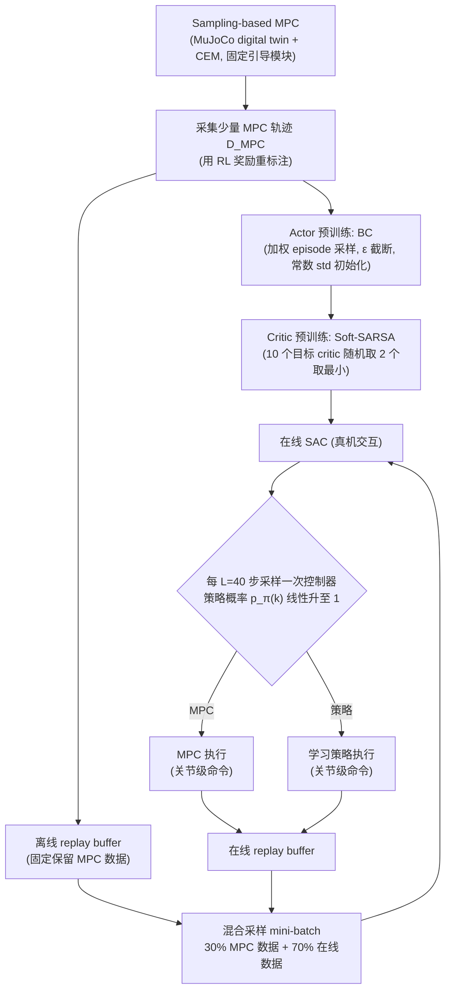

# MPC 脚手架灵巧 RL（arXiv:2609.14878）

**MPC 脚手架灵巧 RL**（*Real-World Reinforcement Learning with MPC Scaffolding for Dexterous Manipulation*，[arXiv:2609.14878](https://arxiv.org/abs/2609.14878)）来自 [senlanke 具身运控lab 周更盘点](../../sources/blogs/wechat_senlanke_weekly_manipulation_2026-09-14_18.md)（2026-09-14–18）。

## 一句话定义

**Sampling MPC 初始化 buffer 并预训练；在线 SAC 与 MPC 共训，逐渐交权；16-DoF Allegro 手内旋转 7 min 达 5/5，20 min 速度超 MPC 5×、1000 次旋转。**

## 英文缩写速查

| 缩写 | 英文全称 | 简要说明 |
|------|----------|----------|
| MPC | Model Predictive Control | 模型预测控制 |
| SAC | Soft Actor-Critic | 软 actor-critic |
| RL | Reinforcement Learning | 强化学习 |

## 为什么重要

- 真机 dex RL 探索难；MPC scaffolding 提供安全探索与初始化。

## 流程总览

图依据：论文 §II-A 至 §II-D / Fig. 1。

## 核心机制

| 项 | 内容 |
|----|------|
| **arXiv** | [2609.14878](https://arxiv.org/abs/2609.14878) |
| **开源** | **待发布**（步骤 2.5，2026-09-20） |
| **方法摘要** | MPC trajectories init replay + online SAC with gradual handoff from MPC to policy. |

## 源码运行时序图

**不适用**（截至 2026-09-20 未发布可运行官方代码或待核实）。

## 实验与评测

- Allegro in-hand rotation: 5/5 in 7 min online; 1000 rotations / 110+ min（作者报告）。
- 读法：先对齐任务设定、传感器与成功定义，再解读 headline 数字。

## 与其他工作对比

| 维度 | 读法 |
|------|------|
| **同周对照** | 见对应 [周更盘点](../../sources/blogs/wechat_senlanke_weekly_manipulation_2026-09-14_18.md) 映射表，勿跨任务直接比 SR |
| **开源状态** | **待发布** — 部署前以项目页/arXiv 为准 |

## 结论

**MPC scaffolding 使无示范真机 dex RL 在分钟级达到超 MPC 吞吐。**

1. 开源：**待发布**；勿凭公众号摘要臆断可复现性。
2. 指标须连同实验条件解读（仿真/真机、平台、成功阈值）。
3. 关注 arXiv 版本更新与代码发布。

## 关联页面

- [reinforcement-learning](../methods/reinforcement-learning.md)
- [manipulation](../tasks/manipulation.md)
- [model-predictive-control](../methods/model-predictive-control.md)

## 参考来源

- [mpc-scaffolding-dex-rl_arxiv_2609_14878.md](../../sources/papers/mpc-scaffolding-dex-rl_arxiv_2609_14878.md)
- [wechat_senlanke_weekly_manipulation_2026-09-14_18.md](../../sources/blogs/wechat_senlanke_weekly_manipulation_2026-09-14_18.md)
- [arXiv:2609.14878](https://arxiv.org/abs/2609.14878)
- [arXiv PDF](https://arxiv.org/pdf/2609.14878)：已通读方法部分（实验与附录以略读为准）：§II Method（A 概述、B 离线 MPC 数据与预训练、C 混合 replay 在线 SAC、D MPC-策略调度）

## 推荐继续阅读

- [arXiv PDF](https://arxiv.org/pdf/2609.14878)
