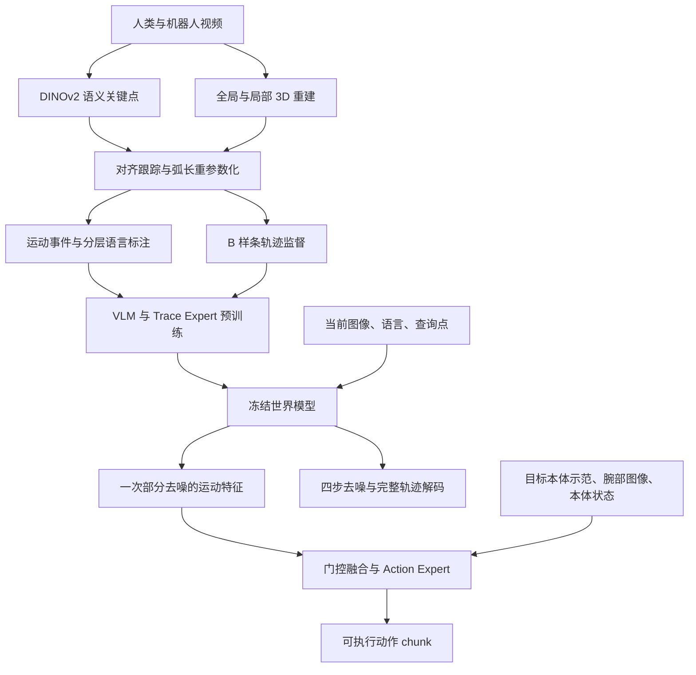
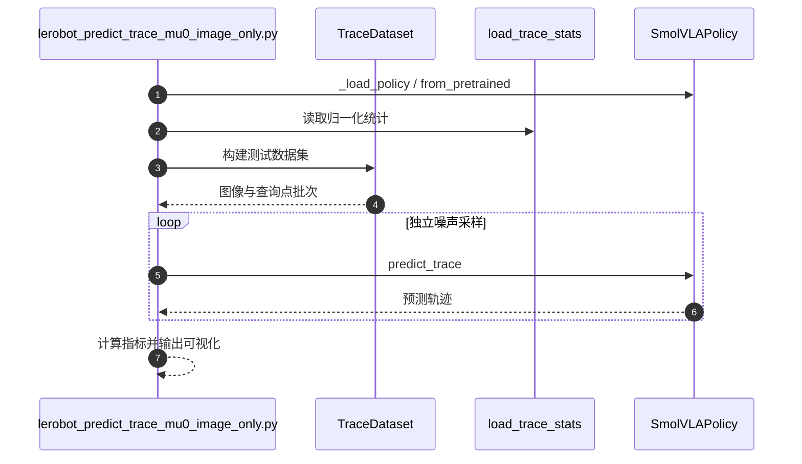

# μ₀: A Scalable 3D Interaction-Trace World Model（可扩展的三维交互轨迹世界模型）

**μ₀: A Scalable 3D Interaction-Trace World Model**（[arXiv:2606.13769](https://arxiv.org/abs/2606.13769)，[项目页](https://mu0-wm.github.io/)，[代码](https://github.com/Yoonkyo/mu0)，**IROS 2026 RoboWoMo Workshop 最佳论文**）由 **马里兰大学、首尔大学** 等提出：世界模型 **不预测稠密像素、也不直接回归具身动作**，而是预测 **关键交互点的 3D 轨迹**（物体/工具/手/接触区），用 **B 样条控制点 + 流匹配** 表示未来运动；**TraceExtract** 从人类/机器人视频自动构建 3D 监督。

## 一句话定义

**用 3D 交互轨迹当中间语言：上游 WM 只吃视频就能学物理变化，下游动作专家使用冻结 μ₀ 的运动特征，并通过目标本体的动作监督学习控制。**

## 英文缩写速查

| 缩写 | 英文全称 | 简要说明 |
|------|----------|----------|
| WM | World Model | 世界/动力学预测模型 |
| VLA | Vision-Language-Action | 视觉–语言–动作策略 |
| HOI | Hand–Object Interaction | 手–物交互区域 |
| WS | Workshop | RoboWoMo 研讨会 |

## 为什么重要

- 纳入 [IROS 2026 九篇获奖盘点](../../sources/blogs/wechat_iros_2026_awards_9_papers_2026-10-02.md)。
- 与像素 WM、action-labeled VLA 对照：**action-free 预训练** 仍报告与 **π₀** 等 **action 监督 VLA** 竞争的性能（论文主张）。
- **开源结论（2026-11-24）：已公开**模型训练、轨迹评测、RoboCasa 策略与独立 TraceExtract 工具及权重；尚未核实完整预训练语料及 UR3 真机部署入口。

## 核心信息

| 项目 | 内容 |
|---|---|
| 机构 | 马里兰大学学院公园分校、首尔大学 |
| 版本 | arXiv v3（2026-10-20），CoRL 2026 |
| 原文 | [HTML v3](https://arxiv.org/html/2606.13769v3) · [PDF v3](https://arxiv.org/pdf/2606.13769v3) |
| 代码 | [μ₀](https://github.com/Yoonkyo/mu0) · [TraceExtract](https://github.com/Yoonkyo/TraceExtract) |

## 核心机制

- **数据（§2、附录 A）：** 以 DINOv2 的实体簇分配关键点，兼顾小物体；全局稀疏锚点与局部密集重建对齐后进行 3D 跟踪，转换到参考相机系，按弧长重参数化；按加速度峰谷切分运动事件，生成细粒度与合并后的语言描述。
- **模型（§3、附录 B）：** SmolVLM2-2.2B 提供语义上下文，可选深度通道使用独立 patch stem；Trace Expert 对可变、无序查询点共享处理，融合局部 DINO 特征、位置及历史。以 10 个三次 B 样条控制点表达 32 步未来，预测相对当前锚点的位移。
- **训练：** 条件流匹配速度场损失 + 轨迹有效性预测损失 + 同簇局部几何刚性损失；完整轨迹推理用四步 Euler 去噪后解码样条。
- **动作适配：** 冻结 VLM 与 Trace Expert，只训练动作专家。一次部分去噪的隐藏特征通过可学习门控交叉注意力注入 VLM，动作去噪器结合腕部图像、本体状态及语言输出动作 chunk；不必先解码完整轨迹或通过 IK 重放。

## 流程总览

## 源码运行时序图

基于官方评测文档及 `src/lerobot/scripts/lerobot_predict_trace_mu0_image_only.py` 的实际调用；这里展示可核对的轨迹评测入口，不把论文架构当作真机运行代码。

最小复现使用 dataset keypoints、无深度、无历史；完整图像模式可合成深度和关键点，但无对应真值时不报告轨迹指标。RoboCasa 另有 `train_policy_mu0_atomic8.sh` 与 `eval_policy_mu0_atomic8.sh`，后者调用 `lerobot_eval_policy_mu0.py` 并在仿真环境执行 `env.step(action)`。详见[官方入口归档](../../sources/repos/mu0.md)。

## 实验与评测

| 实验 | 结果与协议 |
|---|---|
| 轨迹预测（§4.1、D.2） | 129 个未见来源样本，每个 16 查询点；只对移动点计算 ADE、FDE、DTW，另报 Fréchet 距离。 |
| RoboCasa365（表 2、D.5） | 8 任务各 100 条示范；平均成功率：Diffusion Policy 22.75%、π₀ 25.25%、π₀.₅ 42%、TraceGen 23%、μ₀ 30.25%。预训练数据不等量。 |
| 真实机器人（D.7） | UR3 双指夹爪，抓放、倾倒、展毛巾；7 维动作，预测 50 步、执行 25 步。不能外推至任意机器人零样本控制。 |
| 样条消融（表 9） | T=32 的 top5-DTW：完整 0.223；直接预测原始轨迹 0.258。 |
| 动作融合消融（表 10） | 部分去噪特征 30.25%；完整解码轨迹 29.5%；固定门控 0.5 / 0.25 分别 26% / 25%。 |
| 动作头缩放（表 12） | 200M 动作头：无 Trace 10.625%、有 Trace 25.625%；400M：28.25% / 30.25%。 |

## 局限与风险

- 自动重建、跟踪、语义聚类、语言标注会带来监督噪声；轨迹并不直接表示力、触觉或接触模式。
- 跨本体共享的是运动先验，而非统一的低层执行器接口。当前真实机器人评估集中于桌面操作；灵巧手、长程操作和更多本体仍待验证。
- 发布脚本的 atomic8 默认 60k steps 与论文附录 D.5 的 50k steps 不同，复现时须区分发布配置与论文协议。

## 与其他工作对比

| 路线 | 预测/监督目标 | 与 μ₀ 差异 |
|------|---------------|------------|
| **像素 [生成式世界模型](../methods/generative-world-models.md)** | 稠密未来帧 | μ₀ 只预测关键交互点 3D 轨迹，目标更紧凑、与具身无关 |
| **action-labeled [VLA](../methods/vla.md)**（如 [π₀](./paper-pi0.md)） | 具身动作 | 需动作标注数据；μ₀ action-free 预训练，论文主张下游可与之竞争 |
| **trace 专用模型 / tokenized VLM** | 2D/3D trace | 论文表格中的 trace 预测基线 |
| **[HumanEgo](./paper-sa-2605-24934-humanego-zero-shot-robot-learning-from-minutes-o.md)**（同盘点） | 人类 ego 视频 → 直接策略 | μ₀ 走轨迹 WM → 动作专家再接地 |

## 结论

**μ₀ 把 world model 目标从像素换成 3D 轨迹，是跨具身数据缩放的一条中间路线** — TraceExtract 质量决定上限。

1. **已公开** 独立 TraceExtract 与主模型仓库，先按官方文档验证数据、权重和评测配置。
2. **冻结 WM + 动作专家** 便于换机器人，但动作专家仍要 **具身数据或 sim**。
3. 与 **HumanEgo**（同盘点）对照：HumanEgo 走 **人类 ego → 直接策略**；μ₀ 走 **轨迹 WM → 再接地**。
4. 部署时关注 **关键点跟踪误差** 在接触阶段的累积。

## 关联页面

- [WAM 纵深路线](../../roadmap/depth-wam.md)
- [VLA](../methods/vla.md)

- [IROS 2026 九篇获奖地图](../overview/iros-2026-awards-9-papers-technology-map.md)
- [Generative World Models](../methods/generative-world-models.md)
- [HumanEgo](./paper-sa-2605-24934-humanego-zero-shot-robot-learning-from-minutes-o.md)

## 参考来源

- [官方项目页归档](../../sources/sites/mu0-wm.md)
- [TraceExtract 源码归档](../../sources/repos/traceextract-mu0.md)

- [IROS 2026 九篇获奖盘点（公众号）](../../sources/blogs/wechat_iros_2026_awards_9_papers_2026-10-02.md)
- [μ₀ sources 归档](../../sources/papers/mu0_wm_arxiv_2606_13769.md)
- [mu0 仓库归档](../../sources/repos/mu0.md)

## 推荐继续阅读

- GitHub：<https://github.com/Yoonkyo/mu0>
