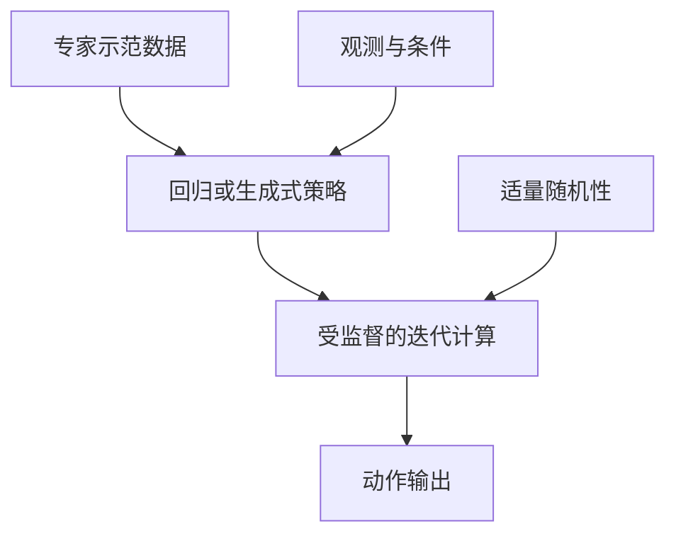
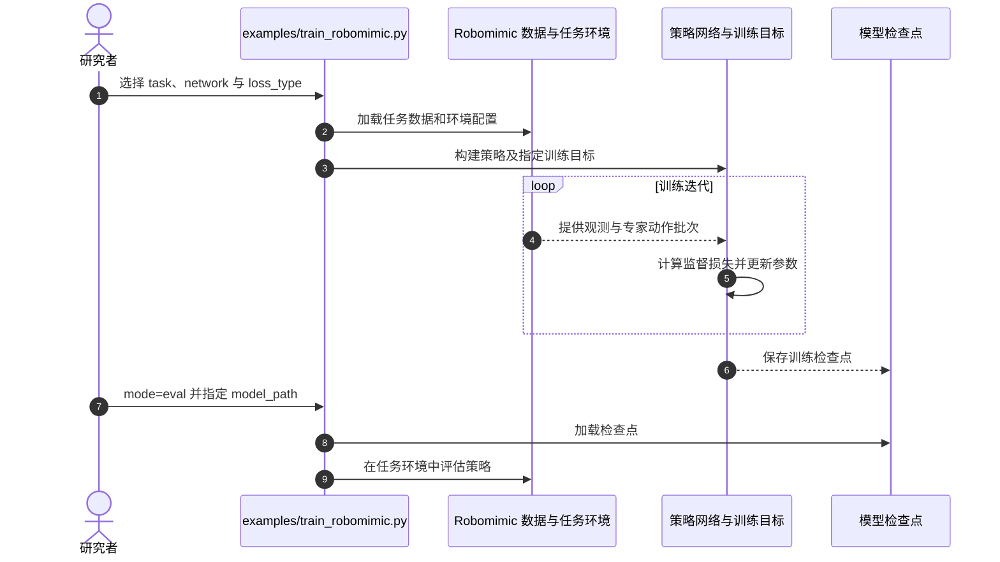

# 生成式机器人控制的关键：迭代计算，而非“加噪”本身

**一句话定义：** 这项 ICLR 2026 研究通过受控行为克隆基准发现，flow / diffusion 策略的主要性能来源是受监督的迭代计算与适量随机性，而非多模态动作分布或额外表达能力。

## 英文缩写速查

| 缩写 | 英文全称 | 简要说明 |
|------|----------|----------|
| GCP | Generative Control Policy | 论文比较的 flow、diffusion 等生成式机器人控制策略 |
| BC | Behavior Cloning | 从专家示范监督学习观测到动作映射的训练范式 |
| MIP | Minimal Iterative Policy | 两步回归式迭代策略，用于隔离迭代计算的收益 |
| RCP | Regression Control Policy | 与生成式策略对照的回归控制策略 |
| VLA | Vision-Language-Action | 实验涉及的预训练视觉-语言-动作策略场景 |

## 为什么重要

flow / diffusion 已成为机器人模仿学习的常见动作生成方法，但“生成分布更灵活”是否就是性能提升的原因并不明确。本文通过控制网络结构、训练监督和随机性等变量，尝试分解真正带来控制收益的因素。工程上可先比较迭代次数、监督位置与随机性，而不必默认采用完整的生成式采样流程。

## 核心方法

论文在行为克隆基准上比较回归控制与生成式控制策略，并系统改变目标函数、模型结构、噪声注入、迭代计算和中间步骤监督。关键区别：

- **多模态拟合：** 生成式策略可表达复杂动作分布，但论文发现这不足以解释其整体优势。
- **策略表达能力：** 对齐网络与训练设置后，回归策略在多数任务上可与 flow 相当；flow 的收益集中在部分高精度任务。
- **迭代计算：** 多个中间步骤逐步修正动作；只有中间步骤也得到训练监督时，这种计算才稳定转化为性能。
- **随机性：** 噪声提供对专家数据流形的覆盖；其效果取决于是否与迭代监督配合，噪声本身不是充分条件。
- **MIP：** 两步回归策略保留逐步改进机制，是检验迭代计算贡献的轻量基线。

## 源码运行时序图

官方 README 展示 Robomimic、Kitchen 与 PushT 训练入口，以及通过检查点评估的示例。上图对应仿真训练 / 评估路径，不表示仓库提供真机部署流程。

## 工程实践

| 工程问题 | 读法 |
|----------|------|
| 选回归还是 flow | 多数任务先对齐架构和训练细节做回归基线；高精度任务再评估 flow 的额外收益 |
| 迭代次数 | 同时报告推理前向次数与闭环成功率，检验多步计算是否值得延迟成本 |
| 中间监督 | 采用多步策略时监督中间步骤，单纯增加推理步骤不能保证收益 |
| 噪声注入 | 将随机性和训练监督联合调参，并测试分布外观测下的恢复表现 |
| MIP | 作为低成本消融，判断收益来自多步计算还是特定生成式目标 |
| 开源与复现 | **代码、数据及 checkpoints 有公开入口**；整理后的代码与依赖可能无法逐数复现论文原结果 |

## 实验与评测

项目页报告论文在 28 个任务及多类观测输入上的评测，涵盖状态、图像、点云、语言条件与预训练 VLA 场景。核心实证结论：

- 对齐架构与训练设置后，回归策略在多数任务可匹配 flow；flow 在高精度任务更有优势。
- 受监督迭代计算配合适量噪声，是生成式控制策略表现的关键组成。
- 两步 MIP 基本匹配 flow 策略，支持“迭代计算是主要收益来源”的解释。
- 随机性和迭代监督有助于策略在分布外观测下贴近专家数据流形。

本页不摘录未在官方摘要 / 项目页中逐项核实的成功率数字。

## 与其他工作对比

| 工作 | 研究问题 | 与本文的关系 |
|------|----------|--------------|
| [When Do Discrete Actions Make Good Continuous Controllers?](paper-discrete-actions-continuous-control.md) | 离散动作头能否匹配连续动作头 | 同属 LeCAR Lab 的 “Robot Learning Science” 主题；本文考察生成式控制的收益来源，另一篇比较离散与连续动作表示 |
| [Diffusion Policy](../methods/diffusion-policy.md) | 如何通过扩散式去噪生成动作 | 本文从控制效果角度拆解生成式策略收益机制 |
| [Flow Matching 具身策略](../concepts/flow-matching-embodied-policy.md) | 如何用连续流生成动作 | 本文强调迭代监督而非分布拟合本身 |

## 结论

**生成式控制策略的有效成分主要是被训练监督的多步计算，并由适当随机性辅助；噪声或复杂分布建模单独都不足以解释收益。**

1. **先对齐再比较：** 回归与 flow 的对比必须控制网络结构和训练流程，否则差异无法归因。
2. **多步计算需要训练信号：** 迭代推理只有在中间步骤有监督时，才更可能转化为控制性能。
3. **把 MIP 纳入基线：** 两步回归策略能检验性能来自迭代机制还是生成式目标。
4. **按任务判断 flow 价值：** 多数任务中回归可能够用；高精度任务需要实测 flow 的收益。
5. **联合调噪声与监督：** 用分布外观测评估恢复表现，避免只看离线拟合误差。

## 局限与风险

- **结论受评测范围约束：** 论文主要是行为克隆基准实验，不能直接推出所有在线强化学习、长时域或真机任务都适用相同结论。
- **迭代带来计算代价：** 多步策略增加前向计算；比较时应同步报告延迟和闭环指标。
- **MIP 不是通用替代：** 两步回归结果说明迭代机制值得研究，不表示所有任务都无需 flow / diffusion。
- **复现数值可能有差异：** 官方仓库说明整理后的代码与依赖迁移后，结果不保证逐项重现论文数字。

## 关联页面

- [离散动作何时能成为好的连续控制器](paper-discrete-actions-continuous-control.md) — 同一 “Robot Learning Science” 主题中的第二篇研究
- [Behavior Cloning](../methods/behavior-cloning.md) — 论文使用的监督策略学习范式
- [Diffusion Policy](../methods/diffusion-policy.md) — 生成式控制的典型方法
- [Flow Matching 具身策略](../concepts/flow-matching-embodied-policy.md) — 连续 flow 的方法背景
- [Diffusion Model](../concepts/diffusion-model.md) — 迭代去噪与生成建模基础

## 参考来源

- [论文摘录](../../sources/papers/much_ado_about_noising_arxiv_2512_01809.md)
- [官方项目页归档](../../sources/sites/much-ado-about-noising-project.md)
- [官方代码仓库归档](../../sources/repos/much-ado-about-noising.md)
- [arXiv:2512.01809](https://arxiv.org/abs/2512.01809)
- [ICLR 2026 论文页](https://proceedings.iclr.cc/paper_files/paper/2026/hash/9299ca9ed58731945e934adb5b71728c-Abstract-Conference.html)

## 推荐继续阅读

- [官方项目页](https://simchowitzlabpublic.github.io/much-ado-about-noising-project/) — 浏览实验可视化、论文、数据与模型入口
- [官方仓库 README](https://github.com/simchowitzlabpublic/much-ado-about-noising) — 查看训练、评估和环境配置
- [arXiv HTML](https://arxiv.org/html/2512.01809) — 阅读完整论文与附录
