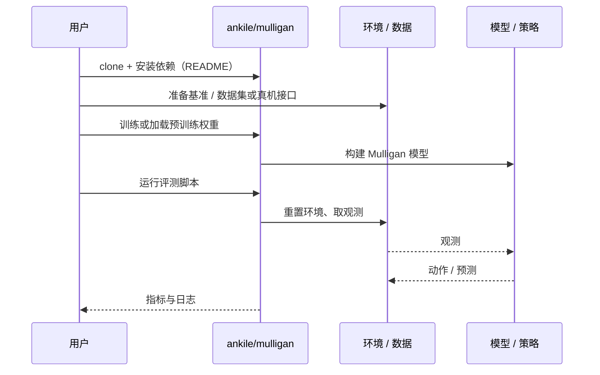

# Mulligan（arXiv:2610.05882）

**Mulligan**（*Mulligan: Performance-Guided Data Collection for Efficient On-Robot Learning*，[arXiv:2610.05882](https://arxiv.org/abs/2610.05882)，[项目页](https://mulligan.page/)，[代码](https://github.com/ankile/mulligan)）来自 [具身智能小站 2026-10-13 盘点](../../sources/blogs/wechat_embodied_station_34_papers_mulligan_2026-10-13.md)，属「强化学习与数据采集」组。

## 一句话定义

**先评测再采集：优先重试失败起点、补足未探索状态，策略用成功人类片段训练、价值函数利用全部交互。**

## 英文缩写速查

| 缩写 | 英文全称 | 简要说明 |
|------|----------|----------|
| HiL | Human-in-the-Loop | 人在回路 |
| IDQL | Implicit Diffusion Q-Learning | 离线 RL 算法 |
| HG-DAgger | Human-Gated DAgger | 人工门控数据聚合 |

## 为什么重要

- 真机策略越熟练，均匀采集越重复已掌握状态；采集起点是部署后学习的可优化变量。
- 开源结论：**已开源**（步骤 2.5，2026-10-14）。仓库可达。
- 同期同组工作见 [失败导向采集与可组合世界动作模型：具身智能小站 10-13 期 34 篇阅读坐标](../overview/embodied-station-2026-10-13-34-papers-technology-map.md)。

## 核心机制

| 项 | 内容 |
|----|------|
| **arXiv** | [2610.05882](https://arxiv.org/abs/2610.05882) |
| **开源** | **已开源** |
| **要点** | 采集预算、初始状态范围与人工介入条件需同时控制；与价值重排序分开检验。 |
| **文内指标** | 最终轮插笔任务 HiL-IDQL+Mulligan 38/50 vs 均匀 HG-DAgger 21/50；三项真机任务共 2,550 次留出盲测（公众号转述）。 |

## 源码运行时序图

以下为按仓库入口（`ankile/mulligan`）推断的通用运行链路；入库日仅核实仓库可达，未逐文件阅读，具体脚本名以 README 为准。

## 实验与评测

- 最终轮插笔任务 HiL-IDQL+Mulligan 38/50 vs 均匀 HG-DAgger 21/50；三项真机任务共 2,550 次留出盲测（公众号转述）。
- **读法：** 本页为索引级摘要，依据公众号转述的官方摘要与仓库信息整理；逐项数字与 baseline 以原文 PDF 为准。

## 与其他工作对比

- 横向索引见 [失败导向采集与可组合世界动作模型：具身智能小站 10-13 期 34 篇阅读坐标](../overview/embodied-station-2026-10-13-34-papers-technology-map.md)；同 arXiv 不重复造页。

## 结论

**把采集预算花在失败起点上，比扩大均匀采集更划算；失败轨迹对价值函数仍有用。**

1. 开源边界：**已开源** — 仓库可达。
2. 核心机制：采集预算、初始状态范围与人工介入条件需同时控制；与价值重排序分开检验。
3. 复现与选型前核对任务协议、硬件与基准口径，勿直接横比公众号摘录数字。

## 关联页面

- [dagger](../methods/dagger.md)
- [safe-real-world-rl-fine-tuning](../concepts/safe-real-world-rl-fine-tuning.md)
- [data-flywheel](../concepts/data-flywheel.md)
- [reinforcement-learning](../methods/reinforcement-learning.md)
- [embodied-station-2026-10-13-34-papers-technology-map](../overview/embodied-station-2026-10-13-34-papers-technology-map.md)

## 参考来源

- [mulligan_performance_guided_data_collection_arxiv_2610_05882.md](../../sources/papers/mulligan_performance_guided_data_collection_arxiv_2610_05882.md)
- [wechat_embodied_station_34_papers_mulligan_2026-10-13.md](../../sources/blogs/wechat_embodied_station_34_papers_mulligan_2026-10-13.md)
- [arXiv:2610.05882](https://arxiv.org/abs/2610.05882)

## 推荐继续阅读

- [arXiv PDF](https://arxiv.org/pdf/2610.05882)
- [项目页](https://mulligan.page/)
- [https://github.com/ankile/mulligan](https://github.com/ankile/mulligan)
