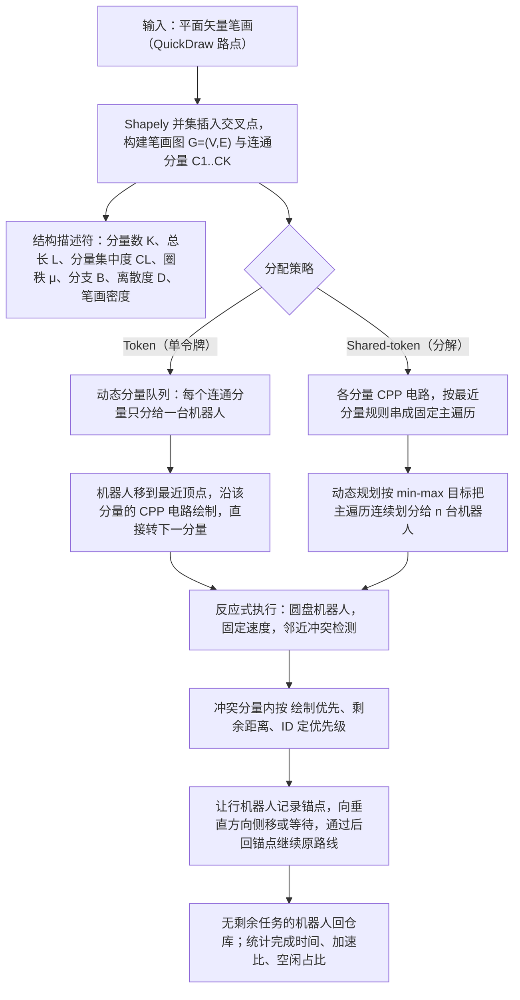

# Multi-Robot Authoring（arXiv:2610.22670）

**Multi-Robot Authoring**（*Task Structure and Scalability in Multi-Robot Authoring*，[arXiv:2610.22670](https://arxiv.org/abs/2610.22670)，[项目页](https://sites.google.com/view/multirobotauthoring/home)）来自 [具身智能小站 2026-11-01 盘点](../../sources/blogs/wechat_embodied_station_56_papers_libero_dynamic_latency_eval_2026-11-01.md)，属「感知、规划与系统」组。

## 一句话定义

**把图画表示成笔画图，比较整块分配与块内拆分的多机器人执行；仿真显示收益取决于图结构和路由，速度提升并不随机器人数线性增长。**

## 英文缩写速查

| 缩写 | 英文全称 | 简要说明 |
|------|----------|----------|
| Multi-Robot Authoring | Task Structure and Scalability in Multi-Robot Authoring | 本文方法 / 基准的简称 |

## 为什么重要

- 多加机器人，不一定让协作绘图更快。
- 开源结论：**项目页未列 GitHub**（步骤 2.5，2026-11-01）。项目页 HTTP 200，未见 GitHub 链接或 coming soon 字样。
- 同期同组工作见 [动态评测、技能编译与环境潜变量适配：具身智能小站 11-01 期 56 篇阅读坐标](../overview/embodied-station-2026-11-01-56-papers-technology-map.md)。

## 流程总览

图依据：论文 §III-A 至 §III-D / Fig.2、Algorithm 1–2。

## 核心机制

| 项 | 内容 |
|----|------|
| **arXiv** | [2610.22670](https://arxiv.org/abs/2610.22670) |
| **开源** | **项目页未列 GitHub** |
| **要点** | 把图画表示成笔画图，比较整块分配与块内拆分的多机器人执行；仿真显示收益取决于图结构和路由，速度提升并不随机器人数线性增长。 |
| **文内指标** | 公众号未给具体数字，本页不引用。 |

## 源码运行时序图

**不适用（项目页未列 GitHub）** — 项目页 HTTP 200，未见 GitHub 链接或 coming soon 字样。 不编造运行脚本；代码公开后再补。

## 实验与评测

- 公众号未给具体数字，本页不引用。
- **读法：** 本页为索引级摘要，依据公众号转述的官方摘要与仓库信息整理；逐项数字与 baseline 以原文 PDF 为准。

## 与其他工作对比

- 横向索引见 [动态评测、技能编译与环境潜变量适配：具身智能小站 11-01 期 56 篇阅读坐标](../overview/embodied-station-2026-11-01-56-papers-technology-map.md)；同 arXiv 不重复造页。

## 结论

**多加机器人，不一定让协作绘图更快：把图画表示成笔画图，比较整块分配与块内拆分的多机器人执行；仿真显示收益取决于图结构和路由，速度提升并不随机器人数线性增长。**

1. 开源边界：**项目页未列 GitHub** — 项目页 HTTP 200，未见 GitHub 链接或 coming soon 字样。
2. 核心机制：把图画表示成笔画图，比较整块分配与块内拆分的多机器人执行；仿真显示收益取决于图结构和路由，速度提升并不随机器人数线性增长。
3. 复现与选型前核对任务协议、硬件与基准口径，勿直接横比公众号摘录数字。

## 关联页面

- [manipulation](../tasks/manipulation.md)
- [locomotion](../tasks/locomotion.md)
- [sim2real](../concepts/sim2real.md)
- [embodied-station-2026-11-01-56-papers-technology-map](../overview/embodied-station-2026-11-01-56-papers-technology-map.md)

## 参考来源

- [multi_robot_authoring_arxiv_2610_22670.md](../../sources/papers/multi_robot_authoring_arxiv_2610_22670.md)
- [wechat_embodied_station_56_papers_libero_dynamic_latency_eval_2026-11-01.md](../../sources/blogs/wechat_embodied_station_56_papers_libero_dynamic_latency_eval_2026-11-01.md)
- [arXiv:2610.22670](https://arxiv.org/abs/2610.22670)
- [arXiv PDF](https://arxiv.org/pdf/2610.22670)：已通读方法部分（实验与附录以略读为准）：笔画图表示、Token 与 Shared-token 分配、反应式让行（§III、§IV）

## 推荐继续阅读

- [arXiv PDF](https://arxiv.org/pdf/2610.22670)
- [项目页](https://sites.google.com/view/multirobotauthoring/home)
