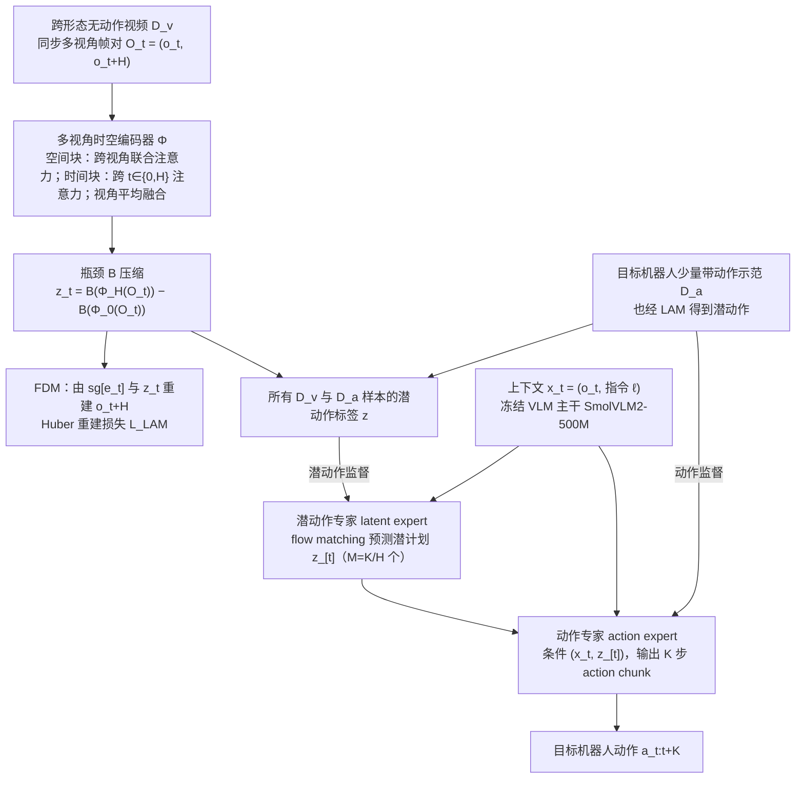

# Multi-View LAPA：面向跨本体机器人视频学习的多视角潜在动作预训练

**Multi-View LAPA**（*Multi-View Latent Action Pretraining for Cross-Embodiment Robot Learning from Videos*，[arXiv:2610.27794](https://arxiv.org/abs/2610.27794)）收录于 senlanke「具身运控lab」10-19–10-23 前沿论文动态（Manipulation）。本页补充论文正文文本中的方法与实验；由于原 PDF 及附录未能完整获取，图表与实验细节仍需对照原文复核。

## 一句话定义

**Multi-View LAPA：面向跨本体机器人视频学习的多视角潜在动作预训练——研究通过多视角视频学习潜在动作表示，使模型能够利用不同视角的运动信息进行预训练，并将学到的动作表示用于跨机器人本体学习。**

## 英文缩写速查

| 缩写 | 英文全称 | 简要说明 |
|------|----------|----------|
| VLA | Vision-Language-Action | 视觉–语言–动作模型 |
| IL | Imitation Learning | 模仿学习 |

## 为什么重要

- 周报所述待解决的问题：不同机器人动作空间不一致，而视频通常不包含可直接使用的机器人控制标签。单一视角还可能无法完整观察操作运动。

## 流程总览

图依据：论文 §III-A / §III-B / §III-C 与 Fig. 1。

## 核心机制

| 项 | 内容 |
|----|------|
| **arXiv** | [2610.27794](https://arxiv.org/abs/2610.27794) · [PDF](https://arxiv.org/pdf/2610.27794) |
| **作者（arXiv）** | Oliver Hausdörfer, Felix Minzenmay, Mani Majd, Maximilian P. Christof, Shiyuan Zhang, Angela P. Schoellig |
| **机构（周报所述，未逐条核实）** | 待核实（作者：Oliver Hausdörfer、Felix Minzenmay、Angela P. Schoellig 等）。 |
| **arXiv 评论栏** | Website: this https URL |
| **开源** | arXiv 摘要页/评论给出项目页或外链（https://learnsyslab.github.io/multiview_latent_action_pretraining/）；未发现代码仓库链接（2026-10-26） |
| **周报所述创新点** | 研究通过多视角视频学习潜在动作表示，使模型能够利用不同视角的运动信息进行预训练，并将学到的动作表示用于跨机器人本体学习。 |

### arXiv 摘要节选（英文原文）

> Action-free videos are an appealing substitute for costly teleoperated data. Latent action models (LAMs) turn videos into a supervision signal by inferring abstract actions between frames.

## 源码运行时序图

**不适用**：项目页仓库仅提供页面和补充视频，未见训练或推理实现；截至 2026-11-05 未核实到官方可运行代码。

## 实验与评测

以下为论文正文文本中的结果（arXiv v1；原 PDF 与附录尚未完整核对，待复核）：

| 设置 | 指标及结果 |
|---|---|
| MimicGen、LIBERO、LIBERO-Plus 低动作预算，三基准均值 | 仅动作 42.7%；单视角 48.9%；多视角 56.2%，相对仅动作分别增加 6.2 和 13.5 个百分点 |
| 冻结潜动作的动作探针 | 单视角 R² 0.54，多视角 0.63；主要改善第一相机的出平面运动 |
| TRLC-DK1 真机、人手视频 | 论文报告 850 次 rollout；人类视频相对仅动作平均增加 20 个百分点；多视角 46%，单视角 21% |
| 真机视频与目标机器人的数据 | 五条机器人示范下，有视频 26%→42%，仅动作 6%→23%；人类视频和机器人数据互补 |

策略学习阶段使用一个外部相机及腕部视角；同步多视角用于 LAM 预训练。抓取和精细交互仍受动作监督不足限制，结果依赖任务。

## 与其他工作对比

| 维度 | 读法 |
|------|------|
| **同周对照** | 见 [Manipulation周报技术地图](../overview/senlanke-weekly-2026-10-19-23-manipulation-technology-map.md)，按方向浏览同期论文 |
| **开源状态** | arXiv 摘要页/评论给出项目页或外链（https://learnsyslab.github.io/multiview_latent_action_pretraining/）；未发现代码仓库链接 |

## 结论

**Multi-View LAPA：面向跨本体机器人视频学习的多视角潜在动作预训练。**

1. 本页是入库级摘要，复现前请核对论文正文、附录与代码仓库。
2. 指标须连同实验条件解读。
3. 关注 arXiv 版本更新与代码发布。

## 关联页面

- [senlanke-weekly-2026-10-19-23-manipulation-technology-map](../overview/senlanke-weekly-2026-10-19-23-manipulation-technology-map.md)
- [manipulation](../tasks/manipulation.md)
- [vla](../methods/vla.md)

## 参考来源

- [项目页核查](../../sources/sites/multi-view-latent-action-pretraining.md)

- [multi-view-latent-action-pretraining-cross-embodiment_arxiv_2610_27794.md](../../sources/papers/multi-view-latent-action-pretraining-cross-embodiment_arxiv_2610_27794.md)
- [wechat_senlanke_weekly_manipulation_2026-10-19_23.md](../../sources/blogs/wechat_senlanke_weekly_manipulation_2026-10-19_23.md)
- [arXiv:2610.27794](https://arxiv.org/abs/2610.27794)
- [arXiv PDF](https://arxiv.org/pdf/2610.27794)：已通读方法部分（实验与附录以略读为准）：§III 方法（LAM、多视角融合、潜动作增强策略）、§IV 实现细节与数据集

## 推荐继续阅读

- [arXiv PDF](https://arxiv.org/pdf/2610.27794)
