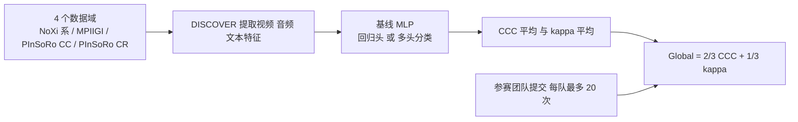

# MultiMediate '26：跨领域、年龄与文化的投入度估计挑战

*Engagement Estimation in Human-Robot and Human-Human Interactions across Domain, Age and Culture: The MultiMediate '26 Challenge*（[arXiv:2611.09913](https://arxiv.org/abs/2611.09913)，Funk 等，奥格斯堡大学 / INRIA / JAIST / 斯图加特大学 / 马普智能系统所，ACM MM '26）。

**性质说明：** 这是一篇「挑战赛概述」论文，不是提出新机器人算法的论文：内容是任务定义、数据集、特征、基线和参赛结果。机器人只出现在 PInSoRo 的儿童-机器人（CR）游戏数据里，论文没有做机器人控制或强化学习。

## 一句话定义

在已有的成人对话「连续投入度」估计挑战上，新增儿童-儿童与儿童-机器人自由游戏的「任务投入 / 社交投入」类别标注，用 CCC 与 kappa 合成一个总分，评测模型能否跨领域、年龄、文化与标签体系泛化（摘要、§2.1）。

## 英文缩写速查

| 缩写 | 英文全称 | 简要说明 |
|------|----------|----------|
| PInSoRo | Plymouth Interacting Social Robots | 英语儿童-儿童、儿童-机器人自由游戏数据集（§2.2） |
| CC / CR | Child-Child / Child-Robot | PInSoRo 的两种互动子集 |
| NoXi | NOvice eXpert Interaction database | 新手-专家二人对话库，多语言（§2.2） |
| NoXi-J | NoXi 日本扩展 | 日语、汉语对话（§2.2） |
| MPIIGI | MPIIGroupInteraction | 德语小组互动数据集（§2.2） |
| CCC | Concordance Correlation Coefficient | 一致性相关系数，连续标签指标，范围 -1 到 +1 |
| kappa | Cohen's kappa | 类别标签一致性指标，范围 -1 到 +1 |
| MLP | Multi-Layer Perceptron | 基线网络：3 层 ReLU 隐藏层 |
| DISCOVER | 行为分析特征提取管线 | 用于提取音频与视觉特征（§3） |
| SEST | Semantic-Enhanced Sparse Temporal | 冠军 HFUT-LMC 的框架，用多模态 LLM（§5.2） |

## 为什么重要

- **作者自述：** 以往挑战只覆盖成人、且每个时刻一个投入度数值；PInSoRo 的儿童自由游戏不是对话、常常很少说话，标注也是类别而非连续值（§1）。
- **作者自述：** 参赛方法在 NoXi 上只比去年冠军提高 0.03，「进展似乎趋于平台」，而新类别任务表现差异很大、提升空间大（§5.2）。
- **笔者判断：** 对做社交机器人或陪伴机器人的人，这是少数把「儿童 + 机器人」投入度放进统一评测的公开基准；但基线分数很低（见下文），目前更像「问题还没解决」的证据。

## 核心机制

### 流程总览

### 任务与指标（§2.1）

- 连续标签（NoXi、NoXi-J、NoXi Add.、MPIIGI）用 CCC；PInSoRo 类别标签用 Cohen's kappa。
- 总分 Global = 2/3 · CCC_Avg + 1/3 · kappa_Avg（式 1）。注意：两种指标被线性混合成一个数，权重由组织者设定，论文未论证为何是 2:1（笔者观察）。

### 数据（§2.2，表 1）

- 共 9 种语言：英、法、德、日、汉、印尼、西、意、阿拉伯语（由表 1 语种清点）。
- NoXi Add. 与 MPIIGI 用作域外测试；MPIIGI 没有训练集，只有验证与测试各 6 场。
- PInSoRo：CC 为 20/7/6、CR 为 12/5/6（训练/验证/测试场数），均为英语，平均约 39 分钟。任务投入 4 类，社交投入 5 类（取自 Parten 游戏阶段）。验证/测试集每场至少 2 名标注者，测试只评估标注者全部一致的帧。
- **重定向就绪度：** 不适用——这是人-人 / 儿童-机器人互动的投入度标注（连续值或类别），不含机器人动作轨迹，不能直接作为机器人策略的动作数据；训练输入形式为组织者用 DISCOVER 提取的音频、视觉、文本特征（PInSoRo 不发视频与转写）。

## 基线实验与评测（§3–§5.1，表 2–4）

| 项 | 论文数值 |
|----|----------|
| 回归基线 | eGeMAPS v2 音频特征，CCC_Avg 0.45（NoXi 0.55、NoXi-J 0.31、MPIIGI 0.45、NoXi Add. 0.49） |
| 类别基线 | CC 用 XLM-RoBERTa（社交 0.14、任务 0.16），CR 用 Swin Transformer（社交 0.09、任务 0.24） |
| 类别平均 | kappa_Avg 0.16 |
| 总分 | Global 0.36 |

作者的解释：CR 互动多数是孩子安静地玩，所以文本特征在 CR 上几乎无效（kappa -0.03）（§5.1）。作者也说，所选基线「应视为该架构的上界」，因为每个数据集、每类标签都按测试集挑了最好的特征。

## 参赛结果（§5.2，表 4）

| 团队 | CCC_Avg | kappa_Avg | Global |
|------|---------|-----------|--------|
| HFUT-LMC（冠军） | 0.71 | 0.52 | 0.65 |
| NUDT_LDM-AF | 0.73 | 0.46 | 0.64 |
| mltac | 0.70 | 0.36 | 0.59 |
| USTC_IAT_United | 0.74 | 0.22 | 0.57 |
| 基线 | 0.45 | 0.16 | 0.36 |

13 个参赛组，表中只列已发表论文的团队。冠军在 CC 社交 0.65、CC 任务 0.48、CR 社交 0.46 上最好；CR 任务最好的是 NUDT_LDM-AF（0.58）。

## 结论

**MultiMediate '26 把儿童-儿童、儿童-机器人自由游戏的类别投入度并入原有成人连续投入度挑战，结果显示连续回归接近平台，而类别任务仍远未解决。**

1. 总分 Global = 2/3·CCC_Avg + 1/3·kappa_Avg，连续与类别指标被固定权重混合，应分开看（§2.1）。
2. 基线 Global 0.36（CCC_Avg 0.45、kappa_Avg 0.16），作者称其为该架构的上界（§5.1）。
3. 冠军 HFUT-LMC Global 0.65、kappa_Avg 0.52；NoXi 较去年冠军只提高 0.03（§5.2）。
4. CR 子集以安静玩耍为主，文本特征 kappa 为 -0.03，音频文本信号对儿童-机器人场景不够（§5.1）。

## 与其他工作对比

| 工作 | 形态 | 与本挑战的区别 |
|------|------|----------------|
| [动态多模态 HRI 数据集 U1](./paper-dynamic-multimodal-hri-dataset-u1.md) | Unitree U1 导览实验协议，生理 + 行为 + 自报告，数据尚未发布 | 本挑战已有公开特征与 EvalAI 排行；U1 侧重生理信号与任务复杂度 |
| [人机交互中脸部与身体追踪对比](./paper-sa-2606-03694-face-versus-body-tracking-for-human-robot-intera.md) | 第一人称数据集 + 跟踪管线，减少身份切换 | 解决「跟踪谁」，本挑战解决「对方投入程度」 |
| [Social Humanoid](./paper-social-humanoid.md) | 感知 → 运动表示 → 扩散响应 → G1 全身跟踪 | 有机器人动作闭环；本挑战只做估计，不接决策 |

## 工程实践

- **取数：** 数据集与特征在挑战网站提供；PInSoRo 因隐私只发特征，不发视频与转写（§2.2、§3）。提交走 EvalAI，每队最多 20 次（§2）。
- **训练政策：** 可任意组合训练（单个多头模型、多个模型、域适应），可用外部开源语料，需公开方法（§2）。
- **基线复现：** 基线代码与特征提取代码在 [hcmlab/MultiMediate_26](https://github.com/hcmlab/MultiMediate_26)；本次只静态读了 README 前部，其基线结果表与论文表 2、3 数值一致，未运行代码。
- **笔者建议（推测）：** 若做机器人上的投入度感知，应分开报告连续与类别指标，不要只看 Global；CR 子集上音频文本信号弱，需要视觉或交互上下文特征。

## 局限

**论文自己承认的：**

- 基线为按测试集挑选的最优特征，被作者称为架构上界（§5.1）。
- PInSoRo 视频与转写不公开，外部只能用组织者发布的特征（§3）。
- 回归任务 NoXi 提升仅 0.03，进展趋于平台（§5.2）；类别任务差异大。
- 反馈信号（backchannel）检测只收到 1 份提交，没有改进（§5.2）。

**笔者看到的未验证之处：**

- PInSoRo 全是英语，「跨文化」的证据仍来自 NoXi 系的成人对话，儿童数据并没有跨文化维度（由表 1 判断）。
- CR 测试集只有 6 场，CR 与 CC 的差异是否稳健，论文没有给置信区间或多次运行方差。
- 总分用固定 2:1 混合 CCC 与 kappa，两者数值尺度并不等价（"comparable" 是作者的说法），论文未做敏感性分析。
- 本论文是 6 页概述，冠军方法的细节只有一段转述，未在此核实。
- 与机器人的关系：这里只是「估计」投入度，没有把估计结果接入机器人决策闭环，也没有真机实验。
- 表 4 的总分用未四舍五入分数计算，按表中两位小数手算会有 0.01 量级偏差（如基线 2/3·0.45+1/3·0.16≈0.35，表中为 0.36）。

## 关联页面

- [动态多模态 HRI 数据集 U1](../entities/paper-dynamic-multimodal-hri-dataset-u1.md)
- [人机交互中脸部与身体追踪对比](../entities/paper-sa-2606-03694-face-versus-body-tracking-for-human-robot-intera.md)
- [Social Humanoid：可社交响应的人-人形交互](../entities/paper-social-humanoid.md)
- [分布外泛化](../concepts/out-of-distribution-generalization.md)
- [多模态基础](../concepts/multimodality-basics.md)
- [具身评测基准总览](../overview/hub-embodied-eval-benchmark.md)

## 参考来源

- [sources/papers/multimediate-26-engagement-estimation_arxiv_2611_09913.md](../../sources/papers/multimediate-26-engagement-estimation_arxiv_2611_09913.md)
- [arXiv:2611.09913](https://arxiv.org/abs/2611.09913)
- [挑战赛官网数据页](https://multimediate-challenge.org/Dataset/)
- [基线仓库 hcmlab/MultiMediate_26](https://github.com/hcmlab/MultiMediate_26)

## 继续阅读

- [arXiv PDF](https://arxiv.org/pdf/2611.09913v1)
- 论文引用的 PInSoRo 数据集论文：Lemaignan 等，PLOS ONE 13(10) e0205999，2018
- 论文引用的前一届：MultiMediate'25（Withanage Don 等，ACM MM 2025）
