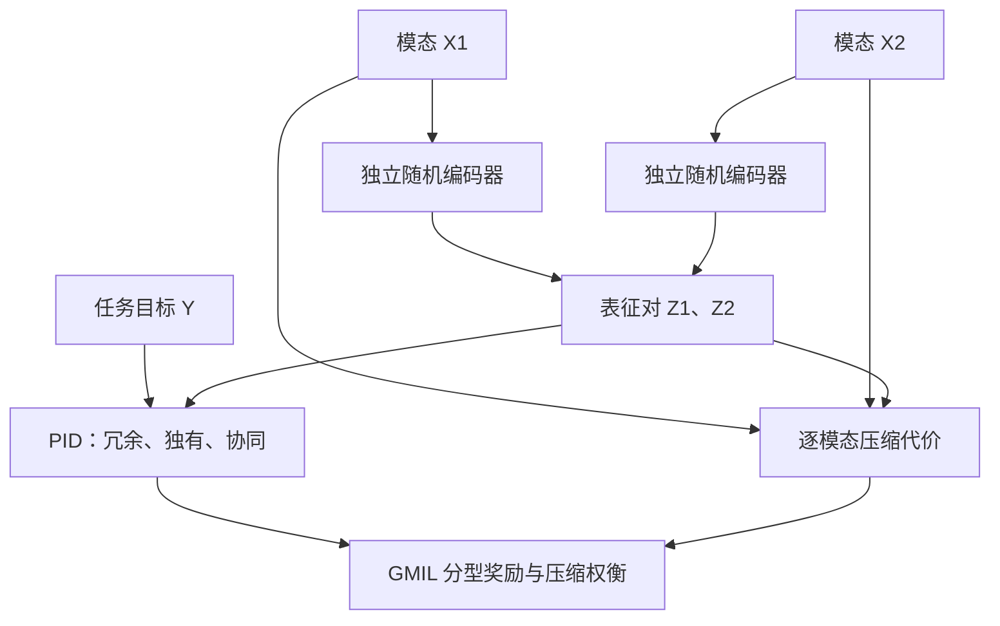

# Dependency, Compression, and Synergy / 依赖、压缩与协同：多模态学习的统一信息论视角

## 一句话定义

用信息论解释多模态模型应该保留多少任务信息，以及这些信息来自重复证据、单模态独有证据还是联合协同。

## 英文缩写速查

| 缩写 | 英文全称 | 简要说明 |
|---|---|---|
| MI | Mutual Information | 变量间统计依赖的总量 |
| IB | Information Bottleneck | 压缩输入与保留任务信息的权衡 |
| PID | Partial Information Decomposition | 将联合预测信息分成冗余、独有和协同 |
| GMIL | Generalized Multimodal Information Lagrangian | 统一压缩代价与分型奖励的目标坐标系 |
| InfoNCE | Information Noise-Contrastive Estimation | 常用于对齐的互信息下界目标 |

## 为什么重要

视觉、触觉与本体感受融合时，仅对齐共有语义可能丢掉单一传感器独有的任务信号。本文提供跨方法的分类依据，帮助区分对齐强度、压缩预算与协同需求；机器人应用是综述证据的一部分。

## 核心信息

| 项目 | 内容 |
|---|---|
| 版本 | arXiv:2609.14421v1，2026-09-13 |
| 机构 | 西南财经大学、北京人形机器人创新中心、中国科学院深圳先进技术研究院、电子科技大学 |
| 材料 | 作者报告的 170 篇近期研究与 12 篇基础工作 |
| 贡献 | 分类综合、GMIL 坐标系与研究空白；没有新增策略或统一基准实验 |

## 核心原理

对两模态 X1、X2 与目标 Y，PID 写成：

$$I(X_1,X_2;Y)=R+U_1+U_2+S.$$

重复提供同一个公平比特是冗余；两个独立公平比特的异或是纯协同：各自无预测能力，合起来才能确定标签。具体原子数值依赖冗余度量，不能把不同估计器的分数直接混比。

对双塔随机编码 Z1、Z2，GMIL 最大化：

$$-\alpha_1 I(X_1;Z_1)-\alpha_2 I(X_2;Z_2)+\beta_R R_Z+\beta_{U_1}U_{1,Z}+\beta_{U_2}U_{2,Z}+\beta_S S_Z.$$

压缩系数非负；分型奖励可以为实数。四类奖励相等时只看总任务信息；偏重协同或独有项则表达不同归纳偏好。无标签对齐通过替换目标近似对应，不能直接把该式等同于 CLIP 损失；单一融合瓶颈也不是双塔瓶颈的原样实例。

### 流程总览

下图是原文 VI 节的分析对象与目标关系，不是论文提供的可运行训练管线。

编码噪声须相互独立且独立于输入与目标，才能得到文中的联合通道分解与总量数据处理界。压缩后四项之和不会增加，不代表每个原子都各自不增。

## 源码运行时序图

**不适用**：截至 2026-11-07，论文摘要页与正文未列该综述的官方可运行实现或独立项目页；本文是综述与目标形式化。被引论文的代码需另行核验。

## 工程实践

以下为依据综述整理的实验设计建议，不是本文验证过的机器人部署方案：先固定任务、数据与骨干，对比单模态、对齐、带压缩融合及交互分型目标；分别测试传感器缺失、噪声、分布变化和任务性能。记录估计器、随机编码假设及预算，并通过移除或干预模态检查模型是否依赖捷径；注意力权重不能替代信息贡献测量。

## 实验与评测

本文没有在相同任务、数据和骨干上直接比较 MI、IB、PID。所列性能来自被引研究，不能当作 GMIL 的新增实验。正文 III 节连接多传感器强化学习与信息瓶颈；V 节讨论预训练模型剪枝、归因和失效诊断，不能直接外推为控制成功率收益。

## 结论

**GMIL 的价值是把选型问题说清楚，最优模型仍需固定条件的实验确定。**

1. 对齐强度不能代替任务信息保留，独有信息多时需专项检查。
2. 压缩预算与信息类型奖励分开消融，避免把架构差异当目标差异。
3. PID 结果须注明度量、估计器和缺失机制。
4. 安全关键传感器失效场景可研究协同抑制，但这是候选方向，不是已验证方案。

## 与其他工作对比

| 视角 | 回答的问题 | 本文指出的边界 |
|---|---|---|
| MI 对齐 | 依赖有多少 | 总量不能区分信息类型 |
| IB 融合 | 压缩后保留多少 | 等权任务奖励看不到原子组成 |
| PID | 保留的是哪类信息 | 高维估计与度量选择影响解释 |
| GMIL | 这些目标如何组织 | 双模态坐标系；部分方法仅近似对应 |

## 局限与风险

- 严格双模态；扩展到更多来源面临冗余格组合复杂度。
- 观测信息分解不自动区分因果信号和数据捷径。
- 未占据区域仅指作者筛选语料内未发现，非不存在性证明；选型表是启发式。
- 图 1 在 HTML 中转换不完整，本文流程按正文 VI 节重绘；补充表 S1/S2 未在该 HTML 展开，不声称已核对。

## 关联页面

- [多模态基础概念](../concepts/multimodality-basics.md)
- [视觉–语言特征融合](../concepts/vision-language-feature-fusion.md)

## 参考来源

- [v1 原文核对归档](../../sources/papers/multimodal_information_theory_arxiv_2609_14421.md)
- [论文全文](https://arxiv.org/html/2609.14421v1)，重点对应 II–VII 节。

## 推荐继续阅读

- [arXiv v1 PDF](https://arxiv.org/pdf/2609.14421v1)
