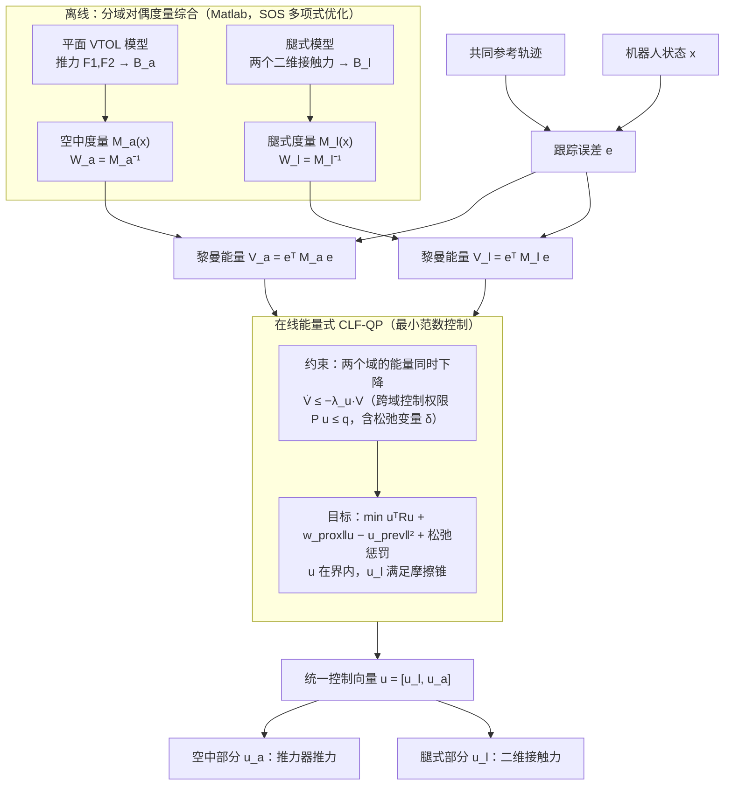

# Legged-Aerial SCCM：基于分离控制收缩度量的多模态四足空地机器人设计与控制

**Legged-Aerial SCCM**（*Design and Control of a Multimodal Legged-Aerial Robot Through Separate Control Contraction Metrics*，[arXiv:2610.27315](https://arxiv.org/abs/2610.27315)）收录于 senlanke「具身运控lab」10-19–10-23 前沿论文动态（人形/四足）。本页依据**周报条目 + arXiv 摘要页**整理，流程图依据论文方法部分（见参考来源），未逐页核对实验数字；指标与结论以论文为准。

## 一句话定义

**Legged-Aerial SCCM：基于分离控制收缩度量的多模态四足空地机器人设计与控制——分别离线求解步行与飞行的控制收缩度量，再通过在线能量型 CLF-QP 统一分配控制；同时研制带四个推进器的四足空地平台并验证推力辅助小跑。**

## 英文缩写速查

| 缩写 | 英文全称 | 简要说明 |
|------|----------|----------|
| RL | Reinforcement Learning | 强化学习 |
| WBC | Whole-Body Control | 全身控制 |

## 为什么重要

- 周报所述待解决的问题：步行和飞行具有不同动力学及控制需求，直接使用统一模型难以兼顾两种模式和推力辅助小跑。

## 流程总览

图依据：论文 §IV-A（域特定对偶度量综合）、§IV-B（黎曼能量 CLF 与 CLF-QP，式 15–19）、Fig. 4。

## 核心机制

| 项 | 内容 |
|----|------|
| **arXiv** | [2610.27315](https://arxiv.org/abs/2610.27315) · [PDF](https://arxiv.org/pdf/2610.27315) |
| **作者（arXiv）** | Kaushik Venkatesh Krishnamurthy, Eric Sihite, Alireza Ramezani, Morteza Gharib |
| **机构（周报所述，未逐条核实）** | 东北大学 Silicon Synapse Lab、加州理工学院 |
| **arXiv 评论栏** | Presented at 2026 IEEE International Conference on Intelligent Robots and Systems, Pittsburgh PA |
| **开源** | arXiv 摘要页与评论未见代码或项目页链接（仅核对 arXiv 摘要页，不代表未发布）（2026-10-26） |
| **周报所述创新点** | 分别离线求解步行与飞行的控制收缩度量，再通过在线能量型 CLF-QP 统一分配控制；同时研制带四个推进器的四足空地平台并验证推力辅助小跑。 |

### arXiv 摘要节选（英文原文）

> The integration of dynamic legged locomotion and aerial mobility offers versatility that is deterred by challenges in payload distribution, actuation, and the contrasting requirements of both domains. In this paper, we present the design and operation of a multimodal quadrupedal aerial-legged robot.

## 源码运行时序图

**不适用**：arXiv 摘要页与评论未见代码或项目页链接（仅核对 arXiv 摘要页，不代表未发布），无可对齐的官方代码流程。

## 实验与评测

- 周报与摘要给出的数字/场景已写入上表「创新点」与摘要节选；其余实验细节、基线与成功率定义请回到论文正文。
- 读法：先对齐任务设定、传感器与成功定义（仿真/真机），再解读 headline 数字，勿跨论文直接比较。

## 与其他工作对比

| 维度 | 读法 |
|------|------|
| **同周对照** | 见 [人形/四足周报技术地图](../overview/senlanke-weekly-2026-10-19-23-humanoid-quadruped-technology-map.md)，按方向浏览同期论文 |
| **开源状态** | arXiv 摘要页与评论未见代码或项目页链接（仅核对 arXiv 摘要页，不代表未发布） |

## 结论

**Legged-Aerial SCCM：基于分离控制收缩度量的多模态四足空地机器人设计与控制。**

1. 本页是入库级摘要，复现前请核对论文正文、附录与代码仓库。
2. 指标须连同实验条件解读。
3. 关注 arXiv 版本更新与代码发布。

## 关联页面

- [senlanke-weekly-2026-10-19-23-humanoid-quadruped-technology-map](../overview/senlanke-weekly-2026-10-19-23-humanoid-quadruped-technology-map.md)
- [locomotion](../tasks/locomotion.md)
- [reinforcement-learning](../methods/reinforcement-learning.md)

## 参考来源

- [multimodal-legged-aerial-robot-sccm_arxiv_2610_27315.md](../../sources/papers/multimodal-legged-aerial-robot-sccm_arxiv_2610_27315.md)
- [wechat_senlanke_weekly_humanoid_quadruped_2026-10-19_23.md](../../sources/blogs/wechat_senlanke_weekly_humanoid_quadruped_2026-10-19_23.md)
- [arXiv:2610.27315](https://arxiv.org/abs/2610.27315)
- [arXiv PDF](https://arxiv.org/pdf/2610.27315)：已通读方法部分（实验与附录以略读为准）：§I–IV（引言、相关工作、设计概述、对比度量/CCM 综合与 CLF-QP），§V 仿真起始部分略读

## 推荐继续阅读

- [arXiv PDF](https://arxiv.org/pdf/2610.27315)
