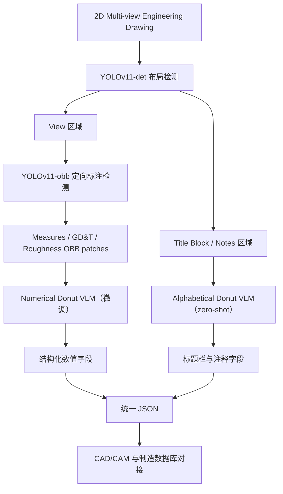

# 多视图工程图纸的三阶段混合解析 | A Multi-Stage Hybrid Framework for Automated Interpretation of Multi-View Engineering Drawings Using Vision Language Model

原文：[Khan et al., arXiv:2510.21862v2](https://arxiv.org/pdf/2510.21862)（2026-01-23）；**机构：新加坡科技研究局 A*STAR SIMTech / ARTC、南洋理工大学（NTU）**。已通读论文十页全文及各图表，未进行代码复现。

## 一句话定义

**该框架按“整页布局检测 → 各视图旋转标注检测 → 文本/数值双模型解析”三阶段，完成多视图机械图纸 PMI（尺寸、GD&T、粗糙度）与标题栏、注释的结构化提取，最后归并为统一 JSON。**

## 英文缩写速查

| 缩写 | 英文全称 | 简要说明 |
|---|---|---|
| PMI | Product and Manufacturing Information | 工程图中的产品制造标注 |
| VLM | Vision-Language Model | 用图像编码与文本解码解析标注 |
| OCR | Optical Character Recognition | 传统字符识别，本文研究目标是绕开独立 OCR 级联 |
| OBB | Oriented Bounding Box | 旋转边界框，定位倾斜尺寸和符号 |
| GD&T | Geometric Dimensioning and Tolerancing | 几何尺寸与公差特征控制框 |
| JSON | JavaScript Object Notation | 最终导出的结构化格式 |
| F1 | Harmonic Mean of Precision and Recall | 文本/数值标注提取综合评价 |

## 为什么重要

- 多视图工程图纸往往同时包含尺寸、公差、标题栏、注释、等轴测图、剖视图，整图单次解析易造成视图交叠与标注混淆。
- 一种模型不一定适合所有字段，尤其制造检验依赖原始符号、单位、基准语义的保真。
- 本文的检测与字段级评测有详细数据，也揭示了上游检测与下游解析不可互相替代。

## 方法与流程总览

依据[原文 Fig.1–3](https://arxiv.org/pdf/2510.21862)，原论文主干模块如下（与工程建议另行区分）：

- **布局检测数据：** 1,000 张图纸；3,498 个 View、458 个 Title Block、1,127 个 Notes 区域。
- **细粒度标注：** 1,406 张图纸；9,663 Measures、3,215 GD&T、**152 Roughness**，长尾失衡明显。
- **模型差异：** Numerical 分支做 30 epoch 微调，训练/验证/测试为 70:20:10；Alphabetical 分支**没有微调，使用 zero-shot**，不是严格对等的字段类型消融实验。
- **结果：** 输出的 JSON 可以为工艺规划/质检数据库提供输入，但论文未证明任意图纸未经人工复核即可自动放行。

## 实验与评测

下表直接核对 [论文 Table 1（第 8 页）](https://arxiv.org/pdf/2510.21862)，不是跨论文拼接结果：

| 分支 | 类别 | Precision | Recall | F1 | Hallucination |
|---|---|---:|---:|---:|---:|
| 文本（zero-shot） | Title Block | 0.522 | 0.545 | 0.533 | 0.478 |
| 文本（zero-shot） | Notes | 0.681 | 1.000 | 0.810 | 0.319 |
| 文本（zero-shot） | Overall | 0.601 | 0.773 | **0.672** | 0.399 |
| 数值（fine-tuned） | Measures | 0.864 | 0.991 | 0.923 | 0.136 |
| 数值（fine-tuned） | GD&T | 0.933 | 1.000 | 0.965 | 0.067 |
| 数值（fine-tuned） | Roughness | 1.000 | 1.000 | 1.000 | 0.000 |
| 数值（fine-tuned） | Overall | 0.932 | 0.997 | **0.963** | 0.067 |

**关键区分：** 根据第 7 页 Fig.4 与 §4.2，Roughness 的上游 **OBB 检测混淆矩阵对角项约 0.54**，而上表解析阶段该类别 F1 1.0。不能将后者解释为端到端“粗糙度 100% 检出且准确”，更不能推断整张检验表可直接免审。

## 与其他工作对比

- [图纸 PMI OCR/VLM 可靠性比较](../comparisons/pdf-engineering-drawing-pmi-ocr-vlm.md) 把本研究与 FaithC4 等文档忠实转录实验并列，但基准/任务不同，禁止直接比排行榜数字。
- [YOLO26 + PP-OCRv6](../methods/yolo26-ocr-document-parsing.md) 是旋转框检测结合 OCR 识别的工程路径，本研究则使用 Donut 输出 JSON；本论文**未在统一 PMI 测试集上充分评测二者的最终检验错误成本**。

## 结论

**这项工作验证“视图先分离、标注按方向定位、再做字段专用解析”的有效性，却尚未建立可直接免审的全流程质检准确率。**

1. **多视图先切分：** 避免全图一次推理时跨视图的标注干扰。
2. **区分不同阶段：** 检测有漏项时，单独的解析 F1 再高也无法恢复遗失的检验项目。
3. **注意训练差异：** Numerical 是微调，Alphabetical 是零样本；F1 不能只归因于数据类型。
4. **警惕稀有类别：** Roughness 152 个 OBB 样本带来明显上游检测短板。
5. **产线验收需另做验证：** 对图号版本、原始位置、基准/单位和异常字段采用可回溯质检记录。

## 源码运行时序图

**不适用：截至本次核对，论文题录及原文未提供可确认的官方可运行源码仓库/入口**。不编造训练脚本名、启动参数或模块运行时序。

## 工程实践

建议在原文 JSON 输出后增加独立校验层，记录 page/view/bbox/raw_text/parsed_value/tolerance/datum/model_version，并对未定位字段、低置信度及关键尺寸引入复核。这是依据论文风险提出的**工程扩展建议**，不是论文已报告的完整系统。

## 局限与风险

- 标题栏与注释字段较弱；文本分支零样本推理，受密集表格、不同企业格式及低清晰图纸影响。
- 粗糙度检测样本稀少、上游准确率偏低；最终抽取效果应覆盖未检测样本。
- 作者讨论的更强文本模型、合成数据增强和 VLM 自检属于未来工作。
- 未核实公开训练集、权重或完整可运行代码，也没有独立现场复现结果。

## 关联页面

- [PDF 图纸 PMI 提取：OCR 与 VLM 可靠性比较](../comparisons/pdf-engineering-drawing-pmi-ocr-vlm.md)
- [YOLO26 + PP-OCRv6 文档 OCR](../methods/yolo26-ocr-document-parsing.md)
- [自动标注流水线](../methods/auto-labeling-pipelines.md)
- [结构公差仿真工具链](../concepts/structure-tolerance-simulation-toolchain.md)

## 参考来源

- [已通读的论文归档](../../sources/papers/multistage_engineering_drawing_vlm_pmi_2510_21862.md)
- [arXiv PDF 全文](https://arxiv.org/pdf/2510.21862)

## 推荐继续阅读

- [前序研究 From Drawings to Decisions](https://arxiv.org/abs/2506.17374)
- [MechVQA 机械图纸理解基准](https://proceedings.mlr.press/v306/kou26c.html)
