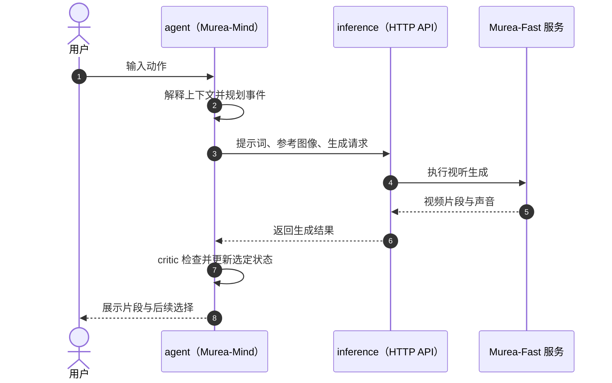

# Murea-InWorld（互动视听世界模型）

**Murea-InWorld** 是 Murea Labs 提出的互动视听世界模型：Agent 维护角色、物体、地点与故事进度，把用户动作转成生成条件，再依据生成片段更新后续计划。

## 英文缩写速查

| 缩写 | 英文全称 | 简要说明 |
|------|----------|----------|
| AV | Audio-Visual | 音视频联合生成与观察 |
| WM | World Model | 根据状态和动作生成后续世界状态或观测的模型 |
| API | Application Programming Interface | Murea-Mind 与 Murea-Fast 之间的 HTTP 服务接口 |
| HF | Hugging Face | Murea-Fast 权重发布平台 |

## 为什么重要

- **显式状态与生成模型分工：** Murea-Mind 记录实体和叙事状态并做计划；Murea-Fast 将计划条件转成带声音的视频。这提供了一种可检查的 Agent + 生成器组合方式。
- **跨片段延续：** 角色外观通过参考图像和描述锚定；续写使用先前视频片段的末尾帧，目标是让场景和角色在多轮互动中保持连续。
- **动作到视听结果闭环：** 系统观察生成帧后再规划，便于研究长时交互中“状态记忆—事件规划—视频 rollout—状态校验”的接口。

## 核心原理

1. **维护世界状态：** Murea-Mind 管理角色、物体、地点和叙事进展，并将用户输入解释为上下文中的动作。
2. **生成事件条件：** Agent 规划后，把事件编译为提示词与参考图像；仓库 README 描述了确定性检查和 critic 等组件。
3. **生成视听片段：** Murea-Fast 基于参考图像生成视频与同步音频，并支持片段续写。两者通过文档化 HTTP API 通信。
4. **回看并更新：** 生成帧返回 Agent，作为后续规划与选定状态更新的依据；分支历史可用于生成替代续篇，多人 co-op 可共享动作输入。

## 工程实践

| 项目 | README 所述 |
|------|-------------|
| 生成分辨率 / 帧率 | 1280×704、24 fps |
| 快速采样 | 8 步蒸馏采样 |
| 性能线索 | 5 秒片段在 4 张 H20 上约 17 秒，使用 sequence parallelism |
| 权重 | Hugging Face 发布 `murea-fast.safetensors`；部署需准备 LTX-2.5 基础组件 |
| 许可 | 仓库代码 Apache-2.0；模型权重应另核对其发布许可 |

以上实现与性能信息来自仓库 README 和部署文档入口；本页未独立运行代码或复现报告评测。

## 源码运行时序图

该时序图依据仓库 README 对组件边界与闭环的概述；部署入口及 API 文档位于仓库的 `inference/` 与 `agent/` 目录。

## 局限与风险

- **开放范围不等于整篇报告模型均开放：** README 声明仓库提供 Murea-Mind 和 Murea-Fast 服务，且发布 Murea-Fast 权重；报告评测 Murea-Pro，但当前开源说明没有确认 Pro 权重或训练代码已发布。
- **算力要求较高：** README 给出的速度依赖 4 张 H20 与 sequence parallelism，不宜外推到单卡或机器人实时控制。
- **不是机器人控制策略：** 项目面向互动故事与视频生成；现有资料没有证明其具备机器人动作接口、物理一致性保证或真机控制能力。用于机器人研究时应视作生成式环境/仿真研究参考。
- **复现前核对基础权重与许可：** Murea-Fast 依赖 LTX-2.5 基础组件；HF 权重及基础组件的许可需分别确认。

## 关联页面

- [生成式世界模型](../methods/generative-world-models.md)
- [视频作为仿真](../concepts/video-as-simulation.md)
- [Latent Imagination](../concepts/latent-imagination.md)

## 参考来源

- [Murea-InWorld 官方项目页归档](../../sources/sites/murea-inworld.md)
- [Murea-InWorld 官方仓库归档](../../sources/repos/murea-inworld.md)
- [官方技术报告 PDF](https://murea.ai/page/paper/InWorld-technical-report.pdf)
- [GitHub 仓库 README](https://github.com/Murea-Labs/InWorld)

## 推荐继续阅读

- [Murea-InWorld GitHub 仓库](https://github.com/Murea-Labs/InWorld)
- [Murea-Fast Hugging Face 权重](https://huggingface.co/MureaLabs/InWorld)
- [技术报告](https://murea.ai/page/paper/InWorld-technical-report.pdf)
