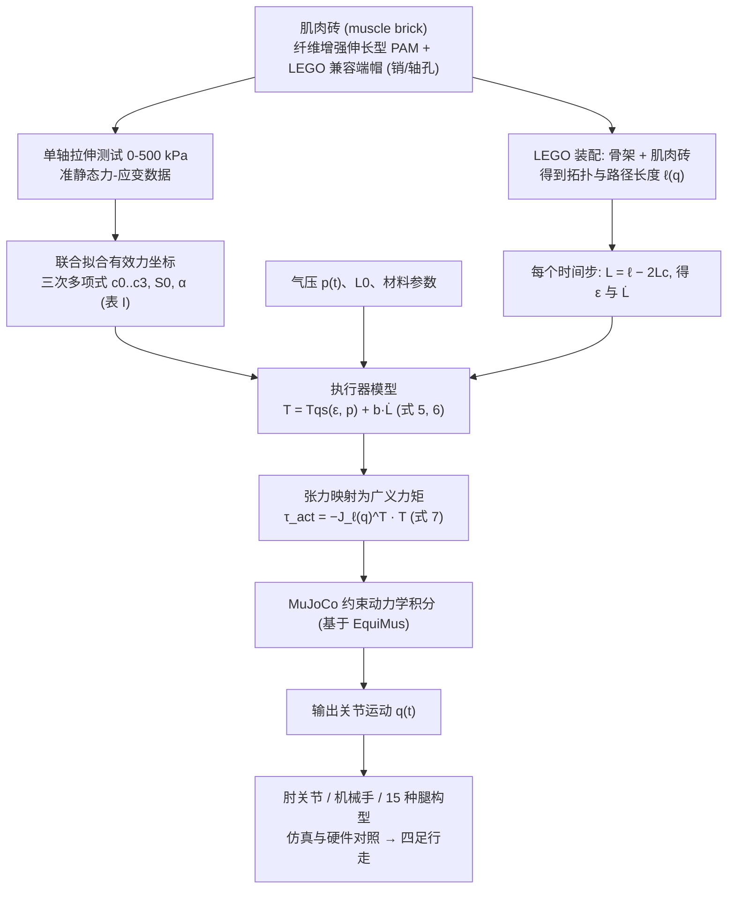

# MUSBRIC：用于可重构肌肉骨骼机器人的乐高兼容气动肌肉模块

**MUSBRIC**（*MUSBRIC: LEGO-Compatible Pneumatic Muscle Bricks for Reconfigurable Musculoskeletal Robots*，[arXiv:2610.40285](https://arxiv.org/abs/2610.40285)）收录于 senlanke「具身运控lab」10-26–10-30 前沿论文动态（人形/四足）。本页依据**周报条目 + arXiv 摘要页**整理，未逐页核对正文 PDF；指标与结论以论文为准。

## 一句话定义

**MUSBRIC：用于可重构肌肉骨骼机器人的乐高兼容气动肌肉模块——将纤维增强伸长型气动肌肉封装成乐高兼容模块，并建立对应 MuJoCo 模型；通过 15 种腿部构型、肘关节、灵巧手和四足行走平台验证可重构设计。**

## 英文缩写速查

| 缩写 | 英文全称 | 简要说明 |
|------|----------|----------|
| RL | Reinforcement Learning | 强化学习 |
| WBC | Whole-Body Control | 全身控制 |

## 为什么重要

- 周报所述待解决的问题：肌肉骨骼机器人改变肌肉连接位置或肢体结构时，通常需要重新加工执行器和骨架。

## 流程总览

图依据：论文 §II 硬件设计、§III 建模与仿真 / Fig.2、§IV–V 验证

## 核心机制

| 项 | 内容 |
|----|------|
| **arXiv** | [2610.40285](https://arxiv.org/abs/2610.40285) · [PDF](https://arxiv.org/pdf/2610.40285) |
| **作者（arXiv）** | Wang, Qiyao, Zhu, Yinglei, Zhou, Liang, Gong, Wenzhe, Liu, Xin-Jun, Zhao, Huichan |
| **机构（周报所述，未逐条核实）** | 清华大学、清华大学医学院 |
| **arXiv 评论栏** | （无） |
| **开源** | arXiv 摘要页与评论未见代码或项目页链接（仅核对 arXiv 摘要页，不代表未发布）（2026-11-02） |
| **周报所述创新点** | 将纤维增强伸长型气动肌肉封装成乐高兼容模块，并建立对应 MuJoCo 模型；通过 15 种腿部构型、肘关节、灵巧手和四足行走平台验证可重构设计。 |

### arXiv 摘要节选（英文原文）

> Musculoskeletal robots combine compliant actuators with articulated skeletons, but exploring alternative configurations often requires repeated fabrication. We present MUSBRIC, a modular hardware platform and accompanying MuJoCo-based simulator for reconfigurable musculoskeletal robots.

## 源码运行时序图

**不适用**：arXiv 摘要页与评论未见代码或项目页链接（仅核对 arXiv 摘要页，不代表未发布），无可对齐的官方代码流程。

## 实验与评测

- 周报与摘要给出的数字/场景已写入上表「创新点」与摘要节选；其余实验细节、基线与成功率定义请回到论文正文。
- 读法：先对齐任务设定、传感器与成功定义（仿真/真机），再解读 headline 数字，勿跨论文直接比较。

## 与其他工作对比

| 维度 | 读法 |
|------|------|
| **同周对照** | 见 [人形/四足周报技术地图](../overview/senlanke-weekly-2026-10-26-30-humanoid-quadruped-technology-map.md)，按方向浏览同期论文 |
| **开源状态** | arXiv 摘要页与评论未见代码或项目页链接（仅核对 arXiv 摘要页，不代表未发布） |

## 结论

**MUSBRIC：用于可重构肌肉骨骼机器人的乐高兼容气动肌肉模块。**

1. 本页是入库级摘要，复现前请核对论文正文、附录与代码仓库。
2. 指标须连同实验条件解读。
3. 关注 arXiv 版本更新与代码发布。

## 关联页面

- [senlanke-weekly-2026-10-26-30-humanoid-quadruped-technology-map](../overview/senlanke-weekly-2026-10-26-30-humanoid-quadruped-technology-map.md)
- [locomotion](../tasks/locomotion.md)
- [reinforcement-learning](../methods/reinforcement-learning.md)

## 参考来源

- [musbric-pneumatic-muscle-bricks_arxiv_2610_40285.md](../../sources/papers/musbric-pneumatic-muscle-bricks_arxiv_2610_40285.md)
- [wechat_senlanke_weekly_humanoid_quadruped_2026-10-26_30.md](../../sources/blogs/wechat_senlanke_weekly_humanoid_quadruped_2026-10-26_30.md)
- [arXiv:2610.40285](https://arxiv.org/abs/2610.40285)
- [arXiv PDF](https://arxiv.org/pdf/2610.40285)：已通读全文：§II 硬件设计、§III 建模与仿真（本构表征、仿真框架）、验证实验

## 推荐继续阅读

- [arXiv PDF](https://arxiv.org/pdf/2610.40285)
