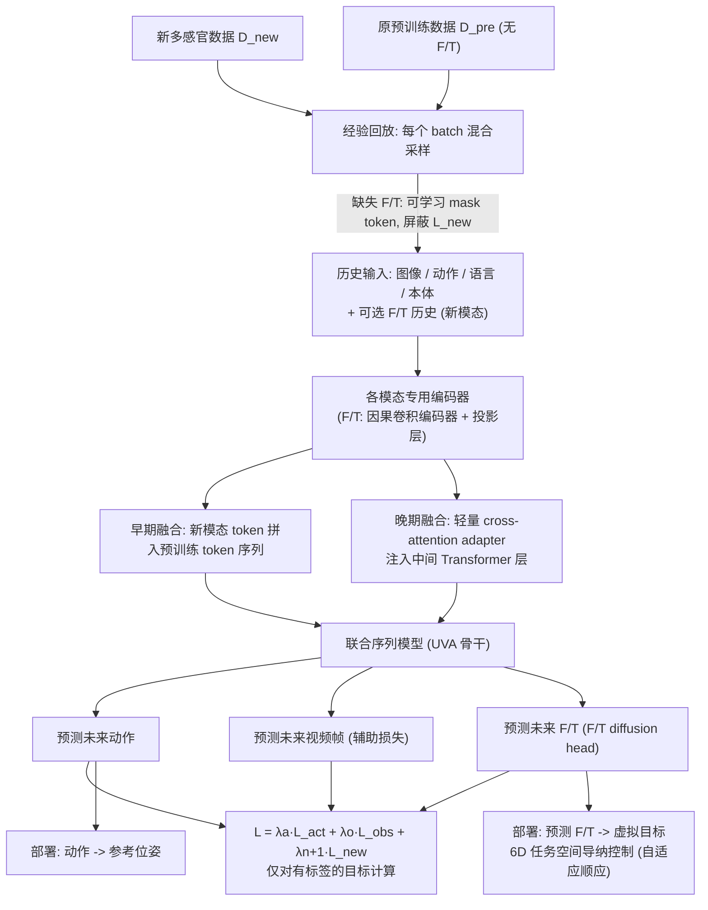

# Multisensory Continual Learning（arXiv:2606.30988）

**Multisensory Continual Learning**（Jaden Clark, Changhao Wang, Yihuai Gao, Seongheon Hong, Hojung Choi, Mark Cutkosky, Yifan Hou, Shuran Song；Stanford University；[arXiv:2606.30988](https://arxiv.org/abs/2606.30988)，[项目页](https://jadenvc.github.io/multisensory-continual-learning/)）— 在预训练视觉–动作模型上持续学习新传感模态（力/力矩）：多阶段融合、未来预测监督与预训练数据回放，避免灾难性遗忘。

## 一句话定义

在预训练视觉–动作模型上持续学习新传感模态（力/力矩）：多阶段融合、未来预测监督与预训练数据回放，避免灾难性遗忘。

## 英文缩写速查

| 缩写 | 英文全称 | 简要说明 |
|------|----------|----------|
| MuSe | Multisensory World Model / continual learning framework | 本文框架 |
| F/T | Force/Torque | 六维力矩传感 |
| UVA | Unified Video-Action | 被扩展的预训练视觉–动作骨干示例 |
| CL | Continual Learning | 新模态增量学习设定 |

## 为什么重要

接触丰富任务需要力觉，但不可能为每种传感器组合从头预训练大模型。

## 流程总览

图依据：论文 §3.1–§3.5 / Fig. 2（部署段落见 §3.5）。

## 核心原理（方法）

模态专用编码器 + 早/晚融合 + 多感官未来预测损失 + 预训练集经验回放；实例化为向 UVA 类模型加 F/T 历史。

## 实验与评测

真机微调任务上力控适应强，部分预训练任务性能反而提升。

## 结论

少量多感官数据 + 正确融合/回放机制，可把力模态「嫁接」到视觉先验上，且可能反哺视觉能力。

- 多阶段融合避免早期破坏视觉表征
- 未来预测提供自监督几何/接触信号
- 回放是防遗忘的关键而非可选项
- 可驱动虚拟目标顺应控制

## 源码运行时序图

**不适用**（截至 2026-08-18：无统一公开可运行代码仓库，或本文为综述/控制器论文以项目页演示为主）。

## 局限与风险

依赖特定硬件 F/T 安装与标定；换传感器位姿需再适配。

## 与其他工作对比

相对从头多模态预训练，更低数据成本；相对纯视觉微调，接触任务更稳。

## 关联页面

- [paper-umi-ft](./paper-umi-ft.md)
- [paper-minimalist-compliance-control](./paper-minimalist-compliance-control.md)
- [manipulation](../tasks/manipulation.md)
- [REALab 14 篇技术地图](../overview/realab-14-papers-technology-map-2026.md)

## 参考来源

- [muse_arxiv_2606_30988.md](../../sources/papers/muse_arxiv_2606_30988.md)
- [wechat_shenlan_realab_14_papers_2026.md](../../sources/blogs/wechat_shenlan_realab_14_papers_2026.md)
- [arXiv PDF](https://arxiv.org/pdf/2606.30988)：已通读方法部分（实验与附录以略读为准）：§1 引言、§3 Method（3.1–3.5、Fig. 2）；§4 案例与实验、附录略读

## 推荐继续阅读

- 论文：<https://arxiv.org/abs/2606.30988>
- 项目页：<https://jadenvc.github.io/multisensory-continual-learning/>
