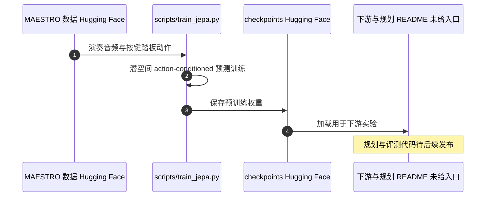

# Music-JEPA（从动作学习声音世界模型）

**Music-JEPA** 把 JEPA 世界模型用于音乐：当前声音是状态，按键与踏板是动作，动作之后的声音是下一状态。模型在潜空间学习这一动作条件动力学，而不直接生成波形。

## 英文缩写速查

| 缩写 | 英文全称 | 简要说明 |
|------|----------|----------|
| JEPA | Joint-Embedding Predictive Architecture | 在潜空间预测未来的架构 |
| WM | World Model | 本文中指「声音世界」的内部动力学模型 |
| MAESTRO | MIDI and Audio Edited for Transcription… | 钢琴演奏数据集，本文训练数据的来源（README 所述） |
| CIRMMT | Centre for Interdisciplinary Research in Music Media and Technology | 作者机构之一（项目页所列） |

## 为什么重要

把「状态—动作—新状态」的框架从视觉与控制推广到音频，说明 JEPA 世界模型不依赖视觉输入；文中还把同一模型反用于从目标音乐推断按键序列，即规划式钢琴转录。

## 核心信息

- 作者：Ziyu Wang、Kun Fang、Yann LeCun
- 机构（项目页）：New York University；MBZUAI；McGill University；CIRMMT；AMI Labs
- 代码：<https://github.com/ZZWaang/music-jepa>（原创代码 MIT）
- 数据与权重：Hugging Face（README 所述）
- 项目页：<https://zzwaang.github.io/music-jepa-demo/>

## 核心原理（方法栈）

1. **状态**：当前声音的表示。
2. **动作**：按键与踏板。
3. **动力学**：在潜空间预测动作后的声音表示（action-conditioned JEPA）。
4. **下游**：节拍检测、作曲家与调性识别；以及从目标音乐做规划。

## 源码运行时序图

复现路径：Python 3.10 + `requirements.txt`，下载数据与权重，运行 `scripts/train_jepa.py` 加配置文件。规划与评测目前无官方入口。

## 实验与评测

- 文章转述：表示可用于节拍检测、作曲家识别、调性识别。
- 文章转述：从目标音乐在潜世界中搜索按键序列，实现规划式钢琴转录；具体指标未在本次入库中核对。

## 工程实践

- 开源状态：**部分开源**（训练与权重已发布；下游与规划代码未发布）。
- 数据为 MAESTRO 衍生的约 200 小时钢琴演奏，适合作为动作条件音频动力学的基线数据。

## 局限与风险

- 规划与转录结果缺少官方可运行代码，无法独立验证文章中的转录效果。
- 仅覆盖钢琴与踏板动作，不能直接推广到其他乐器或连续控制。

## 与其他工作对比

| 维度 | Music-JEPA | [LpWM](./paper-lpwm.md) |
|------|------------|--------------------------|
| 领域 | 音频 | 视觉控制 |
| 动作 | 按键与踏板（离散） | 机器人动作（连续） |

## 结论

**Music-JEPA 证明「状态—动作—新状态」框架可以跨到音频，但目前可复现的部分主要是训练，规划未开放。**

1. **框架可迁移** — 只要有状态、动作与状态变化，就能学习动作条件世界模型。
2. **开源不完整** — 训练代码与权重公开，规划与评测入口仍待发布。
3. **数字待核对** — 转录与分类结果以论文为准，本页未核对原表。
4. **读法** — 更适合作为跨模态 JEPA 的参考实现，而非直接用于机器人控制。

## 关联页面

- [LeWorldModel](./paper-lewm.md) — 同属 JEPA 世界模型，视觉侧
- [Causal-JEPA](./paper-causal-jepa.md) — 同属 2026 年 JEPA 世界模型扩展
- [LpWM](./paper-lpwm.md) — 同为 action-conditioned 潜空间世界模型
- [视频即仿真](../concepts/video-as-simulation.md) — 从观测学习可用于规划的内部世界

## 参考来源

- [Music-JEPA 论文归档](../../sources/papers/music_jepa_arxiv_2607_22000.md)
- [ZZWaang/music-jepa 仓库归档](../../sources/repos/music-jepa.md)
- [深蓝具身智能文章归档](../../sources/blogs/wechat_deepblue_lecun_jepa_11_papers_2026-10-20.md)

## 推荐继续阅读

- [Music-JEPA 项目页](https://zzwaang.github.io/music-jepa-demo/)
- [arXiv:2607.22000](https://arxiv.org/abs/2607.22000)
