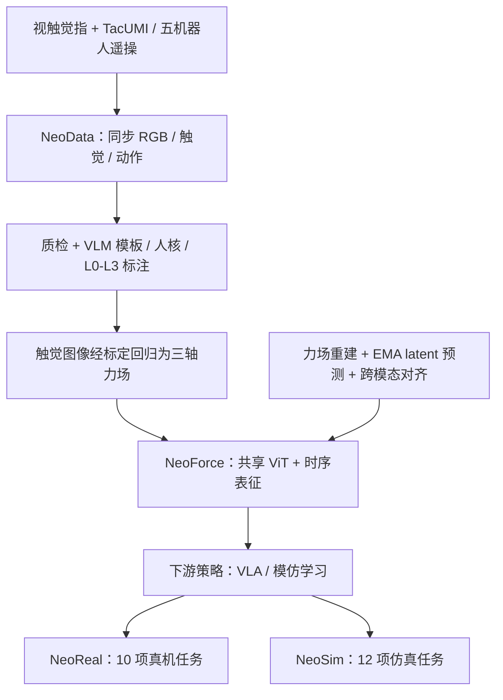
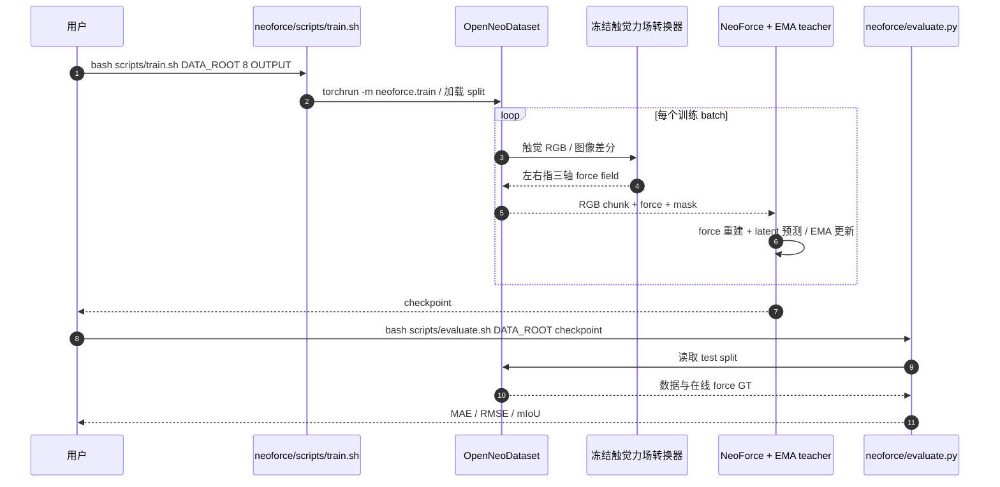

# 𝒩₀-Foundation（Towards the Age of Tactile Intelligence）

**𝒩₀-Foundation**（读作 *Neo-Foundation*，*Towards the Age of Tactile Intelligence*，[项目页](https://research.neoteai.com/n0-foundation/)，[技术报告 PDF](https://research.neoteai.com/assets/n0-foundation-report.pdf)）由 **新智具身智能（NeoteAI）** 与 **复旦 TEAI** 于 **2026-07-25** 发布项目，后续发布 [arXiv:2608.29601v2（2026-09-20）](https://arxiv.org/html/2608.29601v2)：把 **视触觉硬件、大规模多模态数据、硬件无关力场表征与标准化评测** 收成一条可扩展的触觉中心具身操作基础路径。

| 机构 | 新智具身智能（NeoteAI）；复旦大学可信具身智能研究院（TEAI） |
|------|--------------------------------------------------------------|
| 日期 | 2026-07-25 |
| 形态 | Technical Report；arXiv:2608.29601v2（2026-09-20） |
| 开源 | **部分开源**（OpenNeoData、NeoForce 训练/评测代码与权重、NeoSim 代码已发布；外置仿真资产与全量数据非完整公开交付） |

## 一句话定义

**先把接触采得到、力场表示统一、评测对齐，再谈往策略里加触觉——而不是只加一路触觉图像。**

## 英文缩写速查

| 缩写 | 英文全称 | 简要说明 |
|------|----------|----------|
| NeoData | NeoData | >30k h 同步视触觉语料（全量） |
| OpenNeoData | Open NeoData | 5k h 开源子集 |
| NeoForce | NeoForce | 三轴力场监督的视触觉表征模型 |
| NeoReal | NeoReal | 真机 10 任务接触评测套件 |
| NeoSim | NeoSim | 仿真 12 任务（对齐力场格式） |
| TacUMI | 𝒩₀-TacUMI | 双手触觉 + 腕部鱼眼的手持采集夹爪 |
| RGB | Red-Green-Blue | 外视/腕视彩色观测 |

## 为什么重要

- **规模与本体覆盖**：>30k h / 1.4M ep / 6 本体 / 450+ 任务，且 **每指视触觉同步**——与多数「偶发贴触觉」数据集不可同日而语。
- **力场优于外观**：固定 π₀.₅ 时，NeoForce 条件 **32.5%/47.5** > 触觉图像拼接 **27.5%/41.4**，支持「物理接触状态 > 设备相关外观」选型。
- **下游共用底座**：[𝒩₀-VTLA](./paper-n0-vtla.md) 与 [𝒩₀-TWAM](./paper-n0-twam.md) 都建立在 NeoData / NeoForce 叙事上。

## 流程总览

## 核心原理

### 采集与数据

| 项 | 内容 |
|----|------|
| **传感器** | 相机式视触觉：耐磨玻璃 + 弹性纹理层 + 嵌入 RGB |
| **TacUMI** | 双触觉、160° 腕部鱼眼、IR 6-DoF、磁吸开度；约定对齐机器人平台 |
| **机器人本体** | Franka FR3、Piper、ARX X5、UR5e、Flexiv Rizon 4s |
| **占比** | TacUMI ≈ **57%** 轨迹；近 100 名操作员 |
| **层级** | L3 任务 → L2 子任务 → L1 动作 → L0 原子段（VLM 模板 + 人核 + 信号边界） |

### NeoForce

- 统一表示：传感面稠密 **三轴力场**（两剪切 + 法向）。
- 模型：RGB 与力场 chunk patch 化 → 共享 Transformer；重建力场/接触掩码 + 教师引导 latent 预测 + 跨模态对齐。

### 评测套件

- **NeoReal**：10 个真机接触任务；标准化初态、复位与成功判据；报成功率与 progressive score。
- **NeoSim**：12 个单臂/双臂任务；渲染与真实同格式的力场，便于力场条件策略仿真评测。

## 源码运行时序图

以下入口已核对 [NeoForce train.sh](https://github.com/neoteai/N0-Foundation/blob/main/neoforce/scripts/train.sh)、[train.py](https://github.com/neoteai/N0-Foundation/blob/main/neoforce/neoforce/train.py)、[evaluate.sh](https://github.com/neoteai/N0-Foundation/blob/main/neoforce/scripts/evaluate.sh) 和 [NeoSim collect_data.py](https://github.com/neoteai/N0-Foundation/blob/main/neosim/scripts/collect_data.py)。两条运行路径是**独立工作流**，不代表 NeoForce checkpoint 可直接作为 NeoSim 策略使用。

**NeoSim 的独立采集 / 策略评测链**：`python scripts/collect_data.py insert_USB demo` → 读取 `task_config/demo.yml` → `isaaclab.app.AppLauncher` → `envs.insert_USB.Task` → 每个 seed 的 `reset/play_once/check_success/save_to_hdf5`；策略评测由 `eval/run_eval.sh` → `eval/eval_official_ee.py` 连接单独的远端 policy server。详见 [仓库归档](../../sources/repos/n0-foundation.md)。`neosim/` 的外置 USD / TacEx 资产尚需按 README 配置，本文未实际跑通 GPU 仿真。

## 工程实践

| 项 | 实践要点 |
|----|----------|
| **数据入口** | [OpenNeoData](https://huggingface.co/datasets/NeoteAIEmbodied/OpenNeoData) · ModelScope 镜像；按发布平台的门禁与 **CC-BY-NC-SA-4.0** 获取 |
| **代码入口** | [NeoForce](https://github.com/neoteai/N0-Foundation/tree/main/neoforce) 训练/评测与[权重](https://huggingface.co/NeoteAI/NeoForce)，[NeoSim](https://github.com/neoteai/N0-Foundation/tree/main/neosim) 仿真任务、采集和策略评测；代码目录为 MIT |
| **复现实验** | 先按 `neoforce/docs/Installation.md`、`DataPreparation.md` 生成 split/force stats，再从 `train.sh` 和 `evaluate.sh` 入手；报告的 MAE/RMSE 是训练尺度归一化的相对误差 |
| **触觉怎么接策略** | 优先试 **力场/NeoForce 条件**，不要默认「多拼一路触觉相机」 |
| **评测** | 接触任务同时看 **binary success** 与 **progressive**；双手互接触任务在 NeoSim 上仍是瓶颈 |
| **硬件** | 真机复现需 InTac 类视触觉指；公司 SDK 见 [neoteai-release](../../sources/repos/neoteai-release.md) |

## 实验与评测

| 设定 | 结果（项目页） |
|------|----------------|
| π₀.₅ 无触觉（NeoReal 均） | **26.5% / 38.1** |
| + 触觉图像拼接 | 27.5% / 41.4 |
| + 触觉 action-expert 条件 | 30.0% / 44.3 |
| + **NeoForce 表征条件** | **32.5% / 47.5** |
| NeoSim π₀.₅ / LingBot-VA | 45.8% / 32.1%（每任务 100 次随机 rollout） |
| NeoForce reconstruction → + latent prediction（Table 2） | MAE 0.070 → 0.066；RMSE 0.095 → 0.089；mIoU 0.968 → 0.966 |

## 结论

**𝒩₀-Foundation 的核心贡献是形成「同步视触觉采集 → 物理力场统一表征 → 真机/仿真评测」的可复用研究栈；截至 2026-11-19 NeoForce 代码/权重和 NeoSim 代码已公开，但全量数据、外置资产与真机系统仍限制完整复现。**

1. **优先复用 OpenNeoData + LeRobot v3.0 加载器**，不要等模型仓。
2. **触觉接入排序**（同骨干）：NeoForce > action-expert 条件 > 图像拼接 > 无触觉。
3. **纯视觉策略在 NeoReal 上仍低**（~26%）：接触任务不要只刷视觉 VLA 榜。
4. **TacUMI 占比高**：跨本体迁移时要显式处理手持 vs 真机动力学差。
5. **许可为 NC**：产品化前先确认授权。
6. **优先阅读已发布的 NeoForce 训练/评测与 NeoSim 代码**，区分可以做的离线实验与需要额外资产、GPU、真机的复现。

## 与其他工作对比

| 工作 | 关系 |
|------|------|
| **[Deform360](./paper-deform360-deformable-visuotactile-dataset.md)** | 同为大规模真实视触觉数据；Deform360 偏可变形体 WM，Foundation 偏跨本体操作语料 + 力场表征 |
| **[𝒩₀-VTLA](./paper-n0-vtla.md) / [𝒩₀-TWAM](./paper-n0-twam.md)** | 下游策略消费者；共用 NeoData / NeoForce 叙事 |
| **纯视觉 VLA（π₀.₅ 等）** | Foundation Table 2 显示接触任务上视觉 alone 远不够 |

## 局限与风险

- 全量 NeoData 未开源；论文规模数字 ≠ 可下载子集。
- NeoForce 训练/评测与 NeoSim 代码已发布，但 NeoSim 的部分二进制 USD、TacEx 资产/策略 checkpoints 需另取，不能视为即装即复现；未对硬件实测。
- 力场估计依赖特定传感器标定；跨厂商传感器需重标定/适配。
- 论文已于 2026-08-30 收录 arXiv:2608.29601，**本次以 2026-09-20 的 v2** 为主；项目页初始发布日期与论文修订日期不能混为一谈。

## 关联页面

- [NeoteAI](./neoteai.md) · [𝒩₀-VTLA](./paper-n0-vtla.md) · [𝒩₀-TWAM](./paper-n0-twam.md)
- [接触操作纵深路线](../../roadmap/depth-contact-manipulation.md) · [具身数据纵深路线](../../roadmap/depth-embodied-data.md)
- [视触觉融合](../concepts/visuo-tactile-fusion.md) · [接触丰富操作](../concepts/contact-rich-manipulation.md)
- [Deform360](./paper-deform360-deformable-visuotactile-dataset.md) — 另一条大规模真实视触觉数据轴
- [具身大模型评测基准选型闭环](../queries/embodied-eval-benchmark-selection-loop.md) — NeoReal（真机 10 任务）/ NeoSim（仿真 12 任务）属其 ③ 策略任务成功率评测层：接触丰富操作的力场条件真机 + 仿真套件

## 参考来源

- [sources/papers/n0_foundation.md](../../sources/papers/n0_foundation.md)
- [sources/sites/research-neoteai-com.md](../../sources/sites/research-neoteai-com.md)
- [sources/repos/n0-foundation.md](../../sources/repos/n0-foundation.md)

## 推荐继续阅读

- [项目页](https://research.neoteai.com/n0-foundation/)
- [OpenNeoData](https://huggingface.co/datasets/NeoteAIEmbodied/OpenNeoData)
- [技术报告 PDF](https://research.neoteai.com/assets/n0-foundation-report.pdf)
- [arXiv:2608.29601v2 全文 HTML](https://arxiv.org/html/2608.29601v2)
- [NeoForce 训练/评测代码](https://github.com/neoteai/N0-Foundation/tree/main/neoforce) · [NeoSim 仿真代码](https://github.com/neoteai/N0-Foundation/tree/main/neosim)
