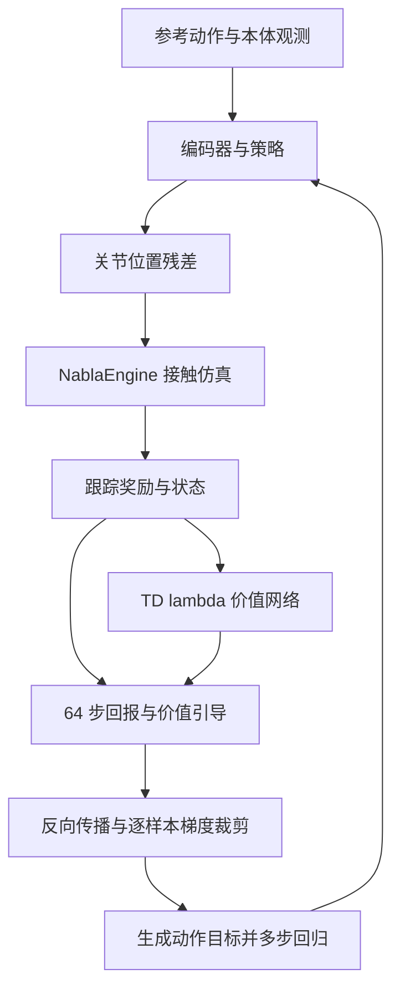
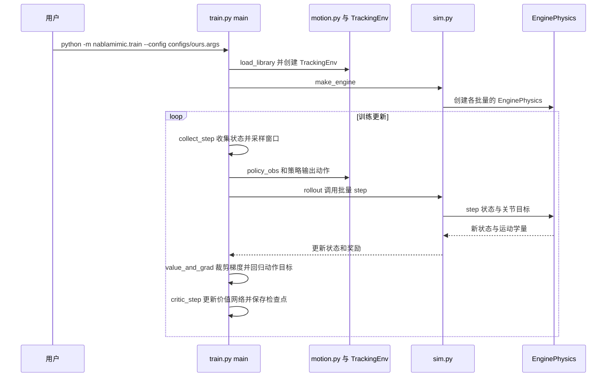

# ∇Mimic: Ultra-Efficient Humanoid Control with Differentiable Simulation / 基于可微仿真的高效人形控制

## 一句话定义

∇Mimic 通过处理接触动力学中的极端梯度，结合专用于 G1 的 NablaEngine，训练单一全身动作跟踪策略。

## 英文缩写速查

| 缩写 | 英文全称 | 简要说明 |
|------|----------|----------|
| BPTT | Backpropagation Through Time | 跨仿真时间窗反向传播 |
| PODS | Policy Optimization by Differentiable Simulation | 利用梯度改进动作并回归策略 |
| SHAC | Short-Horizon Actor-Critic | 短视界一阶 actor-critic 基线 |
| PD | Proportional-Derivative | 关节位置执行器 |

## 核心信息

| 项目 | 内容 |
|------|------|
| 机构 | 加州大学戴维斯分校（University of California, Davis） |
| 作者 | Weyl Lu、Yubei Chen |
| 原文 | [arXiv:2610.41654v1](https://arxiv.org/html/2610.41654v1)，2026-10-30；以下论文数据均指 v1 |
| 任务 | Unitree G1 29 关节，跟踪 40 条重定向 LAFAN1 动作 |
| 输入与输出 | 10 帧本体感知、未来 10 帧参考动作及相对躯干朝向；输出参考关节位置的残差 |
| 控制 | 50 Hz，四个 5 ms 物理子步，PD 位置目标 |

## 项目流程图

## 核心机制

- **梯度稳定性：** 每步反向传播时，按批次中位数的 3 倍裁剪每个环境的动作梯度，避免少数异常值压制其他样本；裁剪会引入偏差。
- **动作目标：** 将裁剪梯度归一化为动作空间目标，用多个小批次回归复用仿真窗口。论文设置初始目标变化 RMS 为 0.03 rad、每次更新回归 8 步。
- **仿真器：** 每个 world 对应一个 GPU warp；前向保留 tape，反向通过单个 megakernel 重放四个子步。约束求解的梯度来自固定活动集合下的最优性条件。
- **梯度边界：** 训练默认在近零距离自接触及近乎平行胶囊处冻结特定几何导数，并在执行器力饱和时保留阻尼项；因此训练梯度并非所有状态下严格的原始导数。

## 源码运行时序图

依据 [NablaMimic 源码](https://github.com/OamIcs/NablaMimic/tree/bfbb2a6773b4776c17402a34a93ec7589d9c7c18) 的 `train.py`、`sim.py`、`env.py` 与 README；下图对应推荐的 NablaEngine 训练路径。

评估入口为 `scripts/evaluate_run.sh`，调用 `python -m nablamimic.evaluate`，使用 MuJoCo Warp。当前仓库的推荐配置与论文 v1 的配置细节不同；复现应锁定版本和配置。

## 实验与评测

论文 v1 在 RTX PRO 6000 上以 3 个种子训练；评估时每条动作从首帧运行一次，使用 MuJoCo Warp、确定性策略、无噪声和随机化。归一化回报覆盖整段动作，摔倒后剩余部分计零；训练时间不含编译及评估。

| 结果 | 论文 v1 报告 |
|------|-------------|
| 0.82 回报 | 平均曲线约 0.34 小时；1.8 小时达到 0.874 |
| 逐样本裁剪消融 | 残差动作设置下 3 个种子均发散 |
| 引擎前向加梯度 | 4096 个 G1 world、RTX PRO 6000：1.78 ms；对比 MuJoCo Warp 的伴随 PR 为 20.5 ms，约 11.5 倍 |
| 引擎 GPU 支持 | 项目页报告已测试 V100、RTX 3090、H100 和 RTX PRO 6000；计时加速比仅在同一 GPU 内比较 |

SuperMimic 的 1.2 小时数字来自其论文、使用 H100；原实现未公开，不能将其视为相同硬件的严格对照。项目主页的更新配置报告：8 分钟附近的检查点，40 段动作中平均有 0.25 段发生摔倒（3 个种子）；这不是论文 v1 的 0.82 回报达标时间，不能与 20 分钟直接等同。

## 与其他工作对比

- **对 [SuperMimic](./paper-supermimic.md)：** 二者都用动力学导数训练跟踪策略；SuperMimic 对在线学习的世界模型求替代梯度，∇Mimic 直接用仿真器的精确梯度，靠逐样本裁剪约束极端值（§2、§4）。SuperMimic 原实现未公开，仅引用其论文的 0.82 达标时间（1 张 H100、1.2 小时内），不同 GPU，且该论文未给最终分数（§7.1–7.2、表 4）。
- **对 PPO（[BeyondMimic](../methods/beyondmimic.md) 配置）：** 零阶基线只用标量回报，同样在 NablaEngine 上训练，环境、观测和评测奖励与 ∇Mimic 一致；表 4 中 3 小时回报为 0.638，6 小时内未达到 0.82。两组 PPO 基线均为单种子，∇Mimic 为 3 种子（附录 D、§8）。
- **对 [SHAC](./paper-shac.md)：** 同为短窗口 BPTT 加 TD(λ) critic；∇Mimic 改为逐步按批次中位数裁剪每个样本的动作梯度，并沿用 PODS 的动作目标回归，以固定弧度步长构造目标（§2、§5）。SHAC 原梯度保护在 0.06 小时停止；放宽保护后 3 小时为 0.816（表 4）。
- **对其他可微仿真跟踪：** [Bundled Contact Gradients](./paper-bundled-contact-gradients.md) 在平滑接触仿真器上以 64 个环境训练 4 条 LAFAN1 片段，DiffMimic 每次跟踪单条片段且无 critic；∇Mimic 在完整 MuJoCo 接触动力学上以 4096 个窗口训练 40 条片段的单一策略（§2）。论文未在相同协议下与它们实测对比。
- **引擎贡献：** 同一算法在 [MuJoCo Warp](./mujoco-warp.md) 伴随 PR 上逐次更新曲线重合，按小时计 NablaEngine 快 4.7 倍；速度对比仅在同型号 GPU 内进行（§7.3、§8）。

## 结论

**该工作在限定仿真任务中展示了接触梯度稳定化和专用引擎的组合价值。**

1. 对照 PPO 与 SHAC 时保留算法、种子数、评测和 GPU 条件。
2. 迁移至其他机器人或复杂地形需要扩展专用碰撞与内核；论文 v1 尚未进行真机部署。
3. 官方代码 Apache-2.0；README 指出默认配置约需 50 GB 显存，缩小批量会改变复现条件。LAFAN1 重定向数据为非商业许可。
4. 稀疏奖励和长视界存在价值估计偏差与梯度累积之间的权衡，不能直接外推所有任务。

## 关联页面

- [运动控制](../tasks/locomotion.md)
- [动作重定向](../concepts/motion-retargeting.md)
- [相关论文地图](../overview/embodied-station-2026-11-03-49-papers-technology-map.md)

## 参考来源

- [论文归档](../../sources/papers/nablamimic-2610-41654.md)
- [训练代码归档](../../sources/repos/nablamimic.md)
- [引擎代码归档](../../sources/repos/nablaengine.md)
- [项目主页归档](../../sources/sites/nablamimic.md)

## 推荐继续阅读

- [论文全文 v1](https://arxiv.org/html/2610.41654v1)
- [项目主页](https://sailab.ai/nablamimic/)
