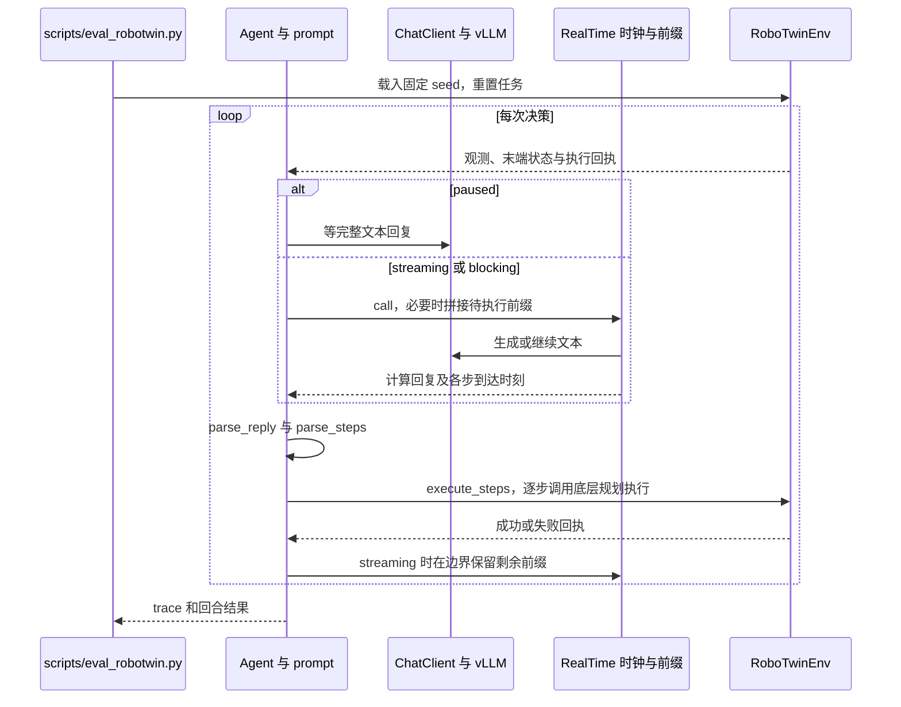

# A Glimpse of Training VLMs as Foundation Models for Robotic Manipulation｜nanoAstra：用原生文本接口训练机械臂操作基础模型

## 一句话定义

> nanoAstra 将操作示范转成带进度描述的参数化语义步，用原生 VLM 文本解码器预测，再由独立解析器和控制层执行，不另加动作头。

## 英文缩写速查

| 缩写 | 英文全称 | 简要说明 |
|---|---|---|
| VLM | Vision-Language Model | 读图和状态，输出结构化进度与语义步 |
| VLA | Vision-Language-Action Model | 论文对照组，多使用专门动作输出表示 |
| CP-SFT | Capability-Preserving Supervised Fine-Tuning | 混入通用图文数据，尽量保住原能力的监督微调 |
| EEF | End Effector | 末端位置、方向和夹爪状态的基准 |
| I/M | Inference-to-Motion Ratio | 推理耗时除以对应动作执行时长 |

## 为什么重要

模型不必以高频文本模拟电机控制。它负责从多模态观测决定下一段行为，底层程序负责把有限动作词和数值转为位姿、规划与执行。真正可对照的是：相同测试预算下，语义步表示是否泛化，以及动作输出到可执行的第一步之间等了多久。

## 核心机制

1. **统一几何和切分轨迹。** 在可求得夹指中点时统一抓握参考点；当前状态、历史和标签采用同样的坐标变换。对缺失或错位的主相机外参重新标定。先给子任务打进度语义，再保留子任务边界，并在夹爪切换、停顿、急转弯和手腕大转处切出决策点。
2. **每步有左右臂字段。** 训练使用平移、旋转、夹爪和等待这些基本类型；同一臂的多个命令组成一次复合运动，双臂可同时执行。进度是描述不是底层指令。`done` 也不等于环境成功判定。发布解析器另外支持姿态预设、回零等条目。
3. **CP-SFT 保留原生生成接口。** Qwen3.5-9B 全量微调；机器人系统提示写明本体、轴、单位、词表和结构，属于软约束，不是受保证的语法解码。交叉熵之外加数位加权和符号监督（权重 0.3）。数据经处理后保留 5,310.5 小时实机操作、约 81.8 万 episodes 和 1,490 万语义训练样本；另混 155 万通用图文例，约 37.3% 可训练 token 来自通用数据。
4. **流式使用承诺前缀。** 可执行步就绪即交给执行层；当前回复剩不超过两步时用新观测开始下一轮，将已排队的动作作为续写前缀，而不是重新执行一次。这让阻塞可以减少，不能保证任意硬件下都不等待。

## 实验与评测

| 口径 | 作者结果 | 注意 |
|---|---|---|
| RoboTwin 2.0 随机化、paused | nanoAstra-9B **17.8%**；LingBot-VLA-2.0 和 thinking Qwen3.8-27B 均 **10.8%** | 50 任务 × 10 runs；仿真在推理期间暂停。无仿真轨迹训练或基准专项微调，不是无机器人训练 |
| RoboTwin 2.0 持续仿真时钟，H20 延迟口径 | blocking → streaming：成功率 **11.2% → 12.9%**，等待占比 **35.0% → 6.9%** | 每模式每任务 5 runs；Wait 与 Idle 均排除首轮和受失败步骤影响的轮次，不能把等待占比当成全回合指标 |
| 生成相对动作时长 | 单 H20 **1.69 / 2.66 s**，I/M 0.64；RTX 4090 **3.89 / 2.87 s**，I/M 1.36 | 不是伺服频率；I/M 小于 1 也不保证没有停顿 |
| RoboDojo Open | **4.75%（19/400）**，进度分 5.06 | 8 任务、10 seeds、每 seed 5 runs；成功与部分进度分开 |

## 结论

语义动作把 VLM 决策和控制器解耦，但收益取决于执行接口和评测时钟。

- 对齐抓握参考点、坐标轴、单位和真实执行回执，再判断模型输出是否有用。
- 测成功率时同时说明时限和是否暂停仿真；单独报告等待和推理时长。
- 用短步回执检查重复、漏步和虚报完成，再扩大任务范围。
- 通用能力并未完全保持；用原有任务集验收能力回归。

## 与其他工作对比

- [Embo-Harness](paper-embo-harness.md) 把提示和执行接口作为变量比较长链路；nanoAstra 还用机器人语义标签训练 VLM 参数。
- [Action Chunking](../methods/action-chunking.md) 常将连续动作块预测和执行异步化；这里的前缀是已排队文本语义步，仍需独立的轨迹规划。
- [RoboTwin](robotwin.md) 是评测与仿真平台，不是 nanoAstra 的训练数据来源；和常见任务专项训练后的成功率不可直接横比。

## 工程实践

- 以 [官方源码归档](../../sources/repos/nanoastra.md) 固定的 GitHub 提交、RoboTwin 子模块及模型清单为起点。先选 paused 核对基本可执行性，再对照同一 seeds 清单测 blocking 和 streaming。
- vLLM 服务仅生成结构化文本；评测客户端记录 prompt、reply、步骤回执和图像。公开代码可以核验这些接口，不等于发布了训练实现。
- 若要重算等待占比，另记语义步到达、开始、结束和推理空转 tick；默认 trace 记轮级时钟和回执，没有这些逐步时间。显式 `wait` 原语不应混进推理等待。
- 对需要接触、双臂避碰或真机运行的任务，必须由独立执行层约束运动和拒绝不合法目标，不能把解析成功视为动作安全或规划成功。

## 源码运行时序图

## 局限与风险

- 真机示范是训练来源，主对照是仿真，并非真机成功率。语义状态漂移、夹持误差和重复动作在论文中导致未完成；长时序泛化未解决。
- 作者报告最终 MMMU 58.6% → 53.1%、ERQA 47.3% → 41.0%；能力保持不是无回退。
- 实际发布有评测执行器和权重，未发现完整训练数据或训练代码；本次仅静态核对与 CPU 单测，不声称已复现端到端结果。

## 关联页面

- [机器人代理式操作策略](../methods/agentic-manipulation-policies.md)：文本策略、状态检验和执行器的职责边界。
- [双臂操作](../tasks/bimanual-manipulation.md)：两臂共同执行仍需规划、碰撞检查与同步。
- [具身评测基准选型闭环](../overview/hub-embodied-eval-benchmark.md)：比较已知任务、零样本和真实执行的不同测量口径。
- [机器人视觉感知栈选型闭环](../queries/robot-perception-stack-selection-loop.md)：先验收相机与抓握点对齐，再将定位误差和语义步执行误差分别归因。
- [VLA 纵深 Stage 4](../../roadmap/depth-vla.md)：区分实际执行时钟、用时、动作粒度和控制频率。

## 参考来源

- [论文 v1 归档](../../sources/papers/nanoastra_arxiv_2611_29338.md)：图 2–8、表 1–4。
- [官方项目页归档](../../sources/sites/nanoastra.md)：语义步、架构和分模式评测。
- [官方源码及权重归档](../../sources/repos/nanoastra.md)：固定发布版本与实际运行入口。

## 推荐继续阅读

- 对读[论文表 2–3](https://arxiv.org/html/2611.29338v1#S3)和 [RealTime 代码](https://github.com/Hugo-AGI/nanoAstra/blob/5a99fb76664c51df95843fda4fa6cbd69e7edc12/nanoastra/streaming.py)，分开记录模型耗时、仿真时钟和执行时间。
