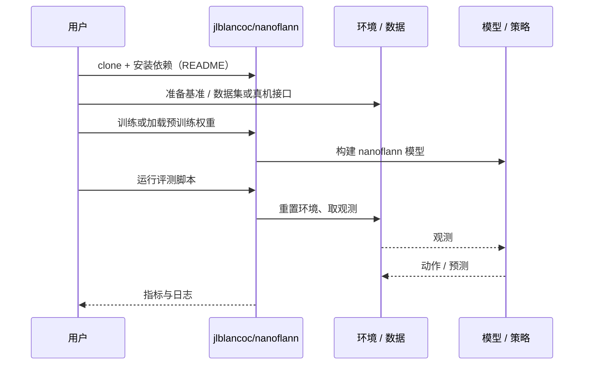

# nanoflann（arXiv:2610.15215）

**nanoflann**（*nanoflann: A Header-Only KD-Tree Library for Exact Nearest-Neighbor Search on Compile-Time Product Manifolds*，[arXiv:2610.15215](https://arxiv.org/abs/2610.15215)，[代码](https://github.com/jlblancoc/nanoflann)）来自 [具身智能小站 2026-10-14 盘点](../../sources/blogs/wechat_embodied_station_41_papers_streamingwam_2026-10-14.md)，属「导航、足式与规划」组。

## 一句话定义

**把旋转、位姿等乘积流形的距离与剪枝规则编译期纳入精确 KD-tree 近邻搜索，避免对原始坐标直接用欧氏距离。**

## 英文缩写速查

| 缩写 | 英文全称 | 简要说明 |
|------|----------|----------|
| KD-tree | k-dimensional tree | 空间划分近邻索引 |
| NN | Nearest Neighbor | 近邻搜索 |
| SE(3) | Special Euclidean group | 刚体位姿空间 |

## 为什么重要

- 机器人状态空间的近邻搜索若忽略几何，采样规划与定位会得到错误邻居。
- 开源结论：**已开源**（步骤 2.5，2026-10-14）。长期维护的 header-only C++ 库；乘积流形接口需 C++17。
- 同期同组工作见 [流式动作块与世界模型记忆：具身智能小站 10-14 期 41 篇阅读坐标](../overview/embodied-station-2026-10-14-41-papers-technology-map.md)。

## 核心机制

| 项 | 内容 |
|----|------|
| **arXiv** | [2610.15215](https://arxiv.org/abs/2610.15215) |
| **开源** | **已开源** |
| **要点** | 编译期组合各因子流形的度量与包围盒剪枝；另提供动态索引。 |
| **文内指标** | 库论文；性能对比以原文与仓库 benchmark 为准。 |

## 源码运行时序图

以下为按仓库入口（`jlblancoc/nanoflann`）推断的通用运行链路；入库日仅核实仓库可达，未逐文件阅读，具体脚本名以 README 为准。

## 实验与评测

- 库论文；性能对比以原文与仓库 benchmark 为准。
- **读法：** 本页为索引级摘要，依据公众号转述的官方摘要与仓库信息整理；逐项数字与 baseline 以原文 PDF 为准。

## 与其他工作对比

- 横向索引见 [流式动作块与世界模型记忆：具身智能小站 10-14 期 41 篇阅读坐标](../overview/embodied-station-2026-10-14-41-papers-technology-map.md)；同 arXiv 不重复造页。

## 结论

**采样规划或 SLAM 需要 SE(3) 近邻时，优先用支持流形度量的库而非对坐标拼接做欧氏搜索。**

1. 开源边界：**已开源** — 长期维护的 header-only C++ 库；乘积流形接口需 C++17。
2. 核心机制：编译期组合各因子流形的度量与包围盒剪枝；另提供动态索引。
3. 复现与选型前核对任务协议、硬件与基准口径，勿直接横比公众号摘录数字。

## 关联页面

- [trajectory-optimization](../methods/trajectory-optimization.md)
- [a-star](../methods/a-star.md)
- [configuration-space](../concepts/configuration-space.md)
- [embodied-station-2026-10-14-41-papers-technology-map](../overview/embodied-station-2026-10-14-41-papers-technology-map.md)

## 参考来源

- [nanoflann_product_manifold_kdtree_arxiv_2610_15215.md](../../sources/papers/nanoflann_product_manifold_kdtree_arxiv_2610_15215.md)
- [wechat_embodied_station_41_papers_streamingwam_2026-10-14.md](../../sources/blogs/wechat_embodied_station_41_papers_streamingwam_2026-10-14.md)
- [arXiv:2610.15215](https://arxiv.org/abs/2610.15215)

## 推荐继续阅读

- [arXiv PDF](https://arxiv.org/pdf/2610.15215)
- [https://github.com/jlblancoc/nanoflann](https://github.com/jlblancoc/nanoflann)
