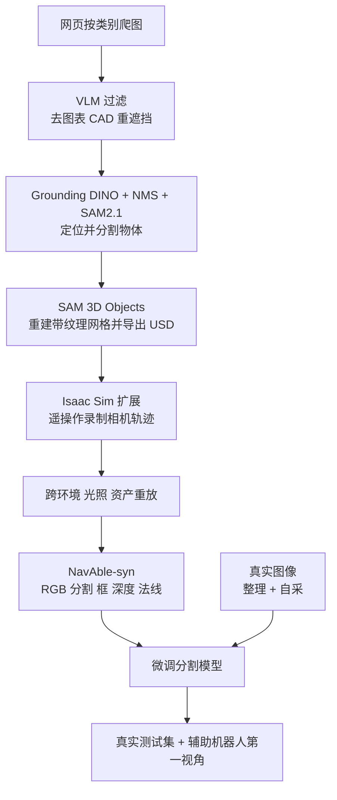

# NavAble：盲人导航的无障碍关键物体数据集与合成管线

**NavAble 把电梯按钮、门按钮、行人信号、扶手等稀有但安全攸关的物体做成 11 类分割数据集，并用「网页爬取 + VLM 过滤 + SAM 3D 资产 + Isaac Sim 重放」的管线补足类别和视角覆盖。**

论文 *NavAble: A Large-Scale Dataset and Synthetic Data Generation Pipeline for Blind Navigation*（[arXiv:2610.19330](https://arxiv.org/abs/2610.19330)，[数据集](https://huggingface.co/datasets/NavAble/NeurIPS_2026_BLV)）。

## 英文缩写速查

| 缩写 | 英文全称 | 简要说明 |
|------|----------|----------|
| BLV | Blind and Low-Vision | 目标用户群，数据集针对其导航需求 |
| APS | Accessible Pedestrian Signal | 无障碍行人信号按钮，11 类之一 |
| mIoU | mean Intersection over Union | 分割主指标，真实测试集上衡量 |
| USD | Universal Scene Description | 3D 资产导出格式，供 Isaac Sim 使用 |

## 为什么重要

- 现有视觉数据集很少覆盖按钮、扶手等无障碍关键物体，类别少、标注不一致。
- 合成管线把人工降到「摆放物体与录制轨迹」，可按类别和视角补洞。
- 在手杖形设备和 Unitree Go2 的第一视角上做了出分布测试，对应真实辅助平台。

## 核心信息

| 项 | 内容 |
|----|------|
| **机构** | UMass Amherst；大邱庆北科学技术院（DGIST）；波士顿大学，依据 arXiv HTML |
| **类别** | 11 类：电梯、电梯按钮、门按钮、人行横道、行人信号、APS 按钮、公交站、公交站牌、扶手、扶梯、旋转闸机 |
| **数据规模** | 真实约 41.5K（约 36K 整理 + 约 5.5K 自采，RealSense D435，50 个地点）；合成 452K 帧、37 个环境、500+ 资产 |
| **开源** | **已开源（数据集）**（2026-10-17 核查）：[HF 数据集页](https://huggingface.co/datasets/NavAble/NeurIPS_2026_BLV) cc-by-4.0，三个子集；管线文件列表未核实 |

## 核心原理

### 流程总览

- 合成数据 25K+ 条轨迹、488 个摆放位置，781K 实例标注（论文）。
- 真实测试集 1,482 张仅来自自采，并按地点与训练分离，避免泄漏。

## 源码运行时序图

**不适用**：论文称管线与 Isaac Sim 扩展发布在 HF 数据集地址，但 2026-10-17 抓取的页面未显示文件列表，无法对齐真实入口（未核实）。

## 与其他工作对比

| 维度 | NavAble（本文） | [Segment Anything](./paper-segment-anything.md) | [SAM 3](./paper-sam3.md) |
|------|------|------|------|
| 目标 | 11 类盲人导航关键物体的语义分割数据与合成管线 | 类别无关的可提示分割基础模型 | 统一图像 / 视频可提示概念分割（PCS） |
| 数据规模 | 约 41.5K 真实图像 + 452K 合成帧 | SA-1B（11M 图像 / 1.1B mask） | 本库页未列 |
| 主要产出 | 数据集（HF，cc-by-4.0）+ 合成管线，微调 SAN、Mask2Former 等 | 模型 + 数据集，Apache-2.0 推理仓 | 模型 + facebook/sam3.1 checkpoint |
| 在本文中的角色 | — | 管线以 SAM2.1 做物体分割标注 | 本文未直接评测 |

- **相对 Segment Anything：** SAM 系列提供通用 mask 能力，并在 NavAble 管线中被当作标注工具；NavAble 补的是按钮、扶手等罕见且安全攸关类别的语义标签与视角覆盖。
- **相对 SAM 3：** SAM 3 走开放词汇概念提示路线；NavAble 中开放词汇模型 SAN 零样本仅 14.94 mIoU，说明这类长尾无障碍类别仍需领域数据微调（该结论不针对 SAM 3 本身）。
- 各文任务与测试集不同，mIoU 不可横比。

## 工程实践

| 项 | 建议 |
|----|------|
| 取数 | 从 HF 加载 parquet，子集 real_curated / real_ours / syn；字段含 image、mask、source_dataset、split_origin |
| 训练配比 | 不同模型对合成 / 整理数据反应不一：SAN、SegFormer 受益，DeepLabv3+ 与 EncNet 反而下降或持平，需逐模型验证 |
| 评测 | 用地点分离的真实测试集；闸机类无真实实例，需排除出均值 |
| 部署前 | 先在目标平台第一视角上做小规模评测，再决定是否加合成 |
| 管线复用 | 资产需 SAM 3D 重建并导出 USD，摆放与轨迹录制仍需人工 |
| 重定向就绪度 | 数据为 2D 图像 + 像素级掩码，可直接作分割训练输入；跨平台迁移靠视角而非形态重定向，手杖 / Go2 第一视角的出分布 mIoU 明显偏低，部署前须在目标平台视角补采或微调 |

## 实验与评测

- **真实测试集 mIoU（仅真实 → 最佳配置）：** SAN 62.07 → 68.12；Mask2Former 68.84 → 72.67；SegFormer 61.06 → 65.96；SAN 零样本 14.94。
- **摘要口径：** 微调后超过 80% mIoU，合成最多 +3.5 mIoU；抓取的表 3 数字与此不完全对应（最佳配置含整理数据，口径不同），引用前请对照原表。
- **手杖形设备（157 张，5 类）：** SegFormer 11.94 → 16.17，人行横道提升最大（+9.64 IoU）。
- **Unitree Go2（155 张，9 类）：** SegFormer 21.56 → 23.08；三个类别仅 1 个真值实例，结论不稳。

## 结论

**NavAble 的主要贡献是数据与管线，而非新模型；合成数据的收益真实但依赖模型，且在辅助平台上绝对精度仍低。**

1. **先看口径** — 摘要的 +3.5 与表中最佳配置增益不同，注意区分「仅合成」与「合成 + 整理」。
2. **逐模型验证** — 两个模型加合成后无提升甚至下降。
3. **出分布仍弱** — 手杖设备 16.17、Go2 23.08 mIoU，远低于同分布测试集。
4. **样本小** — 两个平台各约 150 张，部分类别仅 1 个实例。
5. **未验证闭环** — 未与实际辅助导航系统联合部署（作者自述）。

## 局限与风险

- 作者自述：类别体系遗漏许多 BLV 相关对象；真实数据地理多样性有限；摆放与轨迹录制仍需人工；未报告多种子误差棒。
- 开源：数据集已公开；管线文件与数据卡细节未核实。
- 未核实：HF 数据卡对许可证以外的使用限制。

## 关联页面

- [图像分割分类](../concepts/image-segmentation-taxonomy.md) — 语义 / 实例分割背景
- [机器人视觉感知栈选型闭环](../queries/robot-perception-stack-selection-loop.md) — NavAble 填的是「2D 检测/分割选型」层的数据缺口；手杖 / Go2 出分布结果提示须在目标平台视角上复核
- [SAM 3](../entities/paper-sam3.md) — 同系列分割基础模型（管线使用 SAM2.1 与 SAM 3D Objects）
- [Isaac Sim](../entities/isaac-sim.md) — 合成帧渲染平台
- [Sim2Real](../concepts/sim2real.md) — 合成到真实的迁移问题

## 参考来源

- [navable_arxiv_2610_19330.md](../../sources/papers/navable_arxiv_2610_19330.md) — 论文摘录与开源核查
- [navable-project.md](../../sources/sites/navable-project.md) — HF 数据集页归档
- [arXiv:2610.19330](https://arxiv.org/abs/2610.19330)

## 推荐继续阅读

- [NavAble 数据集](https://huggingface.co/datasets/NavAble/NeurIPS_2026_BLV)
- [NavAble 论文 HTML](https://arxiv.org/html/2610.19330v1)
