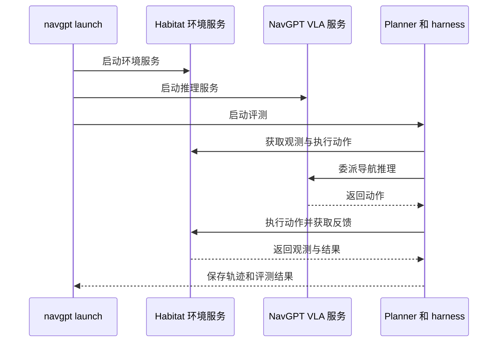

# NavGPT-3：分层运行时连接导航推理与动作

## 一句话定义

NavGPT-3 用导航 harness 和线程调度连接语言模型规划、空间工具与 NavGPT VLA，使长程推理与较快的动作执行协同。

## 英文缩写速查

| 缩写 | 英文全称 | 简要说明 |
|------|----------|----------|
| VLN | Vision-and-Language Navigation | 语言指令条件下的视觉导航 |
| VLA | Vision-Language-Action | 视觉、语言条件下生成动作的模型 |
| SR | Success Rate | 导航成功率 |
| nDTW | normalized Dynamic Time Warping | 归一化路径一致性指标 |

## 核心信息

| 字段 | 内容 |
|------|------|
| 机构 | 阿德莱德大学澳大利亚机器学习研究所；Metacognition；澳大利亚国立大学；Roblox；北京大学；上海交通大学；北卡罗来纳大学教堂山分校；新南威尔士大学 |
| 论文 | [arXiv:2610.10787](https://arxiv.org/abs/2610.10787) |
| 任务 | R2R-CE、RxR-CE 视觉语言导航 |
| 资源 | [项目页](https://metacognitionai.github.io/NavGPT3/) · [代码](https://github.com/metacognitionai/NavGPT-3) |

## 核心机制

Planner 结合观测、路线状态、空间工具和执行反馈，选择直接使用工具或委派 VLA 导航。运行时为推理、行动与监控线程分配独立上下文、工具和权限，并通过中断与运动控制权切换处理事件。VLA 在 19.28M 样本上训练，根据图像变化、时间和视角分配视觉 token。

## 源码运行时序图

README 也提供分别启动 `navgpt.environment`、`navgpt.vla` 后运行 `navgpt run` 的路径；图概括仿真评测流程，不代表已发布 Unitree 部署实现。

## 评测与局限

| Val-Unseen | VLA 8B 单模型 SR | 完整系统 SR |
|------|------|------|
| R2R-CE | 76.94% | 81.51% |
| RxR-CE | 82.39% | 90.43% |

项目页说明上述完整系统采用 GPT-6 Astra 作为 Planner。论文将 RxR-CE 的 90.43 SR 与人类 90.4 SR 对照，但项目页注明人类研究采用离散导航，设置不同，不宜视作严格同条件比较。论文报告 VLA 单步 0.5–1 秒、语言模型决策 3–19 秒，属于高层决策响应时间，而非电机控制周期。

## 与其他工作对比

- **对 [NaVILA](./paper-notebook-navila-legged-robot-vision-language-action-model.md)：** 二者都是分层导航：NaVILA 由高层 VLA 输出「前进 75 cm」等中层命令、RL locomotion 执行关节控制；NavGPT-3 在 VLA 之上再加语言模型 Planner 与线程运行时，负责工具调用、委派与中断。
- **对 [NaVid](./paper-vln-10-navid.md) 一类端到端导航 VLA：** NaVid 仅依赖 RGB 视频流直接输出底层动作；NavGPT-3 的 VLA 单模型与完整系统 SR 对照（R2R-CE 76.94%→81.51%）显示外层 Planner 的增益，但完整系统使用项目页所述的 GPT-6 Astra 作为 Planner，增益与该 Planner 绑定。
- 范式定位可对照 [VLN 四范式开源复现策展](../overview/vln-open-source-repro-paradigms.md)：NavGPT-3 横跨「语言中枢」与「导航 VLA」两条范式。

## 结论

分层运行时为语言推理与导航动作提供了可中断、可反馈的接口，仿真结果显示完整系统优于单独 VLA。

- 对照实验应固定数据划分、Planner 和 VLA 配置，避免混淆不同系统。
- 复现需取得 Matterport3D 场景权限并准备 GPU、权重及评测数据。
- 官方公开 VLA 推理、harness、仿真评测与权重；Unitree 部署代码尚待发布，不能据此假定真机部署可直接复现。
- 短响应时间不能替代底层安全控制与真机测试。

## 关联页面

- [视觉语言导航](../tasks/vision-language-navigation.md)
- [VLN 四范式开源复现策展](../overview/vln-open-source-repro-paradigms.md)
- [VLA 方法](../methods/vla.md)

## 参考来源

- [论文归档](../../sources/papers/navgpt3_arxiv_2610_10787.md)
- [项目页归档](../../sources/sites/navgpt-3.md)
- [官方仓库归档](../../sources/repos/navgpt-3.md)

## 推荐继续阅读

- [官方 README 与复现步骤](https://github.com/metacognitionai/NavGPT-3)
