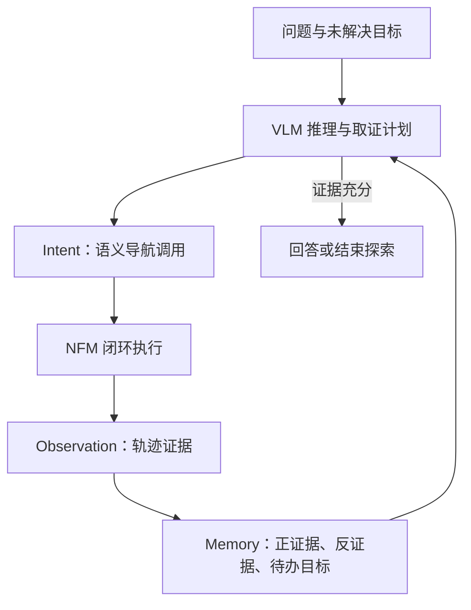

# NavMCP：长时程具身导航的基础模型脚手架

## 一句话定义

NavMCP（arXiv:2608.30396）让视觉语言模型负责选择要寻找的证据与何时停止，让导航基础模型负责闭环执行语义子目标，并通过记忆跨多次导航调用持续累积证据。

## 英文缩写速查

| 缩写 | 英文全称 | 简要说明 |
|------|----------|----------|
| VLM | Vision-Language Model | NavMCP 的高层推理模型，提出取证需求并调整计划 |
| NFM | Navigation Foundation Model | 将语义子目标转成短时程闭环导航轨迹的执行模型 |
| EQA | Embodied Question Answering | 智能体主动探索后依据环境证据回答问题 |
| SR | Success Rate | 论文用于报告 Go2 导航任务成功情况的比例 |

## 为什么重要

长时程具身任务的瓶颈可能不只在单次导航策略，也在高层 agent 如何调用、检查和记住导航结果。NavMCP 将两种基础模型的职责分开，并用跨调用记忆把孤立 rollout 接成持续探索过程；这让接口与证据管理成为系统设计的一部分，而无需先联合训练一套新模型。

## 方法栈与流程总览

NavMCP 的核心是 VLM reasoner 与 NFM executor 的反复协作：

1. **Intent：** VLM 根据问题或当前未解决目标，决定需要什么证据、去哪里寻找，并发起一个语义导航子目标。
2. **Navigation rollout：** NFM 将子目标落实为短时程闭环导航行为，机器人在真实环境中移动。
3. **Observation：** 系统把 rollout 结果转换为与来源轨迹关联的观察证据，供 VLM 检查是否找到支持或反证。
4. **Memory：** 保存已发现信息、否定证据和仍未解决的目标，供后续调用继续推理。
5. **Stop：** VLM 判断证据是否充分；若不足则发起下一次导航调用。

论文正文说明该系统不重新训练 VLM 或 NFM；因此其研究对象是模型间的 agent scaffolding、调用接口和记忆闭环，而非新的单体导航策略。

## 实验与评测

| 评测 | 论文正文报告（Table 1–3） |
|------|---------------------------|
| **HM-EQA** | Acc **76.7%**（较 FAST-EQA +7.5 pp），Normalized Agent Steps **0.15**；同一骨干（`Qwen3.5-397B-A17B` + 同工具集）下领先 FAST-EQA **10.5 pp**、领先 episodic interface **14.9 pp**（Table 2） |
| **MT-HM3D** | Acc **54.4%**（较基线 +3.9 pp），Normalized Agent Steps **0.19** |
| **EXPRESS-Bench** | LLM Score **79.27**，路径效率 $E_{\text{path}}$ 为表内最优 |
| **Unitree Go2 实机长程导航** | 成功率 **78.3%**；随任务时程拉长，相对最强基线的优势由 **10 个百分点** 扩大到 **45 个百分点** |

以上结果已对照论文全文（Table 1–3 与 §5）核实：跨调用 `intent / observation / memory` 脚手架在不重训任何 VLM/NFM 前提下，将算力瓶颈从高层模型反复重猜转为低次数外层调用与可追溯轨迹证据累积。

## 与其他工作对比

- **Episodic interface：** 是论文直接对照的接口；NavMCP 的区别在于 intent、观察证据和 memory 跨导航调用持续传递，而非每回合独立执行。
- **[HUMEMBR](./paper-humembr.md)：** 同样面向导航中的具身问答与持久记忆，但聚焦人中心日常规律、结构化检索与 Spot/GraphNav；NavMCP 聚焦 VLM 与 NFM 的协作框架及长时程取证。
- **[Qwen-Robot Suite](./qwen-robot-suite.md)：** 可作为“通用 agent 编排专用物理基础模型”的系统背景对读（Table 3 即消融固定 `Qwen-RobotNav-8B` 下不同上层 VLM 的表现）。
- **[SuperNav](./paper-supernav-agentic-navigation.md)：** 同属 agentic 导航方向，适合比较高层规划、导航后端、工具接口与跨步骤记忆的设计边界。

## 源码运行时序图

**不适用**：截至 2026-11-21 复核，官方 arXiv 条目与作者学术页仍未列出可运行代码仓库或数据集下载入口，无法对齐真实源码入口绘制运行时序图。

## 工程实践

| 项目 | 读法 |
|------|------|
| 系统边界 | 将高层取证 / 停止判断与底层闭环导航分开，避免把 VLM 的语言计划当作电机控制指令 |
| 证据记录 | 同时保存支持、否定和未解决信息，避免重复探索或把“没看到”误当作“目标不存在” |
| 长程评测 | 按任务时程分组看成功率及相对基线差距，检查调用次数增加后性能是否保持 |

以上工程建议依据论文机制框架整理，不代表官方已公开对应源码或工具协议实现。

## 结论

**一句话总判：NavMCP 的主要价值是把导航基础模型从独立的短回合执行器，接入能规划取证、检查轨迹并跨调用记忆的长程 agent。**

1. 评估长时程 agent 时，单回合导航成功率不足以代表任务能力；应按任务时程检查性能差距如何变化。
2. 若任务需要主动找证据，导航结果应回流给推理层并关联到轨迹，而不是只返回“已执行”状态。
3. 记忆需要显式保留否定证据与待办目标，才能减少重复搜索并支持可靠停止。
4. Go2 实机（78.3%）与 EQA 基准证明跨调用脚手架有效，但迁移到其他本体或 NFM 仍需重测工具调用延迟与误差敏感度。
5. 复现前仍受制于官方源码与完整评测脚本未公开的边界（截至 2026-11-21）。

## 局限与风险

- 高层 VLM 的停止判断、观察解释和记忆更新仍可能出错；系统需要独立的安全约束、超时与人工接管机制。
- 78.3% 是论文在 Unitree Go2 场景下的实机结果，不应外推为跨本体或无约束开放环境的可靠性保证。
- 截至 2026-11-21 核查，官方 arXiv 条目与作者学术页尚未公布可运行源码或数据下载链接。

## 关联页面

- [视觉–语言导航（VLN）](../tasks/vision-language-navigation.md) — 语言条件下的导航任务背景
- [HUMEMBR](./paper-humembr.md) — 人中心长期记忆与具身问答导航
- [SuperNav](./paper-supernav-agentic-navigation.md) — 预训练多模态模型的 agentic 导航框架
- [Qwen-Robot Suite](./qwen-robot-suite.md) — 专用具身基础模型与 agent 的组合路线

## 参考来源

- [NavMCP 论文来源归档](../../sources/papers/navmcp_arxiv_2608_30396.md)
- [arXiv:2608.30396](https://arxiv.org/abs/2608.30396)
- [Haoqi Yuan 学术主页](https://yhqpkueecs.github.io/)

## 推荐继续阅读

- [arXiv:2608.30396 — Scaffolding Foundation Models into Physical-World Agents Pushes the Frontier of Long-Horizon Navigation](https://arxiv.org/abs/2608.30396)
- [Haoqi Yuan 学术主页](https://yhqpkueecs.github.io/)
