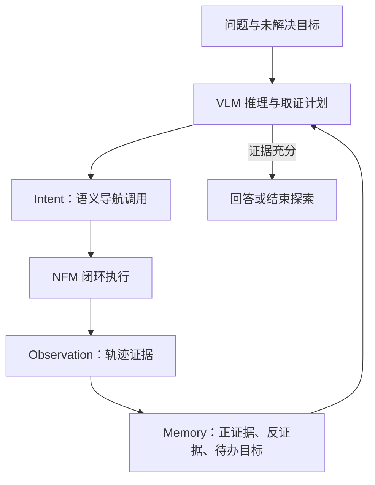

# NavMCP：长时程具身导航的基础模型脚手架

## 一句话定义

NavMCP（arXiv:2608.30396）让视觉语言模型负责选择要寻找的证据与何时停止，让导航基础模型负责闭环执行语义子目标，并通过记忆跨多次导航调用持续累积证据。

## 英文缩写速查

| 缩写 | 英文全称 | 简要说明 |
|------|----------|----------|
| VLM | Vision-Language Model | NavMCP 的高层推理模型，提出取证需求并调整计划 |
| NFM | Navigation Foundation Model | 将语义子目标转成短时程闭环导航轨迹的执行模型 |
| EQA | Embodied Question Answering | 智能体主动探索后依据环境证据回答问题 |
| SR | Success Rate | 论文用于报告 Go2 导航任务成功情况的比例 |

## 为什么重要

长时程具身任务的瓶颈可能不只在单次导航策略，也在高层 agent 如何调用、检查和记住导航结果。NavMCP 将两种基础模型的职责分开，并用跨调用记忆把孤立 rollout 接成持续探索过程；这让接口与证据管理成为系统设计的一部分，而无需先联合训练一套新模型。

## 方法栈与流程总览

NavMCP 的核心是 VLM reasoner 与 NFM executor 的反复协作：

1. **Intent：** VLM 根据问题或当前未解决目标，决定需要什么证据、去哪里寻找，并发起一个语义导航子目标。
2. **Navigation rollout：** NFM 将子目标落实为短时程闭环导航行为，机器人在真实环境中移动。
3. **Observation：** 系统把 rollout 结果转换为与来源轨迹关联的观察证据，供 VLM 检查是否找到支持或反证。
4. **Memory：** 保存已发现信息、否定证据和仍未解决的目标，供后续调用继续推理。
5. **Stop：** VLM 判断证据是否充分；若不足则发起下一次导航调用。

论文摘要说明该系统不重新训练 VLM 或 NFM；因此其研究对象是模型间的 agent scaffolding、调用接口和记忆闭环，而非新的单体导航策略。

## 实验与评测

| 评测 | 论文摘要报告 |
|------|--------------|
| 具身问答 | HM-EQA、MT-HM3D、EXPRESS-Bench 上作者报告优于论文所列对照方法（以投稿时的比较集合为限） |
| 匹配骨干的接口比较 | HM-EQA 上，NavMCP 比 episodic interface 高 14.9 个百分点 |
| Unitree Go2 实机长程导航 | 成功率 78.3%；任务时程增加时，相对最强基线的差距由 10 扩大到 45 个百分点 |

这些数字支持“持久的跨调用推理与证据记忆有助于长时程任务”这一系统级结论。摘要没有给出各基准的完整指标表、试验次数或统计区间，比较具体实现时需回到论文正文与附录核对。

## 与其他工作对比

- **Episodic interface：** 是论文直接对照的接口；NavMCP 的区别在于 intent、观察证据和 memory 跨导航调用持续传递，而非每回合独立执行。
- **[HUMEMBR](./paper-humembr.md)：** 同样面向导航中的具身问答与持久记忆，但聚焦人中心日常规律、结构化检索与 Spot/GraphNav；NavMCP 聚焦 VLM 与 NFM 的协作框架及长时程取证。
- **[Qwen-Robot Suite](./qwen-robot-suite.md)：** 可作为“通用 agent 编排专用物理基础模型”的系统背景对读。两者是不同工作；NavMCP 论文摘要未说明其使用 Qwen-Robot 系列模型。
- **[SuperNav](./paper-supernav-agentic-navigation.md)：** 同属 agentic 导航方向，适合比较高层规划、导航后端、工具接口与跨步骤记忆的设计边界。

## 工程实践

| 项目 | 读法 |
|------|------|
| 系统边界 | 将高层取证 / 停止判断与底层闭环导航分开，避免把 VLM 的语言计划当作电机控制指令 |
| 证据记录 | 同时保存支持、否定和未解决信息，避免重复探索或把“没看到”误当作“目标不存在” |
| 长程评测 | 按任务时程分组看成功率及相对基线差距，检查调用次数增加后性能是否保持 |
| 源码运行时序图 | **不适用**：截至 2026-10-25，官方 arXiv 条目与作者学术页未列可运行代码仓库，无法对齐源码入口绘制运行时序 |

以上前三项是依据论文抽象结构给工程实现的阅读建议，不代表作者发布了对应代码或工具协议。

## 结论

**一句话总判：NavMCP 的主要价值是把导航基础模型从独立的短回合执行器，接入能规划取证、检查轨迹并跨调用记忆的长程 agent。**

1. 评估长时程 agent 时，单回合导航成功率不足以代表任务能力；应按任务时程检查性能差距如何变化。
2. 若任务需要主动找证据，导航结果应回流给推理层并关联到轨迹，而不是只返回“已执行”状态。
3. 记忆需要显式保留否定证据与待办目标，才能减少重复搜索并支持可靠停止。
4. 论文摘要中的 Go2 与 EQA 结果是系统级证据，不能单独证明可迁移到其他机器人、场景或 NFM。
5. 复现前应先确认官方源码、数据和完整评测协议是否发布；当前可见官方材料不足以完成代码级复现。

## 局限与风险

- arXiv 摘要的结果不足以单独判断各子模块贡献；需查正文中的消融、提示设置和统计细节。
- 78.3% 是论文所述 Unitree Go2 实机结果，不应外推为跨本体或广泛环境的可靠性保证。
- 高层模型的停止判断、观察解释和记忆更新都可能出错；系统仍需独立的安全约束、超时与人工接管机制。
- 当前可查的 arXiv 条目与作者学术页未列代码或数据链接，公开资料不足以核验完整复现路径。

## 关联页面

- [视觉–语言导航（VLN）](../tasks/vision-language-navigation.md) — 语言条件下的导航任务背景
- [HUMEMBR](./paper-humembr.md) — 人中心长期记忆与具身问答导航
- [SuperNav](./paper-supernav-agentic-navigation.md) — 预训练多模态模型的 agentic 导航框架
- [Qwen-Robot Suite](./qwen-robot-suite.md) — 专用具身基础模型与 agent 的组合路线

## 参考来源

- [NavMCP 论文来源归档](../../sources/papers/navmcp_arxiv_2608_30396.md)
- [arXiv:2608.30396](https://arxiv.org/abs/2608.30396)
- [Haoqi Yuan 学术主页](https://yhqpkueecs.github.io/)

## 推荐继续阅读

- [arXiv:2608.30396 — Scaffolding Foundation Models into Physical-World Agents Pushes the Frontier of Long-Horizon Navigation](https://arxiv.org/abs/2608.30396)
- [Haoqi Yuan 学术主页](https://yhqpkueecs.github.io/)
