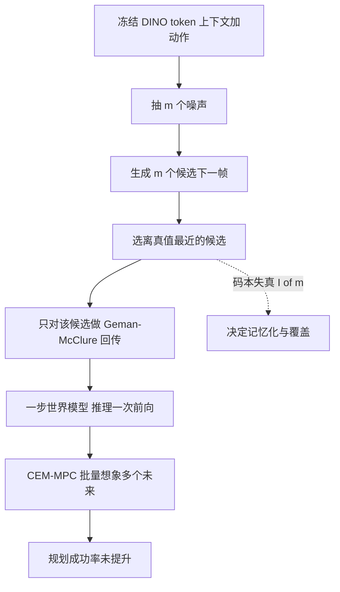

# Nearest-of-m 世界模型（arXiv:2611.11887）

*How Many Candidates Does a One-Step World Model Need? A Random-Codebook Account of Nearest-of-m Training on Frozen DINO Tokens*（Song & Lee，Chungbuk National University，[arXiv:2611.11887](https://arxiv.org/abs/2611.11887)，v1，2026-11-09）。代码仓库：<https://github.com/thddydgnl/nearest-of-m-world-models>。

## 一句话定义

在冻结的 DINOv2/v3 patch token 上，训练时每步抽 m 个噪声候选、只拉近离真值最近的那个（条件 IMLE），推理一次前向；论文把它解释为「m 个随机码本的期望失真」，用来回答一步世界模型到底需要多少候选、何时任何 m 都不够（摘要，第 1、4 节）。

## 英文缩写速查

| 缩写 | 英文全称 | 简要说明 |
|------|----------|----------|
| IMLE | Implicit Maximum Likelihood Estimation | 每个数据点匹配最近的生成样本；条件版即本文的 nearest-of-m（第 1 节） |
| WM | World Model | 世界模型；IMLE-WM 指本文模型 |
| DINO | self-DIstillation with NO labels | 冻结视觉编码器，本文用 DINOv2 ViT-S/14 与 DINOv3 特征（第 3 节） |
| FM-50 / FM-2 | Flow Matching, 50 / 2 steps | 流匹配基线，按 FlowWM 配方（第 3 节） |
| iMF | improved MeanFlow | 一步流生成器基线（第 3 节） |
| NFE | Number of Function Evaluations | 每步网络评估次数 |
| CEM-MPC | Cross-Entropy Method MPC | 本文规划器（第 3 节） |
| BAIR | BAIR robot pushing | 真实机器人推物视频数据集（Ebert 等 2017，表 1） |
| I(m) | codebook miss distortion | 码本漏掉真实模式时的期望失真（式 3） |

## 为什么重要

- 特征空间世界模型若只做确定性回归，会预测多模态未来的均值；流匹配 / 扩散又要几十次网络评估。nearest-of-m 单次前向，适合规划时需要想象大量未来的场景（第 1 节）。
- 论文把「m 要多大」从经验猜测变成可预测量：由 I(m) 而非漏失概率 (1−1/K)^m 决定，并且预先记录预测再跑实验（第 4、7 节，附录 B）。
- 给出明确的负面结果：规划成功率不随模型概率估计变准而提高（第 9 节），对「模型指标变好就能规划更好」的假设是反例。

## 核心原理与流程总览

**训练目标（第 3 节，式 1）。** 对每个转移抽 m 个噪声 z，生成候选，选 `argmin` 距离真值最近者，仅该候选带梯度，损失为 Geman–McClure。网络为 ConvNeXt 栈，动作 FiLM 注入，噪声经自适应 LayerNorm 只进最后几块（late fusion）；8M 与 21M 两种规模。

**随机码本解释（第 4 节，式 2）。** 期望损失 = 用 m 个独立生成样本作码本量化真值的失真。由此推出：

1. 非重复上下文中，记忆化解的损失比泛化解低恰好 I(m)（命题 1）；离散模式下 I(m) 随 m 超过 K 指数消失。
2. 连续高维下，最优样本散度约为真实散度的 e_m/√d，欠分散（命题 2）。
3. 模式概率随 m 变平，等模式时 q=p（引 Bennett 2026 的定理）。
4. 能量分数的记忆化激励与 m 无关（命题 3）。

**逐步匹配（第 3、9 节）。** 沿模型自己的 H=4 步 rollout，每步抽 m 个新噪声、选最近真帧者训练并回灌；整段轨迹匹配因轨迹模式数按 K^H 增长而失败（附录 G）。

## 关键结果（均为论文自述，带出处）

| 项 | 结果 | 出处 |
|----|------|------|
| 非重复上下文覆盖（A2-div, K=4） | m=16：覆盖 0.93 / 精度 0.82；FM-50：0.79 / 0.51；能量分数 m=8：0.36（理想采样器 0.99） | 表 2 |
| 延迟 | 3.3 ms / 步 对 FM-50 的 107 ms（RTX A5000, batch 1） | 表 2 |
| Bouncing Shapes F1 误差 | 自回归 probe：m=16 为 7.21，m=4 为 6.61，FM-50 为 12.28 px | 表 3 |
| 随机 Push-T 精度 / 召回 | h=16：m=16 精度 34.1、召回 37.8；FM-50 为 40.7 / 42.0；精度差值显著，召回差值层级 bootstrap 区间含 0 | 表 4、15 |
| 记忆化 | m=4 记忆化指数 0.75、覆盖 0.46；m=16 为 0.29；能量分数 0.87 / 0.97 | 表 2，第 7 节 |
| 拟合 | I(m,K) 的 RMSE 0.031，(1−1/K)^m 为 0.068；预先记录的 9 个预测中 7 个落入区间 | 第 7 节，附录 B |
| BAIR | 最佳 16 样本 token 误差 0.527 对 FM-50 0.843，但 Fréchet 距离 2.09 对 1.38，kNN 召回 0.15 对 0.84 | 第 8 节，表 13 |
| 规划（随机 Push-T） | IMLE-WM 31.7%、回归 31.7%、FM-2 34.7%、FM-50 30%（10 局）；每步规划 4.0 s 对 FM-50 的 200 s | 表 18 |
| 规划（分支风险） | IMLE-WM 一步坑概率估计 0.36（真值 0.33），成功率 55.3%，坑率 31.0%；回归 56.3% / 24.3%；FM-2 67.0% / 18.7%；oracle 76% | 表 18，第 9 节 |

## 工程实践

- **配方要点：** AdamW，lr 2e-4，batch 128，EMA，主对比 12k 步、三种子；候选生成在独立的 bfloat16 autocast 区、无梯度，否则会静默切断权重梯度（附录 D）。
- **选 m：** 论文给的经验规则是估计近乎相同上下文下的结果多样性算 I(m)，取使其降到模式间距几个百分点的最小 m；A2 上 m=16–32 可使 excess memorization 低于 0.05（第 7、10 节）。代价：m 从 4 到 32，确定性转移误差 1.2 到 2.8–3.5 px，训练时间约 3 倍，推理成本不变（图 2）。
- **防记忆化：** 增大 m 最干净；RS-IMLE 拒绝采样无效；给上下文加噪 σ=1.0 能压住记忆化但覆盖 / 精度 / 确定性误差受损（表 11）。
- **规划：** CEM-MPC，T=5，64 条候选序列，每候选想象 mp=4（Push-T）或 8（branch-risk）个未来，代价为到目标距离的均值；方差惩罚在真模拟器上也使成功率 78% 降到 50%（附录 C、G）。
- **代码：** 仓库 README 列出训练 / 评测 / 规划代码与队列脚本；本页**未运行也未审阅代码**（仅读 README）。

## 与文章说法的核对

文章（《机器人动作块太长，什么时候该重新规划？》2026-11-11 条目）原文：标题「世界模型候选更多，规划就一定更好吗」；「分析多候选预测中的最近样本训练，解释随机码本如何覆盖多种未来。实验同时给出反例：预测指标改善未必转化为规划收益，候选数量也不存在跨任务通用最优值。」

| 文章说法 | 核对结果 |
|----------|----------|
| 分析最近样本训练，随机码本解释覆盖多种未来 | 一致：第 4 节把 nearest-of-m 目标写成随机码本失真，用它预测覆盖、记忆化与欠分散。 |
| 预测指标改善未必转化为规划收益 | 一致，且有数字：分支风险任务中 IMLE-WM 风险估计最准（0.36 对 0.33）而成功率 55.3% 不高于回归 56.3%，FM-2 估计最差却成功率最高 67.0%（表 18）。限定：仅两个仿真任务，规划器是简单的均值距离 CEM，论文自己说是规划器利用了模型误差，不是模型本身的问题（第 9 节），未做真机。 |
| 候选数量不存在跨任务通用最优值 | 论文**没有这句话**，是对其结论的概括：论文说 m 取决于结果流形上的 I(m)，离散少模式 m=16–32 够用，Bouncing Shapes 上 m=4 就够（第 6 节），连续高维（BAIR）任何可承受的 m 都不够（第 8、10 节）。可视为合理转述，不是论文原话；论文也没有专门做「跨任务最优 m」的统计。 |
| 标题「候选更多，规划就一定更好吗」 | 易误读：论文中 m 是**训练时**的候选预算，规划实验（表 18）只列 m=16 一档，并没有改变 m 去测规划成功率；规划部分比较的是不同生成目标 / 模型。因此「候选更多规划不更好」不是论文直接测到的因果结论。 |
| 「候选更多」暗含 m 越大越好 | 论文还指出 m 越大代价上升（确定性误差、训练时间、模式概率变平，第 7、8 节），并提醒大 m 样本不能当校准概率用（Broader Impact）。 |
| 仿真还是真机 | 文章摘要未写；论文基准除 BAIR 外均为合成或仿真（第 1 节），规划只在仿真，无真机实验。 |

## 局限

论文自述（第 10 节，7 条）：(1) 真实视频上欠分散且没有一步变体修复，BAIR 的各向同性拟合含一个自由参数；(2) 随机 Push-T 上相对流匹配的优势在精度，召回优势在三种子下不超过种子方差；(3) 基准多为合成 / 仿真，模型小（8M、21M），流匹配基线远小于 FlowWM 的规模；(4) 两个任务上规划成功率都没提升；(5) 大 m 压平模式概率，能量分数也未带来校准优势；(6) 消融、BAIR 变体与确定性 Push-T 对照只用单种子，K=2/16 网格与能量分数追加实验两种子；(7) 命题 3 是在观察到能量分数记忆化之后推出的，仅追加实验有事先记录的预测，且只试了一个 β 与两种距离。另：所有模型对首次接触的位移都错约 12/16 px，掩盖了目标间差异（第 6 节）。

本页作者判断（推测，未经论文验证）：结论是在 8M–21M 小模型、几小时训练的设置下得到的，是否随规模保持未知；记忆化实验依赖上下文带「身份键」的人为设计（A2-div 随机外观），真实机器人数据里的对应程度未测；代码我只读了 README，未验证可复现。

## 与其他工作对比

| 工作 | 关注点 | 与本文的区别 |
|------|--------|--------------|
| [DINO-WM](./paper-sa-2411-04983-dino-wm-world-models-on-pre-trained-visual-featu.md) | 冻结 DINO patch 特征上的世界模型 + 零样本规划 | 本文沿用其特征空间规划设置，但把确定性预测换成每步可采样的一步随机模型；论文中的「回归」基线对应确定性路线 |
| [FlowWM](./paper-flowwm-feature-space-stochastic-wm.md) | 冻结 DINOv3 特征空间里用条件流匹配建模多模态未来 | 本文的 FM-50 / FM-2 基线按 FlowWM 配方实现；nearest-of-m 推理一次前向（3.3 ms 对 107 ms，表 2），但 BAIR 上欠分散（第 8 节） |
| [DINO-world](./paper-sa-2507-19468-dino-world-back-to-the-features-dino-as-a-founda.md) | 以 DINO 特征为底座的视频世界模型 | 关注大规模视频预测；本文是 8M / 21M 小模型，重点是「候选数 m」的理论解释而非规模 |

## 结论

**nearest-of-m 的训练目标等价于 m 个随机码本的期望失真，这让「一步世界模型需要多少候选」成为可预测量，但更好的预测分布并没有带来更高的规划成功率。**

1. 码本漏失失真 I(m) 比 (1−1/K)^m 更能预测覆盖与记忆化（RMSE 0.031 对 0.068，第 7 节）；离散少模式任务上 m=16–32 即可。
2. 在合成任务上 m=16 的覆盖 / 精度优于 FM-50，且推理快约 30 倍（表 2）。
3. 连续高维的真实视频（BAIR）上样本欠分散，任何可承受的 m 都不够（第 8 节，命题 2）。
4. 局限：模型小、基准多为合成 / 仿真、规划只测两个仿真任务且成功率未提升，部分消融为单种子（第 10 节）。

## 关联页面

- [生成式世界模型](../methods/generative-world-models.md)
- [基于模型的强化学习](../methods/model-based-rl.md)
- [模型预测控制 MPC](../methods/model-predictive-control.md)
- [潜空间想象](../concepts/latent-imagination.md)
- [流匹配具身策略](../concepts/flow-matching-embodied-policy.md)
- [DINO-WM](./paper-sa-2411-04983-dino-wm-world-models-on-pre-trained-visual-featu.md)
- [DINO-world](./paper-sa-2507-19468-dino-world-back-to-the-features-dino-as-a-founda.md)
- [DINOv2](./paper-dinov2.md)

## 参考来源

- [sources/papers/nearest-of-m-world-models_arxiv_2611_11887.md](../../sources/papers/nearest-of-m-world-models_arxiv_2611_11887.md)
- [arXiv:2611.11887](https://arxiv.org/abs/2611.11887)
- 代码仓库：<https://github.com/thddydgnl/nearest-of-m-world-models>（仅读 README）

## 继续阅读

- [arXiv PDF（v1）](https://arxiv.org/pdf/2611.11887v1)
- [DINO-WM](./paper-sa-2411-04983-dino-wm-world-models-on-pre-trained-visual-featu.md)：本文规划设置所沿用的特征空间世界模型
- [生成式世界模型](../methods/generative-world-models.md)
