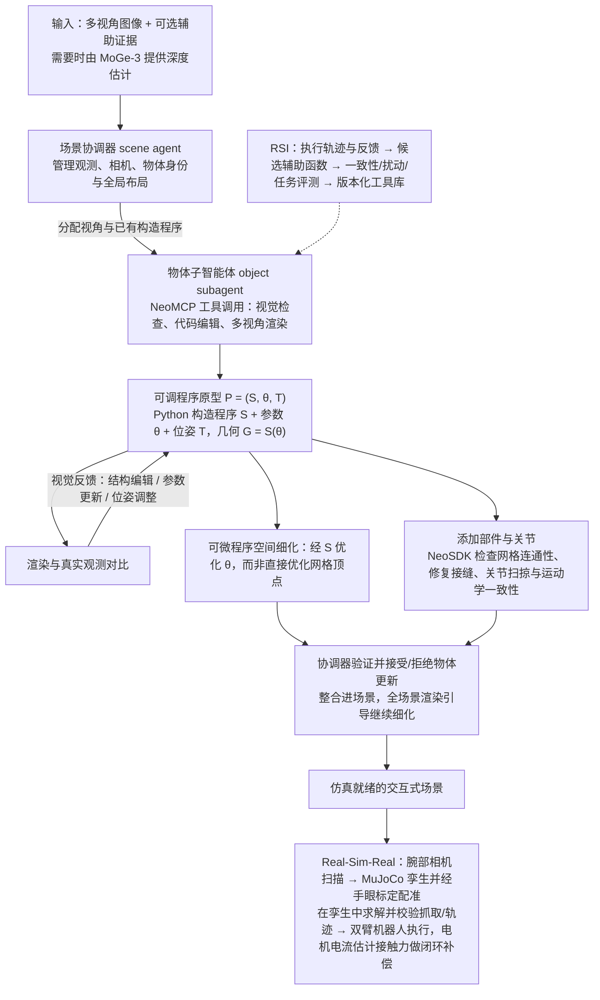

# NeoWorld-3（arXiv:2610.27690）

**NeoWorld-3**（*NeoWorld-3: From Pixels to Code-Defined Physical Worlds*，[arXiv:2610.27690](https://arxiv.org/abs/2610.27690)，[项目页](https://neoworldproject.github.io/Studio/)）来自 [具身智能小站 2026-10-31 盘点](../../sources/blogs/wechat_embodied_station_50_papers_scenerig_photo_to_sim_2026-10-31.md)，属「世界模型与仿真重建」组。

## 一句话定义

**NeoWorld-3将几何、关节和物理检查封装为工具，由代码代理迭代重建；物体、场景及双臂迁移实验展示价值，隐含质量与摩擦仍难从图像确定。**

## 英文缩写速查

| 缩写 | 英文全称 | 简要说明 |
|------|----------|----------|
| NeoWorld-3 | NeoWorld-3: From Pixels to Code-Defined Physical Worlds | 本文方法 / 基准的简称 |

## 为什么重要

- 把交互世界重建成可修改程序。
- 开源结论：**部分开源**（步骤 2.5，2026-10-31）。公众号未给代码链接；项目页链接的 NeoWorldProject/NeoWorldStudio 经 git ls-remote 可达，但页面 GitHub 卡片与 Hugging Face 均标 Coming soon，不能当作已完整开源。
- 同期同组工作见 [单图重建仿真、VLA 适配评测与跨形态世界模型：具身智能小站 10-31 期 50 篇阅读坐标](../overview/embodied-station-2026-10-31-50-papers-technology-map.md)。

## 流程总览

图依据：论文 §3.1–3.4、§4.6 与 Fig. 2 / Fig. 4。

## 核心机制

| 项 | 内容 |
|----|------|
| **arXiv** | [2610.27690](https://arxiv.org/abs/2610.27690) |
| **开源** | **部分开源** |
| **要点** | NeoWorld-3将几何、关节和物理检查封装为工具，由代码代理迭代重建；物体、场景及双臂迁移实验展示价值，隐含质量与摩擦仍难从图像确定。 |
| **文内指标** | 公众号未给具体数字，本页不引用。 |

## 源码运行时序图

**部分开源** — 公众号未给代码链接；项目页链接的 NeoWorldProject/NeoWorldStudio 经 git ls-remote 可达，但页面 GitHub 卡片与 Hugging Face 均标 Coming soon，不能当作已完整开源。 待可运行代码公开后补图。

## 实验与评测

- 公众号未给具体数字，本页不引用。
- **读法：** 本页为索引级摘要，依据公众号转述的官方摘要与仓库信息整理；逐项数字与 baseline 以原文 PDF 为准。

## 与其他工作对比

- 横向索引见 [单图重建仿真、VLA 适配评测与跨形态世界模型：具身智能小站 10-31 期 50 篇阅读坐标](../overview/embodied-station-2026-10-31-50-papers-technology-map.md)；同 arXiv 不重复造页。

## 结论

**把交互世界重建成可修改程序：NeoWorld-3将几何、关节和物理检查封装为工具，由代码代理迭代重建；物体、场景及双臂迁移实验展示价值，隐含质量与摩擦仍难从图像确定。**

1. 开源边界：**部分开源** — 公众号未给代码链接；项目页链接的 NeoWorldProject/NeoWorldStudio 经 git ls-remote 可达，但页面 GitHub 卡片与 Hugging Face 均标 Coming soon，不能当作已完整开源。
2. 核心机制：NeoWorld-3将几何、关节和物理检查封装为工具，由代码代理迭代重建；物体、场景及双臂迁移实验展示价值，隐含质量与摩擦仍难从图像确定。
3. 复现与选型前核对任务协议、硬件与基准口径，勿直接横比公众号摘录数字。

## 关联页面

- [world-action-models](../concepts/world-action-models.md)
- [generative-world-models](../methods/generative-world-models.md)
- [simulation-evaluation-infrastructure](../concepts/simulation-evaluation-infrastructure.md)
- [embodied-station-2026-10-31-50-papers-technology-map](../overview/embodied-station-2026-10-31-50-papers-technology-map.md)

## 参考来源

- [neoworld_3_arxiv_2610_27690.md](../../sources/papers/neoworld_3_arxiv_2610_27690.md)
- [wechat_embodied_station_50_papers_scenerig_photo_to_sim_2026-10-31.md](../../sources/blogs/wechat_embodied_station_50_papers_scenerig_photo_to_sim_2026-10-31.md)
- [arXiv:2610.27690](https://arxiv.org/abs/2610.27690)
- [arXiv PDF](https://arxiv.org/pdf/2610.27690)：已通读全文：§3 方法（可调程序原型、分层智能体重建、可微细化、关节验证与修复）、§4 实验（含 §4.6 Real-Sim-Real）

## 推荐继续阅读

- [arXiv PDF](https://arxiv.org/pdf/2610.27690)
- [项目页](https://neoworldproject.github.io/Studio/)
