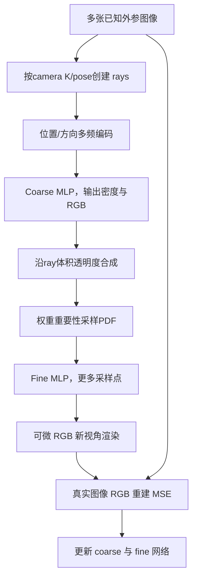
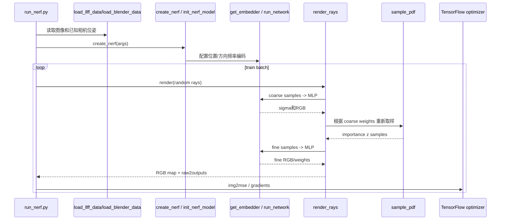

# NeRF：神经辐射场新视角合成 / Representing Scenes as Neural Radiance Fields

## 一句话定义

NeRF 将静态场景表示为神经网络 `F_theta(x,y,z,theta,phi)->(RGB,sigma)`，沿每条已知位姿的摄像机射线采样体积密度与方向相关颜色，以体积透明度合成 RGB，用真实图像的像素误差直接优化神经场。

## 英文缩写速查

| 缩写 | 英文全称 | 简要说明 |
|---|---|---|
| NeRF | Neural Radiance Fields | 连续5D神经辐射场 |
| MLP | Multi-Layer Perceptron | 由位置/方向输出颜色密度 |
| NVS | Novel View Synthesis | 已知训练视点到未知视点的合成 |
| PE | Positional Encoding | 多频正余弦坐标提升细节表达 |
| PDF | Probability Density Function | 光线重要性采样分布 |
| SfM | Structure from Motion | 训练时需要的相机位姿/内参来源 |
| LLFF | Local Light Field Fusion | 实景基准与 SfM 预处理 |

## 为什么重要

原 NeRF 让照片成为 3D 连续场的监督而无需逐体素3D标签；它奠定神经渲染和后续 iMAP/NICE-SLAM/3DGS 的概念基础。**它训练的是给定位姿的静态场景重建，不负责现场追踪相机**，与 4D-GS 动态场景或 SplaTAM RGB-D SLAM 的任务不同。

## 核心原理与方法

1. 输入 `(xyz,viewdir)` 经过不同频率正余弦 positional encoding；空间 xyz 经 8层256维 MLP 提取密度和局部特征，方向编码并入 128 维后输出 RGB，保留视角高光。
2. 在每条 ray 的 near/far 边界均匀采样点，用 coarse MLP 计算体素 sigma/RGB，按 `T_i * (1-exp(-sigma_i Δ_i))` 累积可微渲染色。
3. 从粗渲染的 sample weights 构造 PDF，分层再采样细粒度位置，并用 fine MLP 进一步恢复细节；论文 §5.2 的 coarse/fine 随机性可调。
4. 对已知相机位姿的照片最小化两个网络的 MSE，不通过 depth GT 或表面标注监督；real LLFF scene 的 NDC ray 参数化区别于 synthetic sphere。
5. 原作者将每个静态场景优化单独一套网络，因此不包含跨场景通用训练或动态高斯速度保证。

## 流程总览（论文 Fig2与§3–5）

## 源码运行时序图

根据作者 `bmild/nerf@14c5556` 的 `run_nerf.py` 与 `run_nerf_helpers.py` 核对，不以主观推测构造不存在的在线相机位姿估计代码。

## 实验与评测

原始 ECCV 2020 Table1（PSNR / SSIM / LPIPS，分别对不同数据集平均）：

| 条件 | PSNR↑ | SSIM↑ | LPIPS↓ |
|---|---:|---:|---:|
| Diffuse Synthetic 360 | 40.15 | 0.991 | 0.023 |
| Realistic Synthetic 360 | 31.01 | 0.947 | 0.081 |
| Real Forward-Facing | 26.50 | 0.811 | 0.250 |

真实 LLFF 方法在 Real Forward-Facing LPIPS 为 **0.212**，优于 NeRF 的 0.250；不能称所有单项完胜。Table2 去 positional encoding 的 PSNR 28.77，去 view dependence 27.66，完整 31.01。作者原始 TF 代码 V100 高分辨率渲染约 30 秒/帧，需要数小时级单场景训练，不能描述为实时 SLAM。

## 与其他工作对比

NeRF 是离线、已知位姿的单场景重建方法；下表说明后续 SLAM / 高斯方法在哪些设计上与它分道。

| 对照 | 差异 | 论文结果/说明 |
|---|---|---|
| [NICE-SLAM](./paper-nice-slam.md) | 继承"沿射线采样 + 可微体渲染"思想，但把单个大 MLP 换成分层局部 feature grid + 固定预训练解码器，并在线优化相机位姿，输入为 RGB-D | NeRF 需要外部 SfM 位姿、数小时单场景训练；NICE-SLAM 把渲染误差同时用于追踪和建图 |
| [3D Gaussian Splatting](./paper-rcl-2308-04079-3d-gaussian-splatting-for-real-time-radiance-fie.md) | 用显式各向异性高斯 + 光栅化替代 MLP 查询 + 射线逐点采样 | 本论文 §6 给出原 TF 实现 V100 约 30 秒/帧渲染；后续提速属于其他工作，不归功于原始 NeRF |
| [SplaTAM](./paper-splatam.md) / [MonoGS](./paper-monogs.md) | 用 3DGS 做在线 SLAM，相机位姿由渲染残差直接优化；NeRF 不估计位姿 | 任务不同：NeRF 报告新视角合成 PSNR（Table1），SLAM 论文主要报告 ATE 与渲染质量 |
| [COLMAP](./colmap.md) | COLMAP 提供 NeRF 训练所需的相机内外参（LLFF 预处理） | 上游依赖关系，位姿误差会直接传导为 NeRF 几何/外观漂移 |
| LLFF（论文内基线） | 基于多平面图像的局部光场融合 | 本论文 Table1 Real Forward-Facing 上 NeRF PSNR/SSIM 更高，但 LLFF 的 LPIPS 0.212 优于 NeRF 的 0.250 |

## 结论

**核心不是体渲染本身，而是已知多视角图像监督下位置高频编码、view-dependent appearance 与粗细重要性采样。** 不能仅按新渲染基准速度忽略原实现真实训练和采样成本。

## 工程实践

- 原作者环境：TensorFlow1.15，`conda env create -f environment.yml`、`python run_nerf.py --config config_fern.txt`。
- 对自己的数据必须先获取 COLMAP/LLFF pose 与相机 K；`run_nerf.py` 使用 OpenGL camera-to-world（X右Y上Z后）坐标系，避免和 ROS camera optical Z前约定混淆。
- 作者 README 给的 `config_fern.txt` 是 low-res demo；复现论文数字须用 `paper_configs/` 参数，不能用 demo 的低分辨率结果声称还原原论文。

## 局限与风险

- 不直接求解新帧相机姿态，训练输入需要已知 pose；动态物体/时间不在5D输入内。
- 单场景优化/射线采样耗时较高（V100 高分辨率~30秒/帧），明显不满足移动机器人实时控制环。
- 训练图像稀疏/大视差、非稳态光照及位姿噪声会产生几何/外观漂移；相机坐标和 NDC 需匹配原实现。
- 该节点引用原作者论文和代码，**并非本地已经运行训练或者复现数字**。

## 关联页面

- [COLMAP](./colmap.md)
- [NICE-SLAM](./paper-nice-slam.md)
- [4D-GS](./paper-4d-gaussian-splatting-wu.md)

## 参考来源

- [原始 NeRF 论文完整阅读](../../sources/papers/vision3d_nerf_primary_paper_20261108.md)
- [官方代码仓库记录](../../sources/repos/vision3d_nerf_20261108.md)
- [arXiv 2003.08934 原文](https://arxiv.org/html/2003.08934)
- [作者源码](https://github.com/bmild/nerf)

## 推荐继续阅读

- [NeRF 原作者项目页](https://www.matthewtancik.com/nerf)
