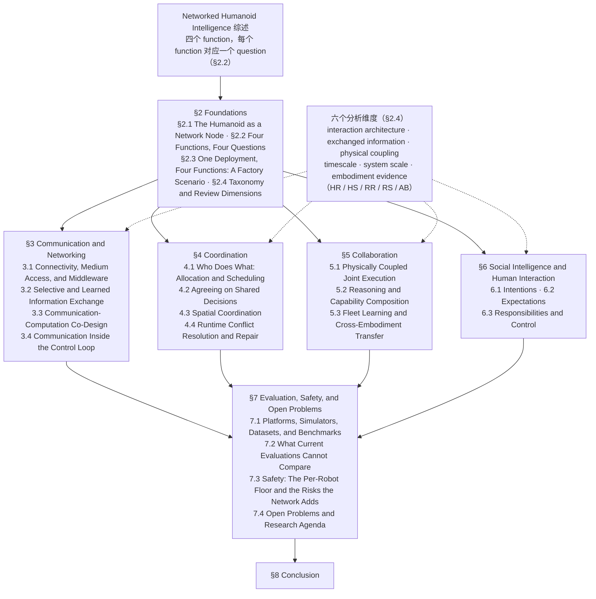

# Networked Humanoid Intelligence：网络化人形智能：通信、协调、协作与社会交互

**Networked Humanoid Intelligence**（*Networked Humanoid Intelligence: Communication, Coordination, Collaboration, and Social Interaction*，[arXiv:2610.34740](https://arxiv.org/abs/2610.34740)）收录于 senlanke「具身运控lab」10-26–10-30 前沿论文动态（人形/四足）。本页依据**周报条目 + arXiv 摘要页**整理，流程图依据论文分类体系与章节结构（见参考来源），未逐页核对各章细节；指标与结论以论文为准。

## 一句话定义

**Networked Humanoid Intelligence：网络化人形智能：通信、协调、协作与社会交互——按通信、协调、协作和社会智能四个功能梳理网络化人形系统，并从交互架构、交换信息、物理耦合、时间尺度、系统规模和机器人形态六个维度建立分类体系。**

## 英文缩写速查

| 缩写 | 英文全称 | 简要说明 |
|------|----------|----------|
| RL | Reinforcement Learning | 强化学习 |
| WBC | Whole-Body Control | 全身控制 |

## 为什么重要

- 周报所述待解决的问题：人形研究通常将机器人视为独立个体，缺少对多机器人共享信息、任务、基础设施和知识的统一分析。

## 流程总览

图依据：综述分类体系图（论文 §1.3 Organization、§2.2 Four Functions, Four Questions、§2.4 Taxonomy and Review Dimensions、Fig. 2，以及 §3–§8 章节标题）

## 核心机制

| 项 | 内容 |
|----|------|
| **arXiv** | [2610.34740](https://arxiv.org/abs/2610.34740) · [PDF](https://arxiv.org/pdf/2610.34740) |
| **作者（arXiv）** | Nguyen, Loc X., Le, Huy Q., Yoon, Ji Su, Tran, Nguyen H., Huh, Eui-Nam, Hong, Choong Seon |
| **机构（周报所述，未逐条核实）** | 庆熙大学、悉尼大学 |
| **arXiv 评论栏** | （无） |
| **开源** | arXiv 摘要页与评论未见代码或项目页链接（仅核对 arXiv 摘要页，不代表未发布）（2026-11-02） |
| **周报所述创新点** | 按通信、协调、协作和社会智能四个功能梳理网络化人形系统，并从交互架构、交换信息、物理耦合、时间尺度、系统规模和机器人形态六个维度建立分类体系。 |

### arXiv 摘要节选（英文原文）

> Humanoid robots are moving from laboratory platforms toward connected fleets that share workspaces, infrastructure, tasks, and knowledge with other robots and humans. As deployments grow, the operation and improvement of each humanoid depend on information exchanged across the network.

## 源码运行时序图

**不适用**：arXiv 摘要页与评论未见代码或项目页链接（仅核对 arXiv 摘要页，不代表未发布），无可对齐的官方代码流程。

## 实验与评测

- 周报与摘要给出的数字/场景已写入上表「创新点」与摘要节选；其余实验细节、基线与成功率定义请回到论文正文。
- 读法：先对齐任务设定、传感器与成功定义（仿真/真机），再解读 headline 数字，勿跨论文直接比较。

## 与其他工作对比

| 维度 | 读法 |
|------|------|
| **同周对照** | 见 [人形/四足周报技术地图](../overview/senlanke-weekly-2026-10-26-30-humanoid-quadruped-technology-map.md)，按方向浏览同期论文 |
| **开源状态** | arXiv 摘要页与评论未见代码或项目页链接（仅核对 arXiv 摘要页，不代表未发布） |

## 结论

**Networked Humanoid Intelligence：网络化人形智能：通信、协调、协作与社会交互。**

1. 本页是入库级摘要，复现前请核对论文正文、附录与代码仓库。
2. 指标须连同实验条件解读。
3. 关注 arXiv 版本更新与代码发布。

## 关联页面

- [senlanke-weekly-2026-10-26-30-humanoid-quadruped-technology-map](../overview/senlanke-weekly-2026-10-26-30-humanoid-quadruped-technology-map.md)
- [humanoid-locomotion](../tasks/humanoid-locomotion.md)
- [reinforcement-learning](../methods/reinforcement-learning.md)

## 参考来源

- [networked-humanoid-intelligence-survey_arxiv_2610_34740.md](../../sources/papers/networked-humanoid-intelligence-survey_arxiv_2610_34740.md)
- [wechat_senlanke_weekly_humanoid_quadruped_2026-10-26_30.md](../../sources/blogs/wechat_senlanke_weekly_humanoid_quadruped_2026-10-26_30.md)
- [arXiv:2610.34740](https://arxiv.org/abs/2610.34740)
- [arXiv PDF](https://arxiv.org/pdf/2610.34740)：已通读 Abstract、§1.3 Contributions and Organization、§2.2 与 §2.4 的功能定义和分类维度，并核对 §3–§8 各章节标题；各章内容正文以略读为准

## 推荐继续阅读

- [arXiv PDF](https://arxiv.org/pdf/2610.34740)
