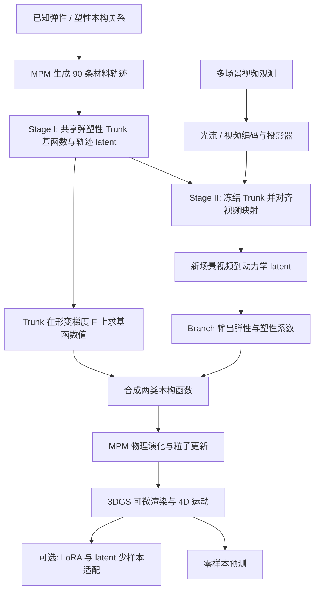
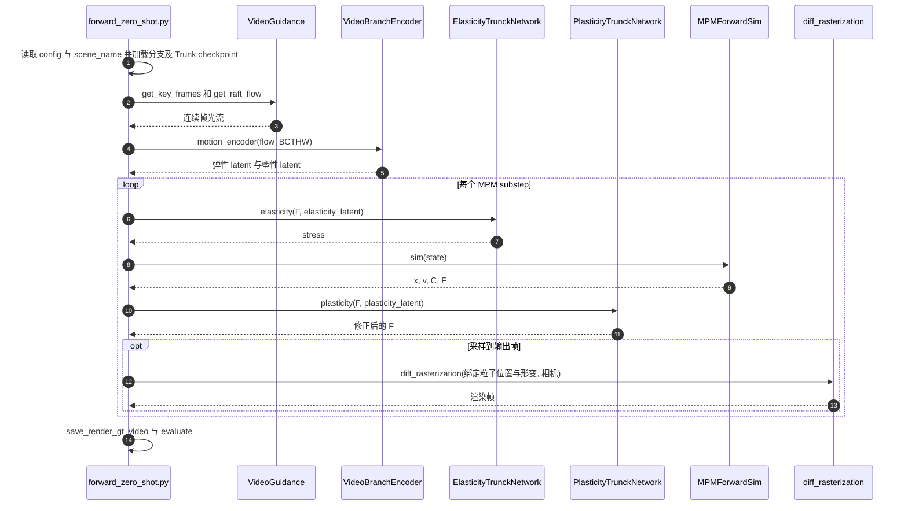

# NeuIDO：物理信息 4D 世界模型的神经内禀动力学算子 / Neural Intrinsic Dynamics Operator for Physics-Informed 4D World Models

## 一句话定义

**NeuIDO** 把视频中的物体运动映射到可供物质点法（MPM）仿真调用的**弹性应力函数与塑性形变修正函数**：先从经典材料轨迹学习共享本构函数空间，再让视频编码器预测对应系数，从而避免每个新场景都从零拟合本构模型。

## 英文缩写速查

| 缩写 | 英文全称 | 简要说明 |
|---|---|---|
| NeuIDO | Neural Intrinsic Dynamics Operator | 从视觉观测到内禀本构函数的神经算子 |
| MPM | Material Point Method | 物质点法，使用学习的本构响应推进粒子动力学 |
| DeepONet | Deep Operator Network | Branch–Trunk 基函数展开形式的神经算子 |
| 3DGS | 3D Gaussian Splatting | 仿真与可微渲染之间的三维高斯表示 |
| LoRA | Low-Rank Adaptation | 少样本阶段给 Trunk 加入低秩适配器 |
| CD | Chamfer Distance | 仿真与真值粒子轨迹点集距离，越低越好 |
| PSNR | Peak Signal-to-Noise Ratio | 新视角渲染质量指标，越高越好 |
| RAFT | Recurrent All-Pairs Field Transforms | 源码用于估计视频帧间光流的网络 |

## 核心信息

| 项 | 内容 |
|---|---|
| 作者 | Jiajing Lin、Xin Zhang、Jianhua Sun |
| 机构 | 上海交通大学人工智能学院；厦门大学信息学院 |
| 论文 | [ECCV 2026 / arXiv:2609.24313v1](https://arxiv.org/html/2609.24313v1)，2026-09-21 |
| 官方项目与代码 | [JiajingLin/NeuIDO](https://github.com/JiajingLin/NeuIDO)；项目链接实际指向 GitHub |
| 输入 | 观察物体运动的视频；论文训练与视觉重建采用多视角标定视频，需已知初速度并初始化 3DGS |
| 输出 | 弹性本构响应与塑性修正的连续函数，送入 MPM 推进物理状态，再经 3DGS 渲染 4D 结果 |
| 开源状态（2026-11-19） | **部分公开源码**；有模型模块和阶段脚本，但 README 仍列权重、数据生成、环境与完整命令为 TODO，尚非可直接复现的完整项目 |

## 为什么重要

物理信息的 4D 世界模型能用模拟器推进真实形变，却往往需要人为指定材料本构形式、逐场景重新辨识参数。另一类神经本构方法能够学非线性响应，但通常仍针对单场景优化。NeuIDO 将问题改成**跨场景的函数空间学习**：从视觉识别材料动力学的潜变量，而不是每次重新训练一个模拟器。它补的是软体/可塑物体的**物性辨识**，不是机器人动作策略或完整接触与执行器模型。

## 核心原理

### 1. Branch–Trunk 表示连续本构函数

论文将视频函数空间映射到本构函数空间。视频分支先从光流特征经编码/投影得到动力学潜向量，再由两个 MLP 头生成弹性与塑性系数；两个独立 Trunk 网络则以形变梯度 `F` 为输入输出共享基函数。线性组合得到应力与塑性修正：

`G_E(video)(F) = Σ λ_E,k(video) φ_E,k(F)`

`G_P(video)(F) = F + Σ λ_P,k(video) φ_P,k(F)`

因而输出**不是一个简单标量材料参数，也不是字符串形式的显式物理公式**，而是由神经网络参数化、可随 `F` 查询的连续本构响应。论文默认潜变量维度 128。

### 2. 两阶段训练：先物理、后视觉

**Stage I 算子预训练：** 经典弹性体、橡皮泥和沙子三个材料族，每族随机采样 30 套材料参数，总计 90 条 MPM 轨迹。采集形变梯度、应力、塑性修正形变梯度；每条轨迹优化独立 latent，同共享弹性/塑性 Trunk 一起学习。此阶段**仍使用已知、人工定义的经典材料本构关系**作为监督。

**Stage II 视觉—动力学对齐：** 从视频估计光流，以 Tora 相关视频编码模块和投影网络生成潜变量；冻结已学的 Trunk，把本构响应接入可微 MPM + 3DGS 渲染，通过观测视频与模拟视频的重建损失训练视频映射。论文主文说冻结 Trunk、仅优化视觉分支；开源源码中还存在独立的 latent 对齐脚本，不能直接等同于完整 Stage II 可复现流水线。

### 3. 零样本与少样本

**零样本：** 未见场景的视频经分支前馈生成本构系数，不需要该场景的额外优化，即可用于模拟。**少样本：** 对分布偏移较大的场景，在 Trunk 注入 LoRA 并联同潜变量进行少量优化；论文给出 100 个适配 epoch、LoRA `r=16, α=16`。这里的“少样本”指有限观测下的场景适应，不是任意未知物体仅凭一张图即可恢复完整材料参数。

## 流程总览

图依据论文 §3、§4 及附录 D 的模块边界绘制：数据生成阶段依赖**已知材料关系**；视觉阶段利用可微仿真与渲染损失对齐，避免把“无需手写本构”误解成“没有物理先验”。

## 源码运行时序图

官方仓库存在阶段脚本，以下只对照 **`experiment/scripts/forward/forward_zero_shot.py` 的可见执行路径**绘制，不代表 README 已提供开箱即用的环境或权重：

静态源码入口包括 `phase1_pretrain/train_latent_space_ours_DeepONet_seperate.py`、`phase2_vision/align_dynamics_func.py`、`phase3_finetune/finetune_model.py` 和 `forward/forward_zero_shot.py`；运行所需资产、依赖和 checkpoint 未完整发布。源码出现 `Trunck` 为仓库实际拼写，不应擅自改成 `Trunk` 作为可调用类名。

## 工程实践

复现应按论文设计把**本构学习、视觉对齐、前馈推理和适配**拆开验收，避免将“仓库内有脚本”误认为“权重和数据齐全”：

| 核查阶段 | 公开代码入口 | 建议检查点 |
|---|---|---|
| Stage I 神经算子训练 | `experiment/scripts/phase1_pretrain/train_latent_space_ours_DeepONet_seperate.py` | 核对弹塑性轨迹数据 `GtF/GtFtmp/GtStress/GtC` 格式与 Trunk 权重键 |
| 视觉对齐 | `experiment/scripts/phase2_vision/align_dynamics_func.py` | 对照光流/可微 MPM/3DGS 的损失路径，区分论文分支训练与 latent 优化脚本 |
| 零样本 | `experiment/scripts/forward/forward_zero_shot.py` | 输入相机、初始粒子状态、绑定映射、预训练 Branch/Trunk checkpoint 是否齐备 |
| 少样本 | `experiment/scripts/phase3_finetune/finetune_model.py` | LoRA 权重和两路 latent 是否从指定基模型加载，保持评测场景独立 |

**当前验证级别：** 只完成官方源码静态核对；README 尚未提供可复现环境和权重，不能声称运行成功。若用于机器人接触仿真，需额外核验材料模型的物理一致性、接触/外力设定与未见材料的泛化。

## 实验与评测

- **合成物体（论文 Table 1）：** 六场景平均 CD：NeuIDO 零样本 **1.643**，少样本适配 **1.216**；对照 NeuMA **1.329**、VisionLaw **1.620**。少样本平均更好，但不能说零样本在各场景都超过基线。
- **真实视频：** Spring-Gaus 三个真实场景，每场景三视角、每视角 19 帧；论文图 4 报告适配后的 PSNR 优于所列基线，原文未把此证明推广到复杂机器人操作任务。
- **未见场景泛化：** 从 PAC-NeRF 的 10 个弹性场景中用 8 个训练、2 个测试，零样本预测好于随机 latent；少样本进一步改进。论文还展示改变初速度或交互物体时的模拟运动。
- **消融：** 潜维度 32 导致拟合和对齐效果变差；从单视角增至多视角改善明显，4 视角到 10 视角收益减弱；附录指出单目真实视频可能失败。

以上数值均为**论文作者报告，非本次运行复现**；CD 对应粒子位置，PSNR/SSIM/LPIPS 对应渲染质量，不能互换。

## 与其他方法对比

| 方法 | 本构或动力学的获得方式 | 本次论文中的比较边界 |
|---|---|---|
| **NeuIDO 零样本** | 共享 Trunk + 视频 Branch 前馈推断 | 六合成场景平均 CD **1.643**；无场景特定适配 |
| **NeuIDO 少样本** | 在同一基底上微调 LoRA 与潜变量 | 同协议 CD **1.216**；**不能**归入零样本 |
| **NeuMA** | 以神经本构表示为核心的场景优化基线 | Table 1 平均 CD **1.329**；属于不同优化预算 |
| **VisionLaw** | 视频条件的本构辨识比较方法 | Table 1 平均 CD **1.620**；需保留作者的合成场景协议 |

上述只是**论文 Table 1 的作者报告**，不表示跨数据集、公平算力或真机下的绝对排名；并非全面取代传统物理引擎。

## 结论

**一句话总判：** NeuIDO 为“视频 → 可查询的材料本构关系 → 可微 MPM 4D 推演”提供跨场景共享表示，是软体物性辨识的重要尝试，但不是已经解决全物理世界建模的通用模拟器。

1. **关键增益在跨场景复用：** 共用 Trunk 本构基底，零样本新场景只预测 latent/系数；相比逐场景优化更便于快速初始化。
2. **分清弹性与塑性：** 应力输出和塑性修正分别建模，部署时必须让两者与仿真器状态更新一致。
3. **本构先验并未消失：** Stage I 的 90 条监督轨迹来自三个经典材料族，而不是从所有真实世界视频无监督发现物理定律。
4. **少样本成绩需注明条件：** Table 1 的 1.216 是经过适配的平均 CD，不能宣传为纯零样本。
5. **视频观测有辨识歧义：** 多视角比单视角更可靠；仅像素重建拟合好不能等价证明本构关系唯一正确。
6. **工程落地先看开放边界：** 当前有源码文件，但缺少完整安装、数据流水线与预训练权重，不宜宣称已可复现论文指标。

## 局限与风险

- **论文自述：** 仅用重建损失产生的视觉监督较弱且存在歧义，增加视角仍有边际效益递减；神经本构尚缺明确的硬物理约束，可能过拟合视觉而非得到真实材料法则。
- **设置依赖：** 实验使用已知初速度、3DGS 场景初始化及特定多视角采集条件，不等于单视频直接恢复全部接触、关节与外力。
- **理论边界：** 附录的算子逼近定理以紧致性、连续性和可近似潜变量分解为假设，误差仍含视频编码的信息压缩项；并非守恒律必然满足的证明。
- **代码开放边界（2026-11-19）：** 仓库确有网络、MPM、训练/前馈脚本，然而 README 的环境配置、Stage I 数据生成、训练权重和端到端命令均为 TODO；本次未跑 GPU 训练/推理。

## 关联页面

- [可微仿真](../concepts/differentiable-simulation.md)：视频损失如何反传至动力学表示。
- [系统辨识](../concepts/system-identification.md)：从参数标定走向连续本构函数空间学习。
- [生成式世界模型](../methods/generative-world-models.md)：像素未来生成与物理仿真约束的路线对比。
- [CRISP：接触引导 Real2Sim](../methods/crisp-real2sim.md)：场景几何与接触物理一致性方法的对照；NeuIDO 主要辨识软体弹塑性本构。
- [Real2Sim 纵深 Stage 2](../../roadmap/depth-real2sim.md)：补全几何后辨识软体物性/动力学。
- [WAM 纵深 Stage 1](../../roadmap/depth-wam.md)：世界动力学基座的邻接工作；NeuIDO **不输出机器人动作，不是 Joint/Cascaded WAM**。

## 推荐继续阅读

- [NeuIDO 论文全文及附录（HTML v1）](https://arxiv.org/html/2609.24313v1)
- [NeuIDO 官方源码 / README](https://github.com/JiajingLin/NeuIDO)
- [NeuMA（论文相关工作）](https://arxiv.org/search/?query=NeuMA&searchtype=all)：场景特定的神经本构辨识对照。

## 参考来源

- [NeuIDO 论文全文归档](../../sources/papers/neuido_arxiv_2609_24313.md)
- [NeuIDO 项目链接与开放状态](../../sources/sites/neuido.md)
- [NeuIDO 源码目录与入口核查](../../sources/repos/neuido.md)
