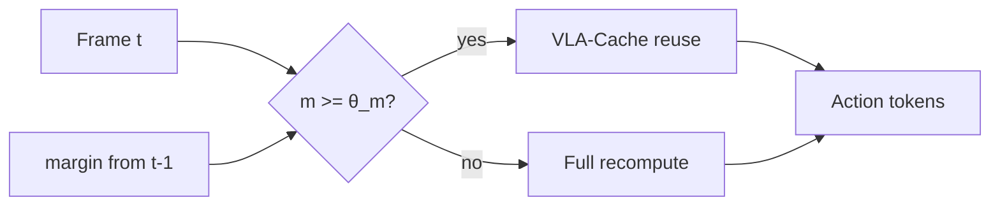
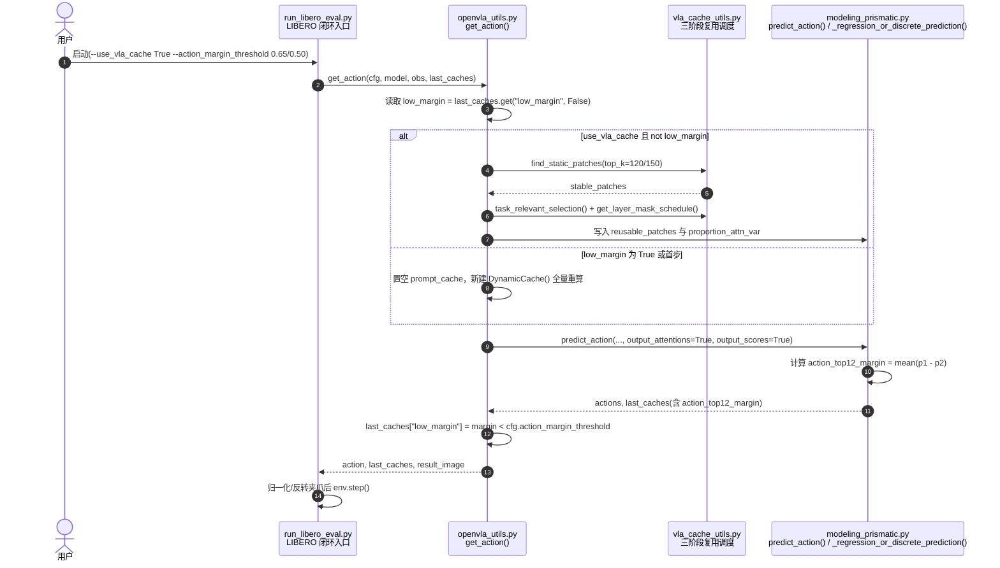

# Neural Introspection Gating（Gated VLA-Cache · arXiv:2608.10824）

**Neural Introspection Gating**（*Neural Introspection Gating for Adaptive KV-Cache Reuse in Vision-Language-Action Models*，[arXiv:2608.10824](https://arxiv.org/abs/2608.10824)，[官方代码](https://github.com/zjw4321/gated-vla-cache)，[项目页](https://zjw4321.github.io/neural-introspection-gating-page/)）由 **东京大学（The University of Tokyo，JSK）** Wu / Kawaharazuka / Okada 提出（**IROS 2026**）：在 VLA-Cache 的观测空间缓存之上，增加 **零额外前向的 logit-margin 内省门控**，模型犹豫时自动失效缓存并全量重算。

## 一句话定义

**视觉看起来没变，不等于动作还敢复用缓存：用 top-1/top-2 动作 margin 决定 KV 是否作废。**

## 英文缩写速查

| 缩写 | 英文全称 | 简要说明 |
|------|----------|----------|
| VLA | Vision-Language-Action | 图像+语言→动作的自回归策略 |
| KV | Key-Value cache | Transformer 层缓存的键值状态 |
| NIG | Neural Introspection Gating | 本工作的内省门控模块 |
| OFT | OpenVLA Fine-Tuning（OpenVLA-OFT） | 高效微调变体；本文第二骨干 |
| LIBERO | — | 操纵基准四套件（Spatial/Object/Goal/Long） |

## 为什么重要

- **VLA 实时性瓶颈在视觉 prompt 前向：** 相邻帧大量冗余，但盲缓存会在抓取对齐等关键步注入误差。
- **训练无关、可插拔：** 不改权重，只改推理调度；适合已有 OpenVLA 部署。
- **把「模型不确定」变成可测信号：** margin 是解码副产品，无需额外前向。

## 核心信息

| 项 | 内容 |
|----|------|
| **机构** | 东京大学（The University of Tokyo，JSK Robotics Laboratory） |
| **基线** | VLA-Cache（patch 相似度 \(\tau=0.996\) + task-relevant + entropy-adaptive） |
| **骨干评测** | OpenVLA（7B，\(\theta_m=0.65\)）、OpenVLA-OFT（8 步 chunk，\(\theta_m=0.50\)） |
| **开源** | **已开源**（Apache-2.0：[zjw4321/gated-vla-cache](https://github.com/zjw4321/gated-vla-cache)，含 `openvla/` 与 `openvla-oft/` 实现；模型权重按官方地址本地下载） |

## 核心原理

### VLA-Cache 三阶段（保留）

1. **Static patch detection** — 帧间 patch 余弦相似度 \(>\tau\)（默认 0.996）标可复用。
2. **Task-relevant filtering** — 高 text→vision attention 的静态块强制重算。
3. **Entropy-adaptive layer reuse** — 低熵层多复用、高熵层多重算。

### 内省门控（新增）

对上一时刻 \(D\) 维动作 token，算均值 margin：

\[
m_{t-1}=\frac{1}{D}\sum_{d=1}^{D}\bigl[p_1(a_{t-1}^{d})-p_2(a_{t-1}^{d})\bigr]
\]

若 \(m_{t-1}<\theta_m\)，丢弃缓存并对当前帧 **full inference**；否则走 VLA-Cache。**信号对比（§VI）：** 作者亦测试了三种替代信号但均被淘汰——(1) **动作分布熵**被 32,000 词表长尾近零概率噪声淹没；(2) **注意力熵**因自回归 LLM 的 **attention sink** 锚定效应而对视觉焦点转移钝化；(3) **相邻步动作 delta**主要对齐接近/抓取等阶段转换而非模型自身不确定性。

### 流程总览

## 工程实践

| 项 | 建议读法（结合官方仓库实码） |
|----|----------|
| 适用动作头 | 依赖 LLM 输出词表 logits；OpenVLA 读 `generate().scores`；OpenVLA-OFT 从 `language_model_output.logits` 提取 |
| 仓库入口 | `--use_vla_cache True --action_margin_threshold 0.65`（`openvla/`）或 `0.50`（`openvla-oft/`），支持 `openvla/run.sh` 一键运行 |
| 权重覆盖机制 | `download_model_local.py` 将权重拉到本地 `checkpoints/`；启动评测时会把改写后的 `modeling_prismatic.py` 拷入该目录，不能直接传 HF Hub ID |
| OFT 索引版本差异 | `main` 修复了 `iros2026` tag 中 logits 从前向切片的偏移问题，改为 `[:, -(ACTION_DIM * NUM_ACTIONS_CHUNK) - 2 : -2, :]`，RTX 5090 实测门控触发率 `14.5% → 33.7%`、算力 `3.25 → 3.44 TFLOPs`，准确率仍在波动范围内（`98.4%` vs `98.0%`） |
| 自调节开销 | Simple 套件（Spatial/Object）门控触发 `<10%`，LIBERO-Long 约 `~24%`（复用约 76% 步数） |

## 源码运行时序图

基于官方仓库 [`zjw4321/gated-vla-cache`](https://github.com/zjw4321/gated-vla-cache) 实码（归档见 [`sources/repos/gated_vla_cache.md`](../../sources/repos/gated_vla_cache.md)）：

## 评测与对比

OpenVLA（Table I，LIBERO 4 套件各 500 episodes，NVIDIA A100，Success % / TFLOPs）：

| Suite | Full | VLA-Cache | Gated（Ours） |
|-------|------|-----------|---------------|
| Spatial | 78.8 / 1.89 | 78.8 / 1.43 | **79.4 / 1.55** |
| Object | **70.4** / 1.86 | 69.4 / 1.44 | 67.8 / 1.54 |
| Goal | 77.2 / 1.83 | 74.0 / 1.40 | **77.4 / 1.50** |
| Long | 54.0 / 1.88 | 50.2 / 1.43 | **54.8 / 1.54** |
| Avg | **70.1** / 1.87 | 68.1 / 1.43 | 69.9 / 1.53 |

OpenVLA-OFT（Table II，8 动作 chunk，Success % / TFLOPs）：Spatial `93.8/4.00` vs `93.8/3.11` vs `94.0/3.23`；Object `98.4/3.96` vs `98.6/3.05` vs `98.6/3.08`；Goal `97.2/3.94` vs `96.8/3.06` vs `97.0/3.07`；Long `93.8/3.98` vs `94.0/3.05` vs `93.0/3.13`；平均 **95.7% / 3.13 TFLOPs**（Full `95.8 / 3.97`，VLA-Cache `95.8 / 3.07`），门控几乎保持休眠、不损伤原性能。

## 结论

**高效 VLA 推理不能只看「画面变没变」，还要看「模型当下敢不敢用旧 KV」；top-1/top-2 logit margin 是零额外前向即可获得的内置保险丝。**

1. **优先在 Goal/Long 等盲缓存掉点的套件上开闸** — OpenVLA 上分别收回 106% 与 121% 掉点，平均算力仅 `1.53` vs `1.87 TFLOPs`。
2. **保留约 80% 算力节省是设计目标** — 用 `1.54` vs `1.43 TFLOPs` 换回长程可靠性比一味压低缓存更有工程价值。
3. **OFT 已稳时不伤分但增益有限** — `main` 分支修复 logits 末尾索引后（相比论文 `iros2026` tag）门控触发率更符合设计意图。
4. **选型坐标：** 要训练无关加速 → Gated VLA-Cache / VLA-Cache；要小模型重训 → TinyVLA / SmolVLA 路线。

## 局限与风险

- **Object 套件略降：** OpenVLA 上 Object 为 `67.8%`（低于 Cache `69.4%` 与 Full `70.4%`），短程任务偶发不必要清缓存。
- **一步滞后与混杂不确定性：** 用 \(t-1\) 步 margin 决策第 \(t\) 步缓存；无法区分「缓存误差」与「任务固有模糊」（多算安全但略增开销）。
- **阈值标定与实机空白：** 单阈值 \(\theta_m\) 虽在单模型内泛化且平台宽（OpenVLA 0.55–0.75、OFT 0.40–0.60），跨模型族仍需重新标定；且目前仅在 LIBERO 仿真验证，未做真机测试。

## 与其他工作对比

| 工作 | 关系 |
|------|------|
| VLA-Cache | 直接基线；本工作加模型内置信门 |
| FastV / PyramidDrop | 层内/跨层视觉 token 剪枝；不针对时序 KV 复用 |
| 小模型 VLA | 重训换速度；本方法保 7B 骨干 |

## 关联页面

- [VLA](../methods/vla.md)
- [Action Chunking](../methods/action-chunking.md) — OpenVLA-OFT 评测使用 8 步动作块并行解码
- [Manipulation](../tasks/manipulation.md) — LIBERO 四套件所属桌面操纵任务域
- [LIBERO](./libero-benchmark.md)
- [VLA 开源复现景观](../overview/vla-open-source-repro-landscape-2025.md)

## 参考来源

- [论文归档](../../sources/papers/neural_introspection_gating_arxiv_2608_10824.md)
- [项目页归档](../../sources/sites/neural-introspection-gating-github-io.md)
- [官方仓库归档](../../sources/repos/gated_vla_cache.md)

## 推荐继续阅读

- 项目页结果表：<https://zjw4321.github.io/neural-introspection-gating-page/>
- 论文 HTML：<https://arxiv.org/html/2608.10824>
