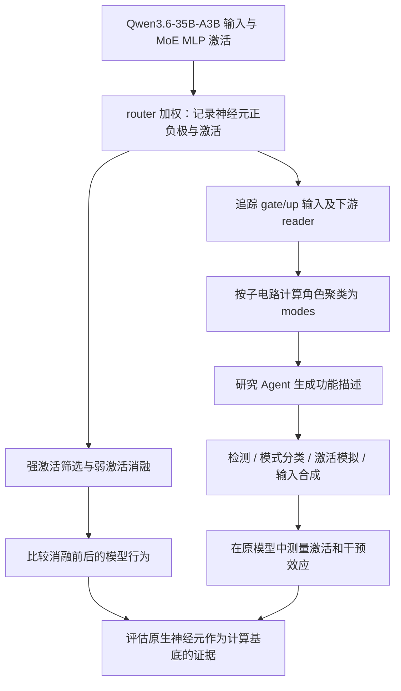

# Neurons as an Interpretable Basis｜神经元作为可解释的计算基底

> **一句话定义**：Goodfire 研究原生 MLP 神经元的有效稀疏性、上下游子电路与可检验的语言描述，主张神经元本身可以作为理解神经网络计算的有用基底，而不必总是先学习替代特征字典。

## 英文缩写速查

| 缩写 | 英文全称 | 简要说明 |
|---|---|---|
| MLP | Multi-Layer Perceptron | 本研究考察的 Transformer 前馈计算单元 |
| MoE | Mixture of Experts | 模型按 token 路由不同 expert 的架构 |
| SAE | Sparse Autoencoder | 与直接研究原生神经元相对照的稀疏特征字典方法 |
| KL | Kullback–Leibler Divergence | 用于衡量消融与模拟后的输出分布损害 |
| SwiGLU | Swish-Gated Linear Unit | 以 gate 与 up 相乘实现神经元激活的门控单元 |

## 核心信息

| 项目 | 内容 |
|---|---|
| 研究团队 | Goodfire：Curt Tigges、Matthew Kowal、Thomas McGrath、Owen Lewis、Nick Cammarata |
| 发布时间 | 2026-11-10 |
| 官方技术全文 | [Neurons as an Interpretable Basis](https://www.goodfire.com/research/neurons-as-an-interpretable-basis) |
| 全文可读版本 | [官方 Markdown](https://www.goodfire.com/research/neurons-as-an-interpretable-basis/article.md) |
| 神经元地图 | [Neuron Atlas](https://www.goodfire.com/research/public_neuron_atlas) |
| 实验对象 | Qwen3.6-35B-A3B 的 MoE MLP 神经元 |
| 开放状态 | 技术文章、PDF、交互地图公开；截至 2026-11-15 官方页面未提供可验证的独立运行源码入口 |

## 为什么重要

传统多义性（polysemanticity）证据让研究者担心，单个神经元承载太多不相关功能，必须通过 SAE 等替代特征基底才能解释网络。本研究提出另一个可以检验的视角：即使神经元有多个功能，其**强激活时的上下游计算角色**也可能只有少数模式，能够用简短的描述预测并通过干预验证。

这是对 [《Neural Networks Are Already Clean》](https://already-clean.goodfire.com/) 观点的技术实验补充；不是对所有模型、多义性或 superposition 的普遍性否定。

## 核心原理与方法

1. **研究原生计算单元**：对于一个 SwiGLU 神经元，关注其 gate / up 输入、router 加权激活与固定的 down-projection 输出方向；正、负极（poles）的功能可不同。
2. **先测因果重要性，再选解释区间**：按强度排序保留每 token 的少数 routed neuron，比较弱激活消融与原模型的语言建模 loss 和基准表现。强激活尤其值得解释，但不是说弱激活完全无用。
3. **追踪子电路而非只贴语义标签**：找出驱动目标神经元的上游单元，以及接收它信号的下游 readers。不同上下文可激活不同 readers；子电路聚类得到少量 *modes*。
4. **用 Agent 验证描述**：给解释器/判断器简短功能描述，分别测试文本激活辨识、模式分类、逐 token 激活模拟、生成可使神经元强激活的新文本。
5. **以随机方向作为对照**：检验原生神经元的下游连接特异性和功能恢复效率是否优于一般随机向量。

### 项目流程图（根据官方研究方法）

## 实验与评测

| 实验 | 官方结果 | 不能误读为 |
|---|---|---|
| 稀疏消融 | 每 token 在 4,096 个 routed neuron 中仅保留 top-320：**消融 92.2%**，语言模型 loss 增加 **2.9%** | 删除了 92.2% 的权重；共享专家也消融；所有推理能力无损 |
| 激活检测 | 给定文字描述区分真实激活片段与随机片段，约 **95%** 准确率 | 对未知分布的任何神经元均达到 95% |
| 模拟激活 | 强激活区间恢复约 **73% 的可恢复消融 KL 损害上限** | 73% 的整个模型已经被完整理解 |
| 合成激活输入 | 128 个神经元极性中 **120 个**，经反馈迭代合成超越 100 亿 token 语料的已见最大激活 | 没有反馈的零样本生成普遍成功 |
| 随机方向基线 | 8 个神经元的功能恢复可相当于 128–256 个随机方向 | 任意网络、任务和层都呈相同比例 |

## 与其他工作对比

| 研究 | 主要分析单位 | 在此处承担的角色 |
|---|---|---|
| [Zoom In: An Introduction to Circuits](https://distill.pub/2020/circuits/zoom-in/)（2020） | 视觉网络的特征与神经元电路 | 早期电路与 superposition 讨论的历史起点 |
| [Language Models Can Explain Neurons in Language Models](https://openai.com/index/language-models-can-explain-neurons-in-language-models/)（2023） | GPT-2 神经元激活与 GPT-4 自动语言解释 | 早期自动解释和自评分框架；并未解释下游机制 |
| [Neural Networks Are Already Clean](https://already-clean.goodfire.com/)（2026） | 图像与语言模型神经元的非正式工作假设 | 为直接理解神经元和递归泛化提供研究动机 |
| 本研究（2026-11-10） | Qwen3.6 MoE 的原生神经元、子电路和模式 | 补充稀疏性消融、因果模拟、文本合成与随机基线 |

## 结论

**可操作总判：原生神经元在作者测试的强激活范围内是有用的分析基底，但目前不能据此断言整个网络已被解释或已安全。**

1. 首先区分**有激活**与**有因果影响**，优先研究经消融证实重要的强激活。
2. 一个神经元可能服务多条子电路；用 gate/up 的输入与下游 readers 区分上下文，不要仅靠最高激活样例起名。
3. 验证说明应包含成对反例、干预和输出分布变化，而不止主观语义准确度。
4. 读数值必须保留实验限定：92.2% 指 routed neuron 的激活消融，73% 指可恢复 KL 损害的相对上限。
5. 若用于机器人 VLA / BFM，需另做机器人模型上的激活与动作因果实验，不能直接移植此 LLM 结论。

## 工程实践

可参考官方 [Neuron Atlas](https://www.goodfire.com/research/public_neuron_atlas) 浏览神经元与子电路；实际复现还需要模型权重、激活采样、归因与消融工具。**本研究当前未公开可核验的独立运行源码入口**，因此这里只给出基于论文的实验步骤，不声称复现。

## 源码运行时序图

**不适用**：2026-11-15 核查官方研究页仅有文章、PDF、交互地图入口，未列出可确认的研究实现仓库、运行命令或 Agent 入口。不能将上方论文级流程图冒充源码时序图。

## 局限与风险

- 作者实验集中于一个 MoE LLM；弱激活、特殊 SwiGLU 象限、不同模型架构和任务的表现仍待验证。
- 对神经元的局部功能解释，不等于理解注意力与多神经元协作，也不能直接推出模型安全、鲁棒性或可控性。
- 作者尚未建立训练过程中神经元角色如何形成的完整机制理论；随机基线与测量阈值也影响解释。
- 当前归档尚未完成官方全文附录与所有图表的逐项核对，页面保持 `draft`，详见[来源记录](../../sources/papers/goodfire_neurons_as_interpretable_basis_2026.md)。

## 关联页面

- [机制可解释性](../concepts/mechanistic-interpretability.md)
- [深度学习基础](../concepts/deep-learning-foundations.md)
- [Causal Analysis of Robot Foundation Models（机器人基础模型因果分析）](./paper-robot-foundation-model-causal-analysis.md)

## 参考来源

- [Goodfire：Neurons as an Interpretable Basis 原文归档](../../sources/papers/goodfire_neurons_as_interpretable_basis_2026.md)
- [Goodfire 原始技术全文](https://www.goodfire.com/research/neurons-as-an-interpretable-basis)
- [Nick Cammarata：Neural Networks Are Already Clean](../../sources/blogs/goodfire_neural_networks_are_already_clean_2026-10-15.md)

## 推荐继续阅读

- [Zoom In: An Introduction to Circuits（Distill, 2020）](https://distill.pub/2020/circuits/zoom-in/)
- [Language models can explain neurons in language models（OpenAI, 2023）](https://openai.com/index/language-models-can-explain-neurons-in-language-models/)
