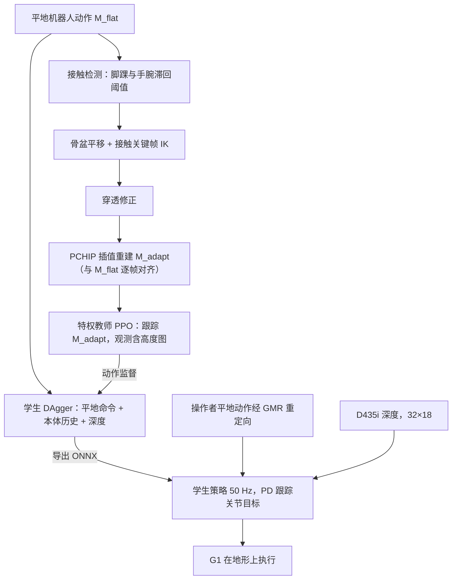
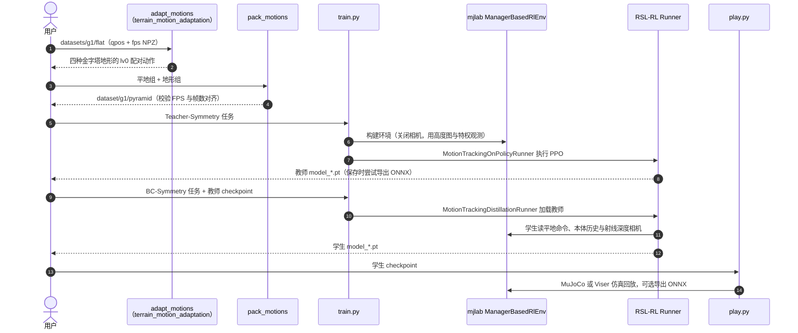

# NEXUS：面向地形适配遥操作的感知式全身控制

**NEXUS**（*Perceptive Whole-Body Control for Terrain-Adaptive Teleoperation*，[arXiv:2609.39000](https://arxiv.org/abs/2609.39000)，[项目页](https://nexus-humanoid.github.io/)，[官方代码](https://github.com/Gamma-Robot/NEXUS)）研究操作者在平地、机器人在楼梯或斜坡上时，人体动作命令如何适配机器人所处地形，并由全身策略执行。作者来自中国电信人工智能研究院（TeleAI）、上海交通大学、香港大学、浙江大学和 [伽马智能（γ-Robotics）](./gamma-robotics.md)。

## 一句话定义

训练时先把平地动作离线改成逐帧对齐的地形版本，用它监督特权教师；部署时学生策略只接收操作者的平地动作命令，靠机载深度和本体反馈自己把动作改成适合脚下地形的版本。

## 英文缩写速查

| 缩写 | 英文全称 | 简要说明 |
|---|---|---|
| WBC | Whole-Body Control | 全身控制 |
| G1 | Unitree G1 | 文章中的人形机器人平台 |
| BFM | Behavior Foundation Model | 行为基础模型；论文对比的 SONIC、HoloMotion 等属此类 |
| PPO | Proximal Policy Optimization | 训练特权教师的强化学习算法 |
| DAgger | Dataset Aggregation | 在学生访问的状态上重新查询教师，做行为克隆 |
| IK | Inverse Kinematics | 逆运动学；在接触关键帧上把手脚放到地形表面 |
| PCHIP | Piecewise Cubic Hermite Interpolation | 保形分段三次 Hermite 插值；把关键帧修正量铺到整段动作 |
| VTR / CP | Valid Time Ratio / Contact Preservation | 运动适配质量指标：几何有效帧比例 / 接触保持比例 |
| SR | Success Rate | 完整跟完参考动作的试验比例 |
| MPKPE / MPKRE | Mean Per-Keypoint Position / Rotation Error | 局部身体位置 / 朝向跟踪误差 |
| GMR | General Motion Retargeting | 真机遥操作时把人体姿态重定向到 G1 的工具 |

## 为什么重要

- **遥操作的真实错配**：操作者通常站在平地，机器人却可能在台阶、坡道或平台边缘。逐帧复制人体动作会让脚悬空或穿进台阶，机器人必须自己感知地形并改姿态和接触（§I）。
- **瓶颈是配对监督**：平地动作库再大，也没有同一行为的地形版本；直接采集要额外动捕和场景重建。NEXUS 用一套参数、不逐动作 / 逐地形调参，批量生成配对参考，训练语料（含地形版本）近 1,000 小时。
- **覆盖面与地形适配要同时有**：同样学地形适配的 [Perceptive BFM（PMT）](./paper-perceptive-bfm.md) 在 100STYLE、LaFAN1 子集上平地 SR 为 0；NEXUS 在这两个子集平地 SR 为 100% 和 70%，并在难地形上把平均 SR 从次优的 31.76% 提到 51.9%（图 4）。
- **接口不变**：学生仍接收平地动作命令，因此重定向、遥操作和上层规划接口可沿用平地 BFM 的形式，地形信息只在机器人侧。

## 流程总览

依据论文 §III 与图 2 绘制：上半部分是离线数据生成与训练，下半部分是零样本真机部署。

## 方法要点

- **离线运动适配**：对每段平地动作和一种固定地形，先按高度与速度检测脚踝、手腕接触；向下射线查询地形高度和法向，骨盆按活动接触中绝对值最大的高度偏移平移；在接触关键帧上做两连杆 IK 和脚底法向对齐，再修正手、脚、膝、肘的穿透；最后把关键帧上的修正量用 PCHIP 插值到整段。没有接触的身体部位基本保持原姿态。
- **教师**：PPO 跟踪适配后参考，观测含特权本体与接触信息和 11×17 高度图；奖励包含跟踪、接触时序与离地间隙、脚底支撑、正则和存活项；带左右对称损失与按失败率的自适应采样。
- **学生**：用 DAgger 式行为克隆蒸馏教师，输入为配对的平地命令、10 帧本体历史和单帧深度图（三层 CNN + MLP）。部署时不需要适配后参考，地形修正由学生在线完成。
- **真机**：Unitree G1 零样本部署，在楼梯、平台、斜坡和草坡上做遥操作。

## 源码运行时序图

依据官方仓库 [Gamma-Robot/NEXUS](https://github.com/Gamma-Robot/NEXUS)（commit `f390cb7`）README 与 `perceptive_bfm.scripts` 下的 `train.py`、`play.py`、任务注册及 runner 源码绘制。仓库发布的是数据生成、训练与仿真回放部分，真机部署未发布。

复现主线是「适配 → 打包 → 教师 → 学生 → 回放」五步，README 示例均为 4 卡、每卡 16,384 环境。仓库另提供单阶段感知 PPO 任务（不带 `-Teacher` / `-BC` 后缀）；推测对应论文消融中的 w/o T–S，论文与 README 未明确说明。

## 工程实践

| 项目 | 内容 |
|---|---|
| 仿真与算力 | mjlab；4 × H100，每卡 16,384 并行环境；物理 / 控制步长 0.005 / 0.020 s |
| 训练地形 | 平地、坡度 0.30（约 16.7°）上下坡、0.10 m 级高 / 0.30 m 踏面上下楼梯；仓库配置同样只有一档难度 |
| 动作语料 | SEED、LaFAN1、AMASS、100STYLE 的平地子集，含地形版本近 1,000 小时 |
| 教师网络 | actor / critic MLP [2048, 2048, 1024, 1024, 512, 512]，ELU；PPO 学习率 1e-3 自适应（target KL 0.01），γ=0.99，λ=0.95 |
| 学生网络 | 深度 CNN 通道 32/32/64，全局最大池化 + MLP [1024, 1024, 512, 512, 256]；MSE 监督 |
| 域随机化 | 足底摩擦 U(0.3, 1.2)、躯干质心偏移、编码器偏置、周期推扰；学生另加相机内外参扰动和观测噪声（表 V） |
| 真机链路 | D435i 深度 60 Hz、480×270，裁边 2 px 后缩到 32×18，截断 0–2 m；Jetson Orin NX 上 ONNX Runtime，控制 50 Hz；GMR 在另一台 PC 重定向，经 ZeroMQ 异步发送 |
| 命令窗口 | 1 当前 + 6 历史 + 6 前瞻帧（前瞻 120 ms）；丢帧时重复最新姿态，策略不阻塞等待命令或深度 |
| 调试指标 | 数据侧同时看 VTR、穿透、悬空、CP 和非接触关节偏差（只降穿透可能导致支撑脚悬空）；策略侧 SR 与 MPKPE、接触 F1 一起看 |

### 开源状态（2026-11-06 核查）

- **已发布**：独立的地形运动适配包 `terrain_motion_adaptation`、数据打包、教师 PPO / 学生蒸馏 / 单阶段 PPO 训练、MuJoCo 与 Viser 回放、文档；G1 预训练 ONNX 策略 `resources/g1/checkpoints/policy.onnx`（输入 `obs (1,1473)` 与 `camera (1,1,18,32)`，输出 29 维动作）。
- **未发布**：README 的 Release Status 中 sim-to-sim 与 sim-to-real 部署未勾选；论文用的近 1,000 小时配对语料未发布，仓库只带 3 段示例动作 × 5 个地形组。
- **使用注意**：ONNX 图外的观测拼接、历史处理和深度预处理须自己按 `config.json` 复现，张量形状一致不代表输入兼容；`play.py` 回放的是 `.pt` checkpoint。
- **许可**：原创部分 CC BY-NC 4.0（非商业）；RSL-RL 派生的 PPO 与蒸馏模块保留 BSD-3-Clause。
- 仓库 Python 包名为 `perceptive_bfm`，与对比对象 PMT 论文题目 *Perceptive Behavior Foundation Model* 同名，但两者是不同工作。

## 与同名工作区分

本页对应 **arXiv:2609.39000** 的 *Perceptive Whole-Body Control for Terrain-Adaptive Teleoperation*。仓库中的 [较早 NEXUS 研究预告页](./nexus-humanoid.md)记录的是同一项目页 URL 在 2026-09-06 的状态，当时标题为 *A Perceptive Foundation Policy for Cross-Domain Whole-Body Teleoperation*，论文和代码均未发布。两页的项目页、第一作者和 X 帖相同；推测预告就是本文发布前的版本（题目在发布时更改），但论文没有说明两者关系。预告页保留作为预告期记录，技术内容以本页和论文为准。

## 参考来源

- [NEXUS 论文来源归档（arXiv:2609.39000v1 全文核对）](../../sources/papers/nexus_terrain_adaptive_teleop_arxiv_2609_39000.md)
- [arXiv:2609.39000](https://arxiv.org/abs/2609.39000)
- [项目页](https://nexus-humanoid.github.io/)
- [官方仓库 Gamma-Robot/NEXUS](https://github.com/Gamma-Robot/NEXUS)
- [Day 2 文章来源索引](../../sources/blogs/humanoid_motion_intelligence_day2_locomotion_motion_priors_2026_10_03.md)

## 评测

- **运动适配（表 I）**：55 条 G1 动作 × 16 种地形共 880 对，生成 39.87 小时动作，不需逐动作 / 逐地形调参。无手接触组 VTR 92.08%、CP 79.12%（TCRS 89.69% / 29.63%）；有手接触组 80.53% / 71.21%（TCRS 67.95% / 20.61%）。生成耗时比 TCRS 低 4.23–4.88 倍。
- **控制器对比（图 4）**：在 160 条公开评测动作上与 SONIC v1.1、HoloMotion、HumanoidGPT、PMT 的公开 checkpoint 比较。平均 SR：平地 90%（SONIC 88.33%），易地形（5 cm 台阶 / 8.5° 坡）77.36%（次优 64%），难地形（15 cm / 24.2°）51.9%（次优 31.76%）。两档测试地形都不同于训练地形。
- **消融（表 II）**：415 条留出行走片段 × 4 种地形 × 5 级，共 8,300 次试验。SR 91.072%，去掉深度后 87.771%，去掉教师—学生（单阶段 PPO）90.964%；单阶段 PPO 的根位置误差 31.951 cm、MPKPE 9.482 cm，明显差于 NEXUS 的 19.596 cm、7.066 cm。两档较难地形上视觉带来的 SR 差距为 78.10% vs 70.51%。
- **真机**：Unitree G1 零样本部署。训练只见过 10 cm 台阶，仍连续登上 15 cm 台阶楼梯、从 60 cm 平台下台阶或跳下；还展示平台边缘与草坡侧手翻、约 30° 草坡、单 / 双膝跪、单腿平衡和踢腿。常规跟踪中未见失败，60 cm 下落与侧手翻有摔倒；论文没有给出真机成功率统计。

## 与其他工作对比

- **地形条件参考生成**：PMT 内的 TCRS 只做脚轨迹采样优化、根高度调整和腿部 IK，非腿关节不动；NEXUS 同时处理手和脚接触。表 I 中 NEXUS 的非接触关节偏差（0.00984 / 0.01473 rad）远低于 TCRS（0.08884 / 0.12213 rad）；TCRS 在 64 次计时用例中各有 1 次和 5 次进程出错。
- **感知运动跟踪 [PMT](./paper-perceptive-bfm.md)**：问题设定最接近，但平地上就在 100STYLE、LaFAN1 子集失败（SR 0），论文认为与其以行走和舞蹈为主的语料有关。
- **地形无关 BFM（[SONIC](../methods/sonic-motion-tracking.md)、[HoloMotion](./holomotion.md)、HumanoidGPT）**：平地上覆盖面与 NEXUS 接近，地形越陡 SR 降得越多。HoloMotion 在地形上的 MPKPE 更低（8.83 vs 10.15 cm），但误差只统计各自失败前的窗口，须与 SR 一起读。
- **同名预告**：与 [早期 NEXUS 预告页](./nexus-humanoid.md) 的关系见上文「与同名工作区分」。

## 结论

NEXUS 的核心是用可规模化生成的平地—地形配对参考，把「平地命令 → 地形动作」的映射交给机器人侧感知策略去学。

- 先看 SR，再看跟踪误差：地形 MPKPE 不是最优，但难地形 SR 比次优高约 20 个百分点。
- 行走消融中去掉深度，SR 平均只降约 3.3 个百分点，差距集中在较难地形（78.10% vs 70.51%）。论文没有「不用配对参考」的对照，配对数据单独贡献多少无法量化（推测是主要来源）。
- 教师—学生蒸馏几乎不改变 SR，主要降低根位置和身体位置误差。
- 动作语料多样性仍是前提：论文认为 PMT 平地覆盖不足与其语料偏行走和舞蹈有关。
- 复现时要自己补真机部署链路和大规模配对语料；仓库给出的是适配算法、训练管线和一份 G1 ONNX 权重。

## 局限与风险

- **地形类型**：论文自述适配算法不支持悬垂地形；训练只用单一坡度和单一台阶高度，仿真测试也只覆盖上下楼梯和坡道。
- **几何保证**：穿透修正是局部候选搜索，不保证整段轨迹无碰撞；手按胶囊体建模，不做支撑面法向对齐。
- **评测边界**：消融只在行走片段上做；表 II 的 ± 是五个地形等级均值之间的标准差，不是多种子方差；单阶段 PPO 因显存限制使用不同预算。
- **真机证据**：只有定性展示和失败描述，没有真机成功率或误差统计；60 cm 下落和侧手翻会摔倒。
- **开源边界**：部署代码和训练语料未发布；CC BY-NC 4.0 限制商业使用。

## 关联页面

- [nexus-humanoid](./nexus-humanoid.md)
- [Perceptive BFM（PMT）](./paper-perceptive-bfm.md) — 主要对比对象
- [伽马智能（Gamma Robotics）](./gamma-robotics.md) — 官方代码所在 GitHub 组织 Gamma-Robot
- [teleoperation](../tasks/teleoperation.md)
- [whole-body-control](../concepts/whole-body-control.md)
- [地形适配](../concepts/terrain-adaptation.md)
- [教师—学生 DAgger 训练](../methods/teacher-student-dagger-training.md)
- [机器人视觉感知栈选型闭环](../queries/robot-perception-stack-selection-loop.md) — 地形感知输入在感知栈选型中的位置

## 推荐继续阅读

- [NEXUS 官方文档](https://gamma-robot.github.io/NEXUS/) — 安装、数据准备、训练、回放和对称性说明
- [NEXUS 交互式 Demo](https://nexus-humanoid.github.io/demo/) — 在浏览器中选择动作和地形查看策略响应
- [Perceptive Behavior Foundation Model（PMT 项目页）](https://acodedog.github.io/perceptive-bfm/)
