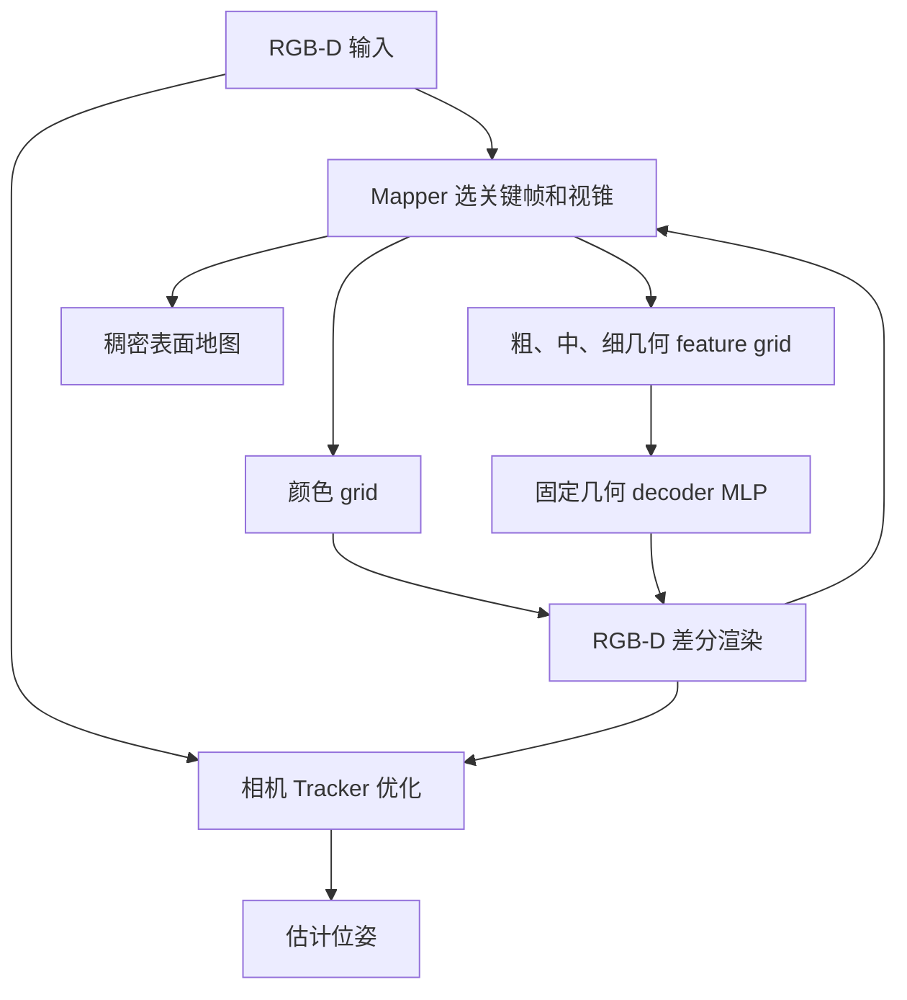
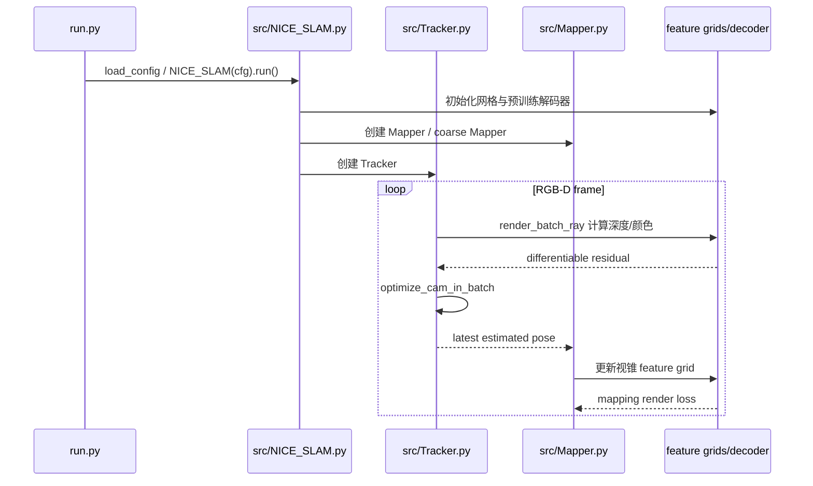

# NICE-SLAM — 论文与作者源码深读

## 一句话定义

NICE-SLAM 采用 coarse/mid/fine 分层局部几何特征网格、颜色网格和预训练几何解码器，实现 RGB-D 稠密 SLAM 的大场景重建与相机跟踪。

## 英文缩写速查

| 缩写 | 英文全称 | 简要说明 |
|---|---|---|
| SLAM | Simultaneous Localization and Mapping | 同步定位与建图 |
| RGB-D | Red Green Blue Depth | 彩色和对齐深度 |
| ATE | Absolute Trajectory Error | 位姿估计误差 |
| PSNR | Peak Signal-to-Noise Ratio | 渲染质量指标 |
| 3DGS | 3D Gaussian Splatting | 显式高斯场景表示 |

## 为什么重要

在机器人三维感知中，隐式体积场、显式高斯和传统点云的选择会影响在线相机跟踪、地图更新、渲染质量与系统时延。NICE-SLAM 的关键设计需要区分**地图表示、位姿优化、显式新区域处理和系统运行时间**。

## 核心原理与方法

粗层 grid 表示墙面与未观测区域的几何概貌，中/细层 grid 优化可见局部细节，另用颜色 grid 做 RGB 重建。Coarse/Mid/Fine 几何采用预训练固定解码 MLP，优化的是局部 feature grid。光线采样和深度/颜色体渲染构造跟踪与建图误差；Tracker 独立优化当前 camera pose，Mapper 优化局部网格和关键帧；大型场景使用可见视锥局部 feature 更新与 keyframe overlap 选取。不是原始 iMAP 的单一全局 MLP。

## 流程总览（原论文）

## 源码运行时序图

README：python -W ignore run.py configs/Demo/demo.yaml；run.py 读取 config → src/NICE_SLAM.py 分配共享资源与调度 Tracker、Mapper；src/Tracker.py::optimize_cam_in_batch 采样渲染光线计算 RGB-D loss，src/Mapper.py 管理 keyframe overlap/frustum 与局部网格更新。 以下图依据作者源码主循环，不等于已在本环境运行。

## 实验与评测

论文 §4.2/Table2 TUM RGB-D ATE RMSE（cm，作者从 5 次运行取最佳）：NICE-SLAM fr1/desk **2.7**、fr2/xyz **1.8**、fr3/office **3.0**；ORB-SLAM2 对应 1.6/0.4/1.0，不能宣称全局胜传统定位。论文还报告 Replica 重建和 ScanNet 大场景，渲染/跟踪使用不同指标。

## 结论

**NICE-SLAM 采用 coarse/mid/fine 分层局部几何特征网格、颜色网格和预训练几何解码器，实现 RGB-D 稠密 SLAM 的大场景重建与相机跟踪。**

- 跟踪和建图使用不同梯度目标，不能把渲染速度等同在线 SLAM 总帧率。
- 数据集划分与 metric 必须与原论文一致，避免比较不同深度、相机位姿来源的结果。
- 对机器人部署必须先完成相机内参、深度外参、时间同步及真实硬件测量。

## 工程实践

README：python -W ignore run.py configs/Demo/demo.yaml；run.py 读取 config → src/NICE_SLAM.py 分配共享资源与调度 Tracker、Mapper；src/Tracker.py::optimize_cam_in_batch 采样渲染光线计算 RGB-D loss，src/Mapper.py 管理 keyframe overlap/frustum 与局部网格更新。

建议分别记录 ATE、深度 L1、PSNR 和关键帧时间成本，并把源码 commit、GPU、分辨率与传感器参数写入实验日志。

## 局限与风险

几何预测有训练集先验及归纳偏置，跨类别泛化不等于保证；光线/体渲染和双设备 Tracking/Mapping 有算力需求；RGB-D 深度噪声和动态物体造成重建误差，论文中传统特征 SLAM 的部分轨迹指标仍优。

## 关联页面

- [4D-GS（动态新视角合成）](./paper-4d-gaussian-splatting-wu.md)
- [COLMAP 稀疏/稠密重建](./colmap.md)
- [LVI-SAM](./paper-lvi-sam.md)

## 参考来源

- [论文深读来源档案](../../sources/papers/vision3d_nice_slam_primary_paper_20261108.md)
- [官方仓库深读档案](../../sources/repos/vision3d_nice_slam_20261108.md)
- [原文全文](https://arxiv.org/html/2112.12130)
- [原作者源码](https://github.com/cvg/nice-slam)

## 推荐继续阅读

- [作者论文和补充材料](https://arxiv.org/html/2112.12130)
