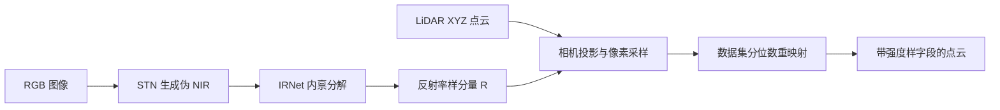
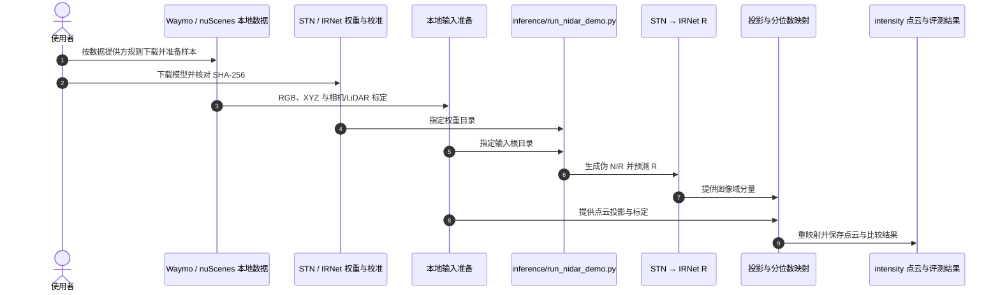

# NIDAR：用伪 NIR 与内禀分解合成 LiDAR 强度

**NIDAR**（*NIR-Guided Intrinsic Decomposition for Scalable Scene-Agnostic LiDAR Intensity Reconstruction*，arXiv:2609.36878，IROS 2026）把 RGB 外观与 LiDAR 几何结合，为已有点云补充强度样信号；部署时不需要目标场景强度标签或逐场景梯度优化。

## 英文缩写速查

| 缩写 | 英文全称 | 简要说明 |
|---|---|---|
| NIDAR | NIR-Guided Intrinsic Decomposition for Scalable Scene-Agnostic LiDAR Intensity Reconstruction | RGB 引导的 LiDAR 强度样信号合成框架 |
| NIR | Near-Infrared | 近红外；先从 RGB 估计伪 NIR 线索 |
| LiDAR | Light Detection and Ranging | 提供点云几何，并与图像做标定投影 |
| STN | Spatial Transformer Network | 官方工件中的 RGB 到伪 NIR 模型 |
| IRNet | Intrinsic Decomposition Network | 预测内禀分量并提供默认路线所需 R |
| SLAM | Simultaneous Localization and Mapping | 论文下游仿真评测的定位与建图任务 |

## 为什么重要

仿真点云常只有 XYZ 几何，而真实 LiDAR 强度可为感知与状态估计提供额外线索。逐场景采集强度标签并优化重建网络会增加扩展成本。NIDAR 把伪 NIR、反射率样分量和分布校准串成固定前馈管线，为既有仿真点云补充强度通道。

## 核心原理

### 输入与输出

输入为相机 RGB、XYZ 点云及相机/LiDAR 标定；输出是在已有点云上关联的强度样数值。NIDAR 不从图像生成 XYZ，也不输出传感器无关材料反射率或绝对光功率。

### 方法栈与流程

默认路线使用 R + quantile remapping。直接强度头 I_hat 并非该路线最终信号；数据集校准不能解释为跨传感器通用标定。

## 源码运行时序图

官方 GitHub 与 HF 提供推理入口、模型工件和 IRNet 训练说明。使用者需按 Waymo / nuScenes 提供方规则获取数据；托管工件另有独立许可边界。

最短推理路径是下载模型、准备样本并运行官方 demo。公开资料也包含 IRNet 训练/续训说明；托管 checkpoint 的逐位训练重放及 STN 重训不属于已确认公开范围。

## 实验与评测

arXiv 摘要报告学习组件以 Waymo 数据离线训练，并固定权重与校准在 Waymo 和 nuScenes 上评测。论文称相对所比较的重建基线具有有竞争力的像素精度和结构/感知保真度；具体数值须结合论文表格与协议核对。

论文还报告 UE5、Isaac Sim 和生成式 LiDAR 流程集成，并在两个仿真室内场景评测两个 intensity-aware SLAM 系统。作者明确指出这些结果不构成真实机器人验证。

## 与其他工作对比

| 路线 | 目标场景监督 / 优化 | 复用边界 |
|---|---|---|
| 场景特定强度重建 | 通常依赖目标场景真实强度和逐场景拟合 | 换场景可能需重新采集或优化 |
| NIDAR | 预训练组件固定，部署不需目标场景强度标签或梯度拟合 | 在论文评测设置跨场景使用；数据集校准与传感器域变化仍限制外推 |

“Scene-agnostic”描述免逐场景训练/优化的路线，不代表任意波段、相机配置或 LiDAR 传感器都已验证。

## 结论

**一句话总判：** NIDAR 用伪 NIR—内禀分解—分布映射管线给仿真点云补充强度样观测，主要价值是降低目标场景标签与拟合成本，而非恢复普适物理反射率。

1. **确认输入齐全：** 需要 RGB、XYZ 与相机/LiDAR 标定。
2. **按默认路线解释输出：** 官方模型卡采用 R + quantile remapping；辅助直接强度头不是默认部署结果。
3. **区分跨场景和跨传感器：** Waymo 与 nuScenes 评测不代表所有波段、曝光和相机都稳定。
4. **逐项检查工件许可：** 代码 Apache-2.0 不自动覆盖权重、校准、数据或第三方组件。
5. **下游证据限于仿真：** 论文报告仿真 SLAM 评测，不能据此声称实机定位已改善。

## 局限与风险

- **信号语义：** 输出是研究用强度样信号，不是绝对回波光功率、传感器无关材料反射率或新几何。
- **校准域：** 曝光、光谱外观、量程、可见性、投影和传感器域变化可能影响结果；校准按数据集区分。
- **时间一致性：** HF 模型卡提示内禀输出可能模糊边界或在相邻帧变化，序列应用应独立检查。
- **验证范围：** 仿真 SLAM 评测不等于实机验证；跨波段、嵌入式与真实传感器验证仍待完成。
- **公开边界：** 代码与部分模型工件可获取；原始数据不托管。托管权重训练过程不保证逐位重放，工件许可分别核对。
- **项目页不同步：** 项目页仍显示 “Coming soon”，而论文、代码和模型已在独立官方入口公开；以各资源当前页面为准。

## 关联页面

- [LiDAR 传感](../concepts/lidar-sensing.md) — 点云、相机协同与传感边界。
- [机器人仿真三层分工](../concepts/robot-simulation-three-layers.md) — 仿真平台与任务/数据管线分工。
- [导航·SLAM·自主栈总览](../overview/navigation-slam-autonomy-stack.md) — 下游定位建图流程。

- [机器人视觉感知栈选型闭环知识链](../queries/robot-perception-stack-selection-loop.md) — LiDAR 强度重建补充感知输入。

## 参考来源

- [NIDAR 论文摘录](../../sources/papers/nidar_arxiv_2609_36878.md)
- [NIDAR 项目页归档](../../sources/sites/nidar-project.md)
- [NIDAR 官方代码与模型工件归档](../../sources/repos/nidar.md)
- [arXiv:2609.36878](https://arxiv.org/abs/2609.36878)

## 推荐继续阅读

- [NIDAR 项目页](https://nidar-web.github.io/)
- [NIDAR 官方 GitHub](https://github.com/Zjj587/NIDAR)
- [NIDAR Hugging Face 模型卡](https://huggingface.co/zhangjunjie587/NIDAR)
