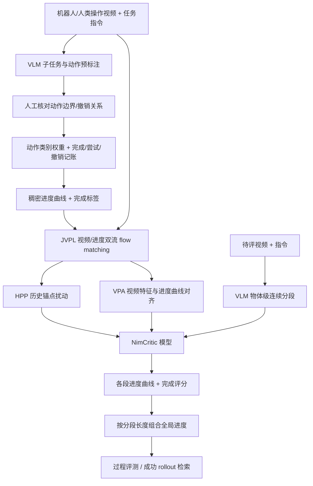

# NimCritic：基于动作感知量化的长时程进度预测（Predictive Long-Horizon Progress Modeling with Action-Aware Quantification）

## 一句话定义

**NimCritic**（[arXiv:2610.32776v1](https://arxiv.org/abs/2610.32776)，2026-10-23）是面向机器人长时程操作的视频过程评测模型：先把任务拆成**物体级子任务**，用动作的完成、尝试与撤销定义稠密进度标注，再联合学习视频预测与进度预测，对执行视频输出**可增、可退、可恢复**的进度曲线和独立的完成判断。

## 英文缩写速查

| 缩写 | 英文全称 | 简要说明 |
|------|----------|----------|
| PRM | Process Reward Model | 根据机器人执行过程给稠密反馈的模型 |
| VLM | Vision-Language Model | 预标注动作，并在长程推理时做物体级子任务分段 |
| LOOM | LOng-hOrizon Manipulation | 论文定义的长程操作进度基准 |
| JVPL | Joint Video–Progress Learning | 联合预测未来视频 latent 与进度/完成信号 |
| HPP | Historical Progress Perturbation | 扰动历史进度锚点，降低递归预测漂移 |
| VPA | Video–Progress Alignment | 对齐视频特征和真实/去噪进度曲线的对比训练 |
| PRC-F1 | Progress Rank Correlation F1 | 前向/反向进度 Spearman 相关的调和组合 |
| TSA | Terminal Success Accuracy | 终点是否完成的加权判别准确率 |
| VPB | Video Progress Benchmark | 论文使用的公开进度评测基准 |

## 为什么重要

- **成功/失败二值太粗：** 抓起积木但尚未放好、误碰推倒此前积木、再次恢复都需要不同反馈，而不是简单按演示视频播放比例计分。
- **将“几分进度”形式化：** 按动作权重记账，可对尝试给临时部分 credit、对破坏操作撤销先前 credit，减少依赖主观手标阶段百分数。
- **连接策略评价与数据清洗：** 把 rollout 转为稠密曲线及终点完成判断，有助于识别失败近因、挑选候选成功轨迹；但论文没有证明把该分数接入 RL 后的真机策略收益。

## 核心信息

| 项 | 论文 v1 核验内容 |
|----|----------------|
| **作者** | Tianchi Xu、Yalin Zheng、Yangxin Zhu、Ruonan Ren、Zheng Fu、Yunlong Wang、Yuanxin Zhong |
| **研究发布入口** | [日冕 RIMBOT 官方研究页](https://rimbot.com/research/)（2026-10-23 研究条目） |
| **输入** | 任务指令 + 操作视频；多任务轨迹额外由 VLM 分段 |
| **训练** | 253,276 条 episode、856.95 小时机器人与第一视角人类视频；VLM 预标、人工核对 |
| **训练机制** | 视频 / 进度两路 diffusion transformer；JVPL + HPP + VPA |
| **推理输出** | 子任务内进度、全局时间加权进度曲线，以及任务完成判断 |
| **评测** | LOOM、VPB、RoboArena；PRC-F1 / TSA / 成功 rollout Recall 和 Hit Rate |
| **在线体验** | [critic.rimbot.com](https://critic.rimbot.com/)（入口可访问，交互功能本次未实测） |
| **开源边界** | **待核验**：官方项目详情本次抓取超时，未取得可确认的代码、权重、LOOM 标注下载入口 |

## 核心原理

### 1. 动作感知进度量化：可以撤销的信用记账

论文把连续操作同一对象的动作归为一个子任务，以全数据归一化动作持续时间定义固定动作类别权重 `w_c`，由动作对目标的效果决定信用因子 `α_i`：

- 有效推进目标：**全额 credit**；只完成接触/尝试而尚未实现目标：**临时半额 credit**；无效执行：**零 credit**。
- 若后续动作把之前成果破坏，明确关联被撤销的早期动作记录，并移除它此前取得的 credit；撤销可以跨子任务。
- 未完成片段还要预测**剩余必要动作**，作为预算 `B` 的组成项。局部进度是已保留的累计动作贡献相对固定预算的比例，不等于 elapsed time。

论文公式 (1)–(2) 的简化读法：

\[
\eta_i = \alpha_i w_{c_i} - \sum_{j\in\mathcal{E}_i\cap\mathcal{I}_k}\alpha_j w_{c_j},\qquad
p_t=\frac{\sum_i \eta_i\ell_i(t)}{B}.
\]

其中 `ℓ_i(t)` 是该动作在当前时间的截断执行比例，`E_i` 标记它要撤销的早期贡献。VLM 生成候选语义与边界，人工复核时间标注，最终由规则算出稠密监督。

### 2. 长程分段：VLM 是前端，不是进度模型本身

按物体中心的**操作对象和目标状态**做连续切段；同一物体的抓取失败/重试保留在同段，工具获取与作用于另一对象的操作可以拆成两段。过短段与相邻段合并。每段使用自己的指令与零起点，并行评估局部进度，再以段的帧数对局部曲线及先前段出口进度做加权组合（论文公式 4）。

**注意：** 训练标注中的跨子任务撤销按原动作归属记账；推理时的全局组合是**按预测段长度加权的公式**，并不是显式重放所有跨段撤销动作。

### 3. 预测 critic：让视频变化与进度变化对齐

模型使用冻结的视频 VAE 与 UMT5 文本编码器、从 Wan2.2-TI2V-5B 初始化的视频主干；视频专家和进度专家通过非对称混合注意力交互：

1. **JVPL：** flow matching 同时学习视觉变化和动作感知的进度/完成轨迹；未来帧用于**训练监督**，不是推理时“偷看”未来。
2. **HPP：** 训练时对历史进度锚点有界随机替换，重新表示相对目标，推理时从去噪后的相对增量还原绝对进度，降低滑窗误差累积。
3. **VPA：** 对齐视频中间表征、真实进度曲线和预测去噪曲线；通过扰动进度的负例训练跨模态对应。
4. **完成判断独立监督：** 连续进度 `p_t` 和是否达成最终目标不能混为一个数，模型分别输出。

## 流程总览

图中 VLM 标注与联合训练属于**离线训练**，VLM 分段与 critic 推理属于**评分阶段**；模型不直接输出机器人控制动作。

## 源码运行时序图

**不适用（当前无法核验官方可运行源码）。** 官网项目详情在入库核对时多次读取超时；未获得经验证的官方 GitHub、下载权重或推理入口，因此不能凭论文结构虚构 `train.py` / `infer.py` 的运行时调用。后续核实正式仓库和 README 后，再补依据实际入口的 `sequenceDiagram`。

## 工程实践

| 步骤 | 论文提供的信息 / 可操作提醒 |
|------|-----------------------------|
| 数据标注 | 按对象划分动作与子任务，显式标完成、临时尝试、撤销引用、缺少的恢复动作，避免用均匀时间插值替代 |
| 训练设置 | 附录 A.3：9 张 2 Hz 的 256×448 RGB 帧；128k updates、48×PPU-ZW810E、有效 batch=192 |
| 评分滑窗 | 使用 5 张已观察 RGB 帧；两帧 latent、20 个 Euler 去噪步；stride=2，按距离加权重叠窗口 |
| 多任务 | VLM 离线分段 + 短段合并 + 分段打分；在比较不同 critic 时必须固定分段前端 |
| 外部体验 | [NimCritic Demo](https://critic.rimbot.com/) 为官方指向的用户入口；尚未实际验证上传、响应或可下载输出 |
| 复现边界 | 尚无核验过的公开代码与权重 URL，不能据论文结构推断部署 API、推理耗时或复现成功 |

## 实验与评测

| 基准 | 论文 v1 结果 | 应如何解读 |
|------|--------------|------------|
| LOOM | **300** 条跨具身轨迹、**19,618** 人工核准帧；整体 **PRC-F1=0.86、TSA=0.92** | 单任务 PRC-F1 仅 **0.67**，低于两组 GVL 的 0.69；多任务 PRC-F1 **0.95** |
| VPB | **PRC-F1=0.77、TSA=0.82** | GVL（GPT-6-Sol）的 TSA=0.50；“提升约 65%”是 **TSA 相对增幅**，并非 PRC-F1 |
| RoboArena | **96.72% Recall、98.09% Hit Rate** | 统计找回人工标成功的 rollout，**不是策略成功率** |
| VPB 消融 | 无 JVPL/HPP/VPA 时 PRC-F1=0.35；逐步加入后 **0.59 → 0.67 → 0.77** | TSA 并不逐项单调改善（依次 0.86/0.75/0.87/0.82） |
| LOOM 分段消融 | 同一 critic 多任务 PRC-F1 **0.55 → 0.95** | VLM 分段贡献很大；共享 Gemini 分段下 GVL（GPT-6-Sol）PRC-F1=0.96，略高于 0.95 |

**指标边界：** PRC-F1 组合进度曲线前/反向的 Spearman 相关；TSA 是是否完成的加权准确率。两者均不是 RL return，也不能取代真实系统的安全、耗时和单位工时指标。

## 结论

**NimCritic 的主要价值是把“任务做了多少”转成可审计、可回撤的动作贡献，并用视觉预测提高过程曲线评分；评测收益不能直接当作控制收益。**

1. **优先记录撤销与恢复** — 单调进度标签不能覆盖长程操作的真实失败模式。
2. **长程任务需报告分段条件** — 同一模型 LOOM 多任务 PRC-F1 从 0.55 提升到 0.95，包含 VLM 前端的贡献。
3. **分开报告进度相关和完成判断** — VPB 0.77 PRC-F1 与 0.82 TSA 是不同统计含义。
4. **RoboArena 的 96.72% 是成功轨迹召回率** — 不要宣传成真机操作成功率。
5. **不要将所有场景概括成第一** — 单任务 LOOM 与共享分段的部分对照仍存在更高 PRC-F1 基线。
6. **部署前需先核验开源与成本** — 官方可运行代码、权重、实测 latency 尚未确认，不应直接规划实时闭环依赖。

## 与其他工作对比

| 工作 | 和 NimCritic 的分工 |
|------|--------------------|
| [过程奖励建模概念](../concepts/progress-reward-modeling.md) | 统一描述过程奖励建模空间；NimCritic 给出动作信用撤销 + 预测视频对齐的具体实例 |
| [PRM-as-a-Judge](./paper-prm-as-a-judge.md) | 将已有 PRM 的曲线用于 OPD 过程指标；NimCritic 侧重**训练一个进度与完成双输出的 judge** |
| [TOPReward](./paper-topreward.md) | 用冻结 VLM 的 token 似然读进度；NimCritic 使用定量标签与可训练双流模型 |
| [RoboDojo](./robodojo.md) | 提供操纵策略评测场景；NimCritic 属于对执行视频进行二次过程评分的模型，所报告的 RoboArena 检索不能直接替代 RoboDojo 指标 |

## 局限与风险

- **官网资料阻塞：** 官方项目页本次访问超时，在线 Demo 仅获得客户端入口，**无法证实**代码、模型权重、LOOM 标注、接口/许可证是否公开；详情见 [官网核查](../../sources/sites/nimcritic_rimbot_project.md)。
- **依赖外部 VLM 分段：** 长程整体结果不能仅归功于 critic。论文附录 A5 表明共享分段显著改善其他基线，说明评测比较需固定该前端。
- **单任务并非全面领先：** LOOM 单任务 PRC-F1 为 0.67，低于两组 GVL 的 0.69；共享分段条件下 GPT-6-Sol 的 PRC-F1 也略高。
- **离线评估不等于实时部署：** 论文未报告定量推理延迟、吞吐或嵌入式平台 benchmark；没有独立运行模型或真机闭环验证。
- **训练成本与监督预算：** 使用 856.95 小时数据、48 加速器以及 VLM 预标 / 人工核对；规模化成本应另行测量，不可据论文直接推算。
- **官网命名差异待查：** 官方研究列表摘要出现“NimProgress”，论文 v1 评测集称“LOOM”；本次没有证据认定两者同一数据集。

## 关联页面

- [过程奖励建模](../concepts/progress-reward-modeling.md)
- [PRM-as-a-Judge](./paper-prm-as-a-judge.md)
- [TOPReward](./paper-topreward.md)
- [RoboDojo](./robodojo.md)
- [具身评测纵深路线 Stage 3](../../roadmap/depth-embodied-eval.md)

## 参考来源

- [NimCritic arXiv v1 论文通读归档](../../sources/papers/nimcritic_arxiv_2610_32776.md)
- [NimCritic 官方项目页及在线 Demo 访问记录](../../sources/sites/nimcritic_rimbot_project.md)
- [arXiv HTML v1 全文](https://arxiv.org/html/2610.32776v1)

## 推荐继续阅读

- [论文 arXiv:2610.32776](https://arxiv.org/abs/2610.32776)
- [日冕 RIMBOT NimCritic 官方研究项目页](https://rimbot.com/research/nimcritic/)
- [NimCritic 在线体验](https://critic.rimbot.com/)
