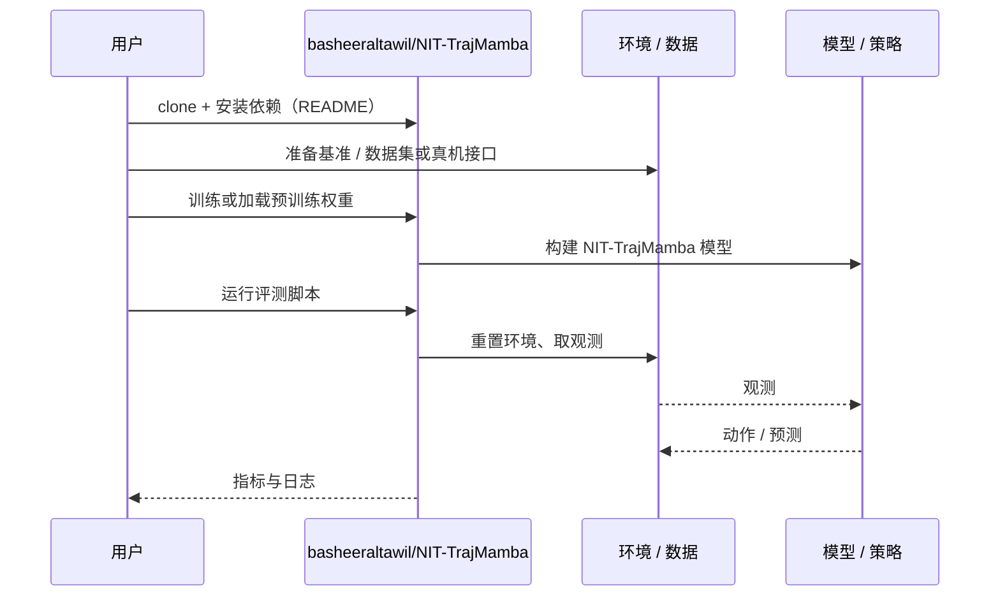

# NIT-TrajMamba（arXiv:2610.33916）

**NIT-TrajMamba**（*Real-Time Human Trajectory Prediction from RGB-D for Mobile Robots Using Bi-Mamba*，[arXiv:2610.33916](https://arxiv.org/abs/2610.33916)，[代码](https://github.com/basheeraltawil/NIT-TrajMamba)）来自 [具身智能小站 2026-10-28 盘点](../../sources/blogs/wechat_embodied_station_59_papers_human_video_to_robot_experience_2026-10-28.md)，属「导航、无人机与群体」组。

## 一句话定义

**统一训练与部署中的姿态检测、深度反投影和平滑流程，再用双向 Mamba 与解码器预测短期速度。**

## 英文缩写速查

| 缩写 | 英文全称 | 简要说明 |
|------|----------|----------|
| NIT-TrajMamba | Real-Time Human Trajectory Prediction from RGB-D for Mobile Robots Using Bi-Mamba | 本文方法 / 基准的简称 |

## 为什么重要

- 让行人轨迹预测贴近真实输入。部署于移动机器人，重点是减少理想训练数据与噪声传感输入的差距。
- 开源结论：**已开源**（步骤 2.5，2026-10-28）。仓库可达（git ls-remote）。
- 同期同组工作见 [潜在动作、免渲染事件仿真与机器人评测：具身智能小站 10-28 期 59 篇阅读坐标](../overview/embodied-station-2026-10-28-59-papers-technology-map.md)。

## 核心机制

| 项 | 内容 |
|----|------|
| **arXiv** | [2610.33916](https://arxiv.org/abs/2610.33916) |
| **开源** | **已开源** |
| **要点** | 统一训练与部署中的姿态检测、深度反投影和平滑流程，再用双向 Mamba 与解码器预测短期速度。 |
| **文内指标** | 公众号转述：部署于移动机器人，重点是减少理想训练数据与噪声传感输入的差距。 |

## 源码运行时序图

以下为按仓库入口（`basheeraltawil/NIT-TrajMamba`）推断的通用运行链路；入库日仅核实仓库可达，未逐文件阅读，具体脚本名以 README 为准。

## 实验与评测

- 公众号转述：部署于移动机器人，重点是减少理想训练数据与噪声传感输入的差距。
- **读法：** 本页为索引级摘要，依据公众号转述的官方摘要与仓库信息整理；逐项数字与 baseline 以原文 PDF 为准。

## 与其他工作对比

- 横向索引见 [潜在动作、免渲染事件仿真与机器人评测：具身智能小站 10-28 期 59 篇阅读坐标](../overview/embodied-station-2026-10-28-59-papers-technology-map.md)；同 arXiv 不重复造页。

## 结论

**让行人轨迹预测贴近真实输入：部署于移动机器人，重点是减少理想训练数据与噪声传感输入的差距。**

1. 开源边界：**已开源** — 仓库可达（git ls-remote）。
2. 核心机制：统一训练与部署中的姿态检测、深度反投影和平滑流程，再用双向 Mamba 与解码器预测短期速度。
3. 复现与选型前核对任务协议、硬件与基准口径，勿直接横比公众号摘录数字。

## 关联页面

- [locomotion](../tasks/locomotion.md)
- [sim2real](../concepts/sim2real.md)
- [reinforcement-learning](../methods/reinforcement-learning.md)
- [vision-language-navigation](../tasks/vision-language-navigation.md)
- [embodied-station-2026-10-28-59-papers-technology-map](../overview/embodied-station-2026-10-28-59-papers-technology-map.md)

## 参考来源

- [nit_trajmamba_arxiv_2610_33916.md](../../sources/papers/nit_trajmamba_arxiv_2610_33916.md)
- [wechat_embodied_station_59_papers_human_video_to_robot_experience_2026-10-28.md](../../sources/blogs/wechat_embodied_station_59_papers_human_video_to_robot_experience_2026-10-28.md)
- [arXiv:2610.33916](https://arxiv.org/abs/2610.33916)

## 推荐继续阅读

- [arXiv PDF](https://arxiv.org/pdf/2610.33916)
- [https://github.com/basheeraltawil/NIT-TrajMamba](https://github.com/basheeraltawil/NIT-TrajMamba)
