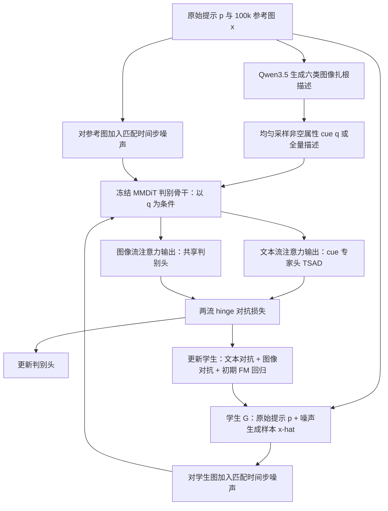
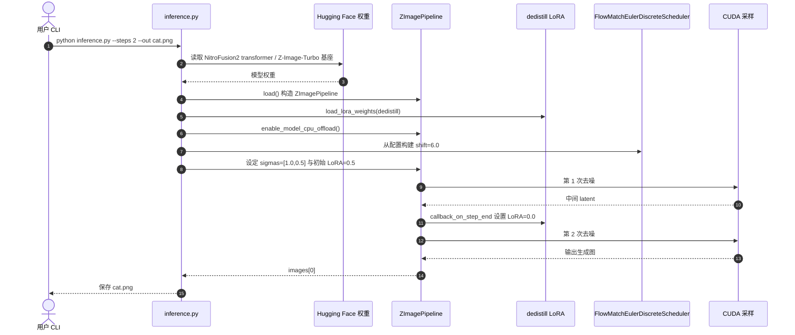

# NitroFusion2：将对抗损失引入多模态扩散 Transformer 文本流

论文：**NitroFusion2: Bringing Adversarial Loss to the Text Stream of Multimodal Diffusion Transformers**（将对抗损失引入多模态扩散 Transformer 的文本流）。

作者：Dar-Yen Chen、Yi-Zhe Song；机构：**英国萨里大学（University of Surrey）SketchX / CVSSP**、**图灵精英研究实验室（Turing Elite Research Labs）**。2026-11-03 提交 arXiv:2611.05648v1。

## 一句话定义

**NitroFusion2** 是基于 6B Z-Image-Turbo 的少步文生图蒸馏方法：让冻结 MMDiT 判别骨干的**文本 token 注意力输出**也接受对抗监督，并用细分视觉属性提示控制判别重点，实现高质量 **1–2 步**生成。

## 英文缩写速查

| 缩写 | 英文全称 | 简要说明 |
|---|---|---|
| MMDiT | Multimodal Diffusion Transformer | 图文 token 共同注意力；文本中间状态可包含图像相关信息 |
| TSAD | Text-Stream Adversarial Distillation | 在文本流中间注意力输出接判别头的对抗蒸馏 |
| ACD | Aspect-Cued Discrimination | 抽取属性提示并路由对应文本流专家判别头 |
| ADD | Adversarial Diffusion Distillation | 用判别损失监督少步扩散学生模型 |
| NFE | Number of Function Evaluations | 采样时去噪网络调用次数；本论文主表的 1/2 步口径 |
| LoRA | Low-Rank Adaptation | 官方两步推理中临时启用去蒸馏适配器 |

## 为什么重要

常规扩散对抗蒸馏的判别器读取**图像特征**。但 MMDiT 使用联合注意力：中间文本 token 的查询已读过图像 token，既受图像影响又保持与提示词绑定。把判别信号放到此处，可以让监督从局部外观延伸至「提示中要求的对象、文字、风格等属性」。这项工作针对**图像生成吞吐与文字保真**，不能直接解释为机器人动作策略已经得到相同增益。

## 核心原理与方法栈

### TSAD：读取已经看过图像的文本流

对于文本查询 $Q_T$、图文键值 $K=[K_I;K_T]$、$V=[V_I;V_T]$，文本流注意力输出满足：

$$U_T=A_IV_I+A_TV_T,\qquad A=\operatorname{softmax}(Q_TK^\top/\sqrt d).$$

其中 $A_IV_I$ 明确依赖图像。与交叉注意力 U-Net 的固定文本嵌入不同，MMDiT 文本流能沿判别器的冻结骨干向生成图像回传对抗梯度。方法在选定层的**文本流注意力输出**上挂轻量文本专家头，同时保留图像流判别头；两者复用同一次冻结骨干前向。

### ACD：让同一骨干按属性提问

每张参考图由 Qwen3.5-35B-A3B 生成图像扎根的六字段结构化描述：**typography（文字）、object（对象）、style（风格）、background（背景）、action（动作）、layout（布局）**，加全量描述共最多七类 cue。每步从「全量 + 非空属性」均匀抽样一个 cue；**学生模型继续使用原始提示词**，只有判别器收到 cue。文本流依据 cue 改变对图像的读取，并选取该类专用文本判别头；图像流头在各 cue 间共享。

### 训练目标与设置

冻结判别 MMDiT 骨干，交替更新轻量判别头与学生模型；判别头使用 hinge loss。学生目标为：

$$\mathcal L_G=(1-\lambda_{img})\mathcal L_{text-adv}+\lambda_{img}\mathcal L_{img-adv}+\lambda_{fm}\mathcal L_{fm}.$$

论文设置 $\lambda_{img}=0.1$、初始 $\lambda_{fm}=0.1$，低噪声回归阈值 $t_{fm}=0.75$。数据：Z-Image-Turbo 12 步合成 **100k** 张参考图，中英文提示各半，约 1024² 像素预算。附录：8 张 H100、Adam 学习率 $5\times10^{-5}$、batch 256、总 20k 步；前 5k off-policy，后 15k on-policy 并将 $\lambda_{fm}$ 置 0。每个 cue / 图像流使用三个专家头池，训练时随机抽头并周期性刷新。上述是**论文训练设定**，非已发布训练脚本的运行记录。

## 流程总览

图中图文双流和 cue 路由对应论文 §3 与附录 C；训练阶段的判别骨干冻结，轻量判别头与学生参数更新。

## 实验与评测

论文表 1 的同尺寸 6B Z-Image 系列对照（分数越高越好；**论文报告值，非本站复跑**）：

| 方法 | NFE | LongText-EN | LongText-CN | GenEval | DPG-Bench | OneIG |
|---|---:|---:|---:|---:|---:|---:|
| **NitroFusion2** | **1** | **43.34** | **47.78** | **75.86** | **86.48** | **47.63** |
| Z-Image-Turbo | 1 | 11.72 | 12.70 | 57.08 | 77.23 | 32.43 |
| TwinFlow | 1 | 29.18 | 36.85 | 66.34 | 85.17 | 42.20 |
| **NitroFusion2** | **2** | 76.03 | 81.95 | 74.46 | 86.21 | 51.45 |
| Z-Image-Turbo | 2 | 72.89 | 78.48 | 76.53 | 85.78 | 50.94 |
| Z-Image-Turbo++ | 2 | 89.88 | 91.62 | 75.70 | 85.86 | 52.50 |

- 单步 NitroFusion2 在这一表的五项指标全部领先同 NFE 的 Z-Image-Turbo 与 TwinFlow；对八步 Z-Image-Turbo 的 **GenEval 75.86 vs 75.01**、**DPG 86.48 vs 84.86**，但长文本指标仍明显落后八步版本。
- **消融（全部 1k 训练步、1 NFE）**：文本流单独监督在五项总体指标上均高于图像流单独监督；联合监督在其中四项更好，**GenEval 则文本流单独更高（66.71 vs 64.39）**。
- 单 cue 在相应属性上强，全 cue 混合在跨属性均衡上更好；消融表里混合策略对全量描述在七项中的六项领先。
- 2 步结果**不代表全项目都领先**：Z-Image-Turbo++ 文字生成和 OneIG 更高，且使用分步两套 6B 模型。论文另报 NitroFusion2 的 OneIG **多样性**单步仅 8.50、两步 9.63，低于对照，需与保真权衡。

## 结论

**核心贡献是把 MMDiT 的文本流转为可随 cue 引导的对抗监督空间，而非简单增加图像流判别器或声称所有两步指标最优。**

1. 图文联合注意力使文本中间状态依赖生成图像，TSAD 才能从该状态把梯度传回学生。
2. ACD 在判别端换 cue，不需要为六种属性各运行一套完整骨干；学生 prompt 保持原样。
3. 最强证据集中在 **1 NFE** 的文字可读性、细节和多指标增益。
4. 上线评估应同时看中英长文本、计数/布局、对齐以及多样性，不能只比 GenEval。
5. 复现时必须区分论文中**完整训练方法**与仓库目前发布的**Diffusers/ComfyUI 推理实现**。

## 与其他工作对比

| 方法 | 对抗监督位置 | 主要目标 |
|---|---|---|
| NitroFusion2 | 冻结 MMDiT 的**文本流 + 图像流**，cue 专家文本头 | 将 4–8 步常见质量压缩至约 1–2 步 |
| NitroFusion（2025） | 专家判别器框架，传统图像特征路线 | 动态对抗训练与单步图像生成 |
| [Adversarial Training for Pixel Diffusion](./paper-adversarial-training-pixel-diffusion.md) | 预测干净 RGB 图像、时间步门控 GAN 后训练 | 恢复像素扩散高频纹理；**不以减步为目标** |
| Z-Image-Turbo | 本文教师/学生初始化基础 | 12 步合成教师样本及少步推理基线 |

## 源码运行时序图

**已公开**：官方 [ChenDarYen/NitroFusion2](https://github.com/ChenDarYen/NitroFusion2) 提供 `inference.py`、Diffusers 用法、ComfyUI JSON workflow、模型 checkpoint 和 LoRA；仓库根目录没有训练入口，**不能据此声称论文训练代码已完整开源**。

此图只描述仓库实际 `inference.py` 的**两步推理**路径：1–4 步由脚本中的 `SHIFT` 与 `LORA_SCALES` 管理；主论文重点论证 1–2 步效果。两步时去蒸馏 LoRA 第一轮 scale 0.5、第二轮 0.0，避免误把它写成训练时序。

## 工程实践

- **官方 CLI**：`python inference.py --prompt "a cat holding a sign that says hello world" --steps 2 --out cat.png`；需要可用的 `torch`、`diffusers`、模型下载环境及计算资源。
- **模型加载**：`ZImageTransformer2DModel.from_pretrained("ChenDY/NitroFusion2", subfolder="transformer", torch_dtype=torch.bfloat16)` 替换 `ZImagePipeline` 的 transformer；基座来自 `Tongyi-MAI/Z-Image-Turbo`。
- **采样参数**：`FlowMatchEulerDiscreteScheduler`；2 步 `shift=6.0`、`sigmas=[1.0, 0.5]`、`guidance_scale=0.0`；实际脚本可用 `--seed`、`--no-dedistill-lora` 调整。
- **可用资源**：ComfyUI 一/两步 workflow、GGUF 量化变体（官方列 2.0–7.2 GB 文件大小）、2026-11-12 发布的 Union ControlNet；文件大小**不是推理显存实测**。
- **许可证边界**：GitHub 仓库代码 `LICENSE` 为 Apache-2.0；权重、基础模型及第三方组件以各自模型卡/许可为准。本次**未运行模型推理**，不提供实际延迟或显存保证。

## 局限与风险

- 复杂场景在单步仍难处理；论文明确指出样本多样性低、不同 cue 存在此消彼长（seesaw effect），层选择也只是实证有效，未证明全局最优。
- 训练使用 100k 合成样本与较大计算预算，移植到机器人视频/动作轨迹尚缺直接评测；不能将文生图 benchmark 外推为控制性能。
- 目前官方仓库可核对的是推理脚本与工作流，而非完整训练实现；训练的 TSAD/ACD 复现须以论文伪代码和附录为依据自行实现。

## 关联页面

- [扩散模型](../concepts/diffusion-model.md) — 采样、蒸馏与少步部署背景
- [扩散 Transformer](../concepts/diffusion-transformer.md) — 图文共同注意力骨干背景
- [生成对抗网络（GAN）](../concepts/generative-adversarial-network.md) — hinge 判别损失背景
- [像素扩散的对抗训练](./paper-adversarial-training-pixel-diffusion.md) — 对照「GAN 后训练但不减步」路线
- [UltraText Bench](./paper-ultratext-bench.md) — 图片内文字生成质量评测相关工作

## 参考来源

- [arXiv 原文全文与附录（通读归档）](../../sources/papers/nitrofusion2_arxiv_2611_05648.md)
- [NitroFusion2 官方项目页归档](../../sources/sites/nitrofusion2_project.md)
- [NitroFusion2 官方仓库与调用链归档](../../sources/repos/nitrofusion2.md)

## 推荐继续阅读

- [arXiv HTML 全文（§3–4、Appendix A–C）](https://arxiv.org/html/2611.05648v1)
- [官方项目主页：方法图与样例](https://chendaryen.github.io/NitroFusion2.github.io/)
- [官方代码与推理示例](https://github.com/ChenDarYen/NitroFusion2)
- [官方模型与量化权重](https://huggingface.co/ChenDY/NitroFusion2)
