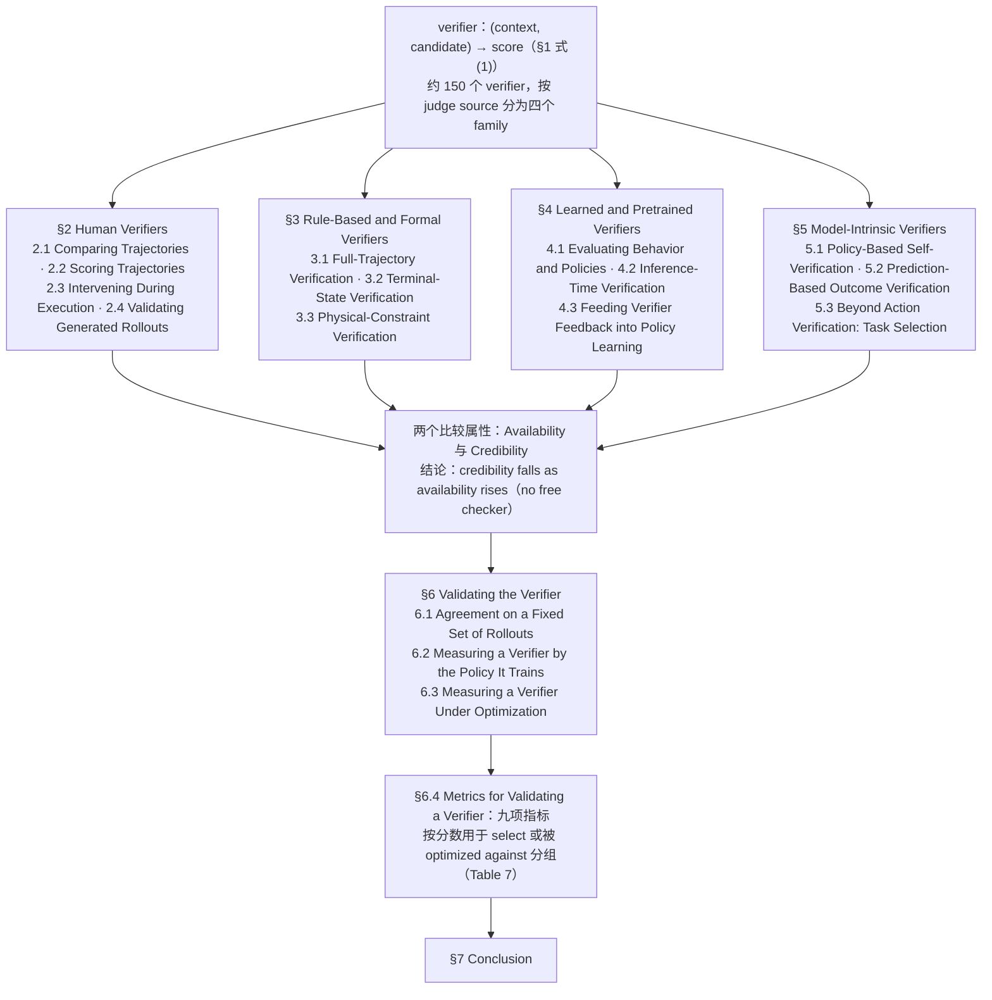

# No Free Checker（arXiv:2609.09250）

**No Free Checker**（[No Free Checker: A Survey of Verifiers for Robot Policies](https://arxiv.org/abs/2609.09250)）来自 [具身智能小站 11 篇盘点](../../sources/blogs/wechat_embodied_station_11_papers_vlm_manipulation_2026-09-10.md)。综述约 150 个 robot policy verifier；人类/规则/学习型/模型内生四类与九项可比指标；ZJUSCL/Awesome-Robot-Verifier 资源索引。

## 一句话定义

**核心贡献是 verifier 分类学与可比性指标，非可运行策略。**

## 英文缩写速查

| 缩写 | 英文全称 | 简要说明 |
|------|----------|----------|
| IL | Imitation Learning | 从专家示范学习策略 |
| VLM | Vision-Language Model | 视觉-语言多模态模型 |
| WM | World Model | 预测未来观测或表征的动力学模型 |
| RL | Reinforcement Learning | 强化学习 |
| CEM | Cross-Entropy Method | 采样优化动作/轨迹的规划器 |
| DoF | Degrees of Freedom | 自由度 |

## 为什么重要

- 纳入本期 **VLM 控制 / 世界模型 / 灵巧操作 / 规划 / 评测** 主线之一。
- 开源状态：**部分开源**（步骤 2.5 核查，2026-09-10）。
- 与 [11 篇技术地图](../overview/vlm-manipulation-11-papers-technology-map.md) 中同类工作可横向对照。

## 流程总览

图依据：综述分类体系图（论文 §1 Introduction 的 verifier 定义与四类 judge source 划分、目录 §2–§7、§6 Validating the Verifier、§6.4 Table 7）

## 核心机制

| 项 | 内容 |
|----|------|
| **arXiv** | [2609.09250](https://arxiv.org/abs/2609.09250) |
| **项目页** | — |
| **代码** | https://github.com/ZJUSCL/Awesome-Robot-Verifier |
| **开源** | **部分开源** |
| **文内指标** | 核心贡献是 verifier 分类学与可比性指标，非可运行策略。 |

## 源码运行时序图

**不适用**（配套为论文资源索引仓，非策略训练/评测 harness。）。

## 实验与评测

| 项 | 文内口径 |
|----|----------|
| 覆盖 | 综述约 **150 个** robot policy verifier |
| 分类 | **人类 / 规则 / 学习型 / 模型内生** 四类 |
| 可比性 | **九项** 跨 verifier 可比指标 |
| 产物 | 资源索引仓 [ZJUSCL/Awesome-Robot-Verifier](https://github.com/ZJUSCL/Awesome-Robot-Verifier)（**部分开源**：索引仓，非评测 harness） |

- **本文不报策略成功率：** 核心贡献是 **分类学与可比性口径**，不是可运行策略或新基准；引用时不要当作成绩单来源。
- **接入选型闭环：** 九项指标可作为 [具身大模型评测基准选型闭环](../queries/embodied-eval-benchmark-selection-loop.md) 中「用什么判成功」一环的对照清单，枢纽索引见 [评测基准枢纽](../overview/hub-embodied-eval-benchmark.md)。
- **读法：** 本页为清单摘要，上表取自 [公众号盘点](../../sources/blogs/wechat_embodied_station_11_papers_vlm_manipulation_2026-09-10.md)；分类边界与逐项指标定义以 **原文 PDF** 为准（[参考来源](#参考来源)）。

## 与其他工作对比

| 对照路线 | 差异 |
|----------|------|
| 单一 benchmark 论文 | 给一套任务与成功判据，数字只在本套内可比；本文横切约 150 个 verifier，问的是 **判据之间能不能比**。 |
| [具身大模型评测基准选型闭环](../queries/embodied-eval-benchmark-selection-loop.md) | 该 query 页按「测什么 → 用什么基准 → 指标怎么取舍」组织选型链；本文补的是 **verifier 本身的分类学**，可作为该链条中判据一环的外部索引。 |
| 人工评测（human-in-the-loop） | 在本文分类里是四类之一；优点是贴近真实成功定义，缺点是成本与一致性，本文用九项指标把它与自动判据放在同一张表上比。 |
| 模型内生 verifier（策略自评 / value head） | 零额外标注但与被测策略同源，存在自证风险；本文将其单列一类而非混入学习型判据。 |
| Awesome-* 资源列表 | 只做链接聚合；本文额外给 **分类维度与可比指标**，是带口径的综述而非纯清单。 |

## 结论

**No Free Checker 值得按「部分开源」边界阅读：先核对仓库是否可跑，再引用文内成功率数字。**

1. 索引来源为公众号导读，实验细节以 arXiv PDF 为准。
2. 开源结论：**部分开源** — 配套为论文资源索引仓，非策略训练/评测 harness。。
3. 选型时对照 [11 篇地图](../overview/vlm-manipulation-11-papers-technology-map.md) 中相邻节点，避免重复造页。

## 关联页面

- [VLM 与操作 11 篇技术地图](../overview/vlm-manipulation-11-papers-technology-map.md)
- [具身大模型评测基准选型闭环](../queries/embodied-eval-benchmark-selection-loop.md)
- [评测基准枢纽](../overview/hub-embodied-eval-benchmark.md)
- [模仿学习 (Imitation Learning)](../methods/imitation-learning.md)
- [Generative World Models](../methods/generative-world-models.md)
- [Manipulation](../tasks/manipulation.md)

## 参考来源

- [no-free-checker_arxiv_2609_09250.md](../../sources/papers/no-free-checker_arxiv_2609_09250.md)
- [wechat 11篇盘点](../../sources/blogs/wechat_embodied_station_11_papers_vlm_manipulation_2026-09-10.md)
- [arXiv:2609.09250](https://arxiv.org/abs/2609.09250)
- [arXiv PDF](https://arxiv.org/pdf/2609.09250)：已通读 Abstract、目录、§1 Introduction（四类 judge source 与 availability / credibility 框架）、§6.4 与 §7 Conclusion 的开头；§2–§5 各节与 §6.1–§6.3 正文以目录和略读为准

## 推荐继续阅读

- [arXiv PDF](https://arxiv.org/pdf/2609.09250)

- [GitHub](https://github.com/ZJUSCL/Awesome-Robot-Verifier)
