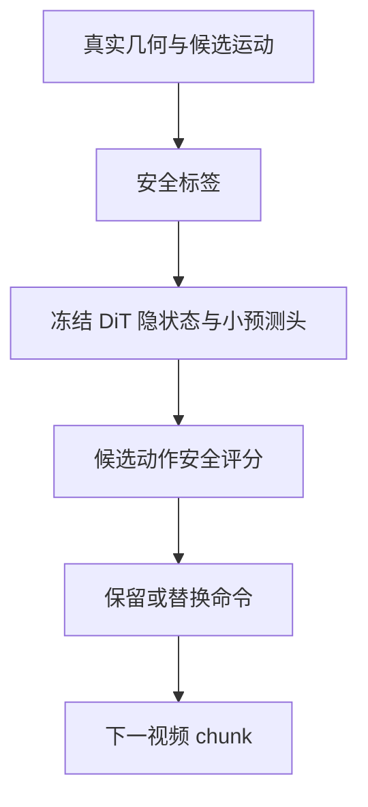
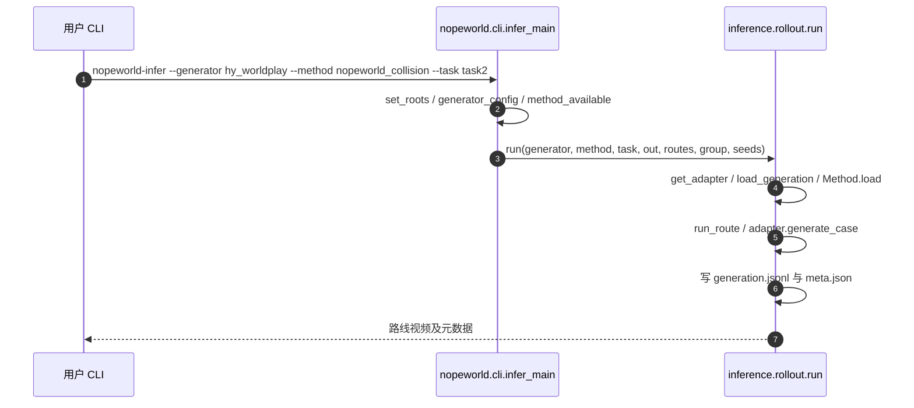

# NoPeWorld：非穿透世界模型（Non-penetrating World Models）

## 一句话定义

冻结视频世界模型，从 DiT 隐状态预测候选相机动作是否违反几何约束，在线替换动作以减少障碍穿透。

## 英文缩写速查

| 缩写 | 英文全称 | 简要说明 |
|---|---|---|
| DiT | Diffusion Transformer | 冻结的视频去噪骨干 |
| VLM | Vision-Language Model | 开放域视频评审 |
| SIS | Safe-Intent Score | 安全且尽量保持意图的评估指标 |

## 为什么重要

冻结视频生成器的物理约束与动作筛选边界。将其作为可比较的独立研究或工程入口，而不是仅记录热度。

## 核心信息

| 字段 | 内容 |
|---|---|
| 机构 | 香港理工大学 Learning & Generation Lab |
| 论文 | [arXiv:2611.27963](https://arxiv.org/abs/2611.27963) |
| 日期 | 2026-11-20 |
| 开放状态 | Apache-2.0；2026-11-21 发布代码、六种生成器的预测头与基准数据；生成器本体须另行获取。 |

## 核心原理与流程总览

训练阶段以 Unreal 场景真实几何标注候选运动安全性，冻结生成器，仅学习不足 200 万参数的头。每个 chunk 评估 34 个候选，包含原动作、停止、缩短步幅与转向。预测模式读取上一 chunk 的状态；碰撞模式读当前 chunk 首次去噪状态。保留安全原动作，否则选择尽量保持意图的候选，再闭环生成视频。

### 方法与训练

- Unreal 几何提供连续扫掠的候选动作标签；圆盘半径 0.25 m，安全余量 0.05 m。34 个候选动作包括原指令、停止及其他修正动作。预测头将特征投影至 128 维并经两层交叉注意力，估计安全性、净空与意图保持；训练采用 BCE、Huber 和 listwise KL 排序损失，729 段视频来自 44 个场景，训练 1000 步。
- Prediction 模式复用上一 chunk 已提交状态，不额外调用 DiT；Collision 模式读取当前 chunk 首次去噪状态，修改动作后重跑 step 0。阈值由验证集确定；无法找到安全候选时停止。

以下为根据原文整理的概念流程。

## 源码运行时序图

`nopeworld/cli.py::infer_main`、`scripts/infer.py`；已核对 CLI 分派及 rollout.py 的 run/run_route。官方命令 `nopebench-download --what weights`、`nopeworld-infer --generator hy_worldplay --method nopeworld_collision --task task2 --cases Cabin_Lake__d001 --out runs/hy/collision`。

## 工程实践

Apache-2.0；2026-11-21 发布代码、六种生成器的预测头与基准数据；生成器本体须另行获取。 复现入口与版本依赖见参考来源。本次未执行训练、推理或仿真复现。

## 实验与评测

NoPeBench Task 1 在真实历史上测试决策，Task 2 在已知几何的闭环生成中评估，Task 3 用开放域静态及移动障碍图像测试零样本迁移。作者报告六模型 Task 2 碰撞模式违规率平均 74%→16%；LingBot-World 2.0 89%→7%。预测模式不是所有模型均支持，Evoke-Turbo 无跨 chunk 记忆。

### 对照、消融与边界

- Task 2 有 100 条障碍路线（32 个留出场景），另有 50 条开放路线；Task 3 含 81 个静态和 50 个动态案例。六模型原始→Collision 违规率分别为 89→7、86→15、86→3、77→30、11→1、95→40（%，按表 4 顺序）；均值 74→16。LingBot Prediction 为 4%，但 WorldPlay2 的 SIS 反而从 36 降至 25，说明不能只看碰撞率。
- 每条路线以原始 53.7 s 为参照，Prediction、Collision、外部深度方法分别增加约 0.7、9.9、14.7 s；附录的人工复核和未来帧替换检验支持 DiT 特征包含碰撞信息，但并非真实机器人安全认证。

## 结论

冻结视频世界模型，从 DiT 隐状态预测候选相机动作是否违反几何约束，在线替换动作以减少障碍穿透。 工程选型时应同时验证指标口径及使用边界。

- 区分真实历史决策、闭环视频违规和开放域评审。
- 同时监测误干预与意图保留，不能只优化停止率。
- 将该方法当生成器侧动作过滤，而非真机安全控制器。

## 局限与风险

视频不穿透不等于机器人安全；几何评估依赖重建和分割，开放域依赖 VLM 判断；预测头并未提供形式化安全保证。安装文档要求至少 80 GB 显存，部分模型建议 96 GB。

**核对状态：** 已完成所列原文核对（论文正文与附录；官方 CLI、rollout.py 的 run/run_route 及发布头加载入口。）；未执行训练或实机复现。

## 关联页面

- [generative-world-models](../methods/generative-world-models.md)
- [world-action-models](../concepts/world-action-models.md)
- [相关纵深路线](../../roadmap/depth-wam.md)

- [平滑导航路径生成](../methods/smooth-navigation-path-generation.md) — 对照真实几何约束下的路径生成；视频动作筛选不是实际规划器。

## 参考来源

- [papers：nopeworld](../../sources/papers/nopeworld_arxiv_2611_27963.md)
- [sites：nopeworld](../../sources/sites/nopeworld.md)
- [repos：nopeworld](../../sources/repos/nopeworld.md)

## 推荐继续阅读

- [论文 HTML](https://arxiv.org/html/2611.27963)
- [arXiv](https://arxiv.org/abs/2611.27963)
- [官方项目页](https://nopeworld.github.io/)
- [官方源码](https://github.com/yuhangdai427/NoPeWorld)
- [预测头权重](https://huggingface.co/PeterDAI/NoPeWorld)
- [NoPeBench 数据](https://huggingface.co/datasets/PeterDAI/NoPeBench)
